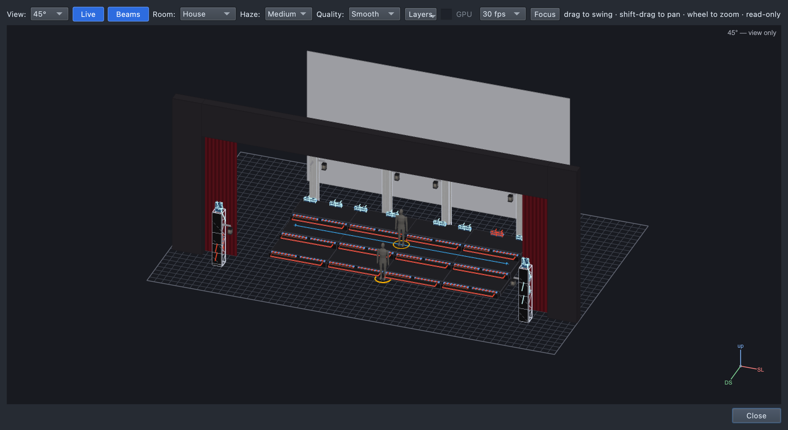

# The teaching show: our virtual stage

`shows/ShowChoir-Classroom.qlcc` is a show choir stage built from a real
one (DanceHysteria), made smaller and simpler for class. It has the rig,
the groups, a few stage targets and a set of colours and levels — and no
show yet: students build that.

**It is never connected to real lights.** No universe has an output and
no light talks to the network, so it can't send anything on the school
network. The **Rig Overview** (View → Rig Overview, ⇧⌘R) is the stage.

## The stage

- **Risers:** three rows — **US** (top, at the back), **CS**, **DS**
  (front) — of four units each, numbered **1–4 from stage right**.
- **Cyc:** the white cloth upstage.
- **Towers:** four upstage, two each side. On each side **1 is the outside
  tower** (nearest the wings), 2 the inside one.
- **Front towers:** one each side, in the house.
- Proscenium and an open main drape.

## The lights (68)

| Lights | How many | Where | Kind |
|---|---|---|---|
| **US/CS/DS Riser 1–4** | 12 | an LED strip along each riser front | pixel strip (64 pixels), colour only |
| **… Riser N Top SR / SL** | 24 | two bars on top of each riser unit, lighting up | pixel bar (colour + white), colour only |
| **SR/SL Tower Box 1–2** | 4 | on the towers, facing out over the stage | pixel box (XL-450), colour only |
| **SR/SL Tower Cyc 1–2** | 4 | on the towers, facing the cyc | pixel box (XL-450), colour only |
| **SR/SL Tower Spot 1–2** | 4 | top of each tower | moving spot with a colour ring |
| **SR/SL Front Spot** | 2 | the front towers | moving spot (for soloists) |
| **SR/SL Front Wash 1–2** | 4 | the front towers | moving wash, with a dimmer |
| **Back Beam 1–8** | 8 | standing along the top riser | two-arm moving beam |
| **Lantern 1–6** | 6 | hanging from the towers (one on the SR front tower) | LED lantern |

"Colour only" lights have no dimmer of their own: a colour plays at full
and a level dims the colour.

## Groups (Library → All → Groups)

| Folder | Group | Lights |
|---|---|---|
| Risers | **Risers** | all 12 riser fronts |
| | **US Risers**, **CS Risers**, **DS Risers** | one row's fronts |
| | **Riser Tops** | all 24 riser-top bars |
| Towers | **Movers** | the 4 tower spots |
| | **Pixel Boxes** | the 4 boxes facing out |
| | **Cyc Washes** | the 4 boxes on the cyc |
| | **Towers SR**, **Towers SL** | everything on that side's towers |
| Front | **Front Wash** | the 4 front washes |
| | **Front Spots** | the 2 front spots |
| Extras | **Back Beams** | the 8 beams |
| | **Lanterns** | the 6 lanterns |

## Stage targets (Library → All → Targets)

| Target | Kind | Where |
|---|---|---|
| **Soloist DS** | a person | centre, just downstage of the risers |
| **Center** | a person | centre of the CS riser row |
| **Riser Line** | a line | across the CS row, SR to SL |

Each has an Aim palette (**Aim Soloist DS**, **Aim Center**, **Aim Riser
Line**) under Palettes → Position.

## Palettes

| Type | Palettes |
|---|---|
| Colour | White, Warm White, Red, Amber, Yellow, Green, Cyan, Blue, Lavender, Magenta |
| Dimmer | Full, 75%, Half, 25%, 10%, Out |
| Position | Aim Soloist DS, Aim Center, Aim Riser Line |

A level you type that isn't there (`dimmer 30`) makes a new palette named
the same way: **30%**.

## The footer

It says **Not ready** in red: "13 universe(s) with fixtures but no
output". That's on purpose. Clicking it also lists "5 definition(s) came
with this show": the show carries the descriptions of the lights the app
doesn't ship, so it opens complete on any computer.
