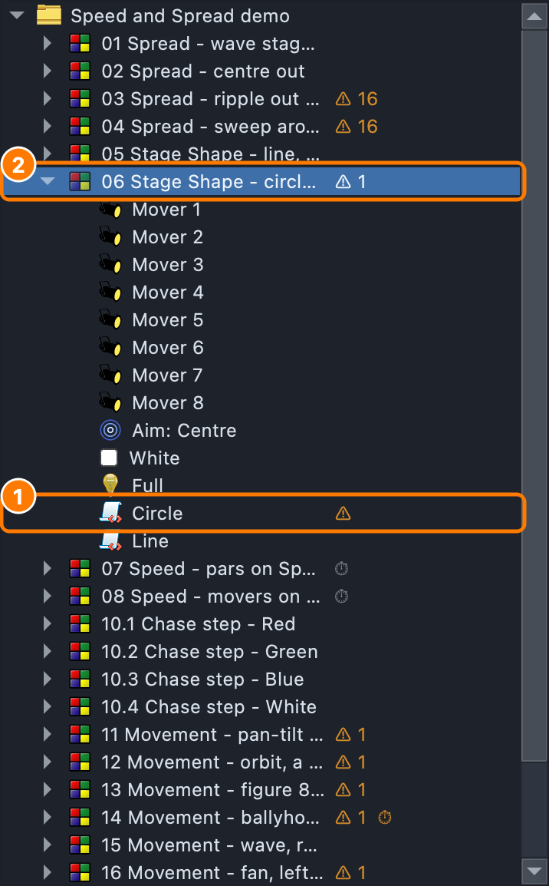

# Effects

An **Effect** palette runs a small script on its look's fixtures, many
times a second: colour chases, flicker, pan/tilt shapes, pixel patterns,
music-driven effects. Pick one in the look editor's effect browser (see
[The effect browser](programming-tab.md#the-effect-browser)); its settings
appear beside the list. They're grouped here by what they do (the
browser's tabs group them by the kind of fixture they're for); its search
finds any of them by name.

Colours come from the **look**: an effect that uses a colour takes the
look's Colour palettes (first, second…) and its Dimmer, so the same effect
works in any colour.

See [How a look stacks](#how-a-look-stacks) for exactly how a look's
colours, dimmers, positions and effects combine, and which wins.

## Colour

| Effect | What it does |
|---|---|
| **Color Alternate** | Cycles up to four colours across the group |
| **Color Chase** | A band of colour chases through the fixtures; a second colour fills behind it |
| **Color Gradient** | A smooth gradient between two colours, optionally moving |
| **Color Phaser** | A waveform crossfade between two colours, phase-spread across the fixtures |
| **Color Spread** | Two colours distributed across the group |
| **Rainbow** | Continuous hue rotation across the fixtures. With a colour in the look it sweeps **that colour** instead (a wave of it across the heads); with two or more, it sweeps through them |
| **Spatial Gradient** | A gradient laid across the rig by where each fixture really is (its 3D position), at a direction you set on a compass |
| **Warm Cool** | Alternates warm (white) and cool (blue) across the fixtures |
| **Amber Pulse** / **UV Pulse** | A phase-shifted pulse or chase on the amber / UV emitters |

## Dimmer

| Effect | What it does |
|---|---|
| **Candle Flicker** | Organic per-fixture brightness flicker around the look's own level |
| **Dimmer Phaser** | A waveform intensity chase with phase spread |
| **Firelight** | Warm flickering fire colours, each fixture on its own |
| **Lightning** | Random storm flashes across the rig |
| **Sparkle** | Random fixtures flash and fade like stars |
| **Spotlight Chase** | A hot spot chases across the rig, with a dimmer trail |
| **Wave** | A travelling sine wave across the fixtures |
| **Native Strobe** | The fixture's own shutter strobe |

## Position (moving heads)

A movement effect moves **round where the look points each head**: put an
**Aim** look (a stage target) or a **Pan/Tilt** look in with it, and the
ballyhoo, orbit, figure 8, diamond, Lissajous, phaser, wander, sweep, wave
or fan runs over that point — each head round its own aim at the target.
The effect's own centre setting (or a joystick) then nudges it from there.
Without one, it runs round the middle of each head's pan and tilt (on a
hung mover, about straight down). A spotlight chase leaves the look's aim
where it is.

| Effect | What it does |
|---|---|
| **Ballyhoo** | Wide, pseudo-random audience-scan sweeps |
| **Diamond** / **Figure-8** / **Lissajous** | Shapes traced by each head |
| **Drawn Path** | Heads follow a path you draw in the look editor |
| **Fan** / **Orbit** / **Followspot** | Fan out, orbit, or follow a joystick's X/Y. Followspot can fade a head out near its pan/tilt limit (**Fade Near Limit**) or while a drape, wall or riser is between it and the subject (**Fade When Blocked** — see [Line of sight](stage-targets.md#line-of-sight)) |
| **Pan/Tilt Phaser** | Independent pan and tilt sines, phase-spread |
| **Stage Shape** | Heads trace the outline of a shape (circle, polygon, star, line) round the look's Aim target, on the floor or stood up as a wall. With **Spread** on, the spread decides which head takes which point — Axis *stage left to right* puts the leftmost heads on the left of the line, no beams crossing |
| **Sweep** | A synchronised pan or tilt scan with a cascade |
| **Wander** | Organic drift, each head on its own path |

## Beam

| Effect | What it does |
|---|---|
| **Gobo Chase** | Steps through gobo wheel positions across the fixtures |
| **Iris Pulse** | Iris pulse or chase, closed to open |
| **Zoom Pulse** | Beam zoom pulse or chase, narrow to wide |

## Pixels and grids

These draw on a **grid**: the look's group as laid out in its head layout
(a run of strips, a matrix), or, across several groups, the rig as it
stands on stage. For pixel boxes and panels see also
[Matrix effects](#matrix-effects).

| Effect | What it does |
|---|---|
| **Confetti** | Random coloured speckles that blink and fade |
| **Meteor** | A meteor with a fading trail sweeps across the pixels |
| **Plasma** | Smooth shifting colour fields |
| **Text** | Words on the grid — scrolling, or still in the middle; see [Text](programming-tab.md#text) |
| **Wand** | A bright wand sweeps across once, then clears |

## Matrix effects

Effects for **pixel boxes and panels** — the looks a pixel-mapping desk
throws across a festival box rig, done as effects. Each draws on a
**canvas**: the look's group as laid out in its head layout (eight boxes
side by side are one 120 × 5 picture), the rig as it stands on stage for
a look on several groups, or — a box in a look with no group — the box's
own grid (an XL-450 is 15 × 5). They're under the **Matrix** tab of the
effect browser, and work on any RGB matrix, strip or row of pars as well.

| Effect | What it does | Main settings |
|---|---|---|
| **Matrix Bars** | Bars of colour scan across, up or down, or bounce between the edges | Direction, Bars, Width, Tail |
| **Matrix Box Chase** | Whole boxes light in turn round the rig, a white hit as each comes on; on one box, its fifths take turns | Order (left to right, bounce, out from the middle, odd/even, random…), Lit, Fade, Flash |
| **Matrix Checker** | A checkerboard that swaps on the beat — colours trade squares, squares go on and off, or crossfade | Swap, Square, Fade, Flash |
| **Matrix Chevrons** | Arrows march the way they point: right, left, up, down, out from or in to the middle | Direction, Spacing, Thickness, Angle |
| **Matrix EQ** | Equaliser bars with falling peak dots, from the live audio input — simulated on the beat while there's none | Source, Bar width, Gain, Peaks, From (bottom / middle), Colours |
| **Matrix Iris** | An eye opens and closes in the middle — breathing, blinking, or snapping open on the beat | Motion, Shape (eye, circle, box, slit), Edge, Background |
| **Matrix Noise** | Drifting clouds of colour sized for big pixels, with white glints at the peaks | Scale, Drift, Contrast, Palette (look, rainbow, fire, ocean), Glints |
| **Matrix Radar** | A line (or two, three, four blades) turns round the middle with a fading wake | Blades, Width, Wake, Direction |
| **Matrix Rain** | Drops fall down the columns with fading trails, each column at its own pace | Density, Trail, Direction |
| **Matrix Ripple** | Rings spread out from the middle, an edge, or anywhere — free running or one a beat | Timing, Spacing, Width, Fade, Origin |
| **Matrix Snake** | Snakes wind along a path: along the rows, up and down the columns, spiralling in, round the edge | Path, Snakes, Length, Colours |
| **Matrix Sparkle** | Colour twinkles that fade, with quick white flashes | Density, Decay, Flashes, Background |
| **Matrix Strobe** | Strobe hits on the beat: the whole canvas, alternate boxes, a random box, random blocks, halves or rows | Pattern, Colour, Flash length, Decay |
| **Matrix Wipe** | Colour fills and empties — across, from the middle, diagonally, as a circle — or wipes each look colour over the last | Direction, Cycle, Edge |

Colours come from the look, in its order (each bar, ring, chevron or step
takes the next); with no colour in the look each has colours of its own.

**Speed.** **speed** is in sweeps, rings or steps a second — or a beat
when the look is on a speed master ([Speed masters](#speed-masters)).
Effects with a **timing** setting can instead step **On the beat**, with a
**division** (every bar, every 2 beats, every beat, twice or four times a
beat); on the beat, every one lands on the same beat as the rest of the
show. With no beat running they fall back to their speed.

**Scope.** **Whole canvas** draws one picture across every box; **Each
box** draws the same picture in each — a ripple from the middle of every
box, a radar in each. Only a fixture that is itself a grid counts as a
box: a strip in a matrix built of strips, or a par in a row of them, is
just a place on the canvas.

**Spread.** Matrix Noise and Matrix Box Chase take the look's
[Spread](#spread) row: with it on, the spread decides where each head
sits in the clouds (Noise) or which box goes when (Box Chase, in place of its Order).

### The white pixels

A box like the Warmdance XL-450 has rows of RGB pixels and rows of white
ones (RGB, W, RGB, W, RGB). Every matrix effect has a **white** setting
for them and a **whiteLevel** to scale them:

| white | The white pixels… |
|---|---|
| **Colour + accents** (default) | carry the white part of the colour — none for a saturated red, all of it for white — plus the effect's **accents**: a bar's leading edge, a sparkle's flash, a drop's head, a strobe hit |
| **Follow brightness** | light wherever the picture is lit (Matrix EQ's default, so the bars are solid) |
| **Accents only** | light only for the accents |
| **RGB only** | stay out of it; the accents go on the RGB pixels |
| **White only** | show the picture; the RGB pixels stay out of it |

It degrades gracefully: on a canvas with no white pixels (the XL-450 in its
135ch RGB mode, any RGB matrix) the accents flash white on the RGB pixels,
and **White only** draws the picture in white on them; on one with no RGB
pixels (its 30ch white mode) the picture is drawn in white whatever the
setting, and two-colour effects (the checker) go on and off instead.

**Set the box up first.** The XL-450's 165ch mode numbers its 45 RGB heads
before its 30 white ones, so its LED layout must say which row is which:
right-click the fixture → **LED Layout…**, type `RGB, W, RGB, W, RGB`,
**Save to Show** — see [LED Layout](fixture-manager.md#led-layout) (or
check with **Grid Probe**). The canvas follows the layout as soon as it is
saved, a loose box as its own 15 × 5 grid. Make one group of the boxes as they hang for a whole-rig
canvas, or use a group per kind (RGB rows, white rows) when you want them
driven apart.

## Music and control

| Effect | What it does |
|---|---|
| **Audio Spectrum** / **Audio VU** | Light with the live audio spectrum / level |
| **MIDI Keys** / **MIDI Flash** / **MIDI Comet** / **MIDI Puddles** | Light from the notes played on a MIDI keyboard — keys, a flash, comets, ripples |

### On the beat

Effects that follow the beat (a **Beat sync** setting, or a beat-made
effect) all read **one beat clock**, so they're on the same beat however far
apart they were started. Turn the clock on in the Programming toolbar's
**Beat** menu (**Internal beat on**, and the **BPM**; the button then reads
"Beat 120"), or **Tap** it: the tempo comes from
your last four taps (pause two seconds to start over), and the beat lands
on your last tap — every beat effect jumps onto it. A single tap just moves
the beat. An external beat (MIDI clock, audio) pulls the clock onto its
beat gently rather than jolting it.

### Spread

Effects that chase across their heads share one **Spread** row in the look
editor, so they all spread the same way: the dimmer, colour and pan/tilt
phasers, the pulses, native strobe, rainbow, warm/cool, gobo chase — and
every movement effect: orbit, diamond, figure 8, Lissajous, ballyhoo,
sweep, wave, wander, fan, drawn path, spotlight chase, and Stage Shape's
outline:

- **Amount** — how far the effect's cycle runs across the heads: **1** is
  one full wave across them, **0.5** half a wave, **2** two waves. At
  **its own** (0) the effect uses its own spread setting, as before.
- **Axis** — what puts the heads in order: **in look order**, the head
  layout's **columns** or **rows**, or where they stand: **stage left to
  right**, **front to back**, **by height** — or round the look's **Aim
  target**: **out from the target** (nearest first, a ripple outward) or
  **around the target** (from straight downstage of it, round towards
  stage right, a sweep). Heads at the same place share a phase (a column, a bar seen
  from the side). With no Aim look, the target axes use centre stage.
- **Direction** — **forward**, **reverse**, **centre out**, **ends in**.
- **Wings** — split the heads into mirrored parts, each running the
  spread (2 wings: out from the middle seam both ways).
- **Blocks of** — neighbouring heads that share a phase.

With the spread on, the effect's own spread (and a phaser's reverse) is
hidden — the Spread row stands in for them — and a **preview** under it
shows the look's heads where they stand, coloured by phase (the same colour
is the same moment in the cycle; a cross marks the target).

On **Stage Shape**: a closed shape gives each head its phase as its place
round the outline (amount 1 = evenly round it once); a **Line** runs the
heads end to end at amount 1. Any direction works: *reverse* walks them the
other way round, *centre out* / *ends in* and **wings** pair heads up on
the same point, which is a look in itself.

### Speed masters

Tempo masters for effects to run on, so one tap or one fader moves
everything on a master together. Open them from the Programming toolbar's
**Beat** menu → **Speed masters…**. **Masters:** at the top sets how many
the show uses — 4 to 16 (fixed slots, so a control surface can map them).
Each row has:

- **Follows** — **Its own tempo** (a BPM — typed numbers apply as you
  type — **Tap**, a **Rate** fader from 0 to 200 %), or the **Main
  clock**, the **Show timeline** or another master at a **Ratio** (×¼ to
  ×4): ×2 plays two beats to the other's one, on the other's beats; ×½ one
  to its two. A master can't follow one that follows it.
- **Show timeline** follows the running show's beat grid (its BPM) at its
  playhead — so when the show follows MIDI timecode, everything on the
  master locks to the song's bars and beats. With no show running it
  follows the main clock.
- **Pause** — the master stops; everything on it freezes where it is.
  A following master picks up on the beat again when un-paused.
- A light that flashes on the master's beat.
- **Inputs…** — drive the master from a MIDI controller (or any input):
  **Tap** and **Pause** on buttons (Pause: press to stop, again to go on),
  **Rate** on a fader — its middle is the tempo as set, the top double,
  the bottom stopped. Move the control with **Auto Detect** on, or choose
  it; the button then reads how many are mapped. Saved with the show.

A master **nothing uses** stays out of the way: its row is here to set up,
but its light is an empty ring ("Nothing is on this master yet") and doesn't
flash. A master is used when an effect, a look, a chase, a chase step or a
collection is on it, when a controller input drives it, or when a used
master follows it.

The used masters also sit in the **footer**, beside the Grand Master: a
button for each, reading its tempo ("Pars 120", or "paused") and lit
orange on its beat — none at all until something is on a master. While its
**rate** is being moved (the fader, or a controller), a green bar fills the
button left to right to the level (half way is 100 %, full is 200 %), then
fades a second after you let go. **View → Speed Master Beat in Footer**
chooses how the beat shows: a **Blink**, a **Bar Across Each Beat** (an
orange bar filling the button's foot through each beat), or **No Beat** —
**Only While Something on It Plays** (the default: a look, chase or effect
on that master, or on one following it, is running), or **Always**;
click one to open this window at that master. **View → Show Speed Masters
in Footer** turns them off. With more than eight in use the names are
shortened (an unnamed one shows its number, "S9"); the tooltip has it all.

**What runs on a master** — choose **Speed** in any of these; the
innermost choice wins:

| Where | Setting | Default |
|---|---|---|
| The effect | Look editor → **Speed** | As the look |
| The look | The look's header → **Speed** | As played |
| A chase step | The chaser's **Speed** column | As the chase |
| A chase | The chaser editor's **Speed** | As played |
| A collection | The collection editor's **Speed** | As played |

"As played" means whatever started it says: a chase hands its master (or
the step's own) to the look it plays, a collection to its members — so the
same look can run on Speed 1 in one chase and Speed 3 in another. With
nothing set anywhere an effect keeps its own speed, as before.

A look's **Speed** and its **Spread** belong to the look, not to the
effect: trying other effects in the look editor's picker — a click or a
double-click on a tile — keeps them, so you can audition effects without
setting the master again. An effect preset that sets one of them still
wins. The **One-shot length** stays with the effect it was set for.

On the main clock or a master, an effect's **rate** (or **speed**) counts
**cycles per beat** — 1 is once a beat, 0.25 once a bar — and the look
editor labels it "(per beat)". It stays on the beat, follows the master's
tap and rate, and stops when it's paused.

A **chase that counts in beats** (its tempo set to Beats) on a master
steps on that master's beats — tap the master and the chase follows; pause
it and the chase holds on its step. A chase counting in time keeps its
times; only the effects in its looks follow the master.

## How a look stacks

A look's **Looks list** is a stack, read **top to bottom**. The same rules
hold for every fixture, every look and every effect, whether the look is on
fixtures or on a fixture group, and while you edit it live.

### 1. Static looks set the base

Colour, Dimmer, Pan/Tilt, Aim, Gobo and the rest paint the look's base.

- **The lower one wins** on what two of them both set: two Dimmers, the
  lower one's level; two Pan/Tilts, the lower one's position — never "the
  higher value", never a mix.
- **Colours are numbered, not stacked.** The first Colour look is the look's
  **colour 1**, the next **colour 2**, and so on. A fixture with one colour
  shows colour 1, whole. A fixture with more colour sets (a bar with two RGB
  cells per head) takes colour 2 on its second set. Effects use them as
  their first, second, third colours. A colour wheel, CMY and a white LED
  follow colour 1.
- **A Dimmer on a fixture with no dimmer channel** (an RGB batten) dims its
  colour instead — the same way it dims an effect's colour on it.

### 2. Effects play on top of the base

Effects run over the base, in list order:

- A **colour effect** (Rainbow, a chase, a WLED effect…) **replaces** the
  base colour on the heads it lights — it doesn't add to it: Cyan under a
  rainbow doesn't wash every hue pale, Blue under a red effect isn't
  magenta. White, and any emitter the effect doesn't name, go dark under it.
  Heads it leaves black keep the base colour.
- A **dimmer effect** (Breathe, Dimmer Phaser, Wave, Candle…) **scales**
  whatever is there: the fixture's master dimmer; else the head's own dimmer
  (a mover whose definition puts its Dimmer in its head); else, with no
  dimmer at all, its colour. Half of a look at 50 % is 25 %. On a fixture
  whose master dimmer serves several heads (a two-arm beam), the brightest
  head sets it: one lit arm is enough.
- A **movement effect** (Ballyhoo, Orbit, Figure 8…) moves round where the
  look's Aim or Pan/Tilt points each head ([Position](#position-moving-heads)),
  and leaves the colour and dimmer alone.
- On a **colour-wheel** fixture an effect's colour picks the nearest slot by
  its **hue**, not its brightness — a breathing blue stays on the blue slot
  while the dimmer breathes.

**Two effects on the same thing:** the **lower one wins** (a colour, a
position, a gobo); **dimmer effects multiply** (two at half: a quarter); a
colour that only adds to what's there (sparkle over a pulse) combines with
it, the brighter showing.

### 3. What belongs to an effect

A **Colour or Dimmer placed under an effect** — after it in the list, before
the next effect; dropping one onto an effect nests it there — **belongs to
that effect and applies to it only**:

- An effect that uses colours takes them as **its** colours and level,
  whatever the look's are.
- An effect that doesn't (a ballyhoo, a gobo chase) has them applied **with
  its output, on the heads it drives**, for as long as it plays.
- They are **not** part of the look's base: the heads the effect doesn't
  drive don't get them.

An **Aim, Pan/Tilt, Gobo** (anything that isn't a Colour or Dimmer) is never
an effect's: wherever it sits in the list, it is the look's.

### 4. The look's own apply across all its effects

The Colours and Dimmers **above every effect** are the **look's own**:
they're the base, and every effect that has **no** colour or dimmer of its
own uses them. An effect with its own uses its own.

### The stack checker

1. **A marked look** — a warning sign in its row; hover it for why. Here two
   movement effects are on the same heads: the lower wins, so the upper one
   is **Covered**.
2. **The scene's row** counts what is marked in it (⚠ n); its page lists
   them in full.

The Programming tab's outline checks the stack against these rules as you build it, and
marks a look (a warning sign in its row; the reason in its tooltip) when it
won't do what it seems to, with a line under the list saying how many:

- **Never shows** — a static look the one below it always covers (two
  Dimmers, two Pan/Tilts: the lower wins).
- **Covered** — an effect another below it overrides on the same heads (two
  colour effects, two movement effects); "on 3 of its 8 heads" when only some.
- **Replaced** — the look's colour, where a colour effect with its own colour
  lights the heads (it shows only where the effect leaves a head dark).
- **Belongs to the effect** — a Dimmer under a movement effect reaches only
  the heads that effect moves; the look's other heads get no dimmer.
- **Does nothing** — an effect for a kind of fixture the look hasn't.
- **No Aim or Pan/Tilt** — a movement effect with nothing to move round.
- **Colour 3 of the look** — a colour no fixture has a set for and no
  effect uses.
- **Black** — a Colour look that is all zero (a "White" saved as
  #000000): the heads it colours give no light, and an effect that takes the
  look's colours (Confetti, a chase) gets black from it too.
- **Can't move** — on an Aim, Pan/Tilt or movement look: a fixture whose
  definition marks every Pan (or Tilt) channel Fine has no coarse channel to
  turn the head, so it stays at 0 whatever the look says. Make the main
  channel Coarse in the fixture definition.
- **No targets** — the look lights nothing until fixtures or groups are
  added.

### Trying a palette on

While the look editor edits a palette the look on the canvas doesn't have,
it's **tried on** that look (not saved into it) by the same rules: a Colour
as the look's colour 1 — so an effect with no colour of its own shows it
too — and anything else as the lowest of the look's own, above the first
effect, so it wins what it sets.

### Examples

On a par (master dimmer), an RGB batten (no dimmer), a colour-wheel mover
(its dimmer in its head) and an RGB mover:

| Looks, top to bottom | What you get |
|---|---|
| Blue · Red | Blue (colour 1); a two-cell fixture: blue and red |
| Full · Dimmer 50 % | 50 % — the lower |
| Blue · Dimmer 50 % | Blue at 50 %; the batten's blue itself at half |
| Blue · Full · colour effect | The effect takes the look's Blue |
| Blue · Full · effect · **Red** | The effect's own Red; Blue doesn't show through |
| Blue · Full · red effect | Red — replaced, not mixed |
| Full · effect · Green · effect · **Blue** | Blue — the lower effect, each with its own colour |
| Blue · Full · Breathe | Blue, its level breathing (master, head or colour dimmer) |
| Blue · Full · Breathe · Breathe | The two multiply |
| Blue · Full · Ballyhoo | Movers sweep round the look's aim, blue at full |
| Blue · Full · Ballyhoo · **Red · 50 %** | The movers red at 50 % while it sweeps; the pars stay blue at full |
| Blue · Ballyhoo · **Full** | The movers at full; the pars dark — Full is the ballyhoo's, not the look's |
| Blue · effect · **Pan/Tilt** | The Pan/Tilt still points the heads: it's always the look's |
| Full · Ballyhoo · Orbit | The Orbit moves them — the lower |
| Green · Full · colour effect · Breathe · Ballyhoo | Every effect uses the look's Green and Full |

These are the look-stack tests (`engine/test/lookstack`): every row above
is checked end to end, through to DMX, on all four kinds of fixture.

## Diagnostics

| Effect | What it does |
|---|---|
| **Grid Probe** | Colours each pixel by its grid column (red) and row (blue) — shows how a group's layout maps onto the rig |
| **Step Test Pattern** | For LED-strip steps: each strip counted, each step numbered and named, a spinner that stops if output freezes — see [Step Test Pattern](programming-tab.md#step-test-pattern) |

## WLED

| Effect | What it does |
|---|---|
| **WLED device effect** | Any of the device's own effects, run on WLED fixtures themselves |
| **WLED Android, Aurora, Blends, Blink, Blink Rainbow, Bouncing Balls, Bpm, Breathe, Candle, Candle Multi, Chase, Chase 2, Chase 3, Chase Flash, Chase Flash Rnd, Chase Rainbow, Chase Random, Chunchun, Color Clouds, Colorful, Colorloop, Colortwinkles, Colorwaves, Dancing Shadows, Dissolve, Dissolve Rnd, Drip, Dynamic, Dynamic Smooth, Fade, Fairy, Fairytwinkle, Fill Noise, Fire 2012, Fire Flicker, Fireworks, Fireworks 1D, Fireworks Starburst, Flow, Flow Stripe, Glitter, Gradient, Halloween Eyes, Heartbeat, Hyper Sparkle, ICU, Juggle, Lake, Lighthouse, Lightning, Loading, Meteor, Meteor Smooth, Multi Comet, Noise 1, Noise 2, Noise 3, Noise 4, Noise Pal, Oscillate, Pacifica, PacMan, Palette, Percent, Perlin Move, Phased, Phased Noise, Plasma, Police, Popcorn, Pride 2015, PS 1D Balance, PS Chase, PS Dancing Shadows, PS DripDrop, PS Fire 1D, PS Fireworks 1D, PS Hourglass, PS Pinball, PS Sparkler, PS Spray 1D, PS Springy, PS Starburst, Railway, Rain, Rainbow, Rainbow Runner, Random Colors, Ripple, Ripple Rainbow, Rolling Balls, Running, Running Dual, Saw, Scan, Scan Dual, Scanner, Scanner Dual, Shimmer, Sine, Sinelon, Sinelon Dual, Sinelon Rainbow, Solid, Solid Glitter, Solid Pattern, Solid Pattern Tri, Sparkle, Sparkle Dark, Sparkle+, Spots, Spots Fade, Stream, Stream 2, Strobe, Strobe Mega, Strobe Rainbow, Sunrise, Sweep, Sweep Random, Tetrix, Theater, Theater Rainbow, Traffic Light, Tri Fade, Tri Wipe, TV Simulator, Twinkle, Twinklecat, Twinklefox, Twinkleup, Two Areas, Two Dots, Washing Machine, Wavesins, Wipe, Wipe Random** | WLED's effects with a qlcconsole version that runs on the look's other fixtures too, at WLED's speed, intensity, palette and colours |
| **WLED DJ Light, Freqmap, Freqpixels, Freqwave, Gravcenter, Gravcentric, Gravfreq, Gravimeter, Juggles, Matripix, Midnoise, Noisefire, Noisemeter, Noisemove, Plasmoid, PS GEQ 1D, PS Sonic Boom, PS Sonic Stream, Puddlepeak, Puddles, Ripple Peak, Rocktaves, Waterfall** | WLED's sound-reactive effects, the same way, following the audio input (Inputs/Outputs); dark with none |

See [WLED effects](programming-tab.md#wled-effects).

## RGB Matrix algorithms

The classic **RGB Matrix** function (Functions window) has its own
algorithms — Fire, Text (with a **Centered** style), Plasma and many
scripted ones. Where one shares a name with an effect, the browser lists it
as "&lt;name&gt; (RGB Matrix)".

## Writing your own

An effect is a JavaScript file in your **EffectScripts** folder
(`~/Library/Application Support/qlcconsole/EffectScripts` on a Mac,
`%USERPROFILE%\qlcconsole\EffectScripts` on Windows,
`~/.qlcconsole/EffectScripts` on Linux); it
appears in the browser next time the app starts. The script is handed every
fixture (each head of a pixel fixture), the look's colours and its own
settings each tick, and returns what each should do. See the
[Effect script API](../../EFFECTSCRIPT_API.md) for the full reference.
