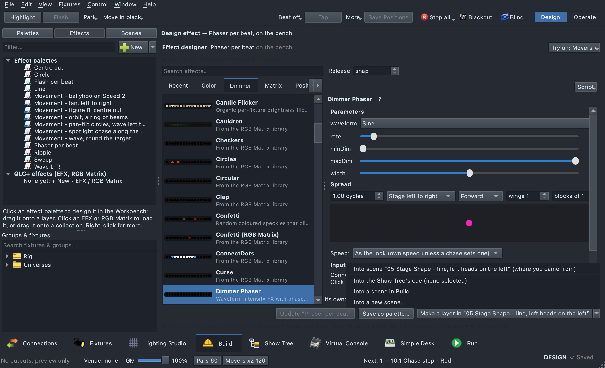

# Effects

An **Effect** palette runs a small script on its look's fixtures, many
times a second: colour chases, flicker, pan/tilt shapes, pixel patterns,
music-driven effects. Pick one in the look editor's effect browser (see
[The effect browser](build.md#the-effect-browser)); its settings
appear beside the list. They're grouped here by what they do (the
browser's tabs group them by the kind of fixture they're for); its search
finds any of them by name.

Colours come from the **look**: an effect that uses a colour takes the
look's Colour palettes (first, second…) and its Dimmer, so the same effect
works in any colour.

See [How a look stacks](#how-a-look-stacks) for exactly how a look's
colours, dimmers, positions and effects combine, and which wins.

## The effect designer

To build an effect in detail, on the heads it is for, use the **effect
designer**. It has the effect browser down one side at full height, with
presets, Recent and WLED. Beside it are the effect's settings: its
parameters, Spread, the speed master and On the beat. Under those is the
effect's **own** colour and dimmer, which apply inside that effect only.
Whatever you pick plays at once on the rig, in Design mode, on just those
heads.

Each setting has a slider and, beside it, its number. Click the number
and type an exact value, in the setting's own units (a rate in cycles a
second, a level from 0 to 1); **Return** sets it and the slider follows.

Open it from any of three places:

- **On a Show Tree layer.** Right-click a layer and choose **Design
  effect…**, or use **Design effect…** in the ⋯ menu of a layer's Effect
  row. The designer plays on that layer's fixtures. The layer's own colour
  and dimmer play under the effect, so it looks as it will in the cue.
  **In context** keeps the rest of the cue playing; **Solo** plays only the
  effect.
- **Build ▸ Effects.** **+ New**, or click an effect palette: the
  designer opens in the Workbench's editor pane, on the **bench**
  described next. Right-click an effect for Duplicate, Rename, Move to
  folder… and Delete. See [Making effects](build.md#making-effects).
- Build ▸ Effects is effects' one home: no window of their own any more.
  **Try on ▾** on the bench picks the groups it plays on, and it
  remembers them.

The designer works on a copy, so nothing in the show changes until you
pick one of these. **While the effect plays** — in a cue on stage, a
scene in Build — your changes show on the rig at once (speed, size,
colours, any setting, another effect picked); **Cancel** puts it back as
it was, **Update** keeps them.

- **Keep on this layer** (on a layer): a one-off for that layer, named
  after the effect and the cue ("Color Chase · 0.0.3 Announcer
  AT-W-ALL"). It works like a value picked in the tree. Its row offers
  **Make reusable** later. An effect of another kind goes **beside** the
  layer's effects (a movement and an intensity effect play together); one
  of the same kind replaces it. Opened from one effect's own row, the
  designer changes that effect. Designing the layer's own one-off again
  changes that one-off; it doesn't make a second.
- **Save in this show…**: files the effect where the show keeps its effect
  palettes, named after the effect (no name box first), so you can use it
  anywhere; in Build ▸ Effects its name is open to type over at once. On a
  layer it also goes on the layer. The Show Tree's Library lists it at
  once.
- **Update "name"**: shown when the designer started from a named
  palette. It writes the design into that palette, which changes it
  everywhere it plays.
- To take an effect to another show, **Export…** it from the effect pane
  (a portable .qxfx file) and **Import…** it there. The browser's presets —
  the ones that come with qlcconsole and any you saved before — are still
  starting points.
- **Save to My effects…** is in the Look Editor with an effect palette
  open, under **Import…** and **Export…** (not in the designer). It keeps
  the effect and its current settings as a named effect among the
  browser's presets on this computer (**Mine**), and the palette then
  plays that effect. An effect of the same name is replaced only if you
  say so. To take it to another computer, use **Export…**.
- **Cancel** (or closing the window) throws the copy away. The show is
  left as it was, and a show that was saved stays saved. On the bench in
  Build, **Esc** goes back to the scene you came from and asks first if
  the effect hasn't been kept
  ([Backing out](build.md#backing-out-esc)).

### Where an effect came from

An effect is one of four kinds. Each one says which it is, wherever it
shows:

| Kind | How you make one | Where it lives | How it is marked |
|---|---|---|---|
| **Built-in** | Comes with qlcconsole | Every show, every computer | No mark |
| **Mine** | **Save to My effects…** | Every show on this computer | A small **mine** mark |
| **This show** | **Save in this show…** | This show's effect palettes | The palette mark |
| **One-off** | **Keep on this layer** | That one layer of that cue | *one-off* in italics, with **Make reusable** |

In the effect browser, **Built-in · Mine · This show** filter the list by
where an effect came from. Picking one of the show's effect palettes there
copies it into the look you are editing, with every setting.

Anything made from another effect has a grey **based on Fire** line under
its name: in the browser, under the effect's name in the look editor and
designer, and beside it in Build ▸ Effects. When some of its settings
differ from that effect, the line counts them (**based on Fire · 2
changes**). Hover over the line to see which settings changed, and from
what.

### How many times it runs

Any effect can run in a loop, once, or a set number of times. Set it under
the effect's settings, in the look editor or the designer. It is also in
the ⋯ menu of an effect's row in the Show Tree, and on the right-click in
Build ▸ Effects (**Runs ▸**):

- **Runs: Loop | Once | N times.** Loop plays for as long as the look
  does. Once and N times play that many runs, then stop.
- **At the end: Hold | Release.** Hold keeps the effect's last frame on
  the rig. Release lets go, so the look's own values come back, or
  whatever is under it.
- **Length.** How long one run lasts. **auto** takes the cue's time: the
  chase step it plays in, or the Show Tree cue (its fade in when the cue
  waits for Go). With neither, the effect's own length applies. Set a
  time to fix it.

A **wave** (Breathe, Dimmer Phaser, Colour Phaser, the pulses) runs in
whole cycles instead. Once is one cycle: a Breathe rises from its floor,
peaks and comes back down, and it ends on its floor rather than wherever
a time cut it off. Its **Length** is one cycle, in seconds. Type **5.5**
for a five-and-a-half-second breath. The Length sets the wave's rate
(1 ÷ length), so the rate setting above moves with it, and moving the
rate changes the Length. N times plays that many cycles. Setting Runs
while it plays starts the run again, so you see the change at once.

Each new start of what carries the effect plays a Once or N times effect
again from its start. That includes a cue's **GO** (also the next cue
copied from this one, sharing its effect), a hit fired again, and a
chaser step. A cue that only **tracks** the layer through, setting
nothing of its own on it, leaves the effect as it is: a breath that has
finished stays on its floor.

A dimmer effect starts with the look. On the first frame the look is
already at the effect's level (a Breathe at its floor), so the look's
own level never flashes up before the effect begins. It scales the
look's level: a Breathe (5% to 100%) on a look at 20% breathes between
1% and 20%. On a light without a dimmer it scales the look's colour,
white included.

An effect written to run once (a wand sweep) starts on **Once**, with its
own end. It can loop too: each run starts again from the beginning.

A classic **EFX** or **RGB Matrix** has its own **Run order**. Its
**Runs ▸** in Build ▸ Effects sets that: **Loop** is Loop and **Once** is
Single shot, which plays once and stops. N times and Hold don't apply to
them.

A run that has ended stops working: a held or released effect costs
nothing while the cue goes on.

### Make a layer

On the bench, **Make a layer** turns what you tried the effect on into
programming: a new layer on the **Try on** groups, playing the effect.

- If you opened the bench with a cue or a scene loaded in the Workbench,
  the button says where: **Make a layer in cue 1 Chorus** or **Make a layer
  in “Verse wash”**. Click it to put the layer there.
- The arrow (or the whole button, when you came from nowhere in
  particular) opens the menu: **Into the Show Tree's cue…** (the cue
  selected in the Show Tree), **Into a scene in Build…** (pick one) or
  **Into a new scene…** (name it; the effect and the groups are offered).

In a Show Tree cue it is a new layer on those groups, with the effect as
its Effect look. In a scene, the groups it doesn't have yet are added as
targets and the effect as a look. A new scene gets both. Either way it is
one undo step: one in the Show Tree's history for a cue, one in Build's
for a scene.

The layer plays the **palette** when the bench has a saved effect palette
on it, unchanged: **Save in this show…** first, or start from one in the
list. Otherwise it plays a **one-off** copy of the design, made the same way
**Keep on this layer** makes one ("Matrix Fire · 1 Chorus Towers"). The
bench keeps your design either way, so you can make another layer from
it.

Afterwards the new layer is selected where it went: in the Show Tree, or
with the scene loaded in the Workbench and the effect's look selected.
Make a layer needs a picked effect and at least one Try on group.

The preview is a hidden scene on the chosen heads. It plays only in Design
mode and only while the designer is on screen; in Operate nothing
previews.

## Colour

| Effect | What it does |
|---|---|
| **Color Alternate** | Cycles up to four colours across the group |
| **Color Chase** | A band of colour chases through the fixtures; a second colour fills behind it. Its speed is in fixtures a second along the line they stand in: pixel boxes and bars go box by box (one pixel fixture on its own, pixel by pixel) |
| **Color Gradient** | A smooth gradient between two colours, optionally moving |
| **Color Phaser** | A waveform crossfade between two colours, phase-spread across the fixtures |
| **Color Spread** | Two colours distributed across the group |
| **Rainbow** | Continuous hue rotation across the fixtures. With a colour in the look it sweeps **that colour** instead (a wave of it across the heads); with two or more, it sweeps through them |
| **Spatial Gradient** | A gradient laid across the rig by where each fixture really is (its 3D position), at a direction you set on a compass |
| **Warm Cool** | Alternates warm (white) and cool (blue) across the fixtures |
| **Amber Pulse** / **UV Pulse** | A phase-shifted pulse or chase on the amber / UV emitters |

## Dimmer

| Effect | What it does |
|---|---|
| **Candle Flicker** | Organic per-fixture brightness flicker around the look's own level |
| **Dimmer Phaser** | A waveform intensity chase with phase spread |
| **Firelight** | Warm flickering fire colours, each fixture on its own |
| **Lightning** | Random storm flashes across the rig |
| **Sparkle** | Random fixtures flash and fade like stars |
| **Spotlight Chase** | A hot spot chases across the rig, with a dimmer trail |
| **Wave** | A travelling sine wave across the fixtures |
| **Native Strobe** | The fixture's own shutter strobe |

## Position (moving heads)

A movement effect moves **round where the look points each head**: put an
**Aim** look (a stage target) or a **Pan/Tilt** look in with it, and the
ballyhoo, orbit, figure 8, diamond, Lissajous, phaser, wander, sweep, wave
or fan runs over that point — each head round its own aim at the target.
The effect's own centre setting (or a joystick) then nudges it from there.
Without one, it runs round the middle of each head's pan and tilt (on a
hung mover, about straight down). A spotlight chase leaves the look's aim
where it is.

| Effect | What it does |
|---|---|
| **Ballyhoo** | Wide, pseudo-random audience-scan sweeps |
| **Diamond** / **Figure-8** / **Lissajous** | Shapes traced by each head |
| **Drawn Path** | Heads follow a path you draw in the look editor |
| **Fan** / **Orbit** / **Followspot** | Fan out, orbit, or follow a joystick's X/Y. Followspot can fade a head out near its pan/tilt limit (**Fade Near Limit**) or while a drape, wall or riser is between it and the subject (**Fade When Blocked** — see [Line of sight](stage-targets.md#line-of-sight)) |
| **Pan/Tilt Phaser** | Independent pan and tilt sines, phase-spread |
| **Stage Shape** | Heads trace the outline of a shape (circle, polygon, star, line) round the look's Aim target, on the floor or stood up as a wall. With **Spread** on, the spread decides which head takes which point — Axis *stage left to right* puts the leftmost heads on the left of the line, no beams crossing |
| **Sweep** | A synchronised pan or tilt scan with a cascade |
| **Wander** | Organic drift, each head on its own path |

## Beam

| Effect | What it does |
|---|---|
| **Gobo Chase** | Steps through gobo wheel positions across the fixtures |
| **Iris Pulse** | Iris pulse or chase, closed to open |
| **Zoom Pulse** | Beam zoom pulse or chase, narrow to wide |

## Pixels and grids

These draw on a **grid**: the look's group as laid out in its head layout
(a run of strips, a matrix), or, across several groups, the rig as it
stands on stage. For pixel boxes and panels see also
[Matrix effects](#matrix-effects).

| Effect | What it does |
|---|---|
| **Confetti** | Random coloured speckles that blink and fade |
| **Meteor** | A meteor with a fading trail sweeps across the pixels |
| **Plasma** | Smooth shifting colour fields |
| **Text** | Words on the grid — scrolling, or still in the middle; see [Text](build.md#text) |
| **Wand** | A bright wand sweeps across once, then clears |

## Matrix effects

Effects for **pixel boxes and panels** — the looks a pixel-mapping desk
throws across a festival box rig, done as effects. Each draws on a
**canvas**: the look's group as laid out in its head layout (eight boxes
side by side are one 120 × 5 picture), the rig as it stands on stage for
a look on several groups, or — a box in a look with no group — the box's
own grid (an XL-450 is 15 × 5). They're under the **Matrix** tab of the
effect browser, and work on any RGB matrix, strip or row of pars as well.

| Effect | What it does | Main settings |
|---|---|---|
| **Matrix Bars** | Bars of colour scan across, up or down, or bounce between the edges | Direction, Bars, Width, Tail |
| **Matrix Bouncing Balls** | Balls bounce round inside the canvas — floating free off every edge, or dropping and bouncing on the floor — with a soft trail and a flash as they hit | Count, Size, Trail, Gravity (off / on) |
| **Matrix Box Chase** | Whole boxes light in turn round the rig, a white hit as each comes on; on one box, its fifths take turns | Order (left to right, bounce, out from the middle, odd/even, random…), Lit, Fade, Flash |
| **Matrix Box VU** | Each box is a VU meter filling with the live audio — the whole level, low to high across the boxes, the bass or the highs — a peak dot holding the top; simulated on the beat while there's no audio | Source, Band, Gain, Release, Peaks, From (bottom, middle, left, middle across), Colours |
| **Matrix Checker** | A checkerboard that swaps on the beat — colours trade squares, squares go on and off, or crossfade | Swap, Square, Fade, Flash |
| **Matrix Chevrons** | Arrows march the way they point: right, left, up, down, out from or in to the middle | Direction, Spacing, Thickness, Angle |
| **Matrix Dissolve** | Pixel by random pixel from one look colour to the next, or to black and back, with a glint as each piece turns | Timing, Mode, Grain, Fade, Glint |
| **Matrix EQ** | Equaliser bars with falling peak dots, from the live audio input — simulated on the beat while there's none | Source, Bar width, Gain, Peaks, From (bottom / middle), Colours |
| **Matrix Fire** | Flames rise from the bottom and flicker, white-hot at the heart (the white pixels) | Height, Intensity, Cooling, Palette (look colours, classic fire, blue fire) |
| **Matrix Fireworks** | Rockets climb and burst into sparks that spread, fall and crackle out — bursting on the beat (the rocket goes up just before), or at random | Timing, Rise, Sparks, Size, Fade |
| **Matrix Gradient Sweep** | The look's colours as a gradient laid at any angle, sweeping along it, smooth or in bands, a line of white riding it | Angle, Width, Speed (minus = backwards), Blend, Sheen |
| **Matrix Image** | A picture or animated GIF on the pixels — see [Pictures and GIFs](#pictures-and-gifs) | Image, Fit (fit, fill, stretch), Timing, Speed, Tint, Highlights |
| **Matrix Iris** | An eye opens and closes in the middle — breathing, blinking, or snapping open on the beat | Motion, Shape (eye, circle, box, slit), Edge, Background |
| **Matrix Kaleidoscope** | A shifting pattern of the look's colours mirrored round the middle, turning slowly | Mirrors (2, 4, 6, 8-fold), Pattern (noise, bars), Scale, Spin |
| **Matrix Lissajous** | A bright line traces a figure-8 — or any Lissajous figure — its trail fading through the look's colours | X and Y frequency, Phase, Line width, Trail |
| **Matrix Noise** | Drifting clouds of colour sized for big pixels, with white glints at the peaks | Scale, Drift, Contrast, Palette (look, rainbow, fire, ocean), Glints |
| **Matrix Radar** | A line (or two, three, four blades) turns round the middle with a fading wake | Blades, Width, Wake, Direction |
| **Matrix Rain** | Drops fall down the columns with fading trails, each column at its own pace | Density, Trail, Direction |
| **Matrix Ripple** | Rings spread out from the middle, an edge, or anywhere — free running or one a beat | Timing, Spacing, Width, Fade, Origin |
| **Matrix Scanner** | KITT's scanner: a bar sweeps back and forth, easing at the ends, a tail fading behind | Direction (across, up and down), Count, Width, Tail, Motion |
| **Matrix Snake** | Snakes wind along a path: along the rows, up and down the columns, spiralling in, round the edge | Path, Snakes, Length, Colours |
| **Matrix Sparkle** | Colour twinkles that fade, with quick white flashes | Density, Decay, Flashes, Background |
| **Matrix Spiral** | Spiral arms wind round the middle and turn, a pinwheel of the look's colours | Arms, Tightness, Width, Direction |
| **Matrix Starfield** | Stars stream out from a point, faster and brighter as they come: warp speed | Density, Trails, Centre (middle, an edge, wandering) |
| **Matrix Strobe** | Strobe hits on the beat: the whole canvas, alternate boxes, a random box, random blocks, halves or rows | Pattern, Colour, Flash length, Decay |
| **Matrix Wipe** | Colour fills and empties — across, from the middle, diagonally, as a circle — or wipes each look colour over the last | Direction, Cycle, Edge |

Colours come from the look, in its order (each bar, ring, chevron or step
takes the next); with no colour in the look each has colours of its own.

**Speed.** **speed** is in sweeps, rings or steps a second — or a beat
when the look is on a speed master ([Speed masters](#speed-masters)).
Effects with a **timing** setting can instead step **On the beat**, with a
**division** (every bar, every 2 beats, every beat, twice or four times a
beat); on the beat, every one lands on the same beat as the rest of the
show. With no beat running they fall back to their speed.

**Scope.** **Whole canvas** draws one picture across every box; **Each
box** draws the same picture in each — a ripple from the middle of every
box, a radar in each. **Each box, staggered** draws the same picture in
each box too, but each box a little behind the last, so the picture rolls
across the rig: a ripple starts in the first box and follows on box by
box, a scanner sweeps a moment later in each. Two settings go with it:

| Setting | What it does |
|---|---|
| **staggerOrder** | the order the boxes go in: **Left to right** (as they stand on stage), **Right to left**, **Out from the middle** (the middle pair first, then outwards, mirror boxes together), or **Random** (a fixed shuffle) |
| **stagger** | how far behind each box is, as a fraction of the effect's cycle — a sweep, a ring, a turn, a dissolve, a beat. 0.125 on eight boxes spreads one cycle across the rig; 0 is plain Each box |

Every matrix effect with a scope has all three (all but Box Chase, Noise,
Rain, Sparkle and Strobe, which work on the rig as a whole). On the beat,
the stagger is in steps of the beat clock, so the boxes still land on the
show's beat, one after another. Matrix EQ and Box VU keep the last few
seconds of the live audio, so a staggered box shows what was playing at its
moment. Only a fixture that is itself a grid counts as a box: a strip in a
matrix built of strips, or a par in a row of them, is just a place on the
canvas (staggered or not, it draws with the whole canvas).

**Spread.** Matrix Noise and Matrix Box Chase take the look's
[Spread](#spread) row: with it on, the spread decides where each head
sits in the clouds (Noise) or which box goes when (Box Chase, in place of its Order).

### Pictures and GIFs

**Matrix Image** plays a still picture or an animated GIF on the canvas.
In the look editor, **Choose…** picks the file (PNG, JPEG, GIF, BMP and
the rest this desk can read), and the line above it says what is
there: its name, size and frames. **Clear** lets it go; until there is a
picture, a heart beats in the look's first colour.

- **Kept in the show.** The picture is stored inside the look itself — the
  file as it was, encoded as text in the show file — so it travels with the
  show (another desk, a backup, a .qlcc) with nothing to relink or lose.
  Files up to **2 MB** are taken; a box rig is a few hundred pixels, so a
  small GIF is plenty. Decoded, frames are kept to 160 × 160 and the first
  240 of an animation.
- **Fit** shows the whole picture, letterboxed on black; **Fill** fills the
  canvas and crops what falls outside; **Stretch** fits it to the canvas
  exactly. On eight boxes side by side (120 × 5) Fill shows a band across
  the middle of a picture; Each box puts the whole picture in every box.
- **Timing.** A GIF plays at its own pace (**speed** 2 is twice as fast),
  or steps a frame **on the beat** (division as above).
- **Tint** blends the picture towards the look's first colour, keeping its
  light and shade; **Highlights** sends its near-white parts to the white
  pixels as accents.
- Each pixel is the average of the part of the picture it covers, so detail
  comes down to big pixels without sparkling. The frames are decoded once,
  ahead of the show, and shared by every look using the same picture.

### The white pixels

A box like the Warmdance XL-450 has rows of RGB pixels and rows of white
ones (RGB, W, RGB, W, RGB). Every matrix effect has a **white** setting
for them and a **whiteLevel** to scale them:

| white | The white pixels… |
|---|---|
| **Colour + accents** (default) | carry the white part of the colour — none for a saturated red, all of it for white — plus the effect's **accents**: a bar's leading edge, a sparkle's flash, a drop's head, a strobe hit |
| **Follow brightness** | light wherever the picture is lit (Matrix EQ's default, so the bars are solid) |
| **Accents only** | light only for the accents |
| **RGB only** | stay out of it; the accents go on the RGB pixels |
| **White only** | show the picture; the RGB pixels stay out of it |

It degrades gracefully: on a canvas with no white pixels (the XL-450 in its
135ch RGB mode, any RGB matrix) the accents flash white on the RGB pixels,
and **White only** draws the picture in white on them; on one with no RGB
pixels (its 30ch white mode) the picture is drawn in white whatever the
setting, and two-colour effects (the checker) go on and off instead.

A plain look does the same for the white pixels: a **Colour** lights them
with the white in it (White and Warm White do, Red and Blue don't), dimmed
by the look's **Dimmer** — the box has no dimmer of its own, so the colour
is the light and a Dimmer alone leaves the box dark.

**Set the box up first.** The XL-450's 165ch mode numbers its 45 RGB heads
before its 30 white ones, so its LED layout must say which row is which:
right-click the fixture → **LED Layout…**, type `RGB, W, RGB, W, RGB`,
**Save to Show** — see [LED Layout](fixture-manager.md#led-layout) (or
check with **Grid Probe**). The canvas follows the layout as soon as it is
saved, a loose box as its own 15 × 5 grid. Make one group of the boxes as they hang for a whole-rig
canvas, or use a group per kind (RGB rows, white rows) when you want them
driven apart.

## Music and control

| Effect | What it does |
|---|---|
| **Audio Spectrum** / **Audio VU** | Light with the live audio spectrum / level |
| **MIDI Keys** / **MIDI Flash** / **MIDI Comet** / **MIDI Puddles** | Light from the notes played on a MIDI keyboard — keys, a flash, comets, ripples |

### On the beat

Effects that follow the beat (a **Beat sync** setting, or a beat-made
effect) all read **one beat clock**, so they're on the same beat however far
apart they were started. Turn the clock on in the Build toolbar's
**Beat** menu (**Internal beat on**, and the **BPM**; the button then reads
"Beat 120"), or **Tap** it: the tempo comes from
your last four taps (pause two seconds to start over), and the beat lands
on your last tap — every beat effect jumps onto it. A single tap just moves
the beat. An external beat (MIDI clock, audio) pulls the clock onto its
beat gently rather than jolting it.

### Spread

Effects that chase across their heads share one **Spread** row in the look
editor, so they all spread the same way: the dimmer, colour and pan/tilt
phasers, the pulses, native strobe, rainbow, warm/cool, gobo chase — and
every movement effect: orbit, diamond, figure 8, Lissajous, ballyhoo,
sweep, wave, wander, fan, drawn path, spotlight chase, and Stage Shape's
outline:

- **Amount** — how far the effect's cycle runs across the heads: **1** is
  one full wave across them, **0.5** half a wave, **2** two waves. At
  **its own** (0) the effect uses its own spread setting, as before.
- **Axis** — what puts the heads in order: **in look order**, the head
  layout's **columns** or **rows**, or where they stand: **stage left to
  right**, **front to back**, **by height** — or round the look's **Aim
  target**: **out from the target** (nearest first, a ripple outward) or
  **around the target** (from straight downstage of it, round towards
  stage right, a sweep). Heads at the same place share a phase (a column, a bar seen
  from the side). With no Aim look, the target axes use centre stage.
- **Direction** — **forward**, **reverse**, **centre out**, **ends in**.
- **Wings** — split the heads into mirrored parts, each running the
  spread (2 wings: out from the middle seam both ways).
- **Blocks of** — neighbouring heads that share a phase.

With the spread on, the effect's own spread (and a phaser's reverse) is
hidden — the Spread row stands in for them — and a **preview** under it
shows the look's heads where they stand, coloured by phase (the same colour
is the same moment in the cycle; a cross marks the target).

On **Stage Shape**: a closed shape gives each head its phase as its place
round the outline (amount 1 = evenly round it once); a **Line** runs the
heads end to end at amount 1. Any direction works: *reverse* walks them the
other way round, *centre out* / *ends in* and **wings** pair heads up on
the same point, which is a look in itself.

### Speed masters

Tempo masters for effects to run on, so one tap or one fader moves
everything on a master together. Open them from the Build toolbar's
**Beat** menu → **Speed masters…**. **Masters:** at the top sets how many
the show uses — 4 to 16 (fixed slots, so a control surface can map them).
Each row has:

- **Follows** — **Its own tempo** (a BPM — typed numbers apply as you
  type — **Tap**, a **Rate** fader from 0 to 200 %), or the **Main
  clock**, the **Show timeline** or another master at a **Ratio** (×¼ to
  ×4): ×2 plays two beats to the other's one, on the other's beats; ×½ one
  to its two. A master can't follow one that follows it.
- **Show timeline** follows the running show's beat grid (its BPM) at its
  playhead — so when the show follows MIDI timecode, everything on the
  master locks to the song's bars and beats. With no show running it
  follows the main clock.
- **Pause** — the master stops; everything on it freezes where it is.
  A following master picks up on the beat again when un-paused.
- A light that flashes on the master's beat.
- **Inputs…** — drive the master from a MIDI controller (or any input):
  **Tap** and **Pause** on buttons (Pause: press to stop, again to go on),
  **Rate** on a fader — its middle is the tempo as set, the top double,
  the bottom stopped. Move the control with **Auto Detect** on, or choose
  it; the button then reads how many are mapped. Saved with the show.

- **From the Virtual Console** — a **slider** (or knob) in **Speed
  master** mode (its properties → **Speed master** tab → **Switch to Speed
  Master Mode**) moves one master's **Rate** (the middle is the tempo as
  set, the top double, the bottom stopped) or its **Tempo** between two
  BPMs you choose; it reads "100 %" or "128 BPM" and follows the master
  tapped or moved anywhere else. A master following another has no rate
  or tempo of its own: the slider reads *n/a*. A **Speed Dial** set to a
  master (its properties → **Speed master**) makes its time one beat —
  500 ms is 120 BPM — and its **Tap** taps the master. A controller mapped
  to the slider's or dial's external input drives the master the same
  way. Saved with the show.

A master **nothing uses** stays out of the way: its row is here to set up,
but its light is an empty ring ("Nothing is on this master yet") and doesn't
flash. A master is used when an effect, a look, a chase, a chase step or a
collection is on it, when a controller input or a VC slider or dial
drives it, or when a used master follows it.

The used masters also sit in the **footer**, beside the Grand Master: a
button for each, reading its tempo ("Pars 120", or "paused") and lit
orange on its beat — none at all until something is on a master. While its
**rate** is being moved (the fader, or a controller), a green bar fills the
button left to right to the level (half way is 100 %, full is 200 %), then
fades a second after you let go. **Settings ▸ Appearance ▸ Speed master
beat** chooses how the beat shows: a **Blink**, a **Bar across each beat**
(an orange bar filling the button's foot through each beat), or **No
beat**, and **Show the beat** chooses when: **Only while something on it
plays** (the default: a look, chase or effect on that master, or on one
following it, is running), or **Always**. Click one to open this window at
that master. **Settings ▸ Appearance ▸ Show the speed masters** turns them
off. With more than eight in use the names are
shortened (an unnamed one shows its number, "S9"); the tooltip has it all.

**What runs on a master** — choose **Speed** in any of these; the
innermost choice wins:

| Where | Setting | Default |
|---|---|---|
| The effect | Look editor → **Speed** | As the look |
| The look | The look's header → **Speed** | As played |
| A chase step | The chaser's **Speed** column | As the chase |
| A chase | The chaser editor's **Speed** | As played |
| A collection | The collection editor's **Speed** | As played |

"As played" means whatever started it says: a chase hands its master (or
the step's own) to the look it plays, a collection to its members — so the
same look can run on Speed 1 in one chase and Speed 3 in another. With
nothing set anywhere an effect keeps its own speed, as before.

**Own speed** has a setting of its own beside the **Speed** list:
**Own speed ×1.00**. ×2 runs the effect twice as fast, ×0.5 half — every
effect has it, also those with no speed setting of their own (Confetti,
Matrix Sparkle), and it multiplies the effect's own speed when it has one.
A change never jumps the effect. On the main clock or a master the master
sets the pace instead, and the setting is hidden.

A look's **Speed** and its **Spread** belong to the look, not to the
effect: trying other effects in the look editor's picker — a click or a
double-click on a tile — keeps them, so you can audition effects without
setting the master again. An effect preset that sets one of them still
wins. How it runs (**Runs**, **At the end**, **Length**) stays with the
effect it was set for.

On the main clock or a master, an effect's **rate** (or **speed**) counts
**cycles per beat** — 1 is once a beat, 0.25 once a bar — and the look
editor labels it "(per beat)". It stays on the beat, follows the master's
tap and rate, and stops when it's paused.

A **chase that counts in beats** (its tempo set to Beats) on a master
steps on that master's beats — tap the master and the chase follows; pause
it and the chase holds on its step. A chase counting in time keeps its
times; only the effects in its looks follow the master.

### Effect controls on the Virtual Console

A **slider or knob** on the Virtual Console can move one setting of an
effect while it plays, so a busking op rides an effect's speed or spread
on a fader instead of opening the look editor. In the slider's properties,
**Effect** tab → **Switch to Effect Mode**, then choose:

- **Controls** — **The current effect** (the effect started last, or
  selected last in Build's look editor, that still plays: one fader for
  every song), **The effect playing on a group** (the newest one on that
  group's fixtures), or **This effect** (one effect palette). The current
  effect can be limited to a **Group**.
- **Setting** — **Speed**, **Size / Width**, **Rate**, **Offset /
  Spread**, **Direction**, **Intensity** or **Colour 1 hue**. Each effect
  calls these its own way; the slider finds them (an effect's `speed` or
  `rate`, `size` or `width`, `spread`, `phaseSpread` or `offset` — else the
  look's **Spread** amount —, `direction` or `reverse`, `intensity` or
  `level`). The slider covers the setting's own range; a list (a
  direction's choices) steps through them. An EFX or RGB Matrix that
  starts is an effect too: **Speed** (×¼ to ×4, the middle as it was),
  **Direction**, **Intensity**, an EFX's **Size**, an RGB Matrix's
  **Colour 1 hue**.

The slider reads the value ("1.50", "Clockwise", "×2.00") and, under it,
the effect and setting ("Truss Wave · Speed"); **n/a** when the effect has
no such setting, *not playing* when this effect doesn't play, *no effect*
when none does. The value is **live**: the palette (or the EFX) keeps what
it had, and the value goes when the effect stops — start it again and it
plays as stored. **Store**, under the slider, keeps it: into the effect
palette (Colour 1 hue stays live: the colour belongs to the look), or in
the EFX / RGB Matrix. A controller mapped to the slider's external input
moves it as any slider. Saved with the show.

## Stack a movement and an intensity effect

Several effects play together on the same lights when each does a
different thing: a **Ballyhoo** (or Circle) on pan and tilt, and a
**Breathe** (or any dimmer effect) on the level. Why it works: a movement
effect leaves the dimmer alone and a dimmer effect only scales the level,
so neither covers the other.

- **In the Show Tree**: on the layer, use the **Effect** row's **⋯ ▸ Set
  to** (every effect palette is listed) or **Design a new effect…**. A
  layer holds one effect of each kind — Colour, Dimmer, Position, Beam,
  Other — each on its own row; another of the same kind replaces it.
  One effect palette on several layers, or an effect on the whole cue,
  is **one** effect over all of them: every layer's lights move, each
  from its own layer's colour and level.
- **In Build**: a scene's Looks list takes as many effects as you like:
  drop them in, or **+ Effect ▾ ▸ Effect look…** in the Workbench. Drag a
  look's row to change the order (lower wins where two set the same
  channel; ⌥ copies).
- **An effect's own colour or dimmer** sits under it in the list and stays
  with it.
- **Moving a look to another layer**: drag its row onto the layer in the
  Workbench (⌥ copies), one undo step. Within one layer of a cue the
  looks play in their kind's order.

## How a look stacks

A look's **Looks list** is a stack, read **top to bottom**. The same rules
hold for every fixture, every look and every effect, whether the look is on
fixtures or on a fixture group, and while you edit it live.

### 1. Static looks set the base

Colour, Dimmer, Pan/Tilt, Aim, Gobo and the rest paint the look's base.

- **The lower one wins** on what two of them both set: two Dimmers, the
  lower one's level; two Pan/Tilts, the lower one's position — never "the
  higher value", never a mix.
- **Colours are numbered, not stacked.** The first Colour look is the look's
  **colour 1**, the next **colour 2**, and so on. A fixture with one colour
  shows colour 1, whole. A fixture with more colour sets (a bar with two RGB
  cells per head) takes colour 2 on its second set. Effects use them as
  their first, second, third colours. A colour wheel, CMY and a white LED
  follow colour 1.
- **A Dimmer on a fixture with no dimmer channel** (an RGB batten) dims its
  colour instead — the same way it dims an effect's colour on it.

### 2. Effects play on top of the base

Effects run over the base, in list order:

- A **colour effect** (Rainbow, a chase, a WLED effect…) **replaces** the
  base colour on the heads it lights — it doesn't add to it: Cyan under a
  rainbow doesn't wash every hue pale, Blue under a red effect isn't
  magenta. White, and any emitter the effect doesn't name, go dark under it.
  Heads it leaves black keep the base colour.
- A **dimmer effect** (Breathe, Dimmer Phaser, Wave, Candle…) **scales**
  whatever is there: the fixture's master dimmer; else the head's own dimmer
  (a mover whose definition puts its Dimmer in its head); else, with no
  dimmer at all, its colour. Half of a look at 50 % is 25 %. On a fixture
  whose master dimmer serves several heads (a two-arm beam), the brightest
  head sets it: one lit arm is enough.
- A **movement effect** (Ballyhoo, Orbit, Figure 8…) moves round where the
  look's Aim or Pan/Tilt points each head ([Position](#position-moving-heads)),
  and leaves the colour and dimmer alone.
- On a **colour-wheel** fixture an effect's colour picks the nearest slot by
  its **hue**, not its brightness — a breathing blue stays on the blue slot
  while the dimmer breathes.

**Two effects on the same thing:** the **lower one wins** (a colour, a
position, a gobo); **dimmer effects multiply** (two at half: a quarter); a
colour that only adds to what's there (sparkle over a pulse) combines with
it, the brighter showing.

### 3. What belongs to an effect

A **Colour or Dimmer placed under an effect** — after it in the list, before
the next effect; dropping one onto an effect nests it there — **belongs to
that effect and applies to it only**:

- An effect that uses colours takes them as **its** colours and level,
  whatever the look's are.
- An effect that doesn't (a ballyhoo, a gobo chase) has them applied **with
  its output, on the heads it drives**, for as long as it plays.
- They are **not** part of the look's base: the heads the effect doesn't
  drive don't get them.

An **Aim, Pan/Tilt, Gobo** (anything that isn't a Colour or Dimmer) is never
an effect's: wherever it sits in the list, it is the look's.

### 4. The look's own apply across all its effects

The Colours and Dimmers **above every effect** are the **look's own**:
they're the base, and every effect that has **no** colour or dimmer of its
own uses them. An effect with its own uses its own.

### The stack checker

1. **A marked look** — a warning sign in its row; hover it for why. Here two
   movement effects are on the same heads: the lower wins, so the upper one
   is **Covered**.
2. **The scene's row** counts what is marked in it (⚠ n); its page lists
   them in full.

The Build tab's outline checks the stack against these rules as you build it, and
marks a look (a warning sign in its row; the reason in its tooltip) when it
won't do what it seems to, with a line under the list saying how many:

- **Never shows** — a static look the one below it always covers (two
  Dimmers, two Pan/Tilts: the lower wins).
- **Covered** — an effect another below it overrides on the same heads (two
  colour effects, two movement effects); "on 3 of its 8 heads" when only some.
- **Replaced** — the look's colour, where a colour effect with its own colour
  lights the heads (it shows only where the effect leaves a head dark).
- **Belongs to the effect** — a Dimmer under a movement effect reaches only
  the heads that effect moves; the look's other heads get no dimmer.
- **Does nothing** — an effect for a kind of fixture the look hasn't.
- **No Aim or Pan/Tilt** — a movement effect with nothing to move round.
- **Colour 3 of the look** — a colour no fixture has a set for and no
  effect uses.
- **Black** — a Colour look that is all zero (a "White" saved as
  #000000): the heads it colours give no light, and an effect that takes the
  look's colours (Confetti, a chase) gets black from it too.
- **Can't move** — on an Aim, Pan/Tilt or movement look: a fixture whose
  definition marks every Pan (or Tilt) channel Fine has no coarse channel to
  turn the head, so it stays at 0 whatever the look says. Make the main
  channel Coarse in the fixture definition.
- **No targets** — the look lights nothing until fixtures or groups are
  added.

### Trying a palette on

While the look editor edits a palette the look on the canvas doesn't have,
it's **tried on** that look (not saved into it) by the same rules: a Colour
as the look's colour 1 — so an effect with no colour of its own shows it
too — and anything else as the lowest of the look's own, above the first
effect, so it wins what it sets.

### Examples

On a par (master dimmer), an RGB batten (no dimmer), a colour-wheel mover
(its dimmer in its head) and an RGB mover:

| Looks, top to bottom | What you get |
|---|---|
| Blue · Red | Blue (colour 1); a two-cell fixture: blue and red |
| Full · Dimmer 50 % | 50 % — the lower |
| Blue · Dimmer 50 % | Blue at 50 %; the batten's blue itself at half |
| Blue · Full · colour effect | The effect takes the look's Blue |
| Blue · Full · effect · **Red** | The effect's own Red; Blue doesn't show through |
| Blue · Full · red effect | Red — replaced, not mixed |
| Full · effect · Green · effect · **Blue** | Blue — the lower effect, each with its own colour |
| Blue · Full · Breathe | Blue, its level breathing (master, head or colour dimmer) |
| Blue · Full · Breathe · Breathe | The two multiply |
| Blue · Full · Ballyhoo | Movers sweep round the look's aim, blue at full |
| Blue · Full · Ballyhoo · **Red · 50 %** | The movers red at 50 % while it sweeps; the pars stay blue at full |
| Blue · Ballyhoo · **Full** | The movers at full; the pars dark — Full is the ballyhoo's, not the look's |
| Blue · effect · **Pan/Tilt** | The Pan/Tilt still points the heads: it's always the look's |
| Full · Ballyhoo · Orbit | The Orbit moves them — the lower |
| Green · Full · colour effect · Breathe · Ballyhoo | Every effect uses the look's Green and Full |

These are the look-stack tests (`engine/test/lookstack`): every row above
is checked end to end, through to DMX, on all four kinds of fixture.

## Diagnostics

| Effect | What it does |
|---|---|
| **Grid Probe** | Colours each pixel by its grid column (red) and row (blue) — shows how a group's layout maps onto the rig |
| **Step Test Pattern** | For LED-strip steps: each strip counted, each step numbered and named, a spinner that stops if output freezes — see [Step Test Pattern](build.md#step-test-pattern) |

## WLED

| Effect | What it does |
|---|---|
| **WLED device effect** | Any of the device's own effects, run on WLED fixtures themselves |
| **WLED Android, Aurora, Blends, Blink, Blink Rainbow, Bouncing Balls, Bpm, Breathe, Candle, Candle Multi, Chase, Chase 2, Chase 3, Chase Flash, Chase Flash Rnd, Chase Rainbow, Chase Random, Chunchun, Color Clouds, Colorful, Colorloop, Colortwinkles, Colorwaves, Dancing Shadows, Dissolve, Dissolve Rnd, Drip, Dynamic, Dynamic Smooth, Fade, Fairy, Fairytwinkle, Fill Noise, Fire 2012, Fire Flicker, Fireworks, Fireworks 1D, Fireworks Starburst, Flow, Flow Stripe, Glitter, Gradient, Halloween Eyes, Heartbeat, Hyper Sparkle, ICU, Juggle, Lake, Lighthouse, Lightning, Loading, Meteor, Meteor Smooth, Multi Comet, Noise 1, Noise 2, Noise 3, Noise 4, Noise Pal, Oscillate, Pacifica, PacMan, Palette, Percent, Perlin Move, Phased, Phased Noise, Plasma, Police, Popcorn, Pride 2015, PS 1D Balance, PS Chase, PS Dancing Shadows, PS DripDrop, PS Fire 1D, PS Fireworks 1D, PS Hourglass, PS Pinball, PS Sparkler, PS Spray 1D, PS Springy, PS Starburst, Railway, Rain, Rainbow, Rainbow Runner, Random Colors, Ripple, Ripple Rainbow, Rolling Balls, Running, Running Dual, Saw, Scan, Scan Dual, Scanner, Scanner Dual, Shimmer, Sine, Sinelon, Sinelon Dual, Sinelon Rainbow, Solid, Solid Glitter, Solid Pattern, Solid Pattern Tri, Sparkle, Sparkle Dark, Sparkle+, Spots, Spots Fade, Stream, Stream 2, Strobe, Strobe Mega, Strobe Rainbow, Sunrise, Sweep, Sweep Random, Tetrix, Theater, Theater Rainbow, Traffic Light, Tri Fade, Tri Wipe, TV Simulator, Twinkle, Twinklecat, Twinklefox, Twinkleup, Two Areas, Two Dots, Washing Machine, Wavesins, Wipe, Wipe Random** | WLED's effects with a qlcconsole version that runs on the look's other fixtures too, at WLED's speed, intensity, palette and colours |
| **WLED DJ Light, Freqmap, Freqpixels, Freqwave, Gravcenter, Gravcentric, Gravfreq, Gravimeter, Juggles, Matripix, Midnoise, Noisefire, Noisemeter, Noisemove, Plasmoid, PS GEQ 1D, PS Sonic Boom, PS Sonic Stream, Puddlepeak, Puddles, Ripple Peak, Rocktaves, Waterfall** | WLED's sound-reactive effects, the same way, following the audio input (Inputs/Outputs); dark with none |

See [WLED effects](build.md#wled-effects).

## RGB Matrix algorithms

The classic **RGB Matrix** function (Build ▸ Effects) has its own
algorithms — Fire, Text (with a **Centered** style), Plasma and many
scripted ones. Where one shares a name with an effect, the browser lists it
as "&lt;name&gt; (RGB Matrix)".

## Writing your own

An effect is a JavaScript file in your **EffectScripts** folder
(`~/Library/Application Support/qlcconsole/EffectScripts` on a Mac,
`%USERPROFILE%\qlcconsole\EffectScripts` on Windows,
`~/.qlcconsole/EffectScripts` on Linux); it
appears in the browser next time the app starts. The script is handed every
fixture (each head of a pixel fixture), the look's colours and its own
settings each tick, and returns what each should do. In the Look Editor,
an Effect look's **Script ▾** has **New script…** (a new one from a
template) and **Edit script…** (the one behind the picked effect). See the
[Effect script API](../dev/EFFECTSCRIPT_API.md) for the full reference.
