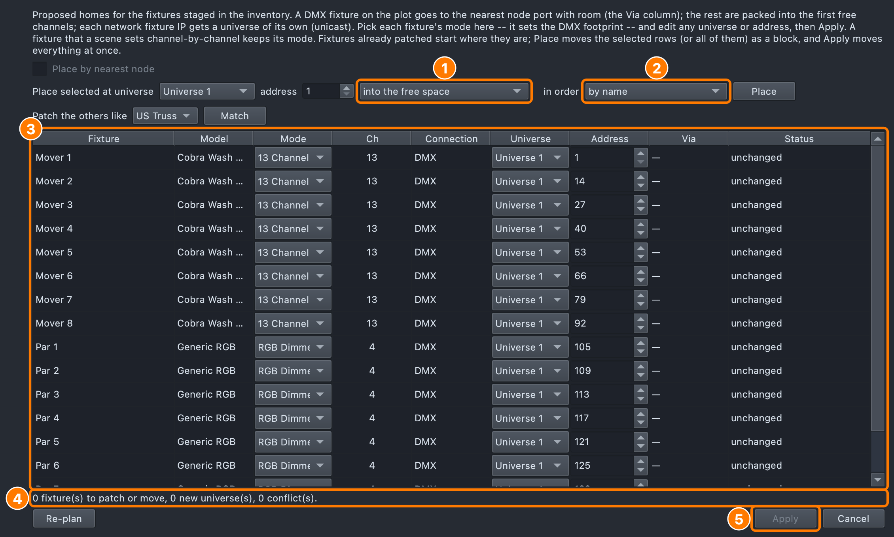

# Fixture Manager

## Why

Stock QLC+'s Fixture Manager is a flat list, grouped only by universe. Its
"Fixture Groups" concept is a bare table you click cells in one at a time,
with no folders and no nested organization — fine for a handful of fixtures,
unworkable for a real rig with dozens of spatial groupings.

This fork turns the fixture tree into the single home for the whole patch —
fixtures, spatial groups, power distribution, universes — and gives fixture
groups two things stock QLC+ lacks: **folders**, so dozens of groups can be
organized hierarchically instead of living in one flat list, and a much
richer **head-layout grid editor** with drag-and-drop placement, multi-cell
block moves, and reusable sub-group blocks.

These groups aren't just filing cabinets — they're the same spatial data
structure the Build tab's drag-and-drop **Targets** and the XY-pad /
EFX functions consume.

## Layout

The **Fixtures** tab is a tree on the left. Four sections are always there:

1. **Fixture Groups** — present even with zero groups, so there's
   somewhere to right-click and create one. Groups nest under here by folder.
2. **Inventory** — fixtures that are in the show but not yet patched (see
   [Inventory](#inventory-design-the-rig-before-patching)), filed
   manufacturer → model → fixture, alphabetically, with a count on each
   folder. It stays even when empty, since it's where Add to inventory lives.
3. **Power** — power-distribution sources and circuits.
4. **Universes** — one folder per universe, pre-built so an empty universe
   shows up before anything is patched to it. Patched fixtures nest under
   whichever universe they're on.

Two more appear at the very top **only when the show has the problem**:

- **Duplicate names (N)** (amber) — one row per name that more than one
  fixture has, its tooltip saying where each one is. Right-click →
  **"Number the Duplicates"**: the patched one keeps the name, the others
  become "name #2", "name #3"… Names are kept unique from now on; renaming
  to a taken name is refused, so this only turns up in older or merged shows.
- **Address clashes (N)** (red) — fixtures the show file puts on channels
  another fixture already uses. Stock QLC+ silently dropped the second one on
  load, taking every group, scene and cue that used it with it. Here it loads
  unpatched (it sends no DMX), is saved back exactly as it was, and waits
  here. Right-click → **"Patch the clashing fixtures..."** opens the Patch
  dialog with free channels proposed for each.

Selecting a fixture, group, universe, or power item swaps the right-hand pane
between an info browser, the group grid editor, the power view, or a
universe's address-usage grid. A fixture's info includes its **Connection**
(DMX, or Network with its IP), its **Definition** source (Included or Local,
below), and, for an unpatched one, "Unpatched -- in the inventory".

**Renaming in the tree.** Select a fixture, a group, a group folder or a
universe and press **Return** (or **F2**), type the new name, and press
Return again; **Esc** keeps the old name. An empty name is ignored, and a
fixture name another fixture already has is refused (group names may
repeat). Double-clicking a group still opens its grid editor, and
double-clicking a fixture its properties; the group editor's Name field
follows a rename made in the tree.

## Inventory: design the rig before patching

Stock QLC+ won't let a fixture exist until it has a universe and an address.
This fork lets you start from the kit list instead: add what you have, place
and group it in the Lighting Studio, build looks on it, and only then give
it real addresses, guided by which node actually serves that part of the rig.

An unpatched fixture is a full member of the show — it can be placed on the
plot, mounted, grouped and used in looks, and the Lighting Studio shows what it
would do — it just sends no DMX until it's patched. The footer's "Not
ready" list counts unpatched fixtures, and a Build-tab look warns when
any of its targets are unpatched.

### Adding to the inventory

- **"Add to inventory..."** (toolbar, or right-click the Inventory root)
  opens the Add Fixture dialog without a universe, address or channel count
  — the mode you pick is only what you expect to use, and can be changed
  when you patch. Quantity goes up to 999 at once, since staged fixtures
  take no channels. With the Inventory root selected, plain **Add** means
  add to the inventory too.
- Right-click a **model's folder** (or one staged fixture) →
  **"Add more X to inventory..."** opens Add already on that model and mode;
  on a manufacturer's folder, on that manufacturer.
- Adding is Design mode only, like Add Fixture.

### Patching: the Patch dialog

**"Patch Inventory…"** (on the Inventory root) or **"Patch…"** —
**"Patch N Fixtures…"** for several (staged fixtures, patched ones, or a mix;
a manufacturer/model folder stands for everything under it) — opens the **Patch** dialog. It
opens on a proposal, which you review and edit before anything changes:

1. **How to place** the selected rows (into the free space, keeping their
   spacing, packed, one universe each).
2. **In what order** — by name, movers first then by kind, or as they hang.
3. **The proposal** — one row per fixture; edit any mode, universe or
   address.
4. **What Apply will do**, and any conflicts.
5. **Apply** — off while there are conflicts.

- One row per fixture: model, **Mode** (the mode decides the DMX
  footprint, so it's chosen here — a generic dimmer gets a channel count),
  channels, **Connection**, **Universe**, **Address**, **Via** (the node port
  that will feed it) and **Status** (ok / new universe / moves from U.A /
  CONFLICT). Conflicts are flagged live and Apply stays off while any remain.
  The universe is picked **by name** from a list of the show's universes in
  name order (numbers in names count as numbers, so U3 comes before U12),
  followed by **New universe N** for the ones a patch can open.
- **"Place by nearest node"** — a DMX fixture placed on the plot goes to the
  nearest network-node port (or wireless receiver) with room; a free port on
  that node claims a new universe, written onto the port when you Apply.
  It's only offered once nodes are placed on the plot (Lighting Studio).
  Everything else is packed into the first free channels, identical fixtures
  on contiguous addresses.
- A **Network** fixture gets a universe of its own at its IP (unicast);
  fixtures behind one IP share it.
- **"Place selected at universe / address … in order …"** puts the
  selected rows — or all of them — where you say, in one **addressing
  order**, the same every time: **by name** (numbers count as numbers, so
  B2 before B10), **movers first, then by kind** (movers, scanners, pixel
  bars, beam bars, washes, strobes, dimmers, effects, atmospherics — each
  by name), or **as they hang** (structure by structure, in their order
  along it). The table lists the rows in that order, and the choice is
  remembered.
  - **into the free space** (the default) addresses them one after another
    in that order, around whatever else is in the universe — so the
    addresses read in order, and the same group always lands the same way,
    wherever its fixtures were before. Any with no room are **flagged** — "no room in U06:
    needs 165 channels, the widest gap is 47" — and left where they were,
    and a bar under the table offers two ways on: **Carry on into the next
    universe** (the patch continues there, packed) or **Fit by changing
    modes** (the biggest fixtures step down to a smaller mode, one at a
    time, until everything fits — only to modes they can take; it says so
    if even their smallest modes don't fit);
  - **keeping their spacing** (move a block as is, gaps and all);
  - **packed together** (in the order too, first free channels from there,
    spilling into the next universe);
  - **one universe each, counting up** (the first row that universe, the
    next the one after, each at that address — a row of lanterns, a node's
    ports).
- **Mode** can be changed for any row, patched or not — to fit a group into
  a universe, say; Status reads **mode changes**, and Apply changes the
  fixture. A mode is shown disabled, with why, when the fixture can't take
  it: a scene sets its channels by number, or the mode has fewer heads than
  a fixture group lays out (a fixture in no group can change its head
  count).
- **Patch the others like [structure] → Match** — offered when the
  fixtures in the dialog hang on more than one structure (four towers, four
  step trusses). Pick one as the pattern: every fixture on the others takes
  the address of the fixture **in the same place** on the pattern — paired
  by where it hangs along the structure, not by name or the order it was
  added — in **its own structure's universe** (T-2's bars stay in T-2's
  universe, at T-1's addresses). Structures carrying a different number or
  kind of fixtures are paired as far as they go, and a note under the table
  says what could not be; one with nothing patched yet is left alone (it
  has no universe to keep). The pattern is taken as it is patched in the
  show, not as edited in the dialog. In the Lighting Studio, right-click a
  structure → **Patch Others Like This (N)…** opens this dialog already
  matched to it.
- **Re-plan** throws away your edits and proposes again. **Apply** patches
  and moves everything at once, all or nothing.

Moving an already-patched fixture is Design mode only. **Apply is one undo
step**: ⌘Z — on the Fixtures tab or in the Lighting Studio — puts every
fixture it moved back where it was, with the mode it had, and returns any
it patched from the inventory to it.

**Dropping on a universe.** Drag fixtures, or a fixture group, onto a
universe row: the Patch dialog opens with them packed into that universe,
for you to review and apply.

**Return to inventory.** Right-click patched fixtures → **"Return to
inventory..."** releases their universe and address but keeps everything
else — placement, groups, looks. They stop sending DMX until patched again.
Design mode only.

**Free universes first.** A fixture that needs a universe of its own — a
network fixture's IP (a WLED lantern), a free node port, a DMX overflow —
takes a **free** one before a new one: nothing patched on it, nothing patched
to its output, no node port carrying it. A run of free universes long enough
for all of them is preferred, so they land together; otherwise the free ones
in order, then new ones past the last. DMX fixtures are placed first, so a
lantern never takes the universe they pack into.

**Universes are named the show's way.** A universe a patch puts fixtures on
that is still called "Universe N" is named as the show names its universes:
the scheme is learned from the names it already has — "U17-US1-1",
"U65-US1-Tops" is a prefix, the universe's number padded the same way, then
what is on it — and what is on it is its fixtures' names ("Lantern #1" on
universe 81 becomes **U81-Lantern-1**; several fixtures, what their names
share). A show with no scheme gets just the label. A name somebody gave is
never changed.

### Network fixtures: one IP each

Add Fixture's **Connection** is chosen per fixture:

- **DMX** — hangs off a node or a wireless receiver.
- **Network (ArtNet/sACN)** — the fixture is its own endpoint, sent Art-Net
  at its own IP.
- **Network (WLED, JSON over Wi-Fi)** — a WLED device, sent its look's state
  through WLED's own API (only when it changes), not Art-Net. The Patch
  dialog patches its universe to the WLED output, never borrowing an
  Art-Net one. A WLED that's slow to answer or on weak Wi-Fi shows up in
  the footer by fixture name.

Adding a batch of network fixtures gives them **one IP each, counting up**
from the one you type (…60, …61, …62, carrying past .255), and the dialog
shows the range under the IP field — "One each: 172.18.2.60 to
172.18.2.63" — or says when there aren't enough addresses left.

### The patch list

The paperwork for the crew who hang, name and address the rig. Open it from
the menu bar's **Fixtures → Patch List…**, or the Lighting Studio's
**More → Patch List…**. A row per fixture, in universe and address order,
fixtures still in the inventory last:

| Column | What it says |
|---|---|
| **Patch** | Universe (and its name) and the channels, one-based as the crew reads them: "1: Stage left · 12–23". A clashing fixture is listed where it asked to be, marked **clash**. |
| **Fixture** | Its name. |
| **Make / model**, **Mode** | From its definition. |
| **Ch** | How many channels it takes. |
| **Connection** | DMX, or a network fixture's transport and the name its IP goes by ("WLED lantern-2"), or the IP when it has none ("WLED 172.18.2.50"). Point at it for the IP. |
| **Goes to** | Where its universe goes: the output and device ("Art-Net → CS1 (172.18.2.211) · port 1 · universe 0:0:0" — port is the socket on the node, universe its Art-Net address), or nothing; point at it for all of it when the column is narrow. |
| **Mounted on** | The same words as Fixture Properties: "Truss FOH · 2.5 m along", "Tower T2 · shelf 3", "free / on the floor". |

- **Save CSV…** — every column plus the fixture ID, the first and last
  channel, X/Y/Z on the plot (in the plot's units) and a note, for a
  spreadsheet or another label program.
- **Save PDF…** — a landscape Letter page, a table per universe headed
  with where that universe goes, the header row repeated on each page.
- **Copy** — the CSV on the clipboard, to paste straight into a sheet.
- **Labels…** — a label per fixture, as a PDF (below).

#### Labels

**Labels…** in the patch list makes a label to stick on each fixture (or
its case), saved as a PDF to print from Preview. Each label has:

- the fixture's **name**, large;
- its **address**, large: universe and first channel, one-based — "U3 · 101"
  ("not patched" for a fixture in the inventory, "clash · U1 · 12" for one
  in an address clash) — with the universe's name, when it has one, smaller
  beside it;
- its **mode and channels** — "16-channel · 16 ch";
- for a network fixture, a line of its own: its transport and the name its
  IP goes by — "WLED · lantern-2" — or the IP when it has no name
  ("WLED · 172.18.2.50");
- **where it hangs**, the same words as the Mounted on column.

A name too long for the label is set smaller, then cut short with "…";
nothing runs off the edge.

Pick the **stock** — the choice is remembered for next time:

| Stock | What it is |
|---|---|
| **Avery 5160** (the default) | US Letter sheets, 30 labels (3 across, 10 down), each 2⅝ × 1 in. Avery's 5260, 5960, 8160 and other "30 per sheet" labels are the same layout. |
| **62 mm roll** | A continuous 62 mm roll (Brother DK-22205 and the like), one 62 × 29 mm label a page; the printer cuts between them. |

and **which fixtures**: all of them, or the rows selected in the list (the
default when some are). The dialog says how many labels that is and, on
sheets, how many sheets. Print the PDF at **100% / actual size** — "fit to
page" shrinks it and the labels no longer line up with the sheet.

## The head-layout grid editor

Select a group to open it: a name field, an "Add group as block…" button,
and a grid of cells. Each occupied cell shows the fixture's icon, name, head
number, DMX address/universe, and a short tag for what that head actually
is — `[RGB]`, `[RGBW]`, `[Wheel]`, `[W]`, `[Amber]` — derived from its real
channel makeup.

### Populating the grid

- **Drag one or more fixtures** from the tree onto a cell — each fixture's
  heads place starting there, spreading rightward across the row.
- **Drag individual heads** — while the group editor is open, fixture rows
  in the source tree expand to show draggable per-head children, so you can
  place one head of a multi-head fixture without the rest.
- **The four arrow buttons** on the right edge open a fixture/head picker
  and place selections advancing in that direction from the current cell.
- **"Add group as block…"** pastes another whole group's layout in,
  anchored at the selected cell, preserving its relative positions.

### Moving things around

- Click-drag an occupied cell (or a multi-cell selection) to move a block; a
  wireframe preview shows the drop target and only accepts drops that don't
  collide with anything outside the moving set.
- Shift+click/drag extends a rectangular marquee selection; Ctrl+click toggles
  one cell at a time.
- Right-click a cell for **"Move `<fixture>` up/down/left/right"** (shifts
  every head of that one fixture as a unit) or, on a pasted block,
  **"Move sub-group up/down/left/right"**.
- Ctrl+Z undoes the last edit (50-deep history).

## Fixture-group folders

A group's folder is just a `/`-separated path string (e.g. `Movers/Front`)
— there's no separate "folder" object, so an empty folder only exists as
long as at least one group references it.

Three ways to file a group into one:

1. **Right-click a folder (or the root) → "New Group..."** — the new group
   is filed there immediately; typing a never-before-seen path creates the
   folder.
2. **Group ▸ Move to Folder ▸** on one or more selected groups — pick
   **Fixture Groups (no folder)** or any folder in use, or **New Folder…**
   to name a new one; it is made inside the folder the groups are in (a
   `/` in the name nests it further).
3. **Drag and drop** a group onto a folder, onto another group (joins its
   folder), or onto empty space / the root (un-files it).

**Select All Similar** (right-click a fixture or a group) picks out the rest
of its kind, ready to group or file in one go:

- **A fixture**: every fixture of the same definition and mode. Picked
  inside a group, it stays in that group; picked under a universe or the
  Inventory, it takes in the whole rig.
- **A group**: every group in the same folder made of the same fixtures —
  as many of each kind — with as many heads. A truss's DS1t, DS2t, CS1t…
  tops are alike; its faces (DS1f…) and a "DS1t RGB" split (the same
  fixtures, only their RGB heads) are not. The grid shape is not
  compared.

Then **Group ▸ Move N Groups to Folder ▸ New Folder…** files them together,
or **Group ▸ Create Group(s) from Selection…** makes one group of them, each
as a block. Groups made from a selection start in the folder it was made in.
None of these are on the Undo (⌘Z) history, which covers the rig and the
patch; moving them back is the same menu.

Rename a folder the same way as any tree row: select it, press Return/F2, or
double-click, and type the new name. Every group in that folder — and every
group in a sub-folder underneath it — gets its path updated to match.

## Creating a group

- **Right-click "Fixture Groups" or any folder → "New Group..."** — an empty
  group at your chosen grid size.
- **⇧⌘N** with a group, a fixture in a group, a group folder or "Fixture
  Groups" selected: an empty 4×4 group named *New Group* in that folder,
  selected, with its name in the editor ready to type. The **Edit** menu
  says where it goes (*New Group in Movers (⇧⌘N)*).
- **Select fixtures and/or groups → Group → "Create Group(s) from
  Selection…"** — one group of the selection, a group per head type, or a
  group per head type for each fixture, previewed before any is made
  (below).

### Create Group(s) from Selection

One menu item, **Group → Create Group(s) from Selection…**, for one group
or many. Take eight bars, each with 16 RGB pixels and 4 white strobe
cells. It offers:

1. **One group with every head** — all 160 heads in one group, made just
   as the old one-click *Create Group from Selection* made it (below). On
   by default when the fixtures have one type of head, or when groups are
   selected.
2. **A group per head type, across all the fixtures** — "Bar · RGB pixels"
   (128 heads) and "Bar · White pixels" (32 heads). On by default when the
   fixtures have more than one type of head.
3. **A group per head type for each fixture** — "Bar 1 · RGB pixels",
   "Bar 1 · White pixels", "Bar 2 · RGB pixels"… 16 groups, filed in a
   folder named after the selection.

**One group.** How the heads are laid out depends on what is selected:

- **Groups selected** (with or without fixtures): with **Each group
  selected as a block, as it is laid out** ticked (the default), each
  group goes in keeping its own layout, one under the other, tagged as a
  [sub-group](#sub-groups-pasted-blocks-with-provenance) so it moves as a
  unit; fixtures selected as well go in a row below them (a head already
  in one of the groups isn't added twice). It's what **Add to Group** does
  into an empty group. Untick it to lay every fixture out afresh instead.
- **Fixtures placed in the Lighting Studio**: laid out from where they
  really stand — **From the front** (as the audience sees it — step fronts
  become one picture), **From above** (the plan) or **Automatic**, with
  **"Close up the gaps"** (on by default: each keeps its place relative to
  the others, empty rows and columns dropped; off is the rig to scale).
- **Otherwise**: the heads fill a **Grid** row by row, the fixtures in
  their order on the 2D plot (top row first, left to right; ones not on
  the plot after, as picked). The grid is suggested from the plot (a row
  of fixtures per band of the plot), else a near-square of the head
  count; change it there, or resize the group later.

**What a head type is.** Fixture definitions don't name their heads'
types, so it is read from each head's channels: its colours ("RGB",
"RGBW", "White"; "Dimmer" for plain intensity) and whether it moves (pan
or tilt in the head, or on the fixture's body: "RGBW movers"). Two heads
are the same type when those match — whatever fixture model they are on,
so the RGB pixels of a bar and of a strip share "· RGB pixels" in option
2. Tick **Keep fixture models apart** to give each model its own group
instead. A head with no colour, intensity or movement is "Other". A
mover's head with only a dimmer (its colour on a wheel) is just
**Movers**. A head whose only colour is a colour wheel or colour-macro
channel — a mover's **colour ring** round the lens — is **Ring** on a
fixture that moves and **Colour macro** elsewhere, so a mover with a ring
as its own head makes a "· Movers" group and a "· Ring" group (see
[Colour rings](show-tree.md#colour-rings)).

**Strobe isn't a type.** A shutter or strobe channel doesn't make a head
a different type: the bars' white strobe cells are "White", and an RGB
head with its own strobe channel is still "RGB". Only colour, intensity
and movement count.

**Names.** Each group is named after what its fixtures' names share, less
a trailing number ("Bar 1"…"Bar 8" → "Bar"), and its head type; a group
per fixture takes the fixture's name. When every fixture in a group has
more than one head of its type, the type is called **pixels** ("Bar · RGB
pixels", "Bar · White pixels"); fixtures of one head of it keep the plain
type ("Par · RGB"), and movers stay movers ("Spot · RGBW movers") however
many heads they have. Type a **Name** to name them all after that
instead. Selecting only groups names them after the groups. Every name in
the list can be changed (double-click it) and any group unticked before
**Create**. A group that already exists with exactly the same heads is
shown as such: in options 2 and 3 it's left unticked; the one group of
option 1, asked for, is still made unless you untick it. **Folder** files
them all (empty: no folder).

**Layout of a group per type.** Fixtures placed in the Lighting Studio are
laid out where they stand, as for one group, each fixture's heads of that
type turned the way it is rigged. Fixtures that aren't placed get a row
each, one under the other, in their order on the 2D plot (a panel keeps
its own grid); fixtures of one head each fill a near-square instead.
Click a group in the list to see its layout.

### LED Layout

A pixel fixture's definition says how big its LED grid is (an XL-450:
15 × 5) but not which head sits in which cell. Many number their heads by
kind instead: the XL-450's 165-channel mode numbers its 45 RGB heads first
and its 30 white ones after, while the bar is built **RGB / W / RGB / W /
RGB**, a row of 15 each. The **LED layout** says where each head really is,
once per model and mode, and everything that draws or groups heads uses it.

**Where to find it.** Right-click a fixture — in the Fixture Manager, on the
Lighting Studio plot or its Layers tree, or in the Rig Overview — and choose
**LED Layout…**; or press **LED Layout…** at the top of **Fixture
Properties**. It is offered for fixtures with more than one head (greyed
for a single-head one), and it makes no group: it is the fixture's map, and
nothing else.

**What it shows.** The fixture as it is built: every cell of the grid, each
head in its cell with its number, coloured by its kind — a colour kind
(RGB, RGBW…) runs red to violet in head-number order, white heads are
white, amber amber, UV purple — so an RGB row reads as a rainbow and a
wrong order shows as a broken one. Empty cells are drawn too.

- **Rows, top to bottom** — type the kind of each row, `RGB, W, RGB, W, RGB`
  (or `RGB/W/RGB/W/RGB`, any case, "White" for W), then **Apply Rows**
  (or Return): each row fills with the next heads of its kind, in head
  order. A pattern that can't hold the heads says why ("RGB rows hold 60
  heads, it has 45"). A strip with no declared grid is one row; typing
  `RGB, W` makes it two rows of half the heads each.
- **Click a head, then another** to swap them, or **an empty cell** to move
  the head there. Click it again to let go.
- **Grid** — columns × rows; grow it to leave gaps (heads keep their
  cells; one that no longer fits takes the first free cell). Too small for
  the heads, the other side grows to fit.
- **Flip ↔ / Flip ↕** — mirror it (a bar seen from behind, or hung upside
  down). **Head Order** puts the heads back in number order, row by row.
- **▶ Preview Order** walks the heads 1, 2, 3… with a fading trail, on the
  grid and on the strip beside it (the heads in number order; click one to
  light it). Tick **Light the fixture too** to light each head on the real
  fixture as well, full and one at a time, to check the map against it; it
  goes back as it was when the preview stops or the dialog closes.

**Where it's kept.** **Save to Show** keeps it in the show (one layout per
make, model and mode, so every XL-450 in that mode shares it, and it
travels with the file). **Save as Default for This Model** also keeps it on
this computer, in the **HeadLayouts** folder of your user data folder
(beside **Fixtures**), one small file per model and mode: new shows, and
shows with no layout of their own for the model, use it. A show's own
layout always comes first; **Use Default** loads the default (or head
order) into the editor. Collect for Transfer copies a show's layouts out
as **HeadLayouts/**.

**What uses it.** Matrix effects' canvas (a loose XL-450 is a 15 × 5 grid
with white rows 2 and 4 — see [The white pixels](effects.md#the-white-pixels)), groups
made by head type, the Lighting Studio plot, the Rig Overview and Angled
views (pixel by pixel, and where each beam starts), and the light
footprints. An edit shows at once in all of them.

### Split by Head Type

Some fixtures mix head kinds — an XL-450 bar is rows of RGB and white
pixels; a bar patched as two fixtures (its RGB part and its white part)
does the same across a selection. **Split by Head Type…** makes one group
per kind ("FART-SR RGB", "FART-SR W"), each fixture's heads of that kind
laid out as a block turned the way it's rigged (a bar hanging down is a
column) and placed as on stage. The wizard shows the fixture's grid
coloured by kind with head numbers, lets you correct the head order (a row
pattern, or click two heads to swap), name each kind's group, and pick the
same From the front / From above / Close up the gaps choices. The grid is
the same editor as [LED Layout](#led-layout); the map you fix is kept in
the show, and — with **Also save as the default for this model**, ticked
to start with — as your default for the model.

It's offered when making a group from mixed fixtures on the Lighting
Studio plot's fixture menu, and on a fixture group's row in the Studio's
Layers list. (In the Fixture Manager, option 2 of
[Create Group(s) from Selection](#create-groups-from-selection) does the
same job.)

### Lay Out from the Stage

A group filled in head order — poured into a square, say — can be put
right in place: on a fixture group's row in the Lighting Studio's Layers
list, **Lay Out from the Stage…** opens the same dialog on *that* group,
keeping its name, and **Apply** re-lays it from where its fixtures stand.

## Sub-groups: pasted blocks with provenance

When you paste one group's layout into another as a block (via "Add group as
block…" or **Group → Add to Group**), every head that came along is tagged with the
source group's id. This is what lets the editor:

- **Color-code** the pasted block distinctly from the rest of the grid, so
  you can see at a glance which heads came from which source group.
- **Move the whole block as one unit** via "Move sub-group…", instead of
  dragging every head separately.
- **Rebuild a composite from its members** — re-pull each source group's
  *current* layout (even if it's since been edited) and re-block them side
  by side, ordered by their position on the 2D plot. Useful for a group like
  "all step fronts" assembled from several smaller per-step groups.

### Change Definition

Select fixtures of one definition and right-click → **Change
Definition…** to move them all to another definition of the same
manufacturer that is a **drop-in**: every mode they use is there by name,
with the same channels in the same order. Addresses, names, groups and
everything programmed stay; only what the definition adds changes — a
mover's colour ring made a head of its own, say. The item only shows when
there is such a definition. Undo it the same way (the old definition is a
drop-in for the new one).

## Context menu

Right-click is laid out by what it is about, in the same order whatever is
selected, and only offers what applies:

1. **The fixture itself** — Fixture Properties…, Definition & Mode…,
   Edit Fixture Definition… and [LED Layout…](#led-layout) (one fixture),
   Change Definition… (fixtures of one definition, when another is a
   drop-in for it), and **Stage Look ▸** (below).
2. **Its address** — **Patch…** (the one name for giving an address and
   moving one, here, on the plot and in the studio; "Patch N Fixtures…" for
   several) and Return to Inventory….
3. **Finding it on the rig** — Test Fixture…, Locate, Reset.
4. **Organising it** — a **Group** submenu (Create Group(s) from Selection…,
   Add to Group ▸, Remove from Group; for a group: Move to Folder…, Remove
   Group (Keep Fixtures), Rebuild Composite), a **Power** submenu (Add to
   Circuit ▸, Remove from Circuit), and Channel Behaviour & Modifiers….
5. **Deleting it** — Delete….

Then what the clicked row offers — Add Fixture / Add RGB Panel on empty
space, the universe's output and Delete Universe… on a universe (below),
Add Power Source… / Add Circuit…,
New Group… on a group folder, Number the Duplicates and Patch the Clashing
Fixtures… on their roots, Add … to Inventory / Patch Inventory… on the
inventory — and Expand All / Collapse All last.

Patch is offered whenever none of the fixtures has an address yet; moving
patched ones is Design mode's — the same rule everywhere.

### Stage Look

**Stage Look ▸** sets what the fixtures selected -- and every fixture of a
group selected -- look like: **Auto** (named for what their type is closest
to, as *Auto (Moving head spot)*), then the looks under **Moving**, **Fixed
conventional**, **Fixed LED** and **Practicals** (Lantern, Staff), with
icons. The one they all share is
ticked. A fixture with a look shows its icon in this list and the other
fixture lists, and its shape on the plot and in the studio; see
[Stage looks](lighting-studio.md#stage-looks). Fixture Properties has the
same choice as its **Stage look** row.

### Patching a universe's output

A universe row patches where the universe goes, with the same questions,
rules and undo as the Connections tab (see
[Connections &amp; patch](other-improvements.md#connections--patch)):

- **Patch output…** — on a universe that goes nowhere yet: the protocol,
  then the interface, then (Art-Net, WLED) the node port — the visible
  devices' ports, free ones first, with **Another address…** and
  **Broadcast**. A port another universe already uses is refused.
- On a patched universe the menu says where it goes now, e.g. **Output:
  ArtNet → CS1 (172.18.2.211) · port 1 · universe 0:0:0**, then **Change
  interface / target…** (the interface asked again, the current one
  preselected, then the port) and **Unpatch output**. A protocol without
  targets (a USB widget) offers **Patch output…** again instead, which
  replaces the patch.
- With several universe rows selected: **Patch N selected universes to…**
  puts them on a device's ports in the order you clicked them, and
  **Unpatch N selected universes** takes them all off.
- **Show in Connections** opens the Connections tab on that universe.

Each is one step of **Undo Patch Change** in Connections, and the row's
"— destination" updates as soon as the patch changes.

## Fixture definitions

### Where a definition comes from

Every definition says where it comes from, in a **Source** column in Add
Fixture and in the fixture editor's browser, in the editor's window title,
and in the Fixture Manager's info pane:

- **Included** — ships with the app. Editing one saves your change as a
  local copy.
- **Local** — your own, in your Fixtures folder. **"Local — replaces the
  included one"** when it has the same make and model as an included one:
  yours is used.

If you have two local files for one fixture, the most recently changed is
used, and the footer lists the unused ones ("same as X" / "older than X,
not used") with **Move to Trash**.

### Out-of-date definitions

**Fixtures → Definition Updates…** lists your definitions that are older
than the current version of the same fixture — the included one, or a
newer copy of your own — split into those the open show uses and the rest,
with what an update would change. **Update from Current** keeps a backup
and can be undone; linked files in the synced QLC+ folder are handled
explicitly; a customised copy is never called old. The footer says when
there are any. See [Definition Updates](definition-updates.md).

### The fixture editor

**"Edit Fixture Definition..."** (right-click a fixture) opens the fixture
editor on its definition. On top of stock QLC+'s editor:

- **Repair view.** A definition that won't load opens in a Repair view
  instead of "unable to load": it says where it breaks (line, column, why),
  shows the file with that line marked and editable, re-checked as you
  type, and lists **proposed repairs, each tried before it's offered** —
  "\>" for "/>", a bare "&", a mismatched closing tag, unquoted attributes,
  curly quotes, a missing DOCTYPE, no mode at all (one is made with every
  channel), a mode naming a channel that isn't there (the nearest real
  name), and more; a last resort is deleting the bad line. Repairs chain,
  so a file broken several ways is fixed in a few clicks. Fixes that can't
  be wrong — the "\>" typo, for one — are applied on open, with a
  "Fixed automatically: …" note and **Undo**. The repaired file opens
  unsaved, for you to look over and save. The footer's "could not be read"
  entries offer **Repair in Fixture Editor…** (and Move to Trash).
- **Problems panel**, checked as you edit. **Errors** are broken data: no
  manufacturer or model, no channels or modes, a mode with no channels,
  overlapping or backwards capabilities, two channels or modes with one
  name. **Warnings** are missing data: no size, no light output, no beam
  angle, no pan/tilt range, a pixel layout that doesn't hold the heads,
  values no capability covers. Double-click one to jump to it. Saving with
  errors asks first.
- **Physical tab → Dimensions in your own units.** Width, height, depth
  and weight show in the unit chosen in qlcconsole's **Settings → Units**
  (millimetres, centimetres, metres, inches, or feet and inches; weight in
  kg with the metric ones, lb with inches and feet). Type a bare number in
  that unit, or any unit with the number and it's converted: `7.5"`,
  `7.5 in`, `0.625'`, `0.625 ft`, `6' 3"`, `190.5 mm`, `19.05 cm`,
  `0.19 m`; `12 kg`, `26.5 lb` (or `lbs`), `400 g`, `5 lb 4 oz`. With
  inches set, `7.5"` stays **7.5 in**; with millimetres it becomes
  **190.5 mm**. Something it can't read turns the field red, with a
  tooltip saying what it accepts, and the value stays as it was.

  The file is unchanged and still opens in stock QLC+: it keeps **whole
  millimetres** (halves round up, so 7.5" = 190.5 mm is saved as
  **191 mm**) and kilograms. The field's tooltip says what will be saved.
  A saved size shows with the fewest decimals that mean the same
  millimetre, so 191 mm reads 7.5 in again, not 7.52. The Fixture
  Manager's information panel shows sizes and weight in the same unit, and
  the Lighting Studio's grid follows it (metres or feet).
- **Physical tab → "Look in the Lighting Studio"** — how the Lighting Studio and
  the Rig Overview draw it:
  - **Body**: Box, or Lantern (a cage glowing all round).
  - **Light**: Beam (a cone at the lens angle), or All round (a bare source
    lighting what's near it).
  - **Source**: one point, or a number of LEDs drawn one by one — a
    **hanging LED cluster** (a wire string through the cage) or **LED tape**
    (wound tight round a core).
  - **Glass**: **Diffuse** (the default — it glows, the LEDs a blur behind)
    or **Clear** (every LED shows).

  A fixture in the show can override its LEDs and glass for its own build
  (Fixture Properties, or the Studio inspector); a WLED that answers says
  how many LEDs it really drives.
- Saving a definition while the show is open re-reads its physical data in
  place, so a "no light output" warning clears without reopening the show.
- When qlcconsole opens the editor for you (Edit Fixture Definition, or a
  repair from the footer), it **closes when you're done** — window closed or
  repair cancelled — rather than leaving an empty editor behind. An editor
  you already had open is left alone.

### Missing definitions and the show cache

A fixture whose definition isn't on this computer stands in as a generic
dimmer, as in stock QLC+ — but here it **keeps its real make, model and
mode**, and saves them. Stock QLC+ wrote "Generic", and the real fixture
was gone for good. The footer lists such fixtures as an error, with
**Fetch Definitions**, which gives each its definition back where the
mode and channel count match. Saving the show while any are missing warns
first, naming them.

So a show never depends on files that may not be there on show day, the
app keeps a **show cache** on this computer: a copy of every non-shipped
definition a show uses, refreshed whenever a show loads or saves. When a
show opens, each definition comes from your library, else the show cache,
else — if it's an online-only file in cloud storage — it's fetched (with a
"Waiting for the cloud…" window you can Skip) and then cached.

### Opening a show on another computer

A **.qlcc carries its own copies** of every fixture definition, effect
script and RGB Matrix script it uses that isn't part of the app — your own
definitions, ones linked in from the old QLC+ folder, ones from the show
cache. Saving writes each one into the show file exactly as it is on disk
(a few KB each); the ones that ship with the app stay out. A **.qxw** is
saved as before, without them, so stock QLC+ can still open it.

When the show opens, each copy is compared with this computer's:

| This computer… | What happens |
|---|---|
| has none | The show's copy is used while the show is open. The footer notes **"N definitions came with this show"** (a note — the show is still Ready); **Install on This Computer** puts them in your user folder. |
| has the same, byte for byte | Nothing to say. |
| has a **different** one | The **show's** copy is used — nothing changes under a patched rig by itself — and the footer warns **"N items in this show differ from this computer's"**. |

**Review…** on that warning lists each difference with:

- **Which looks newer** — "Updated on this computer since the show was
  saved", "This computer has an older copy", or "Can't tell which is
  newer" (from the version that saved each copy, then the file's time when
  it was saved into the show and the file's time here). Pick a row to see
  what changes, mode by mode and channel by channel.
- **Safe to switch?** — *Compatible* when every mode the show's fixtures
  use is in this computer's copy with the same channels in the same order,
  and every setting the show's looks and RGB matrices set is still there,
  of the same kind. Otherwise *Not compatible*, naming the fixtures, the
  functions that use them, or the looks, and what changed ("Mode “4ch”
  goes 4 → 5 channels: 2 fixtures would need re-patching").
- **Use This Computer's** — the show switches now (asking first when it's
  not compatible) and carries this computer's copy from the next save.
  A switch that would need re-patching — a mode that's gone, or fixtures
  that would grow into the next one — is refused, naming them.
  **Use This Computer's for All Compatible** does every safe one at once,
  and **Undo** goes back to the show's copies in one step.
- **Keep the Show's** — stop warning about it. Remembered in the show,
  until this computer's copy changes again.
- **Install the Show's** — writes the show's copy over this computer's
  (asking first; the old file goes to the Trash), so every show opened here
  uses it.

**File → Show Definitions…** lists everything the show carries, whether
or not it differs, with the same choices. See
[Old definitions inside a show](definition-updates.md#old-definitions-inside-a-show).

**Save never swaps versions:** it writes the copy the show is using. A
newer definition on this computer reaches the show only through **Use This
Computer's**. Opening another show starts from this computer's copies
again.

#### Collect for Transfer

**File → Collect for Transfer…** makes a folder named after the show
holding the show as a .qlcc and, beside it, **Fixtures/**, **EffectScripts/**,
**RGBScripts/** and **HeadLayouts/** (the show's LED maps) — everything it
uses that isn't part of the app, as plain files. The show you have open
stays as it is.

Opening a show also looks in its own folder's **Fixtures/**,
**EffectScripts/** and **RGBScripts/** for anything neither the show nor
this computer has, so a collected folder opens complete even as a .qxw,
and definitions kept beside a show are found. (A copy in the show file
comes first, then this computer's, then the show's folder.)

## Terminology

| Term | Meaning |
|---|---|
| **Fixture group** | A named, sized grid of fixture **heads** — used for XY-pad/EFX effects and as a drag-drop target in the Build tab. Distinct from a *Channel Group* (a Simple Desk DMX-channel grouping). |
| **Path / folder** | A group's `/`-separated organizational string; the folder UI is entirely derived from it. |
| **Sub-group** | A per-head tag recording which group a pasted block of heads came from — lets it be color-coded, moved as a unit, and rebuilt from its live sources later. |
| **Add group as block** | Pasting one group's whole layout into another, preserving relative positions. |
| **LED layout** | Where each head of a model and mode sits in its LED grid, and so which rows are RGB and which white. Kept in the show; optionally also as your default for the model. |
| **Inventory / staged fixture** | A fixture in the show with no universe or address yet. It can be placed, grouped and programmed; it sends no DMX until patched. |
| **Connection** | Per fixture: DMX (fed by a node or wireless receiver), or Network — Art-Net/sACN or WLED — at its own IP. |
| **Address clash** | A fixture the show file puts on channels another already uses; loaded unpatched and kept until re-patched. |
| **Included / Local definition** | Shipped with the app, or your own file (which replaces an included one of the same make and model). |
| **Show cache** | This computer's copy of every non-shipped definition a show uses, so the show opens without the original files. |
| **The show's own copy** | A definition or script saved inside a .qlcc. Used when this computer has none or a different one, until you choose otherwise in **Review…**. |
