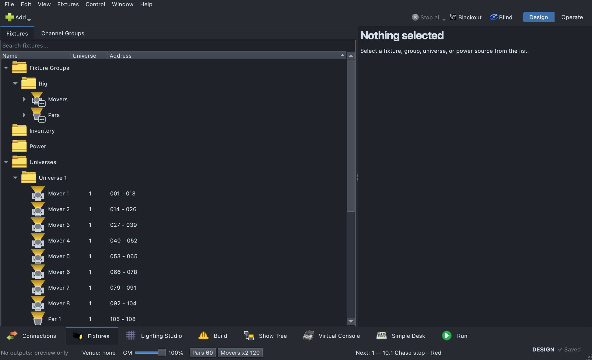
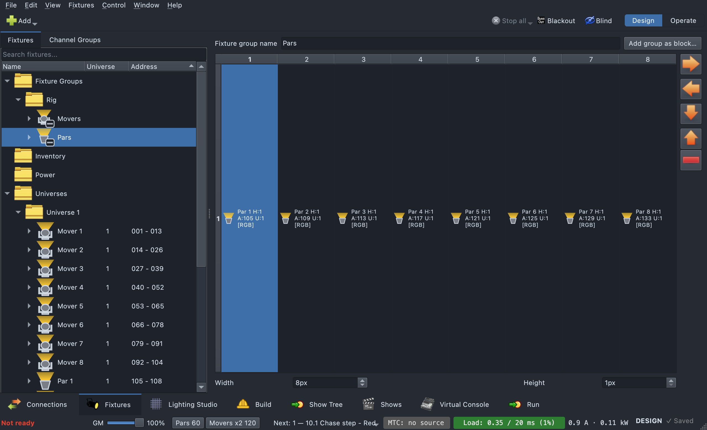

# Fixture Manager

## Why

Stock QLC+'s Fixture Manager is a flat list, grouped only by universe. Its
"Fixture Groups" concept is a bare table you click cells in one at a time,
with no folders and no nested organization — fine for a handful of fixtures,
unworkable for a real rig with dozens of spatial groupings.

This fork turns the fixture tree into the single home for the whole patch —
fixtures, spatial groups, power distribution, universes — and gives fixture
groups two things stock QLC+ lacks: **folders**, so dozens of groups can be
organized hierarchically instead of living in one flat list, and a much
richer **head-layout grid editor** with drag-and-drop placement, multi-cell
block moves, and reusable sub-group blocks.

These groups aren't just filing cabinets — they're the same spatial data
structure the Programming tab's drag-and-drop **Targets** and the XY-pad /
EFX functions consume.

## Layout

The **Fixtures** tab is a tree on the left. Four sections are always there:

1. **Fixture Groups** — present even with zero groups, so there's
   somewhere to right-click and create one. Groups nest under here by folder.
2. **Inventory** — fixtures that are in the show but not yet patched (see
   [Inventory](#inventory-design-the-rig-before-patching)), filed
   manufacturer → model → fixture, alphabetically, with a count on each
   folder. It stays even when empty, since it's where Add to inventory lives.
3. **Power** — power-distribution sources and circuits.
4. **Universes** — one folder per universe, pre-built so an empty universe
   shows up before anything is patched to it. Patched fixtures nest under
   whichever universe they're on.

Two more appear at the very top **only when the show has the problem**:

- **Duplicate names (N)** (amber) — one row per name that more than one
  fixture has, its tooltip saying where each one is. Right-click →
  **"Number the Duplicates"**: the patched one keeps the name, the others
  become "name #2", "name #3"… Names are kept unique from now on; renaming
  to a taken name is refused, so this only turns up in older or merged shows.
- **Address clashes (N)** (red) — fixtures the show file puts on channels
  another fixture already uses. Stock QLC+ silently dropped the second one on
  load, taking every group, scene and cue that used it with it. Here it loads
  unpatched (it sends no DMX), is saved back exactly as it was, and waits
  here. Right-click → **"Patch the clashing fixtures..."** opens the Patch
  dialog with free channels proposed for each.

Selecting a fixture, group, universe, or power item swaps the right-hand pane
between an info browser, the group grid editor, the power view, or a
universe's address-usage grid. A fixture's info includes its **Connection**
(DMX, or Network with its IP), its **Definition** source (Included or Local,
below), and, for an unpatched one, "Unpatched -- in the inventory".

## Inventory: design the rig before patching

Stock QLC+ won't let a fixture exist until it has a universe and an address.
This fork lets you start from the kit list instead: add what you have, place
and group it in the Lighting Studio, build looks on it, and only then give
it real addresses, guided by which node actually serves that part of the rig.

An unpatched fixture is a full member of the show — it can be placed on the
plot, mounted, grouped and used in looks, and the rig view shows what it
would do — it just sends no DMX until it's patched. The footer's "Not
ready" list counts unpatched fixtures, and a Programming-tab look warns when
any of its targets are unpatched.

### Adding to the inventory

- **"Add to inventory..."** (toolbar, or right-click the Inventory root)
  opens the Add Fixture dialog without a universe, address or channel count
  — the mode you pick is only what you expect to use, and can be changed
  when you patch. Quantity goes up to 999 at once, since staged fixtures
  take no channels. With the Inventory root selected, plain **Add** means
  add to the inventory too.
- Right-click a **model's folder** (or one staged fixture) →
  **"Add more X to inventory..."** opens Add already on that model and mode;
  on a manufacturer's folder, on that manufacturer.
- Adding is Design mode only, like Add Fixture.

### Patching: the Patch dialog

**"Patch Inventory…"** (on the Inventory root) or **"Patch…"** —
**"Patch N Fixtures…"** for several (staged fixtures, patched ones, or a mix;
a manufacturer/model folder stands for everything under it) — opens the **Patch** dialog. It
opens on a proposal, which you review and edit before anything changes:

- One row per fixture: model, **Mode** (the mode decides the DMX
  footprint, so it's chosen here — a generic dimmer gets a channel count),
  channels, **Connection**, **Universe**, **Address**, **Via** (the node port
  that will feed it) and **Status** (ok / new universe / moves from U.A /
  CONFLICT). Conflicts are flagged live and Apply stays off while any remain.
- **"Place by nearest node"** — a DMX fixture placed on the plot goes to the
  nearest network-node port (or wireless receiver) with room; a free port on
  that node claims a new universe, written onto the port when you Apply.
  It's only offered once nodes are placed on the plot (Lighting Studio).
  Everything else is packed into the first free channels, identical fixtures
  on contiguous addresses.
- A **Network** fixture gets a universe of its own at its IP (unicast);
  fixtures behind one IP share it.
- **"Place selected at universe / address"**, **keeping their spacing**
  (move a block as is, gaps and all), **packed together** (first free
  channels from there, spilling into the next universe) or **one universe
  each, counting up** (the first row that universe, the next the one after,
  each at that address — a row of lanterns, a node's ports), puts the
  selected rows — or all of them — where you say.
- Already-patched fixtures start where they are; their mode is read-only
  here (change it in the fixture's properties). A fixture a scene sets
  channel by channel keeps its mode, and a mode with a different head count
  is refused — both shown disabled, with the reason.
- **Re-plan** throws away your edits and proposes again. **Apply** patches
  and moves everything at once, all or nothing.

Moving an already-patched fixture is Design mode only. There's no undo for
a re-address — the dialog is the confirmation step.

**Dropping on a universe.** Drag fixtures, or a fixture group, onto a
universe row: the Patch dialog opens with them packed into that universe,
for you to review and apply.

**Return to inventory.** Right-click patched fixtures → **"Return to
inventory..."** releases their universe and address but keeps everything
else — placement, groups, looks. They stop sending DMX until patched again.
Design mode only.

**Free universes first.** A fixture that needs a universe of its own — a
network fixture's IP (a WLED lantern), a free node port, a DMX overflow —
takes a **free** one before a new one: nothing patched on it, nothing patched
to its output, no node port carrying it. A run of free universes long enough
for all of them is preferred, so they land together; otherwise the free ones
in order, then new ones past the last. DMX fixtures are placed first, so a
lantern never takes the universe they pack into.

**Universes are named the show's way.** A universe a patch puts fixtures on
that is still called "Universe N" is named as the show names its universes:
the scheme is learned from the names it already has — "U17-US1-1",
"U65-US1-Tops" is a prefix, the universe's number padded the same way, then
what is on it — and what is on it is its fixtures' names ("Lantern #1" on
universe 81 becomes **U81-Lantern-1**; several fixtures, what their names
share). A show with no scheme gets just the label. A name somebody gave is
never changed.

### Network fixtures: one IP each

Add Fixture's **Connection** is chosen per fixture:

- **DMX** — hangs off a node or a wireless receiver.
- **Network (ArtNet/sACN)** — the fixture is its own endpoint, sent Art-Net
  at its own IP.
- **Network (WLED, JSON over Wi-Fi)** — a WLED device, sent its look's state
  through WLED's own API (only when it changes), not Art-Net. The Patch
  dialog patches its universe to the WLED output, never borrowing an
  Art-Net one. A WLED that's slow to answer or on weak Wi-Fi shows up in
  the footer by fixture name.

Adding a batch of network fixtures gives them **one IP each, counting up**
from the one you type (…60, …61, …62, carrying past .255), and the dialog
shows the range under the IP field — "One each: 172.18.2.60 to
172.18.2.63" — or says when there aren't enough addresses left.

## The head-layout grid editor

Select a group to open it: a name field, an "Add group as block…" button,
and a grid of cells. Each occupied cell shows the fixture's icon, name, head
number, DMX address/universe, and a short tag for what that head actually
is — `[RGB]`, `[RGBW]`, `[Wheel]`, `[W]`, `[Amber]` — derived from its real
channel makeup.

### Populating the grid

- **Drag one or more fixtures** from the tree onto a cell — each fixture's
  heads place starting there, spreading rightward across the row.
- **Drag individual heads** — while the group editor is open, fixture rows
  in the source tree expand to show draggable per-head children, so you can
  place one head of a multi-head fixture without the rest.
- **The four arrow buttons** on the right edge open a fixture/head picker
  and place selections advancing in that direction from the current cell.
- **"Add group as block…"** pastes another whole group's layout in,
  anchored at the selected cell, preserving its relative positions.

### Moving things around

- Click-drag an occupied cell (or a multi-cell selection) to move a block; a
  wireframe preview shows the drop target and only accepts drops that don't
  collide with anything outside the moving set.
- Shift+click/drag extends a rectangular marquee selection; Ctrl+click toggles
  one cell at a time.
- Right-click a cell for **"Move `<fixture>` up/down/left/right"** (shifts
  every head of that one fixture as a unit) or, on a pasted block,
  **"Move sub-group up/down/left/right"**.
- Ctrl+Z undoes the last edit (50-deep history).

## Fixture-group folders

A group's folder is just a `/`-separated path string (e.g. `Movers/Front`)
— there's no separate "folder" object, so an empty folder only exists as
long as at least one group references it.

Three ways to file a group into one:

1. **Right-click a folder (or the root) → "New Group..."** — the new group
   is filed there immediately; typing a never-before-seen path creates the
   folder.
2. **"Move to folder…"** on one or more selected groups — type an arbitrary
   path, applied to all of them at once.
3. **Drag and drop** a group onto a folder, onto another group (joins its
   folder), or onto empty space / the root (un-files it).

Rename a folder the same way as any tree row: select it, press Return/F2, or
double-click, and type the new name. Every group in that folder — and every
group in a sub-folder underneath it — gets its path updated to match.

## Creating a group

- **Right-click "Fixture Groups" or any folder → "New Group..."** — an empty
  group at your chosen grid size.
- **Select one or more fixtures or groups → "Create group from selection…"**
  — for a pure fixture selection:
  - If any of them are placed in the Lighting Studio, the **New Fixture
    Group** dialog lays them out from where they really stand: **From the
    front** (as the audience sees it — step fronts become one picture),
    **From above** (the plan) or **Automatic**, with **"Close up the gaps"**
    (on by default: each keeps its place relative to the others, empty
    rows and columns dropped; off is the rig to scale). It previews the
    size, and warns if a group with exactly these heads already exists —
    keep it, or make another.
  - Otherwise the app suggests a grid size from head count and you fill it.
  - If the fixtures have more than one kind of head, you're first offered
    **Split by Head Type** (below) or **One Group**.

  Selecting existing groups instead copies each one in as a tagged
  sub-group block.

### Split by Head Type

Some fixtures mix head kinds — an XL-450 bar is rows of RGB and white
pixels; a bar patched as two fixtures (its RGB part and its white part)
does the same across a selection. **Split by Head Type…** makes one group
per kind ("FART-SR RGB", "FART-SR W"), each fixture's heads of that kind
laid out as a block turned the way it's rigged (a bar hanging down is a
column) and placed as on stage. The wizard shows the fixture's grid
coloured by kind with head numbers, lets you correct the head order (a row
pattern, or click two heads to swap), name each kind's group, and pick the
same From the front / From above / Close up the gaps choices. The head map
you fix is remembered per model and mode, and copied into the show.

It's offered when making a group from mixed fixtures (above), on the
Lighting Studio plot's fixture menu, and on a fixture group's row in the
Studio's Layers list.

### Lay Out from the Stage

A group filled in head order — poured into a square, say — can be put
right in place: on a fixture group's row in the Lighting Studio's Layers
list, **Lay Out from the Stage…** opens the same dialog on *that* group,
keeping its name, and **Apply** re-lays it from where its fixtures stand.

## Sub-groups: pasted blocks with provenance

When you paste one group's layout into another as a block (via "Add group as
block…" or **Group → Add to Group**), every head that came along is tagged with the
source group's id. This is what lets the editor:

- **Color-code** the pasted block distinctly from the rest of the grid, so
  you can see at a glance which heads came from which source group.
- **Move the whole block as one unit** via "Move sub-group…", instead of
  dragging every head separately.
- **Rebuild a composite from its members** — re-pull each source group's
  *current* layout (even if it's since been edited) and re-block them side
  by side, ordered by their position on the 2D plot. Useful for a group like
  "all step fronts" assembled from several smaller per-step groups.

## Context menu

Right-click is laid out by what it is about, in the same order whatever is
selected, and only offers what applies:

1. **The fixture itself** — Fixture Properties…, Definition & Mode… and
   Edit Fixture Definition… (one fixture).
2. **Its address** — **Patch…** (the one name for giving an address and
   moving one, here, on the plot and in the studio; "Patch N Fixtures…" for
   several) and Return to Inventory….
3. **Finding it on the rig** — Test Fixture…, Locate, Reset.
4. **Organising it** — a **Group** submenu (Create Group from Selection…,
   Add to Group ▸, Remove from Group; for a group: Move to Folder…, Remove
   Group (Keep Fixtures), Rebuild Composite), a **Power** submenu (Add to
   Circuit ▸, Remove from Circuit), and Channel Behaviour & Modifiers….
5. **Deleting it** — Delete….

Then what the clicked row offers — Add Fixture / Add RGB Panel on empty
space, Delete Universe… on a universe, Add Power Source… / Add Circuit…,
New Group… on a group folder, Number the Duplicates and Patch the Clashing
Fixtures… on their roots, Add … to Inventory / Patch Inventory… on the
inventory — and Expand All / Collapse All last.

Patch is offered whenever none of the fixtures has an address yet; moving
patched ones is Design mode's — the same rule everywhere.

## Fixture definitions

### Where a definition comes from

Every definition says where it comes from, in a **Source** column in Add
Fixture and in the fixture editor's browser, in the editor's window title,
and in the Fixture Manager's info pane:

- **Included** — ships with the app. Editing one saves your change as a
  local copy.
- **Local** — your own, in your Fixtures folder. **"Local — replaces the
  included one"** when it has the same make and model as an included one:
  yours is used.

If you have two local files for one fixture, the most recently changed is
used, and the footer lists the unused ones ("same as X" / "older than X,
not used") with **Move to Trash**.

### The fixture editor

**"Edit Fixture Definition..."** (right-click a fixture) opens the fixture
editor on its definition. On top of stock QLC+'s editor:

- **Repair view.** A definition that won't load opens in a Repair view
  instead of "unable to load": it says where it breaks (line, column, why),
  shows the file with that line marked and editable, re-checked as you
  type, and lists **proposed repairs, each tried before it's offered** —
  "\>" for "/>", a bare "&", a mismatched closing tag, unquoted attributes,
  curly quotes, a missing DOCTYPE, no mode at all (one is made with every
  channel), a mode naming a channel that isn't there (the nearest real
  name), and more; a last resort is deleting the bad line. Repairs chain,
  so a file broken several ways is fixed in a few clicks. Fixes that can't
  be wrong — the "\>" typo, for one — are applied on open, with a
  "Fixed automatically: …" note and **Undo**. The repaired file opens
  unsaved, for you to look over and save. The footer's "could not be read"
  entries offer **Repair in Fixture Editor…** (and Move to Trash).
- **Problems panel**, checked as you edit. **Errors** are broken data: no
  manufacturer or model, no channels or modes, a mode with no channels,
  overlapping or backwards capabilities, two channels or modes with one
  name. **Warnings** are missing data: no size, no light output, no beam
  angle, no pan/tilt range, a pixel layout that doesn't hold the heads,
  values no capability covers. Double-click one to jump to it. Saving with
  errors asks first.
- **Physical tab → "Look in the rig view"** — what the Lighting Studio's rig
  view draws:
  - **Body**: Box, or Lantern (a cage glowing all round).
  - **Light**: Beam (a cone at the lens angle), or All round (a bare source
    lighting what's near it).
  - **Source**: one point, or a number of LEDs drawn one by one — a
    **hanging LED cluster** (a wire string through the cage) or **LED tape**
    (wound tight round a core).
  - **Glass**: **Diffuse** (the default — it glows, the LEDs a blur behind)
    or **Clear** (every LED shows).

  A fixture in the show can override its LEDs and glass for its own build
  (Fixture Properties, or the Studio inspector); a WLED that answers says
  how many LEDs it really drives.
- Saving a definition while the show is open re-reads its physical data in
  place, so a "no light output" warning clears without reopening the show.
- When qlcconsole opens the editor for you (Edit Fixture Definition, or a
  repair from the footer), it **closes when you're done** — window closed or
  repair cancelled — rather than leaving an empty editor behind. An editor
  you already had open is left alone.

### Missing definitions and the show cache

A fixture whose definition isn't on this computer stands in as a generic
dimmer, as in stock QLC+ — but here it **keeps its real make, model and
mode**, and saves them. Stock QLC+ wrote "Generic", and the real fixture
was gone for good. The footer lists such fixtures as an error, with
**Fetch Definitions**, which gives each its definition back where the
mode and channel count match. Saving the show while any are missing warns
first, naming them.

So a show never depends on files that may not be there on show day, the
app keeps a **show cache** on this computer: a copy of every non-shipped
definition a show uses, refreshed whenever a show loads or saves. When a
show opens, each definition comes from your library, else the show cache,
else — if it's an online-only file in cloud storage — it's fetched (with a
"Waiting for the cloud…" window you can Skip) and then cached.

## Terminology

| Term | Meaning |
|---|---|
| **Fixture group** | A named, sized grid of fixture **heads** — used for XY-pad/EFX effects and as a drag-drop target in the Programming tab. Distinct from a *Channel Group* (a Simple Desk DMX-channel grouping). |
| **Path / folder** | A group's `/`-separated organizational string; the folder UI is entirely derived from it. |
| **Sub-group** | A per-head tag recording which group a pasted block of heads came from — lets it be color-coded, moved as a unit, and rebuilt from its live sources later. |
| **Add group as block** | Pasting one group's whole layout into another, preserving relative positions. |
| **Inventory / staged fixture** | A fixture in the show with no universe or address yet. It can be placed, grouped and programmed; it sends no DMX until patched. |
| **Connection** | Per fixture: DMX (fed by a node or wireless receiver), or Network — Art-Net/sACN or WLED — at its own IP. |
| **Address clash** | A fixture the show file puts on channels another already uses; loaded unpatched and kept until re-patched. |
| **Included / Local definition** | Shipped with the app, or your own file (which replaces an included one of the same make and model). |
| **Show cache** | This computer's copy of every non-shipped definition a show uses, so the show opens without the original files. |
