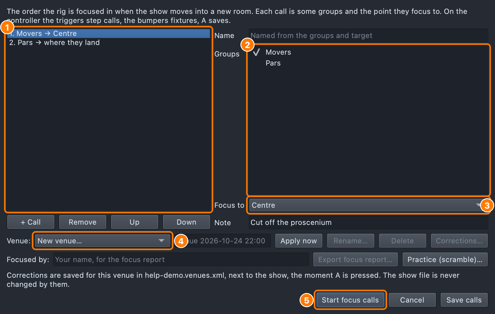
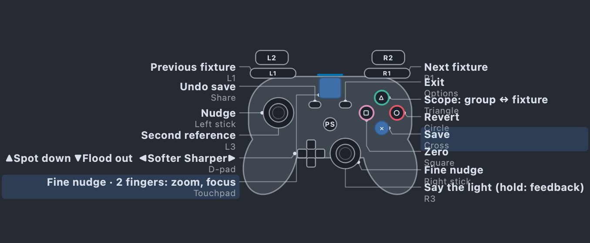
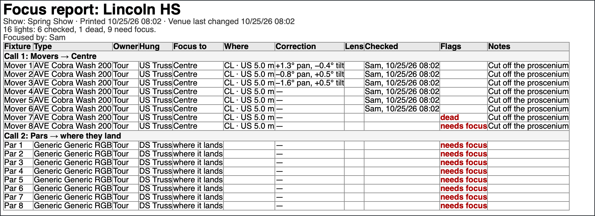
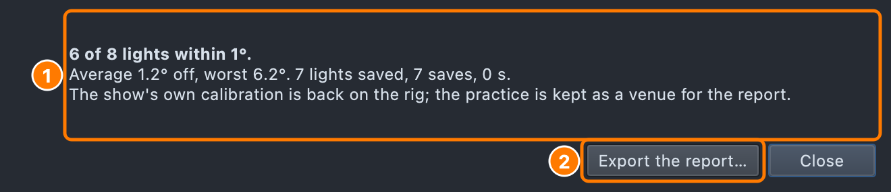

# Venue focus

Focusing the rig when the show moves into a new room, call by call, with
the controller in your hand on the stage.

A **focus call** is some fixture groups and the point they focus to —
"DH Tspots → DSC", then "AT spots → Soloist DS". The show keeps its calls,
in order, so every venue is focused the same way. **Venue focus** runs
them: [Quick focus](lighting-studio.md#quick-focus) a call at a time:
the lights of the call come up aimed at their point, you step through
them and nudge each until it lands, and **A** saves the correction **for
this venue** — never into the show.

## Setting up the calls

Everything for focusing is on the Lighting Studio toolbar's **Focus ▾**
menu (see [The Focus menu](lighting-studio.md#the-focus-menu)). **Focus ▸ Edit
focus calls…** opens the list.

- **+ Call** adds one; **Up** / **Down** set the order they are run in;
  **Remove** takes one out.
- **Groups** — tick the fixture groups the call focuses. Their fixtures
  are worked in stage order (front to back, then house left to right).
- **Focus to** — a stage target (see [Stage targets](stage-targets.md)),
  or **Where they land** for fixed lights, which are focused by moving
  where their beam lands (see
  [Fixed lights](lighting-studio.md#fixed-lights-pars-and-fixed-spots)).
- **Name** — optional; without one the call is named from its groups and
  target ("DH Tspots → DSC").
- **Note** — a word for the crew, shown on the panel while the call runs
  ("cut off the proscenium").

**Save calls** keeps them in the show (they are saved with it).

**No calls yet?** Venue focus, and a venue focus cue, build them for you
from the show's own targets: one call per stage target that a layer in
any cue list or hit aims at (an Aim look, or a line aim), with the groups
whose layers aim there, every owner (tour, house or rental), named "From
the show: DH Tspots → DSC". They are rebuilt each time you start while you
have not changed them, appear in **Edit focus calls…**, and are saved with
the show only when you edit them or press **Save calls** (starting does
not save). A light no layer aims at a target is in no call: it still gets
its correction through calibration (the venue's pan/tilt offsets, a
Quick focus). When there is nothing to build from, the cue page and the
greyed buttons say so: no calls and no aimed layers, or the calls' groups
are empty.

1. The calls, in the order they are run.
2. The groups the selected call focuses.
3. The point they focus to.
4. The venue the corrections are saved for (see below).
5. Start runs them.

## Venues: corrections that stay with the room

What you correct in a venue belongs to that room, not to the show. Choose
the **Venue** before you start:

- **New venue…** — type its name ("Lincoln HS"), or leave it empty and it
  is named with the date and time ("Venue 2026-10-23 19:04"). On a tour,
  **Start from Lincoln HS** (ticked by default, naming the venue changed
  last) copies that room's corrections, trims and targets into the new
  one: a yoke bolted a little round is still round in the next room.
  Untick it to start from the show's own.
- **An existing venue** — its corrections are put back on the rig, and you
  carry on from them.
- **None** — saves go into the show's own calibration, as Quick focus
  does.

**Apply now** puts the chosen venue on the rig without starting the calls
(listing its clashes first: see [The clash check](venues.md#the-clash-check)).
The **venue menu** does the same from anywhere: click the **Venue** chip
in the footer, or **View ▸ Venue…**, or **Focus ▸ Venues** on the
Lighting Studio toolbar (all three open the same menu; see [The venue
chip](venues.md#the-venue-chip)): **Switch venue ▸** a venue (or None),
**New venue…**, **Rename…**, and **Rig and universes…** for the venue
applied. **Rename…** and **Delete** in this dialog rename or forget a
venue and its corrections; the show is not changed. A venue needs a saved
show: until the show has been saved, the dialog says "Save the show
first".

A venue's corrections are kept in a file **next to the show**, named after
it: `Spring Show.qlcc` keeps them in `Spring Show.venues.xml`. Every **A**
writes that file at once, so quitting or a crash loses nothing. The show
file is never changed by them: while a venue is applied the rig shows its
corrections, and **File → Save** still writes the show's own calibration.
When the show is opened again, the venue it was last focused for is
applied again.

**Any calibration change is the venue's while it is applied.** A pan or
tilt offset typed in the fixture's properties, a fixed light's aim or a
lens set by hand goes into the venue and its file at once, not into the
show. (A Quick focus nudge goes in when it is saved with A.) Typed back to
the show's own value, the venue's correction for it goes. With **None**
applied, those edits change the show as always. Choosing another venue (or None) takes one venue's
corrections off and puts the other's on.

The venue file holds, per fixture: a moving head's pan and tilt offsets,
a fixed light's aim (its pan and how far down it points), a lens zoomed
by hand, and which fixture type and mode it was. It also holds the room's
**truss trims** and **target positions** (below).

**Still at the venue?** When you open a show whose applied venue was last
changed more than 20 hours ago, the laptop asks "Still at Lincoln
HS?" (until you answer, the footer's chip says **Venue: Lincoln HS?** and
its menu starts with **Still at Lincoln HS?…**, which asks again):

- **New venue** (the default): name it, or leave it empty for the date.
  Its corrections start from the show's own; Lincoln HS's are kept.
- **Still at Lincoln HS**: carry on with it.
- **None**: the show's own calibration.

The answer shows on the chip: **Venue: Lincoln HS** (its tooltip:
"Confirmed: you are at Lincoln HS."), the new venue, or **Venue: none**.
The Venue Focus dialog does not pick an old venue for you either: until
it is confirmed, **New venue…** is chosen, with a note naming the old
one.

**A fixture that changed.** A correction remembers the fixture's type and
mode. If the light is now another fixture (a lamp swapped for a mover,
another mode), its correction is not applied: the light **needs focus**.
The focus panel says so on it, the plot shows an orange **!** on it,
and the focus calls say "Needs focus: the fixture changed." Focus it and
save: the venue then keeps it as it is now. A correction for a fixture
deleted from the show is kept (it may come back) and listed. A venue
file from before types were kept is applied as it is, with a note once.

**Trims and targets.** A room's pipes hang at other heights and its marks
sit elsewhere. With a venue applied, trimming a truss or moving a stage
target (in the Lighting Studio, or with the target page below) goes into
the venue's file, never the show's. **None** puts the show's own back.

**Seeing and clearing one.** **Corrections…** beside the venue lists the
applied venue's corrections: each light (needs focus, dead, or no longer
in the show, marked), each trim and target. **Clear** puts the one you
pick back to the show's own (a dead light: not dead).

**The file travels.** **File → Collect for Transfer…** copies the venue
file with the show. When you open a show that has no venue file of its
own, but one beside it belongs to the same show under another name (an
earlier version: `DanceHysteria-0.5.venues.xml` beside
`DanceHysteria-0.6.qlcc`, or a Finder copy), the laptop offers to use its
venues. The other file is not changed.

**What the room owns.** A venue can also keep the room's own lights (its
house rig), the outputs of each universe in that room, and the channels
the house desk keeps for itself. See [House rig and tour
package](venues.md).

## Running venue focus

**Focus ▸ Venue focus…** on the Lighting Studio toolbar, or **Venue
focus…** on the Run tab, runs the calls for the venue applied. With no
venue applied it opens the list first, so you say which room this is
before anything is saved. In the list, **Start venue focus** runs them.
Both are greyed until there is something to focus, and the tooltip says
why: no focus calls yet, or none with a light placed on the plot.

The first call comes up: its fixtures aimed at
their point, the first one lit and the rest of the call dimmed. The panel
says the call ("Call 2 of 5: AT spots → Soloist DS") and its note, which
fixture, the scope, and where saves go.

1. The call being focused, and its note for the crew.
2. One fixture or the whole call (Y), and where saves go.
3. The controller, labelled with what each control does here.

| Do | Controller | Keyboard |
|---|---|---|
| Next / previous focus call | RT / LT | PgDn / PgUp |
| Next / previous fixture | RB / LB | ] / [ (or Tab / ⇧Tab) |
| One fixture / the whole call (scope) | Y | G |
| Nudge (coarse, fine) | Left stick, right stick | Arrows (0.1°; ⇧: 1°) |
| Step size ×10 / ÷10 | — | + / − |
| Spot down / flood out (zoom) | D-pad up / down | , / . (⇧: 5°) |
| Sharper / softer (focus) | D-pad right / left | ' / ; (⇧: a bigger step) |
| Save for this venue | A | Return |
| Back to what was saved | B | Backspace |
| Zero | X | 0 |
| Undo the last save | View (on release) | ⌘Z |
| Target page: move this call's target | LS (left stick click) | T (or R) |
| How many are not saved | View + RS | N |
| Say the light | RS (right stick click) | W |
| Feedback: lights / voice / both | RS held | ⇧W |
| Save every light not saved | A held | ⇧Return |
| Every light not saved back to its last save | B held | ⇧Backspace |
| The next light not saved | LB + RB together | U |
| Mark this light dead (or not) | View + X | D |
| Hold every light where it is (again: release) | Both stick clicks | H |
| Go to a light | Click it on the plot | |
| Leave | Menu | Esc |

Held, a D-pad arm keeps zooming or focusing until you let go; the
bumpers and triggers step once a press. **A** must be held for a full
second to save every light (a press saves just this one). **View** undoes when you let it go, so View + RS (how
many are not saved) does not undo.

**X** puts a light back to the show's own calibration while a venue is
applied ("Back to the show's calibration."), not to zero.

**B held** puts back every light not saved, in any call ("3 lights back
to their last save."). It is one step: **View** brings them all back,
still not saved. **A held** is its mirror: every light saved.

**Spot down, flood out, sharper, softer.** The D-pad speaks the crew's
words: up spots the beam down (narrower), down floods it out, right
sharpens the edge, left softens it. The voice says the word once a press,
where the light has a zoom or a focus.

**The focus look** is the bare beam: open white, the shutter open, and
the gobo, prism and frost out (where the fixture says which values do
that), so the edge you focus is the beam's own.

**Holding.** Click both sticks together and every light holds where it
is: nothing on the controller moves anything, nothing blinks or breathes.
The voice says "Holding."; the panel says HOLDING. Click both again (or
press H) and it says "Released." Use it to walk to the light, talk to the
crew, or hand the pad over. The left stick click (the target page) acts
when you let it go, so the two clicks can be pressed together.

**A dead light.** A lamp out, a light that will not move: **View + X**
(or D) marks it **dead** in the venue ("Spot 3 marked dead."); with no venue
applied it is refused ("Apply a venue to mark a light dead."). The panel
and the plot mark it, the Corrections list shows it, and the focus report
lists it. Again marks it not dead.

**Going to a light.** Click a light on the plot and the calls go to it:
its call, that fixture.

**The target page.** Press the left stick (or T) and the stick moves the
call's **target** instead of the light: right is across the stage, up is
upstage. Every head aimed at it follows, like a focus palette on a
lighting desk. **A** keeps the target (for the venue applied, else in the
show), **B** puts it back. Leaving the page or stepping calls with a move
not kept is refused until you choose.

**While you nudge,** the panel says what has changed since the light was
last saved ("Since the save: +2.5° pan, −1.0° tilt") and the plot shows a
dashed ghost where the saved focus lands. **A save** says the light
and where it went ("Saved fixture 3 to Lincoln HS.") and makes the pad
buzz (a pad read through Apple's GameController framework on a Mac, Xbox
or PlayStation) — twice if another light is still unsaved. **Leaving** with lights unsaved says how many ("2 lights not
saved.") before the panel asks.

**The lamp** is colour-blind safe: **blue** with a tick, all saved;
**yellow** with "!", this light; **orange**, another light. The number not
saved is on its rim. While the light you are on is not saved, it
"breathes" slowly on the rig (with lights feedback).

**The pad's light bar** follows the panel's lamp. On a Mac this goes to
pads read through Apple's GameController framework: a PlayStation pad
(DualShock 4 or DualSense) shows the lamp's colour on its light bar and
buzzes on a save. An Xbox pad has no coloured light, so you see the lamp
only on the panel. A PlayStation pad's controls are called by their own
names everywhere: see [On a PlayStation pad](#on-a-playstation-pad).

**The whole call** (Y): a nudge moves every fixture of the call by the
same amount — the truss came in a little low — and **A** saves them all,
one undo step. A bumper picks one fixture again.

## On a PlayStation pad

A DualShock 4 or DualSense works the same as an Xbox pad: each button
does the same job in the same place. The panels, the map, the warnings
and the voice use the pad's own names ("Cross to save, Circle to
revert"). This guide uses the Xbox names, so here is the same pad in
PlayStation words:

| Xbox | DualShock 4 | DualSense | What it does in the focus tools |
|---|---|---|---|
| A | Cross ✕ | Cross ✕ | Save (keep) |
| B | Circle ○ | Circle ○ | Revert; held, every light back |
| X | Square □ | Square □ | Zero |
| Y | Triangle △ | Triangle △ | The scope: one fixture or the whole call |
| LB / RB | L1 / R1 | L1 / R1 | Previous / next fixture |
| LT / RT | L2 / R2 | L2 / R2 | Previous / next call (Focus this cue: layer) |
| LS / RS (stick clicks) | L3 / R3 | L3 / R3 | Second reference / say the light; both at once hold every light |
| View | Share | Create | Undo the last save |
| Menu | Options | Options | Leave (and start a venue focus cue) |
| Xbox button | PS button | PS button | Switch the pad on |
| (none) | Touchpad | Touchpad | Fine aim, zoom and focus (below) |

The pad is recognised from its make and model, so a DualSense says
**Create** and a DualShock 4 says **Share**.

**The touchpad** (on a Mac) works like a laptop's trackpad:

- **One finger** dragged nudges the light by how far you drag, not how
  long you hold. A drag across the whole pad is about 4° of pan. Use it
  for the last fraction of a degree, after the sticks. On the target
  page it moves the target instead.
- **Two fingers** dragged up or down zoom (up is spot down, as D-pad up).
  Dragged left or right they focus (right is sharper, as D-pad right).
  Each drag does one thing, chosen by which way it moves first, and the
  voice says it once ("Spot down.").
- **A click** says the light, as R3 does. It never saves or reverts: a
  firm drag can click the pad by accident.

Nothing moves until a finger has travelled a little, a resting finger
doesn't creep, and the pad is ignored while every light is held. An Xbox
pad has no touchpad: its right stick (fine nudge) and the D-pad do the
same jobs.

## The focus report

**Focus ▸ Focus report…** (for the venue applied), or **Export focus
report…** in the list (below the venue, beside **Focused by:**), writes
what was focused in the venue, light by light and call by call:

- the call, the fixture, its type, whose it is (Tour, House or Rental)
  and where it hangs;
- where it focuses to, with the target's place from the stage marks
  ("SL 2.4 · US 3.1 m");
- the correction from the show's own calibration ("+1.3° pan, −0.4°
  tilt"), and a lens set by hand;
- who checked it and when (every save notes it), and the call's note;
- the flags: **dead**, **swapped** (not the fixture focused there), and
  **needs focus** (not checked here yet, or swapped).

Type your name in **Focused by:** once; this computer remembers it.
Choose the kind of file by its ending:

- **PDF** to print or hand in (landscape, one table);
- **Web page** (.html) to open in a browser;
- **CSV for Lightwright**: one line a light, in Lightwright's column names
  (Purpose, Position, Unit#, Instrument Type, Address, Focus…, Owner).

The report also lists the lights corrected outside the calls, and the
room's trims and targets.

## Practice: scramble and focus back

For the classroom, and only in a [Teaching mode](teaching.md) show (File ▸
Show Settings…): without it the scramble is not offered. A **scramble** knocks every moving head in the focus
calls off its target by a random amount of pan and tilt. You focus them
back, call by call, as you would in a new room, and you are scored on how
many degrees off each light ends up, how long it takes and how many saves
you make. Your real venues are never touched.

**Focus ▸ Practice (scramble)…** (or **Practice (scramble)…** in the list)
says this, asks how far off (easy 1–3°, medium 2–6°, the default; hard
4–10°), then scrambles the heads and starts the calls. Focus each light
back onto its target and save it. It is greyed, saying why, until the
show has focus calls with moving heads placed on the plot, and has been
saved.

- It is a **practice venue** of its own ("Practice 2026-10-24 19:30"):
  the real venues are not changed, and the one you were in comes back when
  the calls end. It takes that room's trims, targets and house rig with
  it, so the room's own lights are there too; its house movers are
  scrambled and scored like the tour's. The show must be saved first.
- On the **real rig** the lights are really off. On the **visualiser**
  the beams are drawn where the scrambled lights land, so the drill works
  with no rig at all.

1. The score.
2. The focus report of the practice, with each light's error.

- When the calls end you get the score: how many lights are within 1°,
  the average and worst error, how many were saved, the saves, and the
  time from the start to the last save. **Export the report…** gives the
  focus report of the practice, with the score and each light's error:
  the hand-in for the focus lesson.

## A venue focus cue (pre-show)

Put the focus at the top of a pre-show cue list, so the list and the focus
are one checklist:

1. Make a cue for it (its looks are the preset: work light, or the first
   call's lights parked at their point) and tick **Make this a venue
   focus cue** on its cue page (or choose it from the **Focus ▾** menu in
   the cue page's header, or in the Workbench's header). The F column
   says **focus**. It is greyed, saying why, until the show has focus
   calls.
2. **GO** onto it in Operate. The cue's looks play and the focus calls are
   **armed**: nothing moves yet. The laptop says "Venue focus ready.
   Press Start to begin." and the cue page, the Run tab and the footer say
   **Venue focus: waiting for the controller**.
3. When the crew is ready, press **Start** (Menu) on the controller — or
   **Start venue focus** on the Run tab, or **⌘↩** (GO's key: while the calls
   wait, it begins them rather than going on). The first call comes up,
   blinking, as the voice says it. First the laptop confirms the venue
   (for a show that has been saved: a venue lives beside the show file): "Still at Lincoln HS? Answer on the laptop, or wait for a new
   venue." (with none applied: "Name this venue on the laptop, or wait
   for today's date."). Press **Still at Lincoln HS**, or type a name and
   press Return (**New venue**); after 8 seconds a new venue is made, named with today's
   date, so an old room is never corrected by mistake. Typing holds the
   clock.
4. Work the calls as below. **Menu**, or **RT** on the last call, ends
   them (asking about anything unsaved) and the list goes on to the next
   cue — only if it is still on the focus cue. Ended any other way (say,
   Focus this cue started), the voice says "Venue focus ended." and the
   list stays where it is.

Starting Quick focus, Venue focus or Focus this cue while another of them
has work not saved is refused, saying what to do first; nothing is thrown
away.

## Telling the operator where they are

Whoever holds the controller is on the stage, looking at the rig, not the
screen. Two things tell them where they are:

- **The lights.** On every change — a call, a fixture, the scope — what
  is picked blinks three times (120 ms on, 120 ms off) and then stays
  lit; the rest of the call stays dim.
- **The laptop's voice.** It says where you are, briefly. Feed the
  laptop's output to the crew's headsets and it is their cue. A line is
  never spoken over. **The voice waits until you stop moving**: when you
  step through lights it says only where you stopped, a moment after you
  stop, not each light you passed (see **Waits** below). Confirmations
  ("Saved fixture 3.") and warnings are never held back and never
  dropped. **Voice to:** in
  the Venue Focus dialog (on a Mac) sends it to a chosen output (an audio
  interface for the headsets, say); **The system's output** is the
  default, and a chosen output that isn't connected stays chosen, marked
  *(not connected)*. When that output is not there (a
  controller unplugged, asleep or on Bluetooth), the voice speaks on the
  computer's own output instead, and the first line says so; nothing is
  lost. Two outputs with the same name (two "Wireless Controller" pads)
  are told apart by ID.
  - stepping to a call: "Call 2, AT spots to Soloist DS. Fixture 1,
    Spot 5."
  - a fixture: "Fixture 3, Spot 3."
  - the whole call: "All 4, group."
  - A: "Saved fixture 3." (with a venue: "Saved fixture 3 to Lincoln
    HS."); A held: "Saved all, 6 lights."; B: "Fixture 3 reverted.";
    B held: "Reverted all, 3 lights."; X: "Zeroed." (with a venue: "Back
    to the show's calibration."); View: "Undone."
  - the D-pad: "Spot down." "Flood out." "Sharper." "Softer."
  - **Say the light** (right stick click, or W) says the light's name
    first and then where you are — "Spot 3. Call 2, AT spots to DSC.
    Fixture 3." — and blinks it.

**Voice detail: terse, standard or verbose.** Beside **Feedback** on
every panel, **Voice** sets how much is said (one setting for Quick focus,
Venue focus and Focus this cue, kept with Feedback on this computer):

| | Terse | Standard (the default) | Verbose |
|---|---|---|---|
| A fixture | "F1 Spot 3." | "Fixture 1, Spot 3." | "Fixture 1 of 8, Spot 3." (with the call) |
| A call | "Call 2." | "Call 2, AT spots to Soloist DS." | "Call 2 of 5, AT spots to Soloist DS, SL 2, US 1." |
| A save | "Saved." | "Saved fixture 1 to Lincoln HS." | "Saved Spot 3 to Lincoln HS." |
| A held | "Saved all." | "Saved all, 6 lights." (in a venue: "Saved all to Lincoln HS, 6 lights.") | as Standard |
| B / B held | "Reverted." / "Reverted all." | "Fixture 1 reverted." / "Reverted all, 3 lights." | "Spot 3 back to its last save." / "3 lights back to their last save." |
| Say the light | "Spot 3." | "Spot 3. Fixture 1." | "Spot 3. Call 2 of 5, AT spots to DSC, CL, US 3. Fixture 1 of 8." |

**Waits: Off, 250, 400 or 700 ms.** Beside **Voice**, how long the voice
waits after your last step before it says where you are (400 ms by
default, this computer's). Hold a bumper through eight lights and you
hear only the one you stopped on. If it was still saying an older
"where" line, that line is cut off: it is out of date. Nothing else is
held or cut. A save, a warning and **Say the light** are said at once.
So are a tool's first line and stepping to a new call. A warning cuts
off a "where" line being said, so "Controller lost" never waits behind
"Fixture 3 of 8". **Off** speaks on every step, as before, and never
cuts a line.

Warnings and safety lines — the controller lost or back, holding, a
light not saved, a refusal, nothing reaching the rig — are said in full
at every level. The panel shows the last line confirmed ("Saved all, 6
lights.") under the light's numbers.

**Feedback: lights, voice or both.** The **Feedback** setting on the panel
(Quick focus, Venue focus and Focus this cue share it; it is this computer's, not
the show's) picks how you are told:

- **Lights and voice** (the default): the blinks and the voice.
- **Lights only**: the blinks (and the panel's lamp); nothing is said.
- **Voice only**: the voice; the rig is not blinked.

**Say the light** speaks whichever it is — you asked. Hold the right stick
click (or press ⇧W) to switch; the voice says the new one ("Feedback:
lights only.").

**Important lines are always spoken,** in Lights only too, and the rig
gives a slow long blink and the pad one long buzz (a save is a quick
double blink and a short buzz; holding every light gives the long buzz,
letting go a short one):

- warnings and refusals ("Spot 3 not saved.", "This call has no target
  to move.");
- the venue asked;
- **the controller lost**: if the pad drops out (asleep, unplugged,
  flat), everything it held is let go — the sticks, a held button — so no
  light drifts and no hold fires: "Controller lost. Lights held." The
  panel switches to the keyboard. When the pad is back the voice says
  "Controller back." and it drives again by itself (in Quick focus and
  Venue focus, once the keys are still; with Keyboard chosen, the panel
  says to click **Use the controller**). Focus this cue takes it back at once.
  A tool started with no pad at all says "No controller connected. Using
  the keyboard." The keys work all the while;
- **nothing reaching the rig**: Blackout on, the Grand Master at zero, or
  the light's universe with no output ("Spot 3's universe has no output:
  it shows nothing.");
- **another pad**: with two pads, the first to press Start (or, for a
  tool started on the laptop, any button) has the controls; the other is
  ignored and told "Another controller is in use." The panel names the
  pad that has it.

The voice is the Mac's own (`say`); on Linux `spd-say`, elsewhere Qt's
speech, if the computer has one. [Focus this cue](refine.md) speaks the same way.
