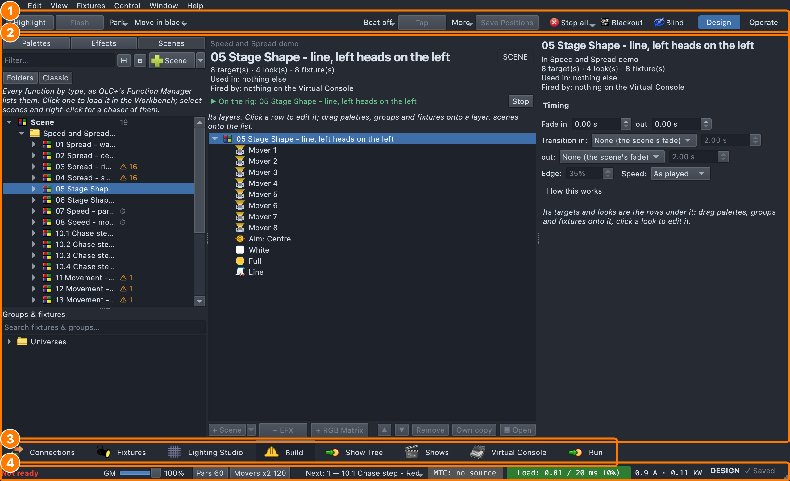
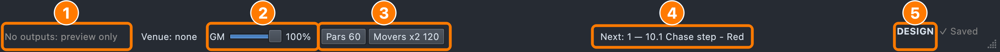

# Getting started

This guide walks through starting qlcconsole and the ways a show usually
comes together — from an empty workspace, from a patch you already have, and
from a show file you're bringing to a venue. Each step links to the guide
with the detail.

Press **F1** anywhere for the help on what you're looking at; **Help ▸
qlcconsole Help** opens this guide set. The numbered pictures are shrunk to fit the
page — click one to see it full size.

## Starting the app

Open **qlcconsole** like any app. A small window shows what it's loading
(fixture definitions, plugins, the workspace), then the main window
opens.

From a terminal:

```
qlcconsole -o path/to/show.qlcc     # open a show
qlcconsole -o show.qlcc -p          # open it straight into Operate mode
qlcconsole -k -o show.qlcc          # kiosk: Virtual Console only, operate mode
qlcconsole -w                       # also serve the web interface (port 9999)
qlcconsole -h                       # every option
```

Always pass the show with **-o**. A bare file name on the command line is
not opened — and saving then can write an empty workspace over it.

### Show files

- **.qlcc** is qlcconsole's own format, and what **Save** writes.
- **.qxw** (stock QLC+) opens fine; save it as .qlcc to keep everything this
  fork adds (the rig, palettes, looks, power profiles, layers…).
- **Autosave** writes a recovery copy every 5 minutes while there are
  unsaved changes (**Settings ▸ General ▸ Autosave** sets it on or off and how
  often). If the app stops without saving,
  the next launch offers to **recover the unsaved work**. A clean quit
  removes the recovery copy.
- A .qlcc **carries its own copies** of every fixture definition, effect
  script and RGB script it uses that isn't part of the app, so it opens
  complete on another computer; where that computer's copy differs, the
  show keeps its own until you choose. See
  [Opening a show on another computer](fixture-manager.md#opening-a-show-on-another-computer).
  **File ▸ Collect for Transfer…** writes the show and those files into one
  folder.
- This computer also keeps a copy of every non-shipped definition a show
  uses — the **show cache** — for shows saved as .qxw. See
  [Missing definitions and the show cache](fixture-manager.md#missing-definitions-and-the-show-cache).
- A show kept in a **cloud folder** (iCloud, Dropbox, Synology…) is saved
  safely; see [Cloud storage](other-improvements.md#cloud-storage).

## Finding your way around



1. **The top bar** — one row. On the left, the open tab's own tools (here
   Build's Highlight, Flash, Park…); in a narrow window, what
   doesn't fit is under **»**. On the right, the show controls:
   **Stop all** (the panic button; hold it for **Fade and stop**),
   **Blackout**, **Blind**, and the **Design | Operate** switch, the mode
   you are in lit. **Blackout** lights red and **Blind** blue while they
   are on.
2. **The open tab** — here Build, with a scene open.
3. **The tabs**, along the bottom.
4. **The footer** — is the show ready to run, how busy the output is, Design
   or Operate (below).

**Settings ▸ General ▸ Show Controls** can put the show controls in the status bar
instead, at its right end beside Ready and the other show chips: the top
is then the tab's own tools alone. It changes at once, no restart, and the
shortcuts are the same either way (⌘⇧Esc Stop all, ⌘F12 Design / Operate).
There, they are icons only (their tooltips name them) unless
**Settings ▸ Appearance ▸ Toolbar style** is **Text only**, and the footer's own DESIGN and
BLACKOUT chips step aside for them. A tab moved to a window of its own
keeps its tools at its own top.

The tabs follow the order a show is built in:

| Tab | What it's for | Guide |
|---|---|---|
| **Connections** | How the console is wired: protocols, interfaces, the universes they carry, what each universe is sending | [Connections & patch](other-improvements.md#connections--patch) |
| **Fixtures** | The fixtures in the show, the inventory, groups and their head layouts, patching | [Fixture Manager](fixture-manager.md) |
| **Lighting Studio** | The physical rig: structures, where every fixture hangs, the network, the 3D Rig Overview | [Lighting Studio](lighting-studio.md) |
| **Functions** | Every function by type, as in QLC+ (Classic QLC+ and Everything views only) | [Coming from the Functions window](build.md#coming-from-the-functions-window) |
| **Build** | Scenes built from looks, looks built from palettes and effects | [Build Tab](build.md) |
| **Show Tree** | A show as one tree: cue lists, cues and the layers in them; the scenes and chaser are made for you | [Show Tree](show-tree.md) |
| **Shows** | The timeline: tracks, sequences, cues, timecode | [Shows](shows.md) |
| **Virtual Console** | The operator's surface | stock QLC+ |
| **Simple Desk** | Raw channel faders | stock QLC+ |
| **Run** | The operator's full-screen cue runner | [Show Tree](show-tree.md#the-cue-runner) |

Which of these you see depends on the view (below).

### Views

**View ▸ Workspace** picks which tabs the main window shows:

- **qlcconsole** — eight tabs, in show order: Connections, Fixtures,
  Lighting Studio, Build, Show Tree, Virtual Console, Simple Desk and Run.
  Shows and Functions are in Everything (**Window** switches there for
  them, with a line to come back). The **Rig Overview** (⇧⌘R) opens in its
  own window, kept in front of the main window.
- **Classic QLC+** — the QLC+ tabs in QLC+'s order and names: Fixtures,
  Functions, Shows, Virtual Console, Simple Desk, Inputs/Outputs (the
  Connections tab), with QLC+'s toolbars: the main one (New, Open, Save,
  Save As, the Rig Overview as QLC+'s Monitor, the address tool, help, dump,
  live edit) and the Fixtures and Functions tabs' full rows of buttons. The
  footer shows only the mode, the Grand Master and Ready.
- **Everything** — every tab.

A view only shows and hides tabs. The show itself doesn't change, and
nothing on a hidden tab stops working. The view is saved with the show: it
marks the show changed, but it isn't an undo step. QLC+ ignores it when it
opens the file. A show saved without a view opens in **Classic QLC+** if
it is an old QLC+ show with no Show Tree, and in **qlcconsole** otherwise.
A new show, and the first launch, start in **qlcconsole**. **View ▸
Workspace** is the one place to change it.

Choosing a tab the view hides (from **Window** or a link such as *Open in
Build*) switches to **Everything**. A line above the tabs says so and has
a button to go back. A tab broken out into its own window stays there
when the view changes. If the new view hides that tab, closing its window
puts it away instead of back on the tab bar. After **File ▸ Upgrade This
Show…** gives a Classic QLC+ show a Show Tree, a line above the tabs
offers the **qlcconsole** view, once.

**Window** lists the view's tabs in their order, numbered as you see them:
⇧⌘1 is the first tab on screen, ⇧⌘2 the next, and so on (⇧⌘0 the tenth).
Change the view and the numbers follow it; in the qlcconsole view
Connections is ⇧⌘1, the Show Tree ⇧⌘5 and Run ⇧⌘9, in Classic QLC+
Fixtures is ⇧⌘1. The tabs the view hides are listed after them, with no
shortcut. Shift-click
a tab to break it out into its own window; Window brings it back.
**Functions** (QLC+'s Function Manager — chasers, EFX, RGB matrices,
scripts, audio, video) is the stock tab in the Classic QLC+ and Everything
views; **Window ▸ Functions** opens it, switching view from qlcconsole.
Build edits any of them in the Workbench. **View ▸ Rig Overview** (⇧⌘R) opens the whole rig
in 3D.

**Design and Operate.** In **Design** mode (the default) you build: the
open scene plays live so you can see it, and nothing runs that you didn't
start. **Operate** (⌘F12) runs the show for real — and locks the editing
that would disturb it (moving fixtures, re-patching). The mode shows in
the footer.



1. **Ready** / **Not ready (N)** — click it for the list. With nothing
   patched to an output it reads **No outputs: preview only**, in grey.
2. **GM** — the grand master, over everything that's sent.
3. **Speed masters** — one button per master the show uses, showing its
   tempo; click one to set it
   ([Speed masters](effects.md#speed-masters)).
4. **Next:** — what the main cue list's GO (⌘↩) plays next; click for
   GO, Back and loading another cue
   ([Show control](show-control.md#whats-next-and-go-from-anywhere)).
5. **MTC** — the timecode the Shows timeline follows.
6. **Load** — how much of each DMX tick the show uses.
7. **DESIGN** / **OPERATE** — click to switch.

**The footer** says whether the show is ready to run: **Ready**, or **Not
ready (N)** in red — click it for the list (unpatched or clashing
fixtures, universes going nowhere, missing definitions, WLED devices that
don't answer or aren't set up for the show…), each with its fix. Beside it,
**Load** is how much of each 20 ms DMX tick the show is using; **MTC** is
the timecode source. See
[Readiness footer](other-improvements.md#readiness-footer).

## Workflow 1 — a new show, designing first

The way a show is usually planned: decide the rig, then patch it. Nothing
needs an address until the end.

1. **Stock the inventory.** Fixtures tab → **Add to inventory**: the
   fixtures you have or will hire, with no address yet. They're real
   fixtures — you can place, group and program them; they just don't send
   DMX. ([Inventory](fixture-manager.md#inventory-design-the-rig-before-patching))
2. **Build the rig.** Lighting Studio → **Add**: trusses, towers,
   platforms and steps, pipes and stands, hangers, scenery (cyc, drapes,
   walls), fountains. Double-click any of them for its editor.
   ([Stage structures](lighting-studio.md#stage-structures))
3. **Put the fixtures on it.** Drag them from the **Inventory** panel onto
   a truss, tower or deck — they mount where you drop them. To move a
   fixture already on the plot onto a structure, **hold Shift as you drop**
   (a plain drag only moves it); a row of fixtures on a set of steps goes
   on with **Mount on → Deck → The deck under each**. Set **Orientation**
   (upright / hung) for anything that pans or tilts.
   ([Mounting a fixture](lighting-studio.md#mounting-a-fixture))
4. **Check it in 3D.** **⇧⌘R** — the Rig Overview. Hide layers in the
   Plot layers panel to see past things; the overview follows.
5. **Draw the network** (optional). **Add → Add Network Node** for each
   Art-Net/sACN node or wireless transmitter, where it'll really be rigged.
   ([Network nodes](lighting-studio.md#network-nodes-and-cable-runs))
6. **Patch.** Select the fixtures → **Patch…**: review the proposal (nearest
   node first, identical fixtures on contiguous addresses, one universe per
   network IP) and **Apply**. For a row of like structures — four towers,
   four step units — right-click one → **Patch Others Like This** so they're
   all addressed the same in their own universes.
   ([Patching](fixture-manager.md#patching-the-patch-dialog))
7. **Wire the universes.** Connections → right-click an interface → patch
   a universe to it. Select a universe to see what it's sending.
8. **Group the fixtures** for effects and looks: select on the plot →
   **Create Fixture Group from Selection**, or lay a group out from the
   stage. ([Groups](fixture-manager.md#creating-a-group))
9. **Mark the places that matter** — marks, a drum kit, a performer — as
   **Stage Targets**, so moving heads aim at them.
   ([Stage Targets](stage-targets.md))
10. **Build looks.** Build tab: make palettes (colour, dimmer, aim,
    effects…), load a scene in the Workbench and drag groups and palettes
    onto it; gather scenes, EFX and RGB Matrices into a collection.
    ([Build Tab](build.md))
11. **Check the footer** says **Ready**, then run it from Virtual Console,
    Simple Desk or Shows.

## Workflow 2 — the patch comes first

When the rig is already hung and the addresses are fixed (a house rig, a
hired rig with a patch sheet):

1. **Connections**: discover the interfaces and nodes (**Rescan** if one is
   missing), patch each universe out, name the universes.
2. **Fixtures → Add** each fixture at its address — or add them to the
   inventory and use the Patch dialog's **Place selected at universe /
   address** to lay a block in at once.
3. **Lighting Studio**: build the structures and mount the fixtures on them
   (drag from the plot with Shift held, or **Mount on** from the right-click
   menu) so aim, beams and the 3D view know where they are.
4. Carry on from step 8 of Workflow 1.

## Workflow 3 — bringing a show to a venue

1. **Open the show** (⌘O, or `-o`). A .qlcc brings its own definitions
   and scripts; if the footer says some **differ from this computer's**,
   **Review…** them. If it says definitions are missing, click it: they
   come from the show cache, your library, or can be repaired in the
   Fixture Editor.
2. **Connections**: are the nodes there? **Rescan**; check each universe
   goes where it should (**By universe** lists them in order with where
   each goes). Select a universe to watch what it sends.
3. **Check the footer** and work down its list.
4. **Test the rig.**
   - Fixture Properties → **Locate** flashes a fixture; **Test
     orientation** points a mover **straight up / down / out** (named for
     how it's mounted) or at a target, to check pan/tilt and calibration.
   - For LED-strip steps, a look with the **Step Test Pattern** effect
     shows each strip's number, each step's name and a spinner that stops
     if output freezes.
     ([Step Test Pattern](build.md#step-test-pattern))
5. **Power.** Fixtures that draw more than a circuit allows can be held to a
   maximum — measure them once and copy the profile to the same fixtures.
   ([A fixture's maximum draw](other-improvements.md#a-fixtures-maximum-draw))
6. Save under a new name for the venue.

### Importing into a show

**File ▸ Import** brings things from another file into the show that's
open, without replacing it (**Open** replaces it). Pick what kind of file
it is; each entry's file dialog shows only that kind:

- **From a show file**
  - **QLC+ / qlcconsole Workspace (.qxw, .qlcc)…** — pick the fixtures,
    groups, functions and palettes to bring in from another show. Clashing
    IDs and addresses are sorted out for you.
  - **ETC Eos Show (ASCII .asc)…** — see
    [Importing an Eos show](#importing-an-eos-show) below.
- **Fixtures &amp; patch**
  - **QLC+ Fixtures List (.qxfl)…** — the fixtures and groups of a list
    saved with **Fixtures ▸ Export fixtures** (**Fixtures ▸ Import
    fixtures** does the same).
- **Any Supported File…** — one dialog for all of them; the importer is
  picked by the file's extension, as the single Import used to do.

### Importing an Eos show

If the venue's rig lives on an ETC Eos-family desk (Element, Ion, Gio),
bring its show across instead of rebuilding it. On the Eos: **File ▸
Export ▸ USITT ASCII**. Here: **File ▸ Import ▸ ETC Eos Show (ASCII
.asc)…** and pick the `.asc`. The wizard goes through three pages:

1. **The show's files.** The `.asc`, plus any magic sheet XML exports
   (their channels land on the 2D map, a layer per sheet).
2. **Fixture types.** Each Eos personality and the fixture definition to
   patch it as. Your choices can be remembered for the next import, and
   a tick (on unless you take it off) brings the cue lists into the Show
   Tree.
3. **Special circuits.** Channels that aren't stage lights, read from
   their Eos labels: **Relay (power)**, **House**, **Work**, **Backstage /
   hall** (hall lights, backstage blues, stairs, exits) or **Normal**. The
   most specific word wins, so *Relay Linear House Lights* is a house
   circuit on a relay panel. Fix any row from its menu, or select several
   and **Set** them together. A channel with the Eos patch option *GM
   exempt* (`$$Options X`) is marked too.

What comes in: the patch, groups, palettes, presets, and each cue list as
a tracking cue list in the Show Tree. House and relay moves stay in the
cues, so the cue that brings the house up still does. The special
circuits come in with their
[output rules](fixture-manager.md#output-rules) set:

- **Relays**: Switch (relay), Ignore Blackout, Ignore the Grand Master,
  On when not in use. They come on when you switch to Operate; **Settings
  ▸ Advanced ▸ Output** (saved with the show) can make it when the show
  opens instead.
- **House, work and backstage**: Ignore Blackout, Ignore the Grand Master.
- **GM exempt** (`$$Options X`): Ignore the Grand Master.

The import report lists the rules each kind got. Each kind also gets a
group under **Eos** (**Power relays**, **House &amp; Work**,
**Backstage**). Each **sub** becomes a Playback fader on its scene,
labelled *Sub N label*, in a new Virtual Console frame **Eos subs**,
using the sub's up and down times. Bump
buttons, LTP and exclusive subs, effects and links aren't carried; the
import report lists everything that didn't come across.

## Workflow 4 — a row of like structures

Steps, towers and booms usually come in sets that should all be the same:

1. Build and rig **one** of them completely.
2. Copy and paste it (⌘C / ⌘V on the plot) for the others, or build them
   from a saved **Studio component**.
3. **Mount on → Deck → The deck under each** puts a selection of fixtures
   on their platforms' tops, upright, with nothing floating.
4. Right-click the first → **Patch Others Like This (N)…** and **Apply**:
   each fixture on the others gets the address of the one in the same place
   on the first, in its own structure's universe.
5. **Select All Similar** on a fixture picks every one of the same model,
   for setting a property (orientation, power profile) on all of them.

## Running the show

- **Operate** (⌘F12, or the top bar's **Design | Operate** switch) — the show runs; editing that would disturb it is
  locked, including programmer faders on the Virtual Console and the Shows
  timeline. The Grand Master still works. GO works in Design too, for
  trying a list out; the first time you press it there in a session, a
  line at the top offers **Switch to Operate**.
- **Overrides** — an amber footer chip lists anything holding the rig over
  the show (Park, Highlight, Hold at end, Focus mode, Blind); click it to
  clear them all.
- **Stop all** (⌘⇧Esc), or its menu's **Fade and stop** (hold the button),
  is the panic button.
- **From QLab**: QLab (or anything that speaks MIDI Show Control or OSC)
  can GO a chase's cues by number. See
  [Show control (QLab)](show-control.md).
- The Virtual Console, Simple Desk and Shows timeline work as in stock
  QLC+; the **Build** tab's tools have Highlight / Flash / Park, and
  the show controls Blind, for working on a running show.

### GO on the beat

A chase (and the cue list that plays it) can hold its GO for the music:
the chaser editor's **GO at once / GO on the beat / GO on the bar**. Press
GO a little early and the next cue lands on the next beat (or bar — four
beats) of the chase's speed master, or the main beat when it has none.
While a GO is waiting, the cue list's **Next** button turns amber; two
presses in one beat are still one cue. Starting a stopped chase waits for
the beat too. A chase played by the Shows timeline goes when the timeline
says, whatever this is set to.

## Keeping it quick

- On a big show (hundreds of fixtures, many universes, pixel effects), run
  a **release build** of the app — a debug build does the same work several
  times slower, and the screen lags behind.
- In the Rig Overview, **Quality: Fast** draws a frame in about half the
  time of **Smooth**, and hiding layers you don't need leaves less to draw.
- The footer's **Load** shows how much of each 20 ms DMX tick the show
  uses; as it nears the whole tick, the output can't keep time and starts
  to stutter.

## Where next

- [What's new](whats-new.md) — the latest changes.
- [Keyboard and mouse](shortcuts.md) — every shortcut.
- [Effects](effects.md) — what each built-in effect does.
- [Troubleshooting](troubleshooting.md) — when something isn't right.
- The [feature guide index](README.md).
