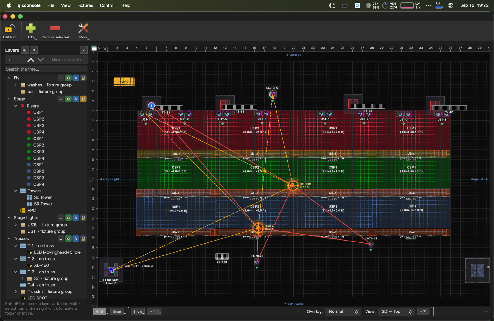
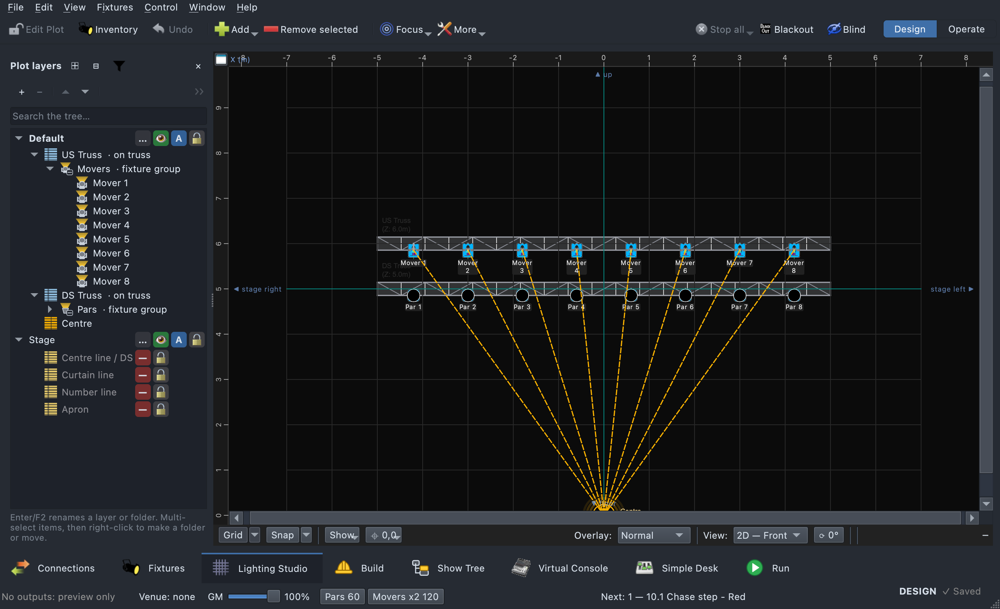
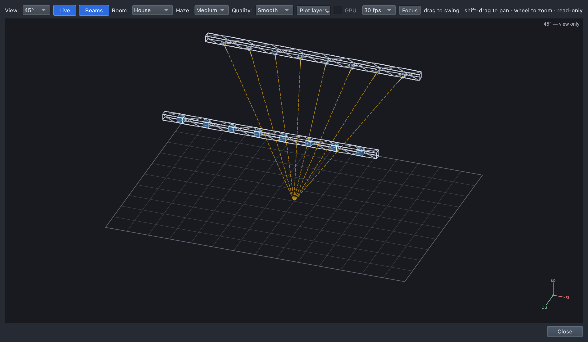
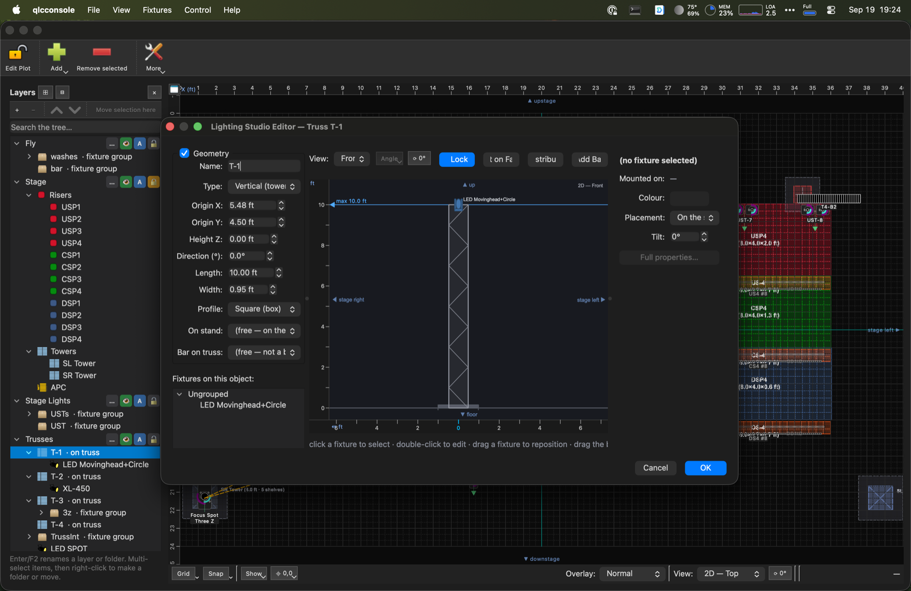
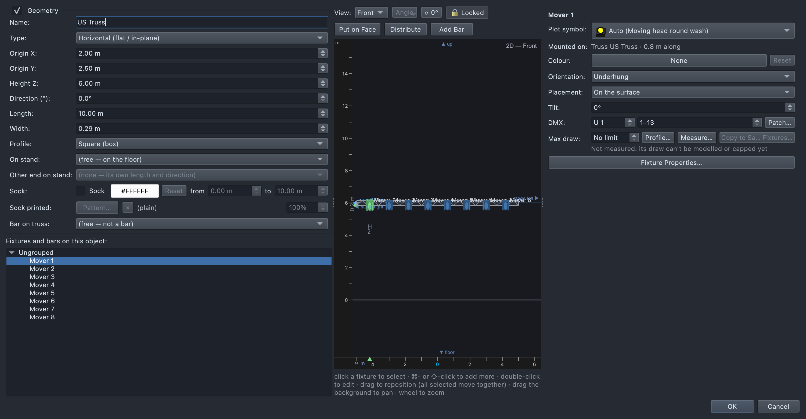

# Lighting Studio (the rig view)

## Why

Stock QLC+ only has a flat 2D plot — fixture icons on a grid. That can't
answer "what does this rig actually look like assembled," "is this fixture
really sitting on top of that platform," or "can this spot even reach that
mark from where it's hung." Lighting Studio is this fork's answer: a
dedicated structural view of the physical rig — trusses, towers, platforms,
pipes, stands — with fixtures mounted onto it in real 3D space, viewable
from Top, Front, Side, or a free 3D angle.

It's built and iterated against a real test rig over many rounds, each
driven by a specific real-world complaint and backed by a regression test —
the recurring lesson threaded through that history: *a mounting property
isn't really implemented until the model derives from it, the UI can set it,
**and** a test drives it end to end.*

## Opening it

- **Window → Lighting Studio** (⇧⌘3) opens the 2D plot with the Layers panel,
  where you build the rig and place structures/fixtures.
- **Double-click any structure** (truss, tower, pipe, stand, platform) opens
  its own dedicated editor — geometry fields, a live elevation preview, and
  everything mounted on it.
- **View → Rig Overview…** (Ctrl/⌘+Shift+R) opens a read-only,
  freely-rotatable 3D view of the *whole* rig at once — the fastest way to
  sanity-check a build. It's a window of its own: opening it leaves you on
  whatever tab you were on, rather than bringing the Lighting Studio tab
  forward. The same shortcut **closes** it when it's the window in front (if
  it's open behind other windows, it's brought forward instead); **⌘W**
  closes it too.
- **F1** anywhere in the Studio opens this guide in the in-app help.

## The four planes

| Plane | What it shows | Editable? |
|---|---|---|
| **Top** | Looking straight down — X/Y layout | Yes — drag fixtures/structures |
| **Front** | Elevation from downstage — X/Z | Yes |
| **Side** | Elevation from the wing — Y/Z | Yes |
| **Angled** | A free axonometric 3D view | View only — a screen point in a 3D projection has no single, honest 3D position to drag to |

### Top view — the plot you already know

Structures and fixtures on the familiar flat plot, plus (fork-specific) the
dashed and solid lines you can see radiating from fixtures to **Stage
Targets** — see [Stage Targets](stage-targets.md).

**Fixtures underneath things.** Looking straight down, every fixture is
drawn over every structure, so it can always be clicked. A fixture with a
truss, deck, pipe or tower top more than half a metre **above** it, over it
on the plan, is drawn **faded with a dashed grey outline** — underneath,
but still there to click. What it is mounted on never counts (a light hung
on a truss is not "under" that truss). Front and Side show heights, so
nothing is faded there.

**Rulers follow what you move.** While anything is selected — fixtures,
trusses, decks, scenery — the rulers band its extent; while you drag it,
the ruler mark sits at its **middle**, not wherever the pointer grabbed it.
So dragging a drape reads its centre line on the ruler.

### Front / Side — elevation, and count badges

An elevation view is where a rig's vertical assembly actually becomes
readable — towers standing up, trusses at their hung height, risers stacked.
It's also where a structure's own fixtures can visually bury it: a wall of
fixture icons on a truss makes the truss itself unclickable. When a
structure's mounted fixtures cover more than 40% of its on-screen footprint
*in the current view*, they collapse into a numbered blue **count badge**
(seen above on several risers) instead — click it to reveal them again. It's
computed per structure, per view: the same rig can show individual fixtures
from the Top but a badge from the Front.

**The crosshair reads H / V / Z.** Hover anywhere in a structure editor or
the Rig Overview: the readout gives **H** (across the stage, stage left
positive), **V** (up/downstage, downstage positive) and **Z** (height above
the floor) of whatever is under the pointer — a person's head, a riser's top,
a truss — exactly, in every view including the angled one. Over empty floor
at an angle it reads the floor there "(floor)"; in a flat view over nothing,
the two coordinates that view has, the third shown as "—".

### Angled — the free 3D view

Drag to swing the camera, shift-drag to pan, wheel to zoom. Toggle **Live**
to shade fixtures by their actual current output, and **Beams** to draw
light cones from anything currently emitting. This is the same rendering a
per-structure editor's own Angled tab uses, just showing everything at once.

**It follows the Studio's layers.** Hide a layer in the Layers panel and
everything on it — structures, scenery, stage figures and fixtures — leaves
the Rig Overview too: not drawn, not counted when the view frames the rig,
and not catching or blocking the light of what is still shown (a hidden
deck no longer stops a beam). Toggling a layer redraws the open overview
where it is, keeping your angle and zoom. A structure's own editor always
shows that structure, whatever layer it is on.

**Keeping it quick.** The toolbar's **Quality** sets how sharply edges are
drawn: **Fast** draws at screen resolution, **Sharpest** at four times it
each way — on a 200-fixture show roughly 8 ms a frame at Fast against 14 ms
at Smooth. The frame rate is only a ceiling: a frame that takes longer
slows the view by itself, and the view never asks for frames faster than it
can draw them. The floor grid is drawn once and reused until the view or
the rig's extent changes.

## Stage structures

Six structure types, each its own object with its own geometry, plus
**hangers** (rigging on a truss or tower) and **scenery** (cyc, walls and
drapes):

- **Truss** — a horizontal or vertical run, drawn as an open lattice (four
  chords, end frames, alternating diagonal bracing) rather than a solid box
  — both because that's what a truss looks like, and so you can see
  anything rigged inside or behind one. A **bar** (a short cross-piece hung
  on a parent truss — e.g. a batten across the front of an overhead truss)
  is internally just a child truss, so mounting, rendering, grouping, and
  deletion all reuse the same machinery.
- **Tower** — a vertical box with **shelves** at set heights; fixtures mount
  on a shelf via local coordinates, or at the very top or bottom of the
  tower.
- **Pipe** — covers both a **boom** (vertical pipe — on a stand, hung from a
  truss, or free-standing) and a **house electric** (horizontal pipe, same
  object with an orientation flag). Fixtures mount up it at a height and
  facing angle.
- **Stand** — a placeable base a pipe stands on; the pipe follows if the
  stand moves.
- **StagePlatform** — risers, decks, steps. Its top can be Solid, Clear
  (translucent, so fixtures mounted inside show through), or Open (no top
  face at all). Platforms can stack on top of each other, deriving their
  base height automatically, and collide realistically so dragging one
  doesn't scramble the pile underneath it.
  - **Steps** are a platform with a Steps shape: a staircase with a step
    count, rise, run, step width, and which way it climbs (upstage,
    downstage, stage left, stage right). **Add → Add Steps** gives two
    8" × 8" steps, 3' wide; in a platform's editor, **Shape: Platform /
    Steps** switches between the two, and the box follows from the steps. Drawn as treads
    with an UP arrow from above, risers face-on, and the staircase side-on.
    Beams land on each tread, a deck-mounted fixture stands on the tread
    under it, and a target bound to the steps aims at the middle tread.
  - **A rounded front** (an apron arc): **Front curve** in a platform's
    editor is how far the middle of the downstage edge reaches past its
    corners — 0 is square, half the width a half circle. The depth is the
    depth at the middle; the corners are cut back. Drawn round from above
    and in the 3D views, and light only lands on the deck inside the curve.
- **Network node** — an Art-Net/sACN node or wireless DMX transmitter,
  placed where it's rigged (see [Network nodes and cable runs](#network-nodes-and-cable-runs)).

Add one from the **Add** menu on the toolbar or the Layers panel; each
type's own editor exposes width/depth/height, position, and (for
pipes/booms) run angle.

### Truss socks

A truss can wear a **sock** — fabric over the truss that diffuses LED bars
rigged inside it. In the truss editor, tick **Sock** and set its colour
(white by default) and how much of the truss it covers (**from / to**).
Bars placed **Inside** the truss no longer throw beams of their own: they
glow *through* the sock, in 20 cm stretches each lit by the bars nearest
it, filtered by the fabric's colour. **Sock printed** adds an image
(**Pattern…** to choose, **×** to clear) stretched over the fabric, with an
opacity percentage beside it; the print still glows, filtering the light,
and a PNG's clear parts show the sock colour beneath.

### Tower faces

A tower can have opaque **faces** — panels covering its sides. In the tower
editor, tick **Faces** and pick which sides (Front, Back, Stage left, Stage
right — all by default), the colour (near-black by default), and the height
range they cover (from / to; the top follows the tower's height). Faces take
a printed pattern and opacity the same way a sock does.

Both show everywhere: in the angled view the sock or faces are lit by the
room and by whatever the rig points at them; the flat elevations show a
glowing band (sock) or filled stretch (faces); the plot shows a band in the
sock's colour, or the faced sides as thick edges. Both are live in the
editor as you change them, and Cancel undoes them.

### Hangers

A **hanger** is rigging, like a truss: a clamp on a truss (a tower truss
included) or a tower, an arm reaching out from the face, and a chain
dropping to one hook. One fixture hangs below the hook.

- **Add one:** in a truss's or tower's own editor, right-click the structure
  → **Add Hanger Here** (it lands where you clicked).
- **Edit it:** double-click the hanger's clamp, arm or chain in the editor
  (or right-click → **Edit Hanger…**). The hanger editor has its **height**
  (or position along a horizontal truss), the **direction** the arm points
  (Downstage, Stage left, Upstage right, …), the **arm** length, the
  **drop** of the chain, and what **hangs** on it. **Copy to Every Tower**
  puts the same hanger on every tower that doesn't already have one there.
- **Remove it:** right-click → **Remove Hanger**. What hung on it stays in
  the show, just unmounted. Removing the truss or tower removes its hangers
  too.
- **Layers** lists each hanger with its tower (rename, edit, delete there).

Hangers show in the structure editors and the 3D views; they aren't drawn on
the 2D plot yet.

### Scenery: cyc, walls and drapes

**Add → Add Scenery** (toolbar, or the canvas's right-click menu, where it
goes where you clicked) offers each kind and puts it where it usually goes:

| Kind | Starts as |
|---|---|
| **Cyclorama** | across the back, stage width, 6 m tall, pale |
| **Back wall** | across the back, 20 cm thick |
| **Proscenium** | framing the front: an arch 2 m wider than the stage, 7 m high, 40 cm thick, its opening the stage's width and 5.5 m high |
| **Main drape** | across the front, house red |
| **Traveler** | mid-stage, black |
| **Leg** | a pair, one each side, 1.2 m wide, black |
| **Border** | hung across, 1.2 m deep with its bottom at 4.8 m |
| **Scrim** | just in front of the cyc, seen through |
| **Wall** | a low built wall: a planter, a fountain's rim |

Its editor (live preview, Cancel reverts) has the kind, position, width,
height, bottom trim, facing, colour and **bow** — curving the middle away
from the audience, or toward them below 0. The rows that only make sense
for some kinds show only there:

- **Curtain** (main drape, traveler) — **Closed**, **Open** (split, each
  half gathered at its end, with **Opening width** for how wide the gap
  between them is) or **Flown out** (taken up out of the way: not
  drawn, and the light goes through; the plot shows where it hangs from,
  dashed). Set while designing; it isn't cued.
- **Opening width** and **Opening height** (proscenium) — the opening,
  centred; the piers are the rest of the width and the header the rest of
  the height. Light goes through the opening and lands on the piers, the
  header and its underside.
- **Shape** and **Thickness** (wall, back wall; a proscenium has a thickness
  too) — **Straight or bowed**, or
  **U, rounded front**: a half-round front as wide as the wall, straight sides
  running back to its **Depth**, the open back at its position.

On the plot it's a band from the Top (a built wall its footprint, an open
curtain its two gathered ends) and the sheet in the elevations; drag, lock,
rename, layer, hide and delete it like any structure, and it's listed in
Layers. From above it is picked before the deck it stands on or over, so
double-clicking a drape across the steps opens the drape. In the 3D views
drapes hang in folds, a scrim is seen through, and a wall has its faces, top
and ends. Everything but a flown curtain stops the
light that reaches it and takes its pool — a beam coming down on a wall lands
on its top — and hides what is behind it.

### Fountains

**Add → Add Fountain…** builds one from its sizes — a drawing beside the
fields shows each one where it is measured, from above and cut through the
front, with its value, and the one being edited picked out — by default 3 ft across
and 4 ft deep with a round front, on a 5" base, with walls of 4" blocks, the
outer 8" high and the inner 14", 4" apart:

- the **base**: a platform with a half-round front;
- the **outer** and **inner walls**: U-shaped walls on the base, open at the
  back, the outer one's outside face on the base's edge;
- a **silk flame** in the middle of the inner wall, standing on the base,
  staged — patch it to the relay's channel (untick it to leave it out).

They're one group, so the fountain drags and turns (**]** / **[**) as one.
Light pointed at the inner wall — pars in the gap, uplighting it — lands on
its face.

## Mounting a fixture

Double-clicking a structure opens its own **Lighting Studio Editor** — the
truss shown above has one fixture on it (`LED Movinghead+Circle`). Geometry
fields on the left, a live elevation preview in the middle (drag a fixture
in it to reposition), and a **Fixtures on this object** list.

Click a fixture in that list (or in the preview) to see its own mount panel:

- **Mounted on** — which structure and where along/on it.
- **Orientation** — which way up the body is: **Upright** (base down),
  **Hung** (base on top) or **Sideways** — worded for what it is on (on top /
  underhung / side arm on a truss, on or under a tower shelf). Offered for
  movers and pars, and for **anything that pans or tilts** even when it is
  shaped like a bar (a two-arm beam bar standing on a step is upright like
  any mover). Hung vs Upright inverts pan/tilt.
- **Face** — which way the fixture faces: **Top, Bottom, Front
  (downstage), Back (upstage), Stage left, or Stage right**. On the outside
  of a truss, choosing a face also moves the fixture to that side (on top,
  underneath, the downstage or upstage chord). This has to agree with *how*
  it's actually mounted, or the fixture looks right from one angle and
  wrong from another (see the callout below).
- **Placement** — **On the surface** (seated on/against the structure) or
  **Inside** (centred in its volume — for something rigged between truss
  chords, or under a Clear/Open platform top, so it reads correctly without
  needing to be visually "seated" on anything).
- **Angle / Tilt** — fine orientation.
- **Light / Glass** — for lanterns and other LED-source fixtures; see
  [Lanterns](#lanterns).
- **DMX** — its universe and start address, moved at once if the channels
  are free (and why not, if not); **Patch…** addresses several together, or
  gives an unpatched one an address.

These are the same rows, with the same names, as the **Fixture** box at the
top of **Fixture Properties** (the **Fixture Properties…** button under
them opens it): the panel is its quick subset, the dialog has everything —
name, X / Y, aim and calibration, Test and Identify.

**Working on several fixtures at once.** Every row applies to every
selected fixture (select a folder row — a group or "Ungrouped" — to take
everything in it; ⌘-click or ⇧-click on the canvas to add or remove). A row
they differ on reads **mixed** and changes nothing until you set it — then
it is set on all of them. **Fixture Properties…** with several selected
opens the same rows (plus aim and icon rotation) for all of them. Dragging
any selected fixture moves them all, as one undo. **Distribute** spaces a
few selected fixtures between the outermost two and lines them up.

**Undo in an editor.** Ctrl/⌘+Z in a structure's editor undoes its last
change — a drag, a layout action, or a panel field (a run of steps on one
field is one undo). The editor as a whole is then one step on the plot's
undo once you press OK; Cancel puts back everything it did.

**Rotation handles.** Select one bar or strip in an unlocked structure
editor and it gets a ring with a knob: drag it round to turn the bar (Angle
when its length lies flat in the view, Tilt when you're looking down its
length). Shift snaps to 15°; one Ctrl/⌘+Z undoes the whole drag. Movers and
pars don't get handles.

**Hanging a fixture.** Right-click a fixture on the plot → **Mount on →
Hanger** and pick the hanger (listed with what it hangs off), or choose the
fixture in the hanger editor's **Hangs** field. Its panel then reads e.g.
"Mounted on: Hanger 1 on T-1". A fixture on a hanger hangs straight down
its chain: any Face, Angle or Tilt left over from what it hung on before is
cleared (a show saved with one is corrected when it loads — that is what
made some lanterns draw on their side, as dark squares).

**Standing fixtures on a deck.** Select them (as many as you like),
right-click one → **Mount on → Deck (N fixtures)**:

- **The deck under each** stands every selected fixture on the platform it
  is over — the nearest within half a metre when it sits on or just off an
  edge — with its base on the deck's top surface;
- or pick a **platform by name** to put them all on that one.

Each is set **Upright**, its old mount (truss, tower, a wrong deck) is
cleared, and one lined up exactly with a deck's edge is nudged a few
centimetres inside, so it is clearly on that deck. This is the clean way to
put a row of fixtures on a set of steps without any of them floating.

**Dragging onto structures: hold Shift.** A plain drag **only moves** a
fixture. To hang it on the truss or pipe — or stand it on the deck — you
drop it over, **hold Shift as you let go**. While you drag, the fixture's
outline turns **green** whenever letting go would attach it (pressing or
releasing Shift updates it at once), and **red** while you are pulling one
off the truss it is on.

- **Coming off needs no Shift.** Drag a fixture well off its truss, or off
  every deck, and it comes off, as before.
- **The Inventory panel is unchanged.** Dragging a fixture in from the
  Inventory and dropping it on a truss or deck still places it there —
  placing it is the point of that drag.
- **Height counts.** A fixture already mounted on something else (a tower,
  a deck, a riser, a pipe) is only offered a truss or pipe within half a
  metre of its own height, Shift or not — a light at the foot of a tower is
  not hung on the bar 2.4 m above it just because it is under it on the
  plan. A free-standing fixture is hung by where you drop it.

**Patching like structures alike.** Right-click a truss, tower, deck or
pipe → **Patch Others Like This (N)…** — "like this" being the other
structures of its kind carrying the same fixtures (models and modes, in the
same order). The Patch dialog opens on all of them, matched to this one:
each fixture takes the address of the one in the same place on it, in its
own structure's universe. See
[Fixture Manager → Patching](fixture-manager.md#patching-the-patch-dialog).

**Testing which way it points.** Fixture Properties → **Test orientation**:
the first pose centres pan and tilt, and is named for how the fixture is
mounted — **Straight down** hung, **Straight up** upright, **Straight out**
on a side arm — following Orientation as you change it.

A fixture standing on a riser/deck, a truss face, a tower shelf, or a pipe
each get their own mount fields, but only ever **one** primary mount at a
time — you can't leave a stale mount behind when you re-attach a fixture
somewhere else.

> **A fixture correct from Top but wrong from Front usually means Face is
> stale.** A deck-mounted fixture in particular needs Face set to "Top" —
> if it's left at the default ("Front (downstage)", meant for a fixture
> bolted to a vertical face), it'll show right from above but appear to
> float or sink through the deck in an elevation view. A deck mount left at
> that default is corrected automatically the next time the workspace
> loads; a Face you've chosen deliberately in this panel (Front or Back
> included) is remembered and left alone.

## Locks

There is **one** lock for objects: the **layer's**. Locking anything locks
its whole layer, and everything on it:

| Lock | Set from | Freezes |
|---|---|---|
| **Layer lock** | An object's right-click menu → **Lock Layer "Rig"** (named for its layer), the Layers panel, or a power/network node's own toggle | Everything on that layer |
| **Folder ("group") position lock** | The Layers panel / group properties | Every member's position, but they stay selectable (locking a parent folder locks its children too) |
| **Global layout lock** | The 🔒 "Edit Plot" toolbar button | The whole plot at once, still selectable |

**Locked draws red**, always: every locked object, and every fixture on a
locked layer, gets a red outline.

An older workspace that had locks on individual objects has them moved onto
a locked layer named **"Locked"** when it loads, so nothing that was held
comes loose. Unlock that layer to move them.

Fixtures don't carry a lock of their own — a fixture's movability comes
from its layer and whatever it's mounted on. **Locking a truss's layer
locks the fixtures riding it, everywhere** — the main 2D plot and every
per-object Lighting Studio editor honor it, not just whichever view you set
the lock from.

The 🔒/🔓 toggle inside a per-object editor is a separate, session-only
convenience — it starts locked every time the editor opens, purely so a
stray drag can't move something while you're just looking. It's independent
of, and doesn't override, the real locks above.

## Selecting and undo on the plot

- **Select All** (Ctrl/⌘+A, or **More → Select All**) selects every
  visible, selectable object on the plot at once.
- **Undo** (Ctrl/⌘+Z, or the toolbar's **Undo**) puts back the last move,
  paste or edit: a whole drag at once (everything it moved — structures,
  scenery, targets, nodes, fixtures — and a deck brings its fixtures back
  with it), or everything one dialog did when you pressed OK.
- **Rotate** — right-click → **Rotate…** (an angle, clockwise seen from
  above; less than 0 the other way), or **]** / **[** for 15° clockwise /
  anticlockwise and **}** / **{** for 1°. The selection — a group, or
  anything selected — turns about its middle: each thing's place and its own
  facing, and everything on it turns with it (fixtures on a truss, a tower's
  shelves or a riser's face; what stands on a deck; hangers; a studio frame's
  members). One Undo puts it all back. A backdrop image and a mark bound to a
  structure stay put; the mark follows its structure.
- **Platforms and towers face any way** — **Facing** in their editors
  (degrees, about their middle); what is on them turns with them. Light lands
  on a turned deck where it really is, and a turned flight of steps climbs
  the way it now faces.
- **Every rig dialog works the same way** — truss, pipe, platform, tower,
  stand, scenery, group, hanger, image, target and Fixture Properties: the
  plot follows its fields as you change them, **Cancel** puts back
  everything it did, and **OK** is one undo step. Lengths are entered in
  the show's units (feet-and-inches, or metres); colours are one swatch
  button showing the colour and its hex value, with **Reset**.
- **Select All Similar** — on a fixture (plot or list), every fixture of the
  same model and mode; on a fixture group's Layers row, the groups of the
  same fixtures laid out the same way.
- Selecting on the plot selects the same objects in Layers, and vice versa.
- Count badges follow their structure through drags and undo, and keep one
  screen size at any zoom, so zooming in uncovers what's under them.

## Beams, footprint, and coverage

When a fixture is live (Design or Operate mode), the rig view shows what
it's actually doing, not just where it sits:

- **Live colour** — a fixture shades by its real current output, reading
  every color-primary channel the fixture defines (RGB/W/Amber/UV/CMY and
  more), not just the common ones. An unlit fixture still reads as an
  object in the room at low ambient brightness, not a flat black shape.
- **Beams** — a moving head or any other emitting fixture (pars, washes,
  bars too, not just movers) draws a light cone from itself to wherever it
  actually lands — the floor, or the nearest platform top in its path —
  with a landing pool shaped like the true conic section where the beam
  meets that surface — or on the cyclorama, for a beam going level or up.
  A beam that lands on more than one thing — half on the end of the cyc and
  half past it, or across the edge of a deck — is split between them, each
  part of the pool on what it reaches.
- **Gobos and prisms** — a beam's pool is drawn through whatever its
  optics are doing: the gobo in the current slot (an open slot, or a wheel
  spinning between slots, shows none), turned by gobo rotation, repeated by
  a prism and turned by prism rotation. It shows on the floor, a deck, or
  the cyc, and dims the haze by how much light the gobo passes. Your own gobo
  pictures go in a slot per fixture: right-click a fixture on the plot →
  **Gobo Wheels…**, optionally for every fixture of its type.
- **Light footprint** (the Show menu / a structure or fixture's context
  menu) — toggles an overlay of **everywhere a selected moving head's
  pan/tilt range can possibly reach**, not just where it's currently
  pointed. A head standing upright with a narrow tilt range can have a
  "coverage" that's nothing at all — and if so, the overlay tells you why in
  plain language (e.g. *"can light nothing here: standing upright, 190° of
  tilt reaches 5° below level — 35 m out from 3.0 m up"*) rather than just
  silently drawing an empty overlay.
- **"Where selected heads CANNOT reach"** — the complementary overlay: deck
  area none of the selected heads can aim at, shaded red.

Both overlays are visualization aids only — they aren't saved with the
workspace.

### How bright each fixture is

The rig view sizes each fixture's light from what the device actually puts
out, read from its fixture definition: the **declared lumens**, or failing
that the **declared watts at about 35 lm/W**. A 100 W LED fixture (3500 lm)
is the reference full beam, and a fixture's output is shared between its
heads, so one section of a bar carries its share. This applies to beams,
pools, light on people, light from inside steps, and the wash on the cyc.
A definition that declares neither is drawn at a guess (as before this
change), and the footer's **Not ready** list names those fixture types
("N fixture types declare no light output"), with **Edit Definition…** to
fix one — save it and the show picks up the new figure without reopening.

- **Pixel bars** — the light comes from the lit pixels, not one cone from
  the bar's centre: each lit section throws its own cones along the bar, in
  its own colour, and lit pixels fill their cell on the bar's face.
- **A bar's light leaves its face** — the side it's faced to, with its tilt
  and flip — so a bar hanging from a truss and faced front lights forward,
  not straight down.
- **Wide cones are dimmer by their spread** — a 150° flood puts less light
  on any one spot than a 40° spot of the same output, in the air, in its
  pool, and on people. A declared lens of 170° or more is treated as a 150°
  flood.

### Light from inside steps and platforms

A fixture placed **Inside** a Clear- or Open-topped platform or step lights
the room only through the top. Each lit head is its own light, firing along
the fixture's facing (tilt included) in its cone, so a washer tipped
upstage lights upstage. The top shows a footprint per lit section of the
bar, each in its own colour, and a person is lit only where those cones
reach. That light also washes onto **scenery**: if a step's light clears
the top and reaches the cyc, the patch it lights there is drawn too (with
Beams on) — handy for checking for overwash. Other structures don't yet
block it.

### Haze

The Rig Overview's toolbar has a **Haze** setting — **None / Light /
Medium / Heavy** (click to cycle; Medium is the default). It sets how
visible beams are *in the air*; where the light lands and what it lights
don't change with it.

In haze, low-output LEDs still read: each lit section of a bar or par gets
a soft **glow** round it, and a lit strip inside a clear- or open-topped
step sends a sheet of **lit air rising** off it, both as bright as the
pixels (colour × dimmer) and scaled by the haze. Lanterns have their own
halo; movers show their beams.

### Lasers and star projectors

A fixture definition can say what its light *is* (Fixture Editor → Look in
the rig view → **Light**). **Beam**, the default, is a cone that lands as a
pool. **All round** is a bare source, like a lantern. Two more are for
lasers:

- **Laser beam** — a pencil line from the head to where it lands, with a
  bright dot there; in haze, a glow along it. A head with several beams
  fans them across its lens angle.
- **Star field** — a projector of colour points: a few hundred stars
  scattered across its spread (the declared angle, else 100°), each landing
  where its ray meets the floor or a structure, with faint rays in haze. A
  prism-rotation channel (or a Prism capability with a speed) turns the field.

Both take their colour and level from the fixture's live output, like any
other light, and follow a mover's pan and tilt.

- **Silk flame** — a fan blowing a sheet of silk up over its own orange and
  yellow lights, switched by a relay: when its channel is past half, tongues
  of flame rise off it, wavering, and warm what is near it; below half it is
  off. The bundled **Generic → Silk Flame (relay)** is one channel for a DMX
  relay pack.

## Lanterns

A **lantern** — such as the bundled WLED Lantern — is drawn as a lantern,
not a spot: a **cage** (caps and posts) around a core lit in its live
colour, with a halo in the haze; in the flat views and on the plot, a
rounded cage with the core. It throws **light all round** rather than a
cone, lighting whatever is near it and falling off with distance.

What makes the light and what it's seen through are set per fixture, in
the structure editor's inspector and in **Fixture Properties**:

- **Light** — **Point source** (one glow), **Hanging LED cluster** (a wire
  string let fall through the cage — more spread out), **LED tape**
  (wound tight round a core — less spread out), or **LEDs on the lens face**
  (a wash's array behind its lenses — a 36 × 18 W mover shows its 36 there,
  lit in the beam's colour, dark when it is out), with an **LEDs** count for
  the LED kinds. The fixture definition sets it (Fixture Editor → Look in
  the rig view → Source); a fixture can say otherwise for its own build.
- **Glass** — **Diffuse** (the default: each pane glows from the LEDs
  nearest it, the LEDs a blur behind, frosted when dark) or **Clear** (each
  LED shows as a bead in its own colour).

The definition's choice is marked **(as defined)**; leave it there and the
fixture follows the definition. A WLED device that answers reports how many
LEDs it drives, and that wins over the definition's count.

What the LEDs show, best source first:

1. **The device's own live pixels**, when it's a WLED fixture that answers
   on the network (asked only while a rig view showing it is on screen and
   the look is actually going out).
2. Otherwise, the **port of its WLED effect**, run on the LEDs with the
   speed, intensity, palette and colours the device is sent — the same
   maths, but not in step with the device.
3. Otherwise, **colour 1 at its dimmer**, with a **"WLED: &lt;effect&gt;"** tag
   beside it naming the effect that has no port.

## Network nodes and cable runs

The physical DMX network can be drawn on the plot, so patching can follow
where the cable actually goes:

- **Add → Add Network Node** places an Art-Net/sACN node or a wireless DMX
  transmitter (pick a **Model** from the built-in gear list, or your own)
  and opens the **Network Topology** dialog for its ports and the universe
  on each. Double-click a node, or **More → Network Topology…**, to edit
  later. A node drags, locks, layers, groups, renames, and deletes like a
  structure.
- **Wireless receivers** are placed automatically among the fixtures on
  their universe (else beside the transmitter), shown with a dashed link;
  drag one from the Top view to where it's really rigged.
- **Cable runs** are drawn from each port through its fixtures in address
  order, as lines that show their stats when you hover; DMX fixtures no
  port serves are flagged.
- **More → Network Report…** lists nodes, ports used and free, universes
  carried, the longest run, per-port fixtures/channels/run length, network
  fixtures by IP, unserved fixtures, and warnings — with **Copy** and
  **Save CSV**.

## Fixture outlines and overlap warnings

Two small but load-bearing visual cues:

- **Outline contrast** — a fixture's body edge is brightened by a fixed
  amount rather than scaled multiplicatively, so a fixture with a declared
  black housing (common — plenty of real fixtures *are* black) is still
  clearly outlined against the dark canvas instead of nearly disappearing
  into it.
- **Overlap warnings** — if two fixtures' physical bodies actually occupy
  the same real-world space (two heads stacked at the same truss offset, or
  a deck fixture dragged into another's footprint), both draw with a flat
  warning-red outline instead of their normal contrast tint — deliberately
  independent of either fixture's own color, so it reads as a warning
  rather than an odd shade.

## Terminology

| Term | Meaning |
|---|---|
| **Plane** | Which of Top/Front/Side/Angled the view is currently showing. |
| **Bar** | A short cross-piece truss hung on a parent truss — modeled as a child truss, not a separate object type. |
| **Placement: Inside** | A fixture centred in its host structure's volume rather than seated on its face/top — for fixtures rigged inside a truss or under a see-through platform top. |
| **Face** | Which way a mounted fixture faces — Top, Bottom, Front, Back, Stage left, or Stage right — has to agree with how it's actually attached. |
| **Layer lock** | The one object lock: locking anything locks its layer and everything on it, drawn red. |
| **Position lock** | A folder-level lock that freezes every member's position but leaves them selectable. |
| **Hanger** | Rigging on a truss or tower — clamp, arm, and chain to one hook a fixture hangs from. |
| **Sock / Faces** | Fabric over a truss that bars inside glow through / opaque panels on a tower's sides. |
| **Haze** | How visible beams are in the air (None/Light/Medium/Heavy) — doesn't change where light lands. |
| **Count badge** | The numbered circle a structure's own fixtures collapse into when they'd otherwise cover more than 40% of it on screen. |
| **Light footprint / coverage** | Everywhere a fixture's full pan/tilt range can reach — distinct from where it's currently pointed. |
| **Shift-drop** | Holding Shift as you drop a fixture over a truss, pipe or deck, to hang or stand it there; a plain drop only moves it. |
| **Beneath (faded)** | In the Top view, a fixture with a structure more than half a metre above it, drawn faded and dashed but still clickable. |
| **Rig Overview** | The read-only, whole-rig 3D window (View → Rig Overview…, Ctrl/⌘+Shift+R). |
