# Lighting Studio

## Why

Stock QLC+ only has a flat 2D plot — fixture icons on a grid. That can't
answer "what does this rig actually look like assembled," "is this fixture
really sitting on top of that platform," or "can this spot even reach that
mark from where it's hung." Lighting Studio is this fork's answer: a
dedicated structural view of the physical rig — trusses, towers, platforms,
pipes, stands — with fixtures mounted onto it in real 3D space, viewable
from Top, Front, Side, or a free 3D angle.

It's built and iterated against a real test rig over many rounds, each
driven by a specific real-world complaint and backed by a regression test —
the recurring lesson threaded through that history: *a mounting property
isn't really implemented until the model derives from it, the UI can set it,
**and** a test drives it end to end.*

## Opening it

- **Window → Lighting Studio** (⇧⌘M, in any view; or its tab number,
  ⇧⌘3 in the qlcconsole view) opens the 2D plot with the Plot layers panel,
  where you build the rig and place structures/fixtures.
- **Double-click any structure** (truss, tower, pipe, stand, platform) opens
  its own dedicated editor — geometry fields, a live elevation preview, and
  everything mounted on it.
- **View → Rig Overview…** (Ctrl/⌘+Shift+R; also on the **Window** menu) opens a read-only,
  freely-rotatable 3D view of the *whole* rig at once — the fastest way to
  sanity-check a build. It stands on the floor at **centre stage** (the
  middle of the stage grid): that point sits across the middle of the
  window, a little below half way, and the view turns about it. It's a window of its own: opening it leaves you on
  whatever tab you were on, rather than bringing the Lighting Studio tab
  forward. The same shortcut **closes** it when it's the window in front (if
  it's open behind other windows, it's brought forward instead); **⌘W**
  closes it too.
- **F1** anywhere in the Studio opens this guide in the in-app help.

## The four planes

| Plane | What it shows | Editable? |
|---|---|---|
| **Top** | Looking straight down — X/Y layout | Yes — drag fixtures/structures |
| **Front** | Elevation from downstage — X/Z | Yes |
| **Side** | Elevation from the wing — Y/Z | Yes |
| **Angled** | A free axonometric 3D view | View only — a screen point in a 3D projection has no single, honest 3D position to drag to |

### Top view — the plot you already know

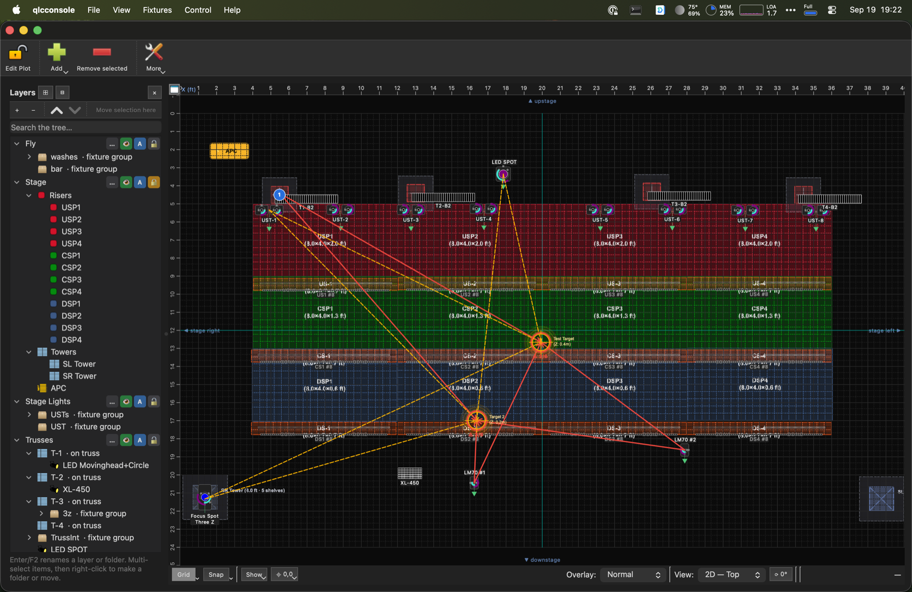

Structures and fixtures on the familiar flat plot, plus (fork-specific) the
dashed and solid lines you can see radiating from fixtures to **Stage
Targets** — see [Stage Targets](stage-targets.md).

**Fixtures underneath things.** Looking straight down, every fixture is
drawn over every structure, so it can always be clicked. A fixture with a
truss, deck, pipe or tower top more than 20 in (0.5 m) **above** it, over it
on the plan, is drawn **faded with a dashed grey outline** — underneath,
but still there to click. What it is mounted on never counts (a light hung
on a truss is not "under" that truss). Front and Side show heights, so
nothing is faded there.

**Rulers follow what you move.** While anything is selected — fixtures,
trusses, decks, scenery — the rulers band its extent; while you drag it,
the ruler mark sits at its **middle**, not wherever the pointer grabbed it.
So dragging a drape reads its centre line on the ruler. The band hugs the
object itself (a fixture's icon, a target's ring), not the room its label
or warning text takes, and it follows a zoom, a scroll, a turn of the plot
and a selection made in Plot layers without the mouse having to move.

**The rulers count from the centre line.** Across the stage (Top and Front),
the ruler reads **0 at the centre line**, marked with a teal **CL** tick,
and counts out to each side; its corner says which side is which (**SR | SL**,
or **SL | SR** with the plot turned round). The footer's readout does the
same: **SR 3.20**, **CL**, **SL 1.50**. That's the same zero as the target
readouts below. Set a **⌖ 0,0** and the rulers count from your point instead.
The rulers count grid squares; the corner names your unit from **Settings ▸
Units** when a square is one of it (**ft**), or says what a square is in it
when the grid is in another unit (**1 = 3' 3 3/8"** for a metre grid read
in feet).

### Stage marks: centre line, curtain line, number line

The marks a crew spikes and focuses by are **stage pieces**: objects on
the plot, on their own **Stage** layer in the Plot layers panel. Each one
has a row there with its own eye (shown or hidden) and lock, and the
layer's eye and lock work on all of them at once, like any layer. The
Stage layer can be hidden and locked but not removed, and new things are
never put on it.

- **Centre line / DSC mark:** a spike on the front edge of the stage at
  centre, labelled **CL** straight over it, and, if you want it, the centre
  line itself, dashed, from the front of the stage to the back. The full
  line takes the place of the teal centre cross's up-and-down line, which
  isn't drawn while it's on; the cross's line across the stage stays. When
  the number line runs through the spike, the number line's own **CL**
  labels it.
- **Curtain line:** where the main curtain hangs, labelled **Curtain line**.
  It's the stage's main reference. Every horizontal truss
  or pipe hung downstage of it, like the FOH electric out over the audience,
  is labelled with how far: **FOH · 13' 9" DS of curtain line** (`FOH · 4.2 m DS of curtain line` on a metric show).
- **Number line:** a line across the stage, ticked every foot or metre (the
  show's unit) and numbered out from centre, which is labelled **CL** (0 on
  the line), with **SR** on one end and **SL** on the other, so "SL 4 on the
  number line" is a place you can find on the plot. When the plot is zoomed
  out, the numbers skip (every 2, 5 or 10) rather than overlap. Each number
  sits centred on its tick, the two sides mirror each other, and the long
  ticks fall only on numbered places: every 5 when every unit is numbered,
  otherwise on every number.
- **Apron:** the stage downstage of the curtain line, as its own piece of
  deck. See [The apron](#the-apron) below.

**Selecting and dragging them.** Click a line on the plot to select it
(a rubber band never picks them up, so dragging a selection box across the
stage leaves them alone). Drag the **curtain line** or the **number line**
up or downstage to move it; drag the **apron's front edge** to make it
deeper or shallower. Each drag is one undo step. A locked piece, or one on a
locked Stage layer, stays where it is. The centre line doesn't move: it's
always the middle of the stage grid.

**Properties.** Double-click a piece, or right-click it (on the plot or in
Plot layers) and choose **Properties…**. Every distance is typed and shown in
the show's unit, with what it means written under it:

- **Curtain line:** **Auto**, or how far upstage of the front of the deck it
  is. A negative distance puts it downstage of the front.
- **Number line:** **Auto** (at the front of the stage), or how far
  downstage of the curtain line it is (**4' 11" DS of curtain line**). A
  negative distance puts it upstage of the curtain line.
- **Apron:** **Auto**, or its **Depth** from the curtain line and its
  **Front curve**; and its **Height** (the main deck's, or one you set:
  0 is the floor).
- **Centre line / DSC mark:** the mark, the full-depth line, or both.

Each also has **Shown** and **Lock**. OK keeps the changes as one undo step;
Cancel puts the stage back. The right-click menu has **Shown**, **Locked**
and **Auto** as ticks too.

**Where they go.** Centre is the middle of the stage grid, the same point
as the teal centre lines. The **front of the deck** is the front of the main
deck at centre: the biggest platform across the centre line, plus any
platform butted against its front across the centre line, and the middle of
a rounded front. A bare floor uses the front edge of the grid. The **front
of the stage** is the front of the deck, or of the apron when it reaches
further. On **Auto** the **curtain line** follows the most downstage **Main
drape** across the centre line, or a **Proscenium** if there is no main
drape; with neither, it sits 4 ft (1.2 m) upstage of the front of the deck.
The **number line** sits at the front of the stage. A line you've set
stays where it is on the plan: move a deck or the other line and it stays
put, and the distance shown changes to match.

#### The apron

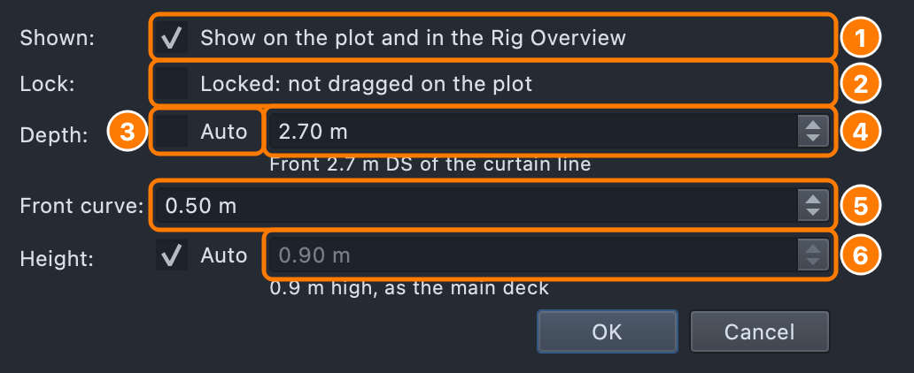

1. **Shown:** the apron and its deck, on the plot and in the Rig Overview.
2. **Lock:** not dragged on the plot.
3. **Auto:** the apron reaches the front of the main deck, with the deck's
   own front curve.
4. **Depth**, from the curtain line, in the show's unit.
5. **Front curve:** how far the middle of its front reaches past its
   corners; 0 is a straight front.
6. **Height:** **Auto** is the main deck's height; untick it to set your
   own. **0 is the floor**: an apron at floor height in front of a raised
   stage. Lights stood on the apron stand at its height.

The apron is its own piece. It starts at the curtain line and runs
downstage by its depth, as wide as the main deck, as high as it until you
set its **Height**, and in its colour (the stage grid's width, on the
floor, with no deck), and its rounded
front is right there at its front edge. It's real deck: drawn as deck on the
plot, in every view, and in the Rig Overview from above, at 45° and in 3D
whatever marks are on, and fixtures and figures stand on it. Move the curtain
line and the apron moves with it, keeping its depth. It never borrows another
platform: a riser butted against the front of the deck stays exactly as it
is, whatever the apron's depth. **Hiding the apron is only how it looks**:
it is not drawn (on the plot, in the Rig Overview, or in a beam's way),
but its deck stays, so a light stood or mounted on it keeps its height
and its mount, and nothing moves or drops. Shown again, it is the same
deck.

**Where a target is, in crew terms.** Every stage target on the plot has a
small readout under it giving where it is against these marks, in the show's
unit, for example **SR 7' 11" · US 10' 2"** (`SL 2.4 · US 3.1 m` on a
metric show, to the inch in feet). That's 7 ft 11 in (2.4 m) stage right of the
centre line (**SL** for stage left, **CL** on it) and 10 ft 2 in (3.1 m) upstage of the
number line (**DS** downstage, **on line** on it). If the target stands on a deck, the deck's height
follows: **↑ 3'** (`↑ 0.9 m` on a metric show). Distances count from the number line, or from the
curtain line when only the curtain line is shown. The readout is
there whether or not the marks are shown, and it follows the target as you
drag it. In the Rig Overview, the same readout sits at the feet of each
figure and area, and under the person Quick focus stands where a fixed light
lands, so it follows that spot as you nudge it. To hide the readouts, untick
**Show ▸ Target Positions** on the plot's footer (or the Rig Overview's).
It's on by default and saved with the show.

Two targets close together don't print their readouts on top of each other:
the second one sits just under the first. A **line target's** readout (where
the line's centre is) shows only while the line is selected, so it never
covers the readout of a person or mark standing on the line. A line target
marks its centre with a small diamond on the curve, not a point target's
ring and crosshair (see [Line targets](stage-targets.md#line-targets)).

The lines are drawn in the **Top** view, over the rig so they're never
hidden. The **Rig Overview** draws them on its floor, from above and at 45°,
at the height of the deck at the front of the stage, with the same
**Apron** dimension and the same **FOH · … DS of curtain line** labels by
the trusses and pipes over the audience. In a small Rig Overview window it
keeps the lines and leaves out those words, so they don't crowd the rig.
Its **Plot Layers** menu lists the pieces under **Stage**, each with a tick.
They're saved with the show; an older show opens with them off, and a show
saved with the old **Show ▸ Stage marks** menu opens with the same marks in
the same places, the apron it tinted now its own deck on **Auto**.

### Front / Side — elevation, and count badges

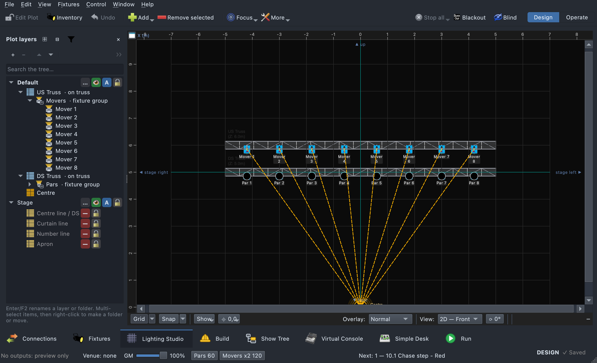

An elevation view is where a rig's vertical assembly actually becomes
readable — towers standing up, trusses at their hung height, risers stacked.
It's also where a structure's own fixtures can visually bury it: a wall of
fixture icons on a truss makes the truss itself unclickable. When a
structure's mounted fixtures cover more than 40% of its on-screen footprint
*in the current view*, they collapse into a numbered blue **count badge**
instead — click it to reveal them again. It's
computed per structure, per view: the same rig can show individual fixtures
from the Top but a badge from the Front.

**The crosshair reads H / V / Z.** Hover anywhere in a structure editor or
the Rig Overview: the readout gives **H** (across the stage, stage left
positive), **V** (up/downstage, downstage positive) and **Z** (height above
the floor) of whatever is under the pointer — a person's head, a riser's top,
a truss — exactly, in every view including the angled one. Over empty floor
at an angle it reads the floor there "(floor)"; in a flat view over nothing,
the two coordinates that view has, the third shown as "—". **H** and **V**
count from the same zero as the plot: **H 0** is the centre line (or your
**⌖ 0,0** when you set one). The Rig Overview's ruler counts from there too,
with its **CL** tick on the centre line; a structure editor's ruler counts
out from the structure's own middle.

**What you click is what you see.** A click picks a fixture on the shape
the view draws for it, or within a few pixels of it: a lantern's cage, a
mover's base and yoke, every head of a twin, the whole width of a thick
bar. At 45° it picks what is in front: a light hidden inside a solid riser
is not picked through the riser's top. The rulers are drawn over the rig,
and a click on a ruler doesn't pick what is under it.

### Angled — the free 3D view

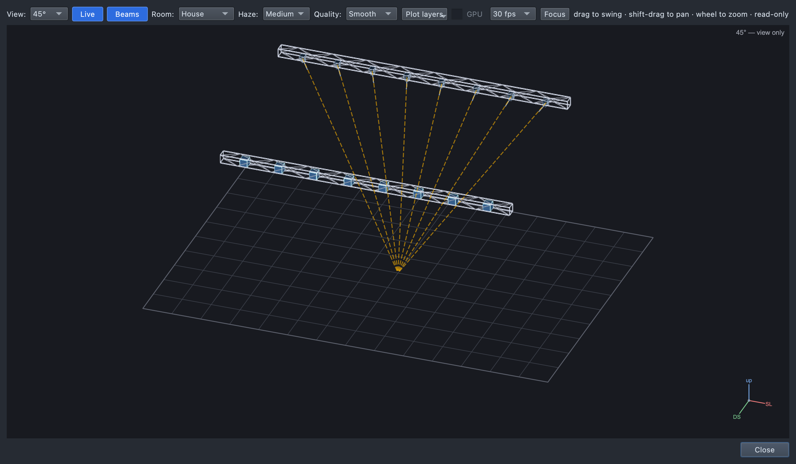

Drag to swing the camera, shift-drag to pan, wheel to zoom; **Fit** puts
the whole rig back in view. Toggle **Live** to shade fixtures by their
actual current output, and **Beams** to draw light cones from anything
currently emitting. This is the same drawing as the **45°** entry in a structure editor's
**View**, just showing everything at once. There, **Angle** sets the
camera by number (**Around the stage**, **Height of eye**), and the turn
button rotates the view 90° (a view setting only; nothing moves).

**Its controls are along the foot**, in a footer bar like the Lighting
Studio plot's: **Show** (with **Target Positions**) and **Plot Layers** on
the left, then **Live**, **Beams**, **Room**, **Haze**, **Owner**, **Quality**,
**GPU**, the frame rate, **Quick Focus** and **Fit**, and **View** (Top,
Front, Back, Side, 45°) on the right, where the plot has its own View. The
window's title bar moves and closes it as before. Click a box (View,
Room, Haze, Quality) to step to its next choice; its arrow lists them
all. **Room** is how much light there is in the house apart from the
rig: **Work light**, **House** (the default), **Dim** or **Blackout**.
**Owner** shows **All** fixtures (the default), **House only** (the room's
own rig) or **Ours only** (the tour package and rentals), by each
fixture's owner (set in the Fixture Manager; a fixture follows its group
unless it says otherwise). It only hides what is drawn; the stage and the
people stay, and nothing about the show or the output changes.

**It follows the Studio's layers.** Hide a layer in the Plot layers panel and
everything on it — structures, scenery, stage figures and fixtures — leaves
the Rig Overview too: not drawn, not counted when the view frames the rig,
and not catching or blocking the light of what is still shown (a hidden
deck no longer stops a beam). Toggling a layer redraws the open overview
where it is, keeping your angle and zoom. A structure's own editor always
shows that structure, whatever layer it is on.

**Or hide it from the overview itself.** The overview's **Plot Layers** menu lists
the show's layers with a tick each: untick one to hide it, **Show All** to
bring everything back. It is the same switch as the layer's eye in the
Studio (and saved with the show), so the two always agree. Showing, hiding
and labels work in Operate mode too; locking a layer stays a Design-mode
change.

**A fixture's LED layout.** Right-click a fixture in the Rig Overview (or
on the plot, or in the Plot layers tree) for **Fixture Properties…** and **LED
Layout…**: where each head of a pixel fixture really is — an XL-450's rows
of RGB and white. The plot, the Rig Overview and the Angled views draw its
pixels in those cells, and redraw as soon as it is saved. See
[LED Layout](fixture-manager.md#led-layout).

**Keeping it quick.** The Rig Overview draws on
the graphics card (Metal on a Mac, OpenGL elsewhere) when the machine has
one; its **GPU** box turns that off, back to drawing on the processor —
the same picture, slower, for a graphics driver that gets it wrong. The
choice is remembered. The footer's **Quality** sets how sharply edges are
drawn: **Fast** draws at screen resolution, **Sharpest** at four times it
each way (on the graphics card, as many samples a pixel as it offers) —
on a 200-fixture show roughly 8 ms a frame at Fast against 14 ms at
Smooth. The frame rate is only a ceiling: a frame that takes longer
slows the view by itself, and the view never asks for frames faster than it
can draw them. Nothing changing means no frames at all: a show held
still, or a window that is hidden, minimised or covered, costs next to
nothing; a gobo or prism that is turning keeps it drawing. The floor grid
is drawn once and reused until the view or the rig's extent changes.

The **GPU** box says what is drawing — **GPU · Metal** (or Vulkan, D3D,
OpenGL) — and its tooltip says "Drawing on: GPU · Metal" or "Drawing on:
CPU". A running show may use the computer's performance cores, all but
two of them; in **Operate** the show comes first: the view uses no more
than part of one core, draws no more than 15 frames a second (setting
`monitor/rig/operatefps`), and its drawing threads run below the DMX and
the rest of the app. A covered or hidden Rig Overview draws nothing in
either mode.

## Stage structures

Six structure types, each its own object with its own geometry, plus
**hangers** (rigging on a truss or tower) and **scenery** (cyc, walls and
drapes):

- **Truss** — a horizontal or vertical run, drawn as an open lattice (four
  chords, end frames, alternating diagonal bracing) rather than a solid box
  — both because that's what a truss looks like, and so you can see
  anything rigged inside or behind one. A **bar** (a short cross-piece hung
  on a parent truss — e.g. a batten across the front of an overhead truss)
  is internally just a child truss, so mounting, rendering, grouping, and
  deletion all reuse the same machinery.
- **Tower** — a vertical box with **shelves** at set heights; fixtures mount
  on a shelf via local coordinates, or at the very top or bottom of the
  tower.
- **Pipe** — covers both a **boom** (vertical pipe — on a stand, hung from a
  truss, or free-standing) and a **house electric** (horizontal pipe, same
  object with an orientation flag). Fixtures mount up it at a height and
  facing angle.
- **Stand** — a placeable base a pipe or a truss stands on; what's on it
  follows if the stand moves. A **horizontal truss between two stands** (a
  goal post, a T-bar between two lifts): in the truss's editor, **On stand**
  picks one and **Other end on stand** the other — the truss then runs from
  the first stand's top to the second's, its direction and length set by
  them and following them as either moves. (Not for a vertical truss; a
  tower stands on the floor, on its own, and carries hangers.)
- **StagePlatform** — risers, decks, steps. Its top can be Solid, Clear
  (translucent, so fixtures mounted inside show through), or Open (no top
  face at all). Platforms can stack on top of each other, deriving their
  base height automatically, and collide realistically so dragging one
  doesn't scramble the pile underneath it. A light whose body ends up
  inside a Solid-topped platform (a floor light at height 0 in a riser) is
  a footer **error** ringed red on the plot; **Sit on Top** stands it on the
  deck (Show Review FIX-15, see [Show Review](show-review.md)). A floor light
  beside a deck that the rest of its row stands on gets an amber ring and a
  footer warning (FIX-16, same fix).
  - **A definition that says 0 for its beam angle or pan/tilt range** (the
    Fixture Editor's defaults, many cheap definitions) still draws and aims:
    the rig view and every aim use a default by fixture type, and the Fixture
    Manager's details and the plot tooltip say "15° (assumed: the definition
    says 0)". Beam angle: 15° moving head or scanner, 25° colour changer,
    par or wash, 6° effect, 40° LED bar, 20° otherwise (none for a hazer, fan
    or laser). Pan and tilt: 540° × 270° for a moving head with pan and tilt
    channels (360° × 270° for other movers), none without those channels.
    A definition that declares them is used as written. Show Review lists
    each such definition once (FIX-18) so the real figures can be set.
  - **Two colours.** **Colour** is the plot's: it tells decks apart on the
    2D plan and in the layers list. **Finish (rig)** is what it is painted —
    stage black unless you set it — and the Lighting Studio's planes and the
    Rig Overview draw it in that, lit by the room and the rig, so an orange
    riser on the plot is the black riser it really is on the rig. Scenery
    has one colour, its real one (a cyc's white, a drape's velour). A warning
    on a prop (light on the cyc nobody meant) is an amber outline, never a
    fill.
  - **Steps** are a platform with a Steps shape: a staircase with a step
    count, rise, run, step width, and which way it climbs (upstage,
    downstage, stage left, stage right). **Add → Add Steps** gives two
    8" × 8" steps, 3' wide; in a platform's editor, **Shape: Platform /
    Steps** switches between the two, and the box follows from the steps. Drawn as treads
    with an UP arrow from above, risers face-on, and the staircase side-on.
    Beams land on each tread, a deck-mounted fixture stands on the tread
    under it, and a target bound to the steps aims at the middle tread.
  - **A rounded front** (an apron arc): **Front curve** in a platform's
    editor is how far the middle of the downstage edge reaches past its
    corners — 0 is square, half the width a half circle. The depth is the
    depth at the middle; the corners are cut back. Drawn round from above
    and in the 3D views, and light only lands on the deck inside the curve.
- **Network node** — an Art-Net/sACN node or wireless DMX transmitter,
  placed where it's rigged (see [Network nodes and cable runs](#network-nodes-and-cable-runs)).

Add one from the plot. The toolbar's **Add** has trusses, platforms and
risers, steps, scenery, fountains, images, network nodes, targets and
people. Right-click an empty part of the plot for **Add Here**, which has
all of those plus **Boom**, **Electric** (a horizontal pipe), **Stand**
and **Tower**, placed where you clicked. Right-click a truss for **Add ▸
Bar…**, or a boom for **Add ▸ Crossbar…**. Each type's own editor has
width/depth/height, position, and (for pipes/booms) run angle. A truss is
**Horizontal**, **Vertical** or **Ground** (on the floor, for a run of
floor units).

**Add ▸ Add Image** puts a picture (a ground plan, a venue drawing) on
the plot as an object: it sits on a layer, drags, locks and hides like a
structure, and a double-click edits it. When the show is saved, a picture
from outside the show's folder is copied into its **images** folder, as
truss and tower pictures are (see [Truss socks](#truss-socks)).

### Stretch and turn by hand

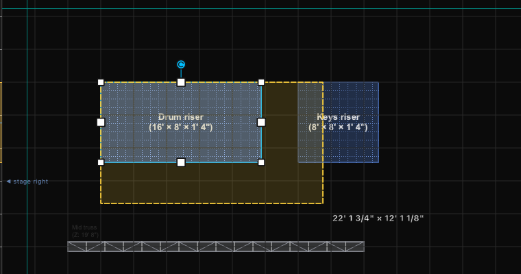

Select a **platform** (a deck, a riser, steps), a **truss**, a free
**pipe** (an electric) or a piece of **scenery** (a wall, a flat, a leg)
on its own in the Top view and it gets handles:

- **A square at each end and side** (and the corners, on a deck): drag
  one to stretch it from there; the opposite side stays where it is. A
  truss and scenery stretch along their length only, a flight of steps
  only across its treads (its depth is its steps).
- **The round knob** off its upstage edge turns it about its middle, and
  everything on it turns with it, as **Rotate** does.
- **The end of a truss, pipe or wall** goes where you drag it and the other
  end stays, so it lengthens, shortens and turns at once (it swings about
  the other end). Near its own line it stays straight (within 3°); it
  catches another truss's, pipe's or wall's end, or a deck's corner, when
  it comes near one, so two walls meet exactly; hold **Shift** to keep it
  to 15° steps; otherwise the end lands on the **Snap** grid. The readout
  adds the way it faces once it turns (**Length 12' 6" · 45°**, and
  **→ end** when it has caught one). Hover over a handle to see what it
  does and its keys.
- **Snapping:** a stretch goes in steps of the plot's **Snap** (off when
  Snap is off) and a turn in 15° steps; hold **Alt/⌥** on any handle to go
  freely, with no grid, no 15° steps and no catching another end.
- **One drag is one undo step.** A truss or pipe stretched or swung at one
  end keeps its lights, bars and hangers where they are from the other end.
- **A cyc only stretches** (it hangs square across the back); other
  scenery turns too. Trusses on a stand, bars on a truss or pipe, booms and
  stands follow what they are on or stand up, and have no handles: drag
  them to move them.
- **Several selected** (a group, or a deck and a truss picked together):
  the knob alone, on the box round them, turns them all about their middle.

The handles are there **only while nothing holds it still**: not with its
own lock on, its group's, its layer's or the plot's (**Edit Plot**), not in
Operate and not in Front or Side. Lift the lock and they come back. A
locked one you select shows its outline dashed in red and a line under it
saying what holds it and where to lift it (**Layer locked — unlock it in
Plot layers**).

### Grouping stage features

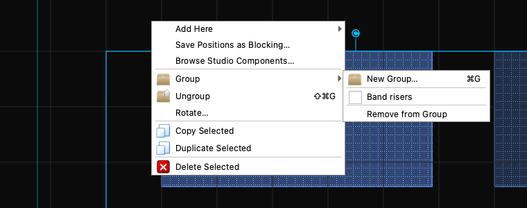

Two risers and the steps up to them, the band's decks, a set of legs:
file them as one group and they select and move as one. Right-click the
plot, any of them, or a structure's Studio canvas ▸ **Group**:

- **New Group** (Ctrl/⌘+G on the plot) makes the group at once, named
  "Group 3" and the like, and puts the name in place in Plot layers to type
  over (when that list is open). It files what is
  selected in the new group, on their layer (inside the group they already
  share, if they share one). A truss or deck goes with what is on it, and a
  whole group selected goes in whole.
- **The groups on that layer** follow, by name: pick one to add what is
  selected to it. One they are all in already is ticked.
- **Remove from Group** takes them out of the group they are in, one level
  out; they stay where they are, on the same layer.
- **Ungroup** (Ctrl/⌘+Shift+G, on the plot's menu) dissolves a whole group.

Each is one undo step. A locked group, a locked layer or a locked plot
greys what it stops, and the item says why (**Group “Band” is locked:
unlock it in Plot layers**). In Plot layers they are groups too.

### People on the stage

A choir on its risers or a band across the apron shows what the light does
to the people in it before anyone stands there. People go on a
**performer line**: a [line target](stage-targets.md#line-targets) with a
count of people spread evenly along it, one on each end, each with their
feet on the highest stage surface under them — a step's tread, a riser,
the apron, the deck. A line drawn up a flight of steps stands people at
every height it crosses. The people belong to the line: drag an end handle
to shorten it, bend it, move it or Undo, and they stand along it again at
the same fractions of its length.

The usual setup is a line a row: three riser rows and the apron make four
lines, each with its own count.

- **Add ▸ Add People…** on the toolbar makes one line where you are
  (right-click the plot for **Add Here ▸ Performer Line…**). Say how many
  are on it; drag its ends to where the row stands, as with any line.
- **Fill with people**: select the risers (steps or decks) and the same
  entry reads **Fill Selected Risers with People…** (or right-click a
  riser for **Add ▸ People on the Risers…**). It makes a line along the
  middle of every tread — a deck gets one to every 3 ft (0.9 m) of its depth —
  by **Apart** — 2 ft (0.6 m) is a choir, shoulder to shoulder about 1 ft 8 in (0.5 m) — or
  **To a row**, and spaced rows can be **staggered**, so each face shows
  between the two in front. The dialog counts the people first.
- **Height**: Children 4 ft 3 in (1.30 m), Students 5 ft 3 in (1.60 m) or Adults 5 ft 9 in (1.75 m), or
  type one, and **Give or take** (±3 in (8 cm) unless set): some are taller than
  others. Each person keeps their height every time the show opens;
  **Shuffle** in the line's own dialog picks again.
- **Costume**: the colour they wear. The rig view lights the body in it,
  so a blue wash on a red robe goes dark, as it would on stage. None
  leaves the neutral body, which shows the light as it is.

Any line takes people in its dialog (double-click it): **People on it**,
**Height**, **Height give or take** and **Costume**; 0 people is a plain
line again. A line in a set (a fill's rows) also shows **Costume and
height for the whole set**: tick it and OK gives every other line in the
set the same costume, height and give or take, so a choir changes in one
place. Each line keeps its own count and its own shuffle. Turning a plain
line into a performer line leaves its points at the heights they have;
only a line made by **Add People…** or a fill runs at chest height.

People face the house, unless the deck under them is turned: on a riser
rotated in its properties, the rig view stands them facing that riser's
front (the highest deck under their feet decides, so a flat step on a turned
riser keeps them facing the same way).

The cue scope does not hide people. **Show ▸ All Targets** off narrows the
targets drawn to the ones the cue on show aims at; the performers are the
scene, not a marker, so they stay drawn while their layer is visible.

Lines go in a **Performers** layer of their own (made the first time). Its
eye hides them on the plot and in the rig view, and its lock holds them
still. A fill's lines are one group named for the set: a click picks one line
(its people with it); click the set's row in **Plot Layers**, or
right-click a line ▸ **Select Group** or **Select All Similar**, to take
the whole set and drag it as one piece.
Move or turn a riser and the lines standing on it go with it; move the
riser out from under a line and its people step down to what is there.
A fill's lines stay out of the aim-target lists (a Look's Aim target, an
Aim palette, a focus call, Focus mode), so fifteen rows do not bury the
targets you named; a performer line on its own is listed, and so is any
line an aim palette already uses.
Filling the same risers again replaces their lines (**Replace the people
already on them**), except one an aim palette uses. Light aimed at a
performer line spreads along their chests. One Undo takes back a fill.

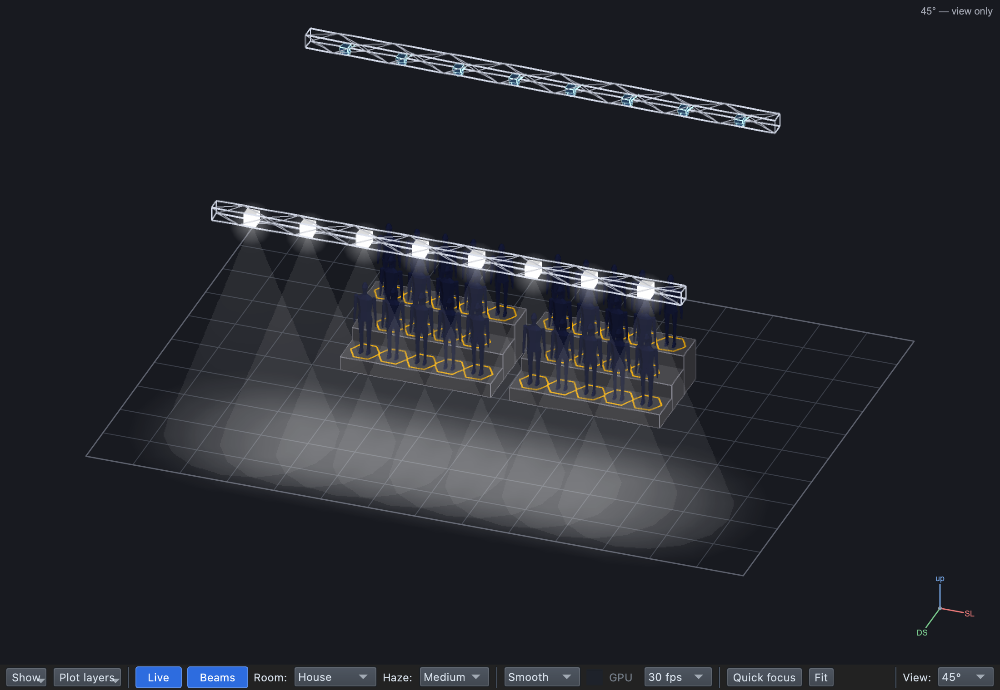

### Truss socks

A truss can wear a **sock** — fabric over the truss that diffuses LED bars
rigged inside it. In the truss editor, tick **Sock** and set its colour
(white by default) and how much of the truss it covers (**from / to**).
Bars placed **Inside** the truss no longer throw beams of their own: they
glow *through* the sock, in 8 in (20 cm) stretches each lit by the bars nearest
it, filtered by the fabric's colour. **Sock printed** adds an image
(**Pattern…** to choose, **×** to clear) stretched over the fabric, with an
opacity percentage beside it; the print still glows, filtering the light,
and a PNG's clear parts show the sock colour beneath.
When the show is saved, a picture chosen from outside the show's folder
(your Downloads, say) is copied into an **images** folder next to the
show, and the show keeps the copy: move or share the show's folder and its
pictures go with it. **File ▸ Save As** into another folder copies them
into that folder's **images** and leaves the old folder as it was. Tower
faces' pictures work the same way.

### Tower faces

A tower can have opaque **faces** — panels covering its sides. In the tower
editor, tick **Faces** and pick which sides (Front, Back, Stage left, Stage
right — all by default), the colour (near-black by default), and the height
range they cover (from / to; the top follows the tower's height). Faces take
a printed pattern and opacity the same way a sock does.

Both show everywhere: in the angled view the sock or faces are lit by the
room and by whatever the rig points at them; the flat elevations show a
glowing band (sock) or filled stretch (faces); the plot shows a band in the
sock's colour, or the faced sides as thick edges. Both are live in the
editor as you change them, and Cancel undoes them.

### Hangers

A **hanger** is rigging, like a truss: a clamp on a truss (a tower truss
included) or a tower, an arm reaching out from the face, and a chain
dropping to one hook. One fixture hangs below the hook.

- **Add one:** in a truss's or tower's own editor, right-click the structure
  → **Add Hanger Here** (it lands where you clicked).
- **Edit it:** double-click the hanger's clamp, arm or chain in the editor
  (or right-click → **Edit Hanger…**). The hanger editor has its **height**
  (or position along a horizontal truss), the **direction** the arm points
  (Downstage, Stage left, Upstage right, …), the **arm** length, the
  **drop** of the chain, and what **hangs** on it. **Copy to Every Tower**
  puts the same hanger on every tower that doesn't already have one there.
- **Remove it:** right-click → **Delete Hanger…**. What hung on it stays in
  the show, just unmounted. Removing the truss or tower removes its hangers
  too.
- **Plot Layers** lists each hanger with its tower (rename, edit, delete there).

Hangers show in the structure editors, the 3D views and on the **2D plot**:
there, the arm out from its truss or tower and a ring at the hook (with the
chain down to it in Front and Side). They go where their structure goes —
no dragging — and double-clicking one edits it; right-click for Edit and
Delete. A hidden layer hides them.

### Scenery: cyc, walls and drapes

**Add → Add Scenery** (toolbar, or the canvas's right-click menu, where it
goes where you clicked) offers each kind and puts it where it usually goes:

| Kind | Starts as |
|---|---|
| **Cyclorama** | across the back, stage width, 20 ft (6 m) tall, pale |
| **Back wall** | across the back, 8 in (20 cm) thick |
| **Proscenium** | framing the front: an arch 6 ft 7 in (2 m) wider than the stage, 23 ft (7 m) high, 16 in (40 cm) thick, its opening the stage's width and 18 ft (5.5 m) high |
| **Main drape** | across the front, house red |
| **Traveler** | mid-stage, black |
| **Leg** | a pair, one each side, 4 ft (1.2 m) wide, black |
| **Border** | hung across, 4 ft (1.2 m) deep with its bottom at 15 ft 9 in (4.8 m) |
| **Scrim** | just in front of the cyc, seen through |
| **Wall** | a low built wall: a planter, a fountain's rim |

Its editor (live preview, Cancel reverts) has the kind, position, width,
height, bottom trim, facing, colour and **bow** (a wall or back wall reads
**Length**, **Width** and **Height**: how long it runs, how thick it is, how
high) — curving the middle away
from the audience, or toward them below 0. The rows that only make sense
for some kinds show only there:

- **Curtain** (main drape, traveler) — **Closed**, **Open** (split, each
  half gathered at its end, with **Opening width** for how wide the gap
  between them is) or **Flown out** (taken up out of the way: not
  drawn, and the light goes through; the plot shows where it hangs from,
  dashed). On its own it is set while designing; to move it in the show,
  drive it by a curtain fixture (below).
- **Driven by** (main drape, traveler) — the curtain fixture that moves it;
  see [Curtains that move](#curtains-that-move).
- **Opening width** and **Opening height** (proscenium) — the opening,
  centred; the piers are the rest of the width and the header the rest of
  the height. Light goes through the opening and lands on the piers, the
  header and its underside.
- **Door width**, **Door height** and **Door at** (wall, back wall) — a door
  in the wall, from the floor up: **Door at** is where its middle is, from
  the middle of the wall. Light goes through it; the wall either side and
  above it stops light as the rest does. **No door** (0) is the default. For
  a side wall, add a **Wall**, give it the height and length, and turn its
  **Facing** to 90°.
- **Shape** and **Thickness** (wall, back wall; a proscenium has a thickness
  too) — **Straight or bowed**, or
  **U, rounded front**: a half-round front as wide as the wall, straight sides
  running back to its **Depth**, the open back at its position.
- **Light here only on purpose** (every kind) — light that lands on it must
  be meant, or [Show Review](show-review.md) warns about it cue by cue
  (PWR-12, *backwash*: see [Light on the cyc only on purpose](#light-on-the-cyc-only-on-purpose)).
  On by default for a **Cyclorama** and a **Scrim**; tick it for a painted
  drop or a wall that must stay clean too.

On the plot it's a band from the Top (a built wall its footprint, an open
curtain its two gathered ends) and the sheet in the elevations; drag, lock,
rename, layer, hide and delete it like any structure, and it's listed in
Plot layers. From above it is picked before the deck it stands on or over, so
double-clicking a drape across the steps opens the drape. In the 3D views
drapes hang in folds, a scrim is seen through, and a wall has its faces, top
and ends. Everything but a flown curtain stops the
light that reaches it and takes its pool — a beam coming down on a wall lands
on its top — and hides what is behind it.

#### Light on the cyc only on purpose

*Backwash* is light that lands on the cyc by accident: a front light or a
special aimed at a performer whose beam carries on past them and splashes
(or shadows) the cyc behind. Light on the cyc should be there because you
meant it. Each piece of scenery with **Light here only on purpose** on (a
cyc and a scrim, by default) is checked by [Show Review](show-review.md)
**PWR-12** in every cue:

- **What counts as landing on it.** The rule is exact, from the plot: each
  lit light (dimmer above 0) throws its cone from where it is in the rig, the
  way PWR-11 follows it — the axis and three rings of sixteen rays across the
  cone. A ray stops at the stage floor, at anything solid the stage counts
  (a riser, a tower), or at scenery; a scrim lets it on through. **Any ray**
  that ends on the cyc is light on the cyc, and the finding says roughly how
  much of the beam (the share of rays).
- **Curtains.** A closed main drape or traveler between a light and the cyc
  takes the light: what lands on the curtain is not on the cyc. A curtain
  stands where **that cue** leaves it, never where it is right now, so the
  same show always gives the same warnings. A curtain moved by a fixture
  ([Curtains that move](#curtains-that-move)) is where the cue's functions
  put it — a "Curtain Open" scene the cue plays, carried in or its own, opens
  it; part open is part open. In a list that moves it somewhere, a cue that
  plays nothing on it has it at rest (closed). A curtain no cue moves is read
  at its set state (Open, Closed, Flown).
- **What counts as meant.** Only something the show says: the fixture's plot
  symbol is **Cyc / strip light** or **Uplight wash**; or its look aims it at
  a target standing on that cyc (a mark, an area or a line within 1 ft 8 in (0.5 m) of
  it — never a person or a kit, who stand in front of it); or you said so with
  **I Meant It**. Nothing is guessed.
- **I Meant It** (the Show Review row) keeps the mark on the layer that lights
  the fixture in the cue its light starts landing, one undo step, saved in the
  show. It stays meant through the cues that follow while it keeps landing,
  even where the layer is set again. Take it back with **Not Meant** on the row
  (Show Review's Not a Problem list) or **Light on the Cyc: Not Meant** on the
  layer's right-click in the Show Tree.
- **Where you work.** Each cue that puts unmeant light on the cyc reads
  **⚠ cyc** in its Show Tree flags — only the mark is in the warning colour,
  **mix** and the other flags beside it keep theirs. Hover it for the detail:
  which fixtures, about how much of each beam, on which cyc, every cue it
  lands in, and what you can do. A click opens the Show Review row; a
  **right-click** answers it on the spot: **I Meant It** (the mark turns green, **cyc ✓**), **Not a Problem…**, **Not Meant: Show Me
  the Layer** (to aim it off, shutter, zoom or darken it) or **Open in Show
  Review**. The cyc itself gets an amber outline in the rig views while a
  warning is open on it; its cloth keeps its own colour. The marks follow
  Show Review's own re-check, a moment after an edit in Design — never while
  the show is running.

There is no live hint in the Workbench and no automatic "keep it off" mode:
holding unmeant light off the cyc would mean clamping output while the show
plays, which this check never touches (decided, can change).

#### Curtains that move

A main drape or a traveler can open and close in the show, because a fixture
moves it. In its editor, **Driven by → Add Curtain Fixture** adds a
**Generic → Stage Curtain** fixture named after it (*Main drape curtain*) and links
the two; or pick a curtain fixture you already have. It's saved with the
show. A fixture you already have — a relay on a dimmer channel — becomes a curtain
fixture when you give it the **Curtain** plot symbol ([Plot
symbols](#plot-symbols)); its intensity opens the curtain. The bundled curtain
fixture is an ordinary fixture with no light and no power draw: it isn't counted in power estimates and isn't listed in Inventory as
something to place, and colour, dimmer and position palettes don't touch it.

| Channel | 0 | 255 |
|---|---|---|
| **Open** | closed | open by its **Opening width** |
| **Open fine** (16-bit modes) | finer steps for Open | |
| **Fly** (main drape) | in, at its trim | flown out |

A main drape gets the **Open + Fly** mode, a traveler **Open**; change the
mode in the Fixture Manager if you need to (**Open 16-bit**, **Open 16-bit +
Fly**). Put the channel in a scene, chaser step, palette or Show Tree layer
like any other. The **fade time is how long the move takes**: a scene that
sets Open to 255 with a 6 s fade opens the curtain over six seconds. There's
no special curtain cue.

**What you see.** The plot and the Rig Overview draw a driven curtain where
its channel puts it, and follow it smoothly while it fades. The halves part
from the centre, out to the opening width, and Fly lifts it until it's gone. A
driven curtain follows its channel and **0 means closed**, so it's closed
until a look opens it, whatever **Curtain** says. When the look holding the
channel is released, the channel goes back to 0 and the curtain closes,
the same as any other channel. **Curtain** still counts in two cases: when
the Rig Overview's **Live** is off (it shows the design, not the DMX), and
when the curtain fixture has been deleted. A drape that isn't driven
looks and behaves exactly as before.

**Moving the real one.** An unpatched curtain fixture moves only the drawing.
To have a cue move the real curtain, patch the curtain fixture to the address
of the curtain's motor controller, or to a DMX relay box that runs it.
Signals to the crew (standby and go cue lights) aren't built yet.

### Fountains

**Add → Add Fountain…** builds one from its sizes — a drawing beside the
fields shows each one where it is measured, from above and cut through the
front, with its value, and the one being edited picked out — by default 3 ft across
and 4 ft deep with a round front, on a 5" base, with walls of 4" blocks, the
outer 8" high and the inner 14", 4" apart:

- the **base**: a platform with a half-round front;
- the **outer** and **inner walls**: U-shaped walls on the base, open at the
  back, the outer one's outside face on the base's edge;
- a **silk flame** in the middle of the inner wall, staged — patch it to
  the relay's channel (untick it to leave it out). Its unit stands on the
  base, out of sight behind the walls; the **silk starts at the top of the
  inner wall** and rises by the **Fire height** (3 ft unless you set it).

It is built as one thing, on one layer: a click on any part selects the
whole fountain, which drags and turns (**]** / **[**) as one, flame and all,
and a layer or group lock holds all of it (and lifts from any of its
pieces). Double-click a part to work on it alone (**Esc**, or a click
outside, comes back out). Light pointed at the inner wall — pars
in the gap, washing it — lands on its face.

**The fountain's editor.** Double-click the base: its editor is titled with
the fountain's name and has a **Fire height** row, in your units, for the
flame. **Fixtures on this object** lists everything mounted in it. The rig
view draws the silk from the inner wall's top up, coloured by the
fountain's own lights when they're on (blue pars make a blue-tinged
flame); the plot draws its outline, from above as a round and in **Front**
and **Side** as a flame from the wall's top to its tip.

**Fountains from before.** A show saved before fire heights keeps its flame
where it was: on load, the silk starts at the inner wall's top and its fire
height is set so its top stays where it was drawn. A flame (or any fixture)
standing on a fountain's base but left out of its group joins it, on the
fountain's layer.

**Fixtures in the fountain.** Drag or add a fixture inside the base and it
is mounted in the fountain — no Shift needed: on the base, or on the inner
wall's top when you drop it on the wall. It joins the fountain's group, so
it moves and turns with it. A par (any fixed light) put inside the inner
wall is aimed up at the middle of the flame. One put in the **gap** between
the outer and inner wall is aimed at the inner wall instead — at the
nearest point of its outside face, half way up — so it washes the wall and
leaves the silk to the pars inside. Change either in Aim & Mount. Drag it
out of the base to take it out.

**A WLED set in the fountain.** A pixel fixture mounted in it (a WLED
string, a pixel tape) gets a **Pixel path** in its properties: **Inner wall
top ring**, **Outer wall top ring**, **Base ring** (round the base's edge)
**Wrapped up the flame** (a spiral; **Turns** sets how many, Auto about
one every 1 ft (30 cm)) or **Sprinkle loops (over the gap)**. See
[Pixel paths](#pixel-paths) and [Sprinkle loops](#sprinkle-loops).

### Pixel paths

A pixel fixture's LEDs are normally where its body is. **Pixel path** (in
its properties, for any fixture with more than one LED) lays them out along
a path instead, in the order of its heads, the first LED at the start: the
ring paths start at one end of the U (stage right) and run round the front.
Two need no fountain: [Wand](#wand) and [Free string
(anchors)](#free-string-anchors), a string laid anywhere through points you
place on the plot.
Each LED is drawn where the path puts it, in its live colour, in the plot
and the rig view: a small point, with a glow as big as it is bright. A WLED
in effect mode shows its effect running along the path (see
[Lanterns](#lanterns)). The LEDs light nothing else on the stage, and
a fixture on a path draws no body or beam in the rig view.

### Sprinkle loops

A fairy string hung over a fountain's gap: at one point round the U it
goes from the inner wall's top across to the outer wall's top, back to the
inner, back and forth, then runs along the wall top to the next point and
does it again. Set the string's **Pixel path** to **Sprinkle loops (over
the gap)** (it has to be in a fountain):

- **Points**: how many places round the U, spread evenly (6 unless set).
- **Spans per point**: how many times it crosses the gap at each (4 unless
  set). The LEDs are shared out equally between the spans.
- **Edit Spans…**: a table of the spans for a string that isn't hung
  evenly — each span's **First LED** and **Last LED** (counted from the
  start of the string, the first LED is 1) and **Point at** (how far round
  the U it hangs, 0% the stage-right end, 100% the stage-left end). LEDs in
  no span are the runs between points: they lie along the top of the wall
  the last span ended on. Overlapping spans, or one past the end of the
  string, are refused. **Clear** goes back to the even spread.
- **Read Segments** (a WLED on the network): reads the device's segments
  and makes one span of each, in order, grouped **Spans per point** to a
  point. It says so when the device doesn't answer, and names any segment
  whose Reverse isn't set the way the note below says.
- **Write Segments…** (a WLED on the network): the reverse. It reads the
  device first, then asks "Write 16 segments to the WLED at …?" and, if you
  agree, makes the device's segments the string's spans, set up as the note
  below says: one segment per span, **Reverse** on every second one, the
  LEDs between spans in no segment (dark), any other segments the device had
  cleared. Then it reads them back and says "Wrote 16 segments to WLED
  (172.18.2.100)", or what came back otherwise. While it works the note
  under the buttons says what it is waiting on. It refuses, writing
  nothing, when the string has more spans than the device keeps segments, or
  a span runs past the LEDs the device drives (set its LED count first:
  **Fix on Device…**, [Fixture Manager](fixture-manager.md)). This changes
  the device itself: Undo can't take it back. A Teaching show that holds
  real output refuses it, with the reason.

Each span droops between the two wall tops: its middle hangs below the
straight line between them by 30% of that distance, more for a span with
more LEDs than the string's average and less for one with fewer. Spans at
one point hang 2" (5 cm) apart. The LEDs are placed by their number on
the string, so a live WLED's pixels and its effects land where they really
are, whatever the segments' Reverse settings.

**Setting up the WLED.** **Write Segments…** does all of this for you,
with no need for the WLED's own web page. By hand: make one segment per span, and leave the LEDs
between points (the runs along the wall to the next point) out of every
segment, so they stay dark. Tick **Reverse** on every second segment —
the ones that run outer wall to inner — so that every span runs inner to
outer: a Drip or Meteor effect then falls outward on all of them at once.
WLED limits how many segments a device can have (32 on an ESP32; Write
Segments reads the device's own limit and refuses past it); for more spans
than that, a 2D matrix set up with Serpentine and a `ledmap.json` on the
device may do the same job, though that hasn't been tried here.

**What the show's effect does on it.** A WLED Effect fixture's effect,
speed, intensity, palette and colours go to every segment the device has,
so the effect plays on every span at once. Its **Option** channel's
**Reverse** turns each segment round from the way it runs, never sets
them all one way: with Reverse on, the spans that ran inner to outer run
outer to inner and the reversed ones the other way, and with it off each
runs its own way again. **Mirror** is the same on every segment. The WLED
output reads the device's segments every few seconds, so after
**Write Segments…** (or a change on the WLED's own page) the next look
reaches the new segments within about 5 seconds.

The fountain is never left turned round. When the WLED output closes (the
universe unpatched, or the app quitting) while Reverse plays, each
segment is sent back its own way first; a WLED that doesn't answer holds
that up for about a second at most. Each segment's own way is also kept
in this computer's settings, by the WLED and its layout (written by
**Write Segments…**, or learned the first time the output sees that
layout), so after a crash mid-Reverse the next run takes the ways from
there, not the turned-round ones the WLED reports. A second computer
driving the same WLED hasn't kept them: run Write Segments… on it once.

### Pixel paths on a WLED's own LEDs

A pixel path draws **LEDs**. A WLED driven through its API (Network (WLED,
JSON over Wi-Fi)) runs its own effects: the Studio draws its live pixels, or
the effect's port, along the path. A WLED patched as its LEDs (**Pixels
(Multi RGB)** over Art-Net/sACN, in [Fixture Manager](fixture-manager.md))
has a head for each LED, and **each head is its LED on the path**: a pixel
effect or RGB Matrix lights the LED the Studio shows lit, wound round the
wand, along the sprinkle loops or the free string, or in a straight run with
no path. Choose JSON for the device's effects with little traffic; Pixels
for per-LED looks in step with the rest of the show (more traffic).

### Wand

A **wand** is a staff with an LED strip or fairy string wound round it,
driven by a WLED. Set a pixel fixture's **Pixel path** to **Wand (wound round
a staff)**. Every length below is shown and typed in your unit (Settings ▸
Units):

- **Wand length**: the staff, 4 ft (1.2 m) unless set.
- **String length**: how long the lit string is, first LED to last. A fairy
  string of 50 LEDs on 16 ft is 16 ft; with the LED count this says how far
  apart they are. Left at **LED tape**, the LEDs are taken as tape, ¾ in
  (2 cm) apart.
- **Staff diameter**: how thick the staff is under the string, 1 in (25 mm)
  unless set.
- **First LED at**: the end the data comes in. **Top (the tip)** runs the
  string down from the tip, so an effect starts at the top; **Bottom (the
  grip)**, the default, runs it up.
- **Turns**: how many times the string goes round. **Auto** works it out
  from the string length and staff diameter, and shows its number, for
  example **Auto (58.0)** for 16 ft of string on a 5 ft, 1 in staff. Set a
  number to override it (count the wraps on the real staff).
- **Held by**: a Person target. The wand is then in their hand: its middle
  **Held at** 3 ft 3 in (1.0 m) above where they stand, a forearm in front
  of them, **Leaning** 20° toward the audience, and it goes where they go.
  **Nobody**: it stands upright where it was placed.

The string starts a hand's width above the bottom of the staff and runs to
the tip. The rig view draws a thin dark staff with the LEDs glowing on it in
their live colours; the plot a short line with coloured dots. A wand throws
no beam. Per-cue blocking positions aren't built yet: a held wand follows
its performer's position on the plot.

### Free string (anchors)

A fairy string or pixel tape that isn't in a fountain or on a staff: tied
along a railing, swagged across a doorway, run up a column and over an
arch. Drawn as a bar, its LEDs sit in the wrong places and a chase that
looks right on the plot runs the wrong way on stage. Set its **Pixel path**
to **Free string (anchors)** (any pixel fixture; no fountain needed) and
lay it on the plot through **anchors**: the points it is tied to or runs
through, in the order the string runs from its first LED.

- **Add Anchor** (in its properties, or right-click the fixture on the
  plot): then click on the plan for each anchor, after the last one. The
  first click of a string with no anchors yet is where it starts. Each
  click is one undo step; **Esc** or a right-click ends. Clicked from
  Fixture Properties, the dialog closes first so you can click the plan.
  From above an anchor takes the fixture's own height; in **Front** or
  **Side** the click sets its height too.
- **Drag an anchor** (select the string; its anchors show as numbered
  handles): from above it moves across and up or down stage and keeps its
  height; in Front or Side it moves across (or in depth) and up or down.
  **Shift** holds the drag to one direction. One drag is one undo step.
  The fixture itself (the controller box) stays where it is.
- **Right-click an anchor**: **Insert Anchor Before** (half way back to the
  one before), **Pin LED Here…** (which LED is tied at this anchor),
  **Unpin LED**, **Reverse This Span** (the span from this anchor to the
  next) and **Delete Anchor**.
- **Edit Anchors…**: every anchor as a table for exact values: **Across**
  and **Depth** (as on the plot's rulers) and **Height**, in your unit
  (Settings ▸ Units), the **Pinned LED** and **Reverse**. Pins that don't
  count up along the string, or one past its last LED, are refused, in
  words.
- **String length**: as for a wand, the lit string first LED to last. A
  fairy string of 50 LEDs on 16 ft is 16 ft (4.9 m); left at **LED tape**,
  the LEDs are ¾ in (2 cm) apart.

**Where the LEDs go.** LED 1 is at the first anchor and the rest follow
along the line through the anchors, the String length apart, heights and
all. A string shorter than its anchors stops where it runs out (the note
under the buttons says how far short); one longer runs on straight past the
last anchor (the note says how much). A pinned LED sits on its anchor, and
the LEDs between two pins are spread evenly between them, whatever the
String length says: pin the LEDs you can count on the real string and the
plot matches it. Until it has anchors of its own the string is drawn from
a little in front of its fixture, a String length across the stage, with
hollow handles: drag one, or click **Add Anchor**, and they become its own.

The plot draws the line through the anchors faintly, an arrow on each span
the way its data runs (turned round where the span is reversed), and the
LEDs on it in their live colours; the rig view draws the LEDs where they
are. A live WLED's pixels land where they really are.

**Write Segments…** (a WLED on the network): one segment for each span from
one anchor to the next, by the LEDs that lie on it as laid out above, each
with **Reverse** set the way its anchor says. Every LED is in a segment. It
reads the device, asks first, writes, reads them back and says what came
back, as for [Sprinkle loops](#sprinkle-loops), and keeps each segment's
own way in this computer's settings the same way, so a Reverse playing when
the app quits is never taken for it. Pins that don't count up are refused with nothing written.

## Mounting a fixture

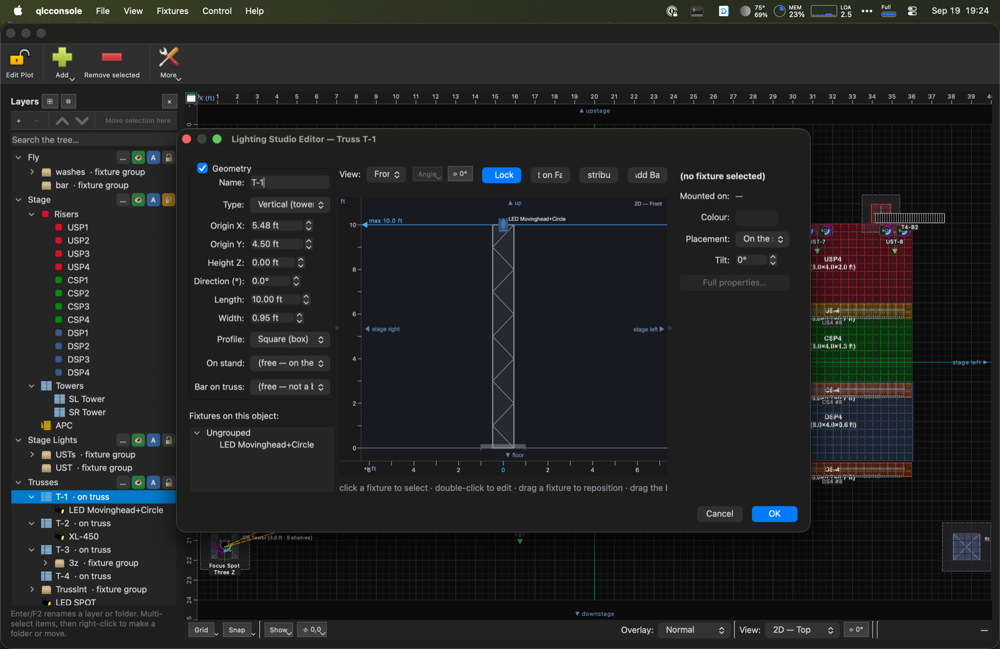

Double-clicking a structure opens its own **Lighting Studio Editor** — the
truss shown above has eight movers on it. Geometry
fields on the left, a live elevation preview in the middle (drag a fixture
in it to reposition), and a **Fixtures on this object** list. A dragged
fixture keeps the spot you grabbed under the pointer, and lands where you
let go in every view, the 2D plot agreeing: a free or deck-standing fixture
no longer jumps half its size, or creeps along the axis Front or Side can't
see.

### Front, Back and Side

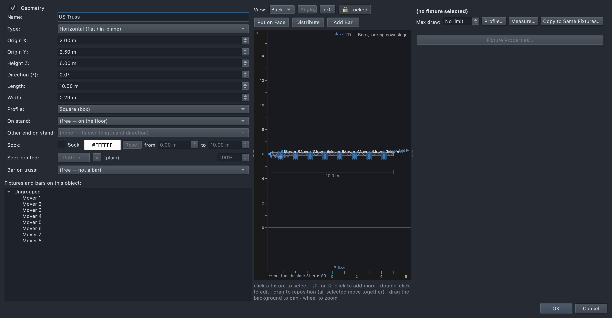

Every structure editor (truss, bar, pipe and boom, electric, stand, tower,
platform, group) has five entries in its **View** list: **Top**, **Front**,
**Back**, **Side** and **45°**, with **⌘1** to **⌘5** (Ctrl on Windows and
Linux) to switch between them while the editor is open. The Rig Overview's
**View** has the same list.

**Back** is the Front elevation seen from behind, looking downstage. Stage
left is on the **left** and stage right on the right, and the corner labels
and the badge ("2D — Back, looking downstage") say so. The ruler under the
canvas still counts out from the structure's centre either way, and reads
**from behind: SL ◀ ▶ SR** to remind you which side is which. Only the
picture is reversed: names and numbers read normally.

In Back, everything on a structure's **upstage** side is nearest you. A
laser or a wash hung on the back chord of a truss is drawn on top of
whatever is on the front chord at the same spot, and a click there picks
it, the way Front picks the downstage one. Back works like Front in every
other way:

- Drag a fixture to move it. The spot you grabbed stays under the pointer.
  Dragging to the right moves it toward stage **right**.
- **Put on Face** puts the selected fixtures on the **Back** face: facing
  upstage, against the structure's upstage side. In Front it puts them on
  the Front face.
- **Distribute** spaces them left to right as you see them.
- The rulers, the crosshair readout (H / V / Z) and the dimension
  callouts measure the same as in Front.

**Side** is the view from stage right: upstage on the left, downstage on
the right.

Click a fixture in that list (or in the preview) to see its own mount panel:

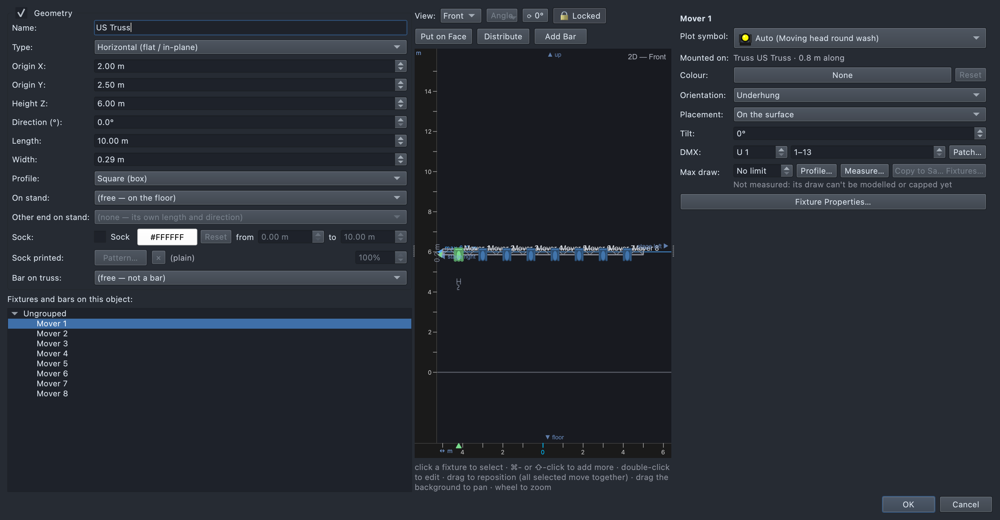

- **Plot symbol** — what it looks like: its icon and its shape on the plot
  and in the studio ([Plot symbols](#plot-symbols)).
- **Mounted on** — which structure and where along/on it.
- **Orientation** — which way up the body is: **Upright** (base down),
  **Hung** (base on top) or **Sideways** — worded for what it is on (on top /
  underhung / side arm on a truss, on or under a tower shelf). Offered for
  movers and pars, and for **anything that pans or tilts** even when it is
  shaped like a bar (a two-arm beam bar standing on a step is upright like
  any mover). Hung vs Upright inverts pan/tilt.
- **Face** — which way the fixture faces: **Top, Bottom, Front
  (downstage), Back (upstage), Stage left, or Stage right**. For a fixed
  light (no pan or tilt) it also aims it that way (see Aiming a fixed
  light, below). On the outside
  of a truss, choosing a face also moves the fixture to that side (on top,
  underneath, the downstage or upstage chord). This has to agree with *how*
  it's actually mounted, or the fixture looks right from one angle and
  wrong from another (see the callout below).
- **Placement** — **On the surface** (seated on/against the structure) or
  **Inside** (centred in its volume — for something rigged between truss
  chords, or under a Clear/Open platform top, so it reads correctly without
  needing to be visually "seated" on anything).
- **Angle / Tilt** — fine orientation of a strip or bar (a positive Tilt
  tips it up). A fixed light is tipped by **Tilt in yoke** instead.
- **Light / Glass** — for lanterns and other LED-source fixtures; see
  [Lanterns](#lanterns).
- **DMX** — its universe and start address, moved at once if the channels
  are free (and why not, if not); **Patch…** addresses several together, or
  gives an unpatched one an address.

These are the same rows, with the same names, as the **Fixture** box at the
top of **Fixture Properties** (the **Fixture Properties…** button under
them opens it): the panel is its quick subset, the dialog has everything —
name, X / Y, aim and calibration, Test and Identify.

### The Inventory panel

**Inventory** on the plot's toolbar shows the fixtures added to the show
but not yet on the plot. A network fixture is marked **[network]**, and
one that isn't the tour's **[House]** or **[Rental]**; **Filter** narrows
the list by name, and its foot says how many are waiting to be placed.
Drag one onto a truss, riser or tower to mount it there, or onto the
floor to set it down. A fixture dragged in (from Inventory or the
Fixtures tab) that is already on the plot isn't placed twice: the footer
says so and it is selected where it is. **Add to inventory...** opens Add
Fixture with no address. Patching is a separate step: see
[The Patch dialog](fixture-manager.md#patching-the-patch-dialog).

### Fixture Properties

**Fixture Properties** (double-click a fixture, or right-click ▸
**Fixture Properties…**) opens for every fixture, placed on the plot or
not, in three boxes:

- **Fixture**: the panel's rows, plus **Owner** (Tour, House or Rental;
  see [Owner](venues.md#owner-tour-house-or-rental)), **Position** on a
  tower (top, a shelf or the base), **Colour** (a fixed light's gel; the
  [patch list](fixture-manager.md#the-patch-list) lists it), and where they apply
  **WLED** (**Fix on Device…**) and **Max draw**.
- **Aim &amp; Mount**: **Height offset** (raised or lowered from its mount,
  a followspot on a riser above the truss, say); **Aim** — a mover's front
  of device, or a fixed light's **Points** and **Tilt in yoke**; **Beam (lens set
  to)**, the angle a lens zoomed by hand is set to (see
  [The beam](#the-beam)); the [calibration offsets](#calibration-offsets);
  **Invert pan** / **Invert tilt**; **Test orientation**; and **Identify**.
  **Identify** and **Reset** send the fixture's own value, hold it about
  3 seconds, then put the channel back as it was. A cue that sets that
  channel in the meantime keeps its value.
- **Position &amp; Orientation**: X, Y and icon rotation on the plot, and
  **Stage position**, where the light really is once its mount is counted.
  A fixture not on the plot has these greyed, *Not on the plot*.

**The orientation diagram** beside Position &amp; Orientation shows the
light from above, DS at the bottom. The **green** arrow is where it
throws: a mover's front of device (pan zero), or a fixed light's face
(Back points upstage, Stage left to stage left) or its Pan and Tilt aim
— the steeper it points, the shorter the arrow; straight down is a
filled dot, straight up a ring. The **blue** arrow is the icon rotation,
which only turns the symbol and never the aim. The diagram follows each
field as you change it.

**Right-click a fixture** on the plot for **Facing (pan zero) ▸**
(Downstage, Stage Right, Upstage, Stage Left), **Set Mounting Height…**
(its height above the floor, in your units from Settings → General → Units;
type `12' 6"` or `3.8 m`, either works), **Unmount from "…"** and **Mount on ▸**. These are
the plot's own and come first. Under them is the fixture's own menu —
**Fixture Properties…**, **Locate**, **Why is this on?**, **Patch…**, **LED
Layout…**, **Output Rules…**, **Selection ▸**, **Rename…** — the same as in
the Fixtures tab, Build and the Show Tree ([right-click
menus](fixture-manager.md#right-click-menus)). A truss, deck, target or
other piece works the same way: where it is, its locks and layers on top;
its own **Edit …**, **Add ▸**, **Used By ▸** (a target: the Aim palettes
pointing at it), **Rename** and **Delete …** below.

**Working on several fixtures at once.** Every row applies to every
selected fixture (select a group row, or "Ungrouped" — to take
everything in it; ⌘-click or ⇧-click on the canvas to add or remove). A row
they differ on reads **mixed** and changes nothing until you set it — then
it is set on all of them. **Fixture Properties…** with several selected
opens the same rows (plus aim and icon rotation) for all of them, and so
does **double-clicking** one of the selected fixtures — on the plot, in Plot
layers, or in a structure editor's fixture list (a group's or a truss's
worth too; click one first to edit it alone). Dragging
any selected fixture moves them all, as one undo. **Distribute** spaces a
few selected fixtures between the outermost two and lines them up.

**Aiming a fixed light.** A par, a profile, a laser or anything else with no
pan or tilt channel is aimed as it is on its yoke, in **Aim & Mount**:
**Points** is which way it points seen from above (0 downstage, 90 stage
right, 180 upstage, 270 stage left) and **Tilt in yoke** how far it is
tipped up or down from level, written that way: "45° down" (a typical front
light), "level", "10° up". The arrows go the way they say (up tips it up);
type "10 up" or "10 down" (a plain number is up, minus is down). The beam
in the 3D view, where its light lands on the plot, Quick focus and the
orientation diagram all take the same aim. Until you set either, it points
as its mount says (straight down when hung). With several selected, the
same two rows act on the fixed lights among them. A moving head's **Aim —
front of device** is its pan home instead.

**Face sets a fixed light's aim too.** A fixed light has the **Face** row
as a strip does: **Back** points it upstage, level; **Front** downstage;
**Stage left** / **Stage right** across; **Bottom** straight down; **Top**
straight up. It is a quick preset for Points and Tilt in yoke, which then
read the real aim (a tilt you had set is kept when you only turn it to
another side). **Dropped on a truss's chord** on the plot, a fixed light
that has no face yet takes that side's: on the upstage chord it faces
Back and throws upstage (a laser at the cyc), on the downstage chord
Front. Dropped on the centreline it hangs and points down, as before. The
Face row reads the side it throws nearest, and is blank while it points
somewhere in between.

**Tilt on a strip goes up.** A strip's or bar's **Tilt** (a roll about its
length) tips its light **up** for a positive value on any upright face —
Front, Back, Stage left or Stage right — where before it depended on the
side (on Back, positive went down). A show saved before keeps every bar
where it was: its tilt is read in the old sense and shown in the new one.
On a Top or Bottom face it is as before (positive tips it upstage when it
runs across the stage).

**Undo in an editor.** Ctrl/⌘+Z in a structure's editor undoes its last
change — a drag, a layout action, or a panel field (a run of steps on one
field is one undo). The editor as a whole is then one step on the plot's
undo once you press OK; Cancel puts back everything it did.

**Rotation handles.** Select one bar or strip in an unlocked structure
editor and it gets a ring with a knob: drag it round to turn the bar (Angle
when its length lies flat in the view, Tilt when you're looking down its
length). They snap to 15° as you turn; hold **Alt/⌥** to turn freely; one Ctrl/⌘+Z undoes the whole drag. Movers and
pars don't get handles.

**A boom's top.** In a stand's editor, unlocked, a dot on top of the boom
drags it taller or shorter. It is only there while the boom can move: not
with the editor locked, nor with the boom, its stand, its layer or the plot
locked.

**Mount on acts on the selection.** Right-click one of several selected
fixtures → **Mount on → Truss**, **Boom**, **Hanger**, **Tower** or **Deck**
and every selected fixture goes there.

**Hanging a fixture.** Right-click a fixture on the plot → **Mount on →
Hanger** and pick the hanger (listed with what it hangs off), or choose the
fixture in the hanger editor's **Hangs** field. Its panel then reads e.g.
"Mounted on: Hanger 1 on T-1". A fixture on a hanger hangs straight down
its chain: any Face, Angle or Tilt left over from what it hung on before is
cleared (a show saved with one is corrected when it loads — that is what
made some lanterns draw on their side, as dark squares).

**Standing fixtures on a deck.** Select them (as many as you like),
right-click one → **Mount on → Deck (N fixtures)**:

- **The Deck Under Each** stands every selected fixture on the platform it
  is over — the nearest within 20 in (0.5 m) when it sits on or just off an
  edge — with its base on the deck's top surface;
- or pick a **platform by name** to put them all on that one.

Each is set **Upright**, its old mount (truss, tower, a wrong deck) is
cleared, and one lined up exactly with a deck's edge is nudged about an
inch (a few centimetres) inside, so it is clearly on that deck. This is the clean way to
put a row of fixtures on a set of steps without any of them floating.

**Dragging onto structures: hold Shift.** A plain drag **only moves** a
fixture. To hang it on the truss or pipe — or stand it on the deck — you
drop it over, **hold Shift as you let go**. While you drag, the fixture's
outline turns **green** whenever letting go would attach it (pressing or
releasing Shift updates it at once), and **red** while you are pulling one
off the truss it is on. Several selected fixtures dragged together all hang
on the truss when the one under the pointer goes green, each where it
landed along it, so their spacing is kept.

- **Coming off needs no Shift.** Drag a fixture well off its truss, or off
  every deck, and it comes off, as before.
- **The Inventory panel is unchanged.** Dragging a fixture in from the
  Inventory and dropping it on a truss or deck still places it there —
  placing it is the point of that drag.
- **Height counts.** A fixture already mounted on something else (a tower,
  a deck, a riser, a pipe) is only offered a truss or pipe within 20 in
  (0.5 m) of its own height, Shift or not — a light at the foot of a tower is
  not hung on the bar 8 ft (2.4 m) above it just because it is under it on the
  plan. A free-standing fixture is hung by where you drop it.

**Patching like structures alike.** Right-click a truss, tower, deck or
pipe → **Patch Others Like This (N)…** — "like this" being the other
structures of its kind carrying the same fixtures (models and modes, in the
same order). The Patch dialog opens on all of them, matched to this one:
each fixture takes the address of the one in the same place on it, in its
own structure's universe. See
[Fixture Manager → Patching](fixture-manager.md#patching-the-patch-dialog).

**Duplicating a structure's setup.** Right-click a truss, tower, pipe or
deck that carries fixtures → **Duplicate Setup to…** copies what is on it
onto the other structures of its kind ("T1 to T2, T3"), where **Patch Others
Like This** only addresses structures that already carry the same lights.
The dialog lists the other structures; tick the ones to fill, choose the
rest, and read the preview (every copy, its name and its address) before
pressing **Duplicate**:

- **What is copied.** The same definition, mode and settings, and the same
  place on the structure: offset along it, side, shelf or deck position,
  face and orientation, and the calibration offsets (pan / tilt offset and
  invert). A copy is hung where the *target* puts that place, so a tower 16 ft 5 in (5 m)
  further on holds its lights 16 ft 5 in (5 m) further on.
- **Hangers and child bars.** A truss's hangers and the child bars hung
  from it (with the hangers on those bars), or a tower's hangers, are copied
  onto each target with the same place, arm, drop, face and run, together
  with the lights hung on them; they take the target's layer and plot group
  and a name that follows the same rule as the lights. The preview counts
  them. **Replace** takes the target's own hangers and child bars off with
  its lights, and Undo puts them back.
- **Names.** The structure's name inside the light's name becomes the
  target's: "T1-Spot 3" on T1 is "T2-Spot 3" on T2, and "T-1" is also found
  as "T1". A name with no trace of the structure gets the target's name in
  front ("T2 Spot 3"). A taken name gets the usual " #2".
- **Addresses.** *At the next free addresses* (the default) runs on from the
  end of the originals, spilling into the next universe. *With an address
  pattern* puts the Nth target N steps on from the original, in addresses
  and universes ("+100 addresses, +1 universe"): a copy whose address is
  taken, off the end of the universe or kept by the venue is left unpatched
  and says why in the preview. *Leave them unpatched* puts them in the
  inventory.
- **Groups.** Fixture groups (Fixture Manager) and plot groups are
  decided separately: **add the copies to the same groups**, or **make a
  parallel group** for each structure ("T2 All Spots"). A group named for
  the structure ("T1 Spots") always gets a parallel group, since adding T2's
  lights to T1's group would be wrong; T1's own plot group is swapped for the
  target's.
  *Decided, can change:* fixture groups default to adding, plot groups to
  parallel.
- **A target that already has fixtures** is asked about, target by target:
  **Skip it** (the default; nothing is removed or doubled), **Add
  alongside**, or **Replace them**. Replace removes the lights already
  there; scenes that used them lose those values, and the dialog counts the
  scenes. Undo brings the lights back but not their values in those scenes.
- **One undo step** (Ctrl/⌘+Z in the plot) removes every copy and group made
  and brings back anything replaced. In a **Teaching** show, when the patch
  would change, you are asked first ("Change the Patch"); declining makes
  nothing.

**Testing which way it points.** Fixture Properties → **Test orientation**:
the first pose centres pan and tilt, and is named for how the fixture is
mounted — **Straight down** hung, **Straight up** upright, **Straight out**
on a side arm — following Orientation as you change it.

A fixture standing on a riser/deck, a truss face, a tower shelf, or a pipe
each get their own mount fields, but only ever **one** primary mount at a
time — you can't leave a stale mount behind when you re-attach a fixture
somewhere else.

> **A fixture correct from Top but wrong from Front usually means Face is
> stale.** A deck-mounted fixture in particular needs Face set to "Top" —
> if it's left at the default ("Front (downstage)", meant for a fixture
> bolted to a vertical face), it'll show right from above but appear to
> float or sink through the deck in an elevation view. A deck mount left at
> that default is corrected automatically the next time the workspace
> loads; a Face you've chosen deliberately in this panel (Front or Back
> included) is remembered and left alone.

## Plot symbols

A definition's type says too little about what a fixture looks like: a
*Color Changer* can be a PAR, a staff or a cyc. **Plot symbol** says it. Set
it in Fixture Properties (one fixture, or several at once — a row they
differ on reads "mixed"), or right-click fixtures or groups in the Fixture
Manager → **Plot Symbol ▸** (offered in Operate too: a symbol changes only the
picture). The fixture's icon follows its symbol in every fixture list
([Icons](fixture-manager.md#icons)).

**Auto**, the default, draws the fixture as its definition's type always
has; the picker names the symbol that type is closest to, as *Auto (LED PAR /
round multi-LED wash)*; a dimmer channel's is *Ellipsoidal / profile spot*.
The other symbols, in six sections:

- **Moving** — Moving head spot, Moving head round wash, Moving head square
  wash.
- **Fixed conventional** — PAR can, Ellipsoidal / profile spot, Fresnel,
  Followspot.
- **Fixed LED** — LED PAR / round multi-LED wash, Square wash, Bar wash,
  Uplight wash, Cyc / strip light, Strobe / blinder.
- **Effects** — **Laser / star projector**: a box in its U yoke, its
  round aperture at the front. It is the *Auto* symbol of a definition
  whose type is Laser.
- **Practicals** — lights that are part of the set: **Lantern** (a
  hurricane lantern, or the one by a door) and **Staff** (a pole with LED
  strip wound round it from top to bottom).
- **Scenery** — **Curtain**: a fixture that moves a curtain rather than
  lighting anything, such as a relay on a dimmer channel that runs a
  traveler's motor. It is then a curtain fixture, like a **Generic → Stage
  Curtain** ([Curtains that move](#curtains-that-move)): listed under a
  drape's **Driven by**, drawn on the plot as that drape rather than as a
  fixture (its place on the plot is kept, hidden), kept out of Inventory,
  and shown with the curtain icon. A fixture marked Curtain that has no
  *Open* or *Fly* channel opens on its master intensity channel, or on its
  first channel if it has none: **0 closed, 255 open**. Back to **Auto**,
  it is an ordinary fixture again.

On the plot each symbol has its own outline — a followspot is a long barrel
with its lens at the front, a bar wash a wide strip, a
square wash a square with a square lens, a round wash a round base, a spot
a chamfered one — and its heads sit where its light comes out, square or
round to match. Marks over the lens say the rest: a spot's gobo, an LED
PAR's ring of LEDs, a Fresnel's rings, a strobe's two cells; a laser is a
box in its yoke, the yoke's back behind it, its aperture at the front. The lens still
shows the fixture's live colour and level. A definition with no dimensions
gets the symbol's proportions (a followspot long, a staff tall).

The practicals are drawn as what they are. A **lantern** has its hook, cap,
glass and base from the front or side (its base, from above). It throws no
beam: its glass glows in its colour and level and the glow spreads round
it, and in the studio it lights what is near it, as the LED lanterns do
([Lanterns](#lanterns)). A **staff** is a pole on a foot from the front or
side, its strip in diagonal turns down its length — the turns show the
staff's live colour, the pole between them is dark. From above it is a
small round dot.

Top, Front and Side draw the same shapes in the studio. The Angled view
draws a lantern as a lantern; every other fixture it still draws by its
type.

A symbol changes only the picture: how the fixture is driven, its beam and
its pool are its definition's. A moving-head symbol draws its yoke and aims
by pan and tilt as a moving head does; the fixed symbols and the practicals
do not — give a
moving head that is used as a followspot *Moving head spot*, not
*Followspot*, to keep its aim on the plot. Setting a symbol is one ⌘Z on
the plot.

**Showing Auto fixtures as their closest symbol.** On the plot's **Show**
menu, **Show Auto Fixtures as Their Closest Plot Symbol** shows every
fixture left on Auto as the symbol its picker names — a colour changer as an
LED PAR, a moving head with a gobo as a moving head spot, a dimmer channel
as an ellipsoidal — exactly as if that symbol were set: its icon in the
fixture lists (the Fixture Manager, Build's groups and fixtures, the Show
Tree's Library and layers), and its shape, proportions and lens marks on
the plot and in the studio. A group whose fixtures all come out as one symbol
shows that symbol's icon with the group badge. A symbol you set still wins, and
the output-rules badge still shows. Turning it off draws them as before. It belongs to the show and is
saved with it (only when on), so the plot looks the same on every computer;
a new show starts with it off. Turning it on or off is one ⌘Z.

The symbol is saved in the show only when it is not Auto, so a show without
symbols saves exactly as before, and QLC+ opens a show with symbols (it skips
them).

## Locks

Two locks hold things still: the **object's own**, and its **layer's**.
Either one is enough.

| Lock | Set from | Freezes |
|---|---|---|
| **Object lock** | An object's right-click menu → **Lock Position** / **Unlock Position** (**Lock Their Positions** for several), or a power source's or network node's own toggle | That one object. It stays selectable, so you can unlock it again; its Plot layers row shows a padlock |
| **Layer lock** | An object's right-click menu → **Lock Layer "Rig"** (named for its layer), or the layer's padlock in the Plot layers panel | Everything on that layer. On the plot it is click-through: a click, a rubber band or Select All passes it by and reaches what is under it. Select it from the Plot layers tree to inspect it (Properties and the right-click menu work); it still can't be moved or deleted |
| **Group position lock** | The Plot layers panel / group properties | Every member's position, but they stay selectable (locking a parent group locks its children too) |
| **Global layout lock** | The 🔒 "Edit Plot" toolbar button | The whole plot at once, aim targets included, still selectable. **Targets Stay Adjustable**, beside the button while the plot is locked, lets aim targets be dragged anyway. The arrow on the button opens **Always Start with the Plot Locked** |

**Dragging something locked** moves nothing and says why on the plot's
status line: **Plot locked — Edit Plot to move**, **Layer locked — unlock it
in Layers to move**, or **Locked — unlock it to move**. Nothing is stored, so
the show isn't marked changed and there is nothing to undo.

**Targets Stay Adjustable** (off to start with) is for re-aiming during a
show with the rig frozen: on, aim targets drag while the plot is locked;
off, a locked plot moves nothing at all. It is your setting, kept on this
computer, not saved in the show.

**Always Start with the Plot Locked** (off to start with) is in the menu
on the lock button's arrow. On, every show you open starts with its whole
plot locked, ready to run; the show isn't marked changed by it. Like
Targets stay adjustable it is yours, kept on this computer, not the
show's. It sits on the lock button because that is where you look when a
plot is locked, and it is there whether the plot is locked or not.

### What holds it: the Plot layers list

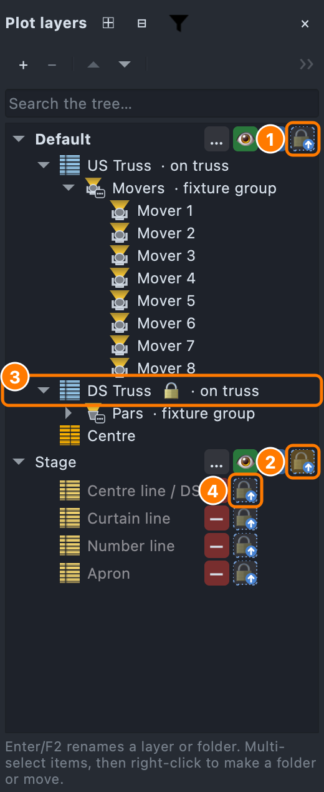

A lock that comes **from above** is drawn apart from the row's own: the
padlock faded, with a small **up-arrow** in a blue disc, and a dashed
outline. A row's own lock is the padlock as always.

1. **Held by the plot.** While the plot is locked, every layer's lock is
   drawn held from above, and its tooltip says **Locked by the plot**. Its
   own switch is kept under that: grey when the layer's own lock is off.
2. **Locked by the plot, and on its own:** amber under the hold. Click a
   layer's lock while the plot is locked and you change the layer's own
   lock; **unlocking the plot puts back exactly what each layer had.**
3. **An object locked on its own:** 🔒 after its name.
4. **Held by its layer** (or the plot): a stage piece's lock is drawn held
   from above while the Stage layer or the plot holds it. An object row
   shows **↑🔒** after its name when its own lock is off but its layer or a
   group holds it.

Each object's tooltip lists everything holding it, nearest first:
**Locked on its own**, **Held by group "Booms"'s lock**, **Held by layer
"Rig"'s lock**, **Held by the plot lock**. The plot's lock isn't repeated
as a ↑🔒 on every object: the layer rows show it. On the plot, an object's
right-click menu says **Held by the plot lock — Edit Plot to move** while the
plot is locked.

Unlocking a layer leaves the objects on it that are locked on their own
still locked. **Locked draws red**, always: every locked object, and
every fixture on a locked layer, gets a red outline (a target keeps its
own colour and gets a red ring).

A new object never lands on a locked layer, where it could not even be
picked. When the active layer is locked, placing one **asks where it
goes**: the unlocked layers are listed (the first one picked, as
before), with **Place on this layer**, **Unlock "Rig" and place here**
(the layer unlocked, the object on it) and **Cancel** (nothing placed).
The answer holds for the rest of that placement (every fixture of one
drop, everything one paste makes); the next one asks again. With every
layer locked, it offers only Unlock or Cancel.

**Shows from 0.2 with a "Locked" layer.** For a while an object's lock was
its layer's, and opening a show that had objects locked on their own moved
them onto a locked layer named **"Locked"** -- which is where that layer came
from. Opening such a show now takes it apart: each object on it keeps its
lock as its own, and goes back to the layer its group, its fixtures or what
it is mounted on are on. When nothing is left on "Locked" it is removed;
when the show doesn't say where something came from, it stays there, on an
ordinary unlocked layer you can rename or empty. Locks that only repeated a
locked layer's are dropped (the layer still holds those objects).

Fixtures don't carry a lock of their own — a fixture's movability comes
from its layer and whatever it's mounted on. **Locking a truss's layer
locks the fixtures riding it, everywhere** — the main 2D plot and every
per-object Lighting Studio editor honor it, not just whichever view you set
the lock from.

The 🔒/🔓 toggle inside a per-object editor is a separate, session-only
convenience — it starts locked every time the editor opens, purely so a
stray drag can't move something while you're just looking. It's independent
of, and doesn't override, the real locks above.

## Selecting and undo on the plot

**One rule for everything on the plot** — fixtures, targets (people,
points, lines, areas), trusses and other structures, decks, scenery,
props, images and nodes:

- **A click selects exactly what you click.** One person out of a group of
  performers is just that person; one line of a choir is that line, its
  pair of people with it; a truss or riser brings its own parts (its bars,
  hangers and the fixtures rigged on it), because they are one thing.
  **Shift**-click adds or takes away one more; a rubber band picks what
  is inside it.
- **Built assemblies are one thing.** What a builder makes as one object —
  **Add Fountain…**'s base, walls and flame, a stamped studio component —
  selects whole from a click on any part, and moves whole. **Double-click**
  a part to go into the assembly and pick just that part; **Esc** or a
  click outside comes back out. **Shift**-click adds the whole assembly.
  A group *you* made of things placed one by one is not an assembly: its
  members are clicked one at a time.
- **A right-click on part of the selection acts on all of it**:
  **Lock N Items** / **Unlock N Items**, **Move to Layer**, **Duplicate N
  Items**, **Delete N Items…** — one undo step each, an assembly counted
  as one item. A fixture has no lock of its own (its layer or what it hangs
  on holds it), so Lock counts the rest. **Edit…** opens the one you
  right-clicked. A right-click outside the selection selects just that item
  first.
- **Duplicate** (right-click, or **Cmd/Ctrl+D** on the plot) copies the
  selection 20 in (0.5 m) on: a target keeps its kind, colour, size, aim and
  person heights, a line its points and people, and is numbered on
  ("Soloist" → "Soloist 2"). **Cmd/Ctrl+C** / **Cmd/Ctrl+V** copy and paste
  targets the same way, several at once, with trusses, decks and scenery.
- **⌫ / Delete** takes the selection off the plot, as **Remove Selected**:
  every selected fixture goes back to the Inventory (it stays in the show,
  its cues keep it), a structure or a target asks first; one **⌘Z** puts
  it all back. **F2** renames the selected item (its row in Plot layers),
  **⌘F** goes to Plot layers' search, and **Esc** lets go of the selection
  (out of an assembly first). Plot layers takes the same keys
  ([Edit keys](shortcuts.md#edit-keys-the-same-in-every-list)).
- **Right-click ▸ Select All Similar** picks every one of the same kind:
  fixtures of the same model and mode; targets of the same kind (people:
  every person; a performer line: the lines of its set); trusses of the same
  type and profile; decks or steps; pipes of the same orientation; scenery of
  the same kind; every stand, tower, hanger, image or power source; network
  nodes of the same transport.
- **A group is selected as a group**: click its row in **Plot Layers**, or
  right-click a member ▸ **Select Group “name”**. Drag any of it and all
  of it moves; click one member again (no drag) to pick it out.
- Groups are kept as they were: **Group ▸ New Group** and **Ungroup**
  make and split them, and locks hold as before. A new group of one member
  and something else moves that member into the new group (the rest of its
  group stays); a whole group selected nests inside the new one.
  **Move Selection Here** in Plot layers does the same: a whole group goes
  to the layer, one member leaves its group.

- **The plot's footer bar**: **Grid** (stage size, units, subdivisions);
  **Snap** (below); **Show** — **Rulers**, **Fixture Labels**, **Fixtures
  on the rig** (hide the mounted fixtures while you place structures),
  **Stage Centre Lines** (the teal cross) and the beam and reach views;
  **⌖ 0,0**, where the rulers read 0 (click a point, **Stage Centre**,
  **Downstage Centre** or the top-left corner); **Overlay** (Normal,
  Power, DMX, Network, Owner, Stage only); **View** (Top, Front, Side)
  and the button that turns the plot 90° (a view setting; nothing moves).
  Click a box to step to its next choice; its arrow lists them all.
- **Snap**, on the plot's footer bar, puts what you drag on the grid:
  fixtures, trusses, towers, stands, pipes, scenery, platforms, power
  sources and network nodes. Its arrow picks the step (**Snap to:**
  Full, 1/2 or 1/4 of a grid square), whatever the grid draws. A fixture
  snaps by its **centre**, the point its light comes from. A grouped
  selection moves by the same amount as the piece you drag, so it keeps
  its shape.
- **Group ▸** (right-click the plot, any object, or a structure's Studio
  canvas) files things in the plot's groups, which Plot layers lists as
  groups and which select and move as one from a row or **Select Group**.
  See [Grouping stage features](#grouping-stage-features).
  **Ungroup** (Ctrl/⌘+Shift+G) dissolves a whole group.
- **Align Fixtures ▸** (two or more selected) and **Distribute Fixtures
  ▸** (three or more) are on the plot's right-click menu. They work on
  what the plot draws: **Same X** and **Same Y** line up the fixtures'
  centres, **Left**, **Right**, **Upstage** and **Downstage** line up those
  edges, and **Distribute** spaces the centres evenly between the outer
  two. A fixture's hanging height is kept, and one Undo puts them back.
- **What you pick is the programmer's selection.** A click or rubber band
  on the plot, or a click in the Rig Overview or a structure's editor, is
  what the Workbench edits and what Flash, Park and Highlight work on —
  whichever tab is in front — and every other view rings it (orange on the
  plot). All of a group picks the group; one or two short of a group, or a
  member just outside the band you dragged (outlined blue), brings a chip
  offering the rest: click it or press **Tab**, **Esc** to leave it. See
  [One selection](build.md#one-selection).
- **Selection ▸** on a fixture's right-click menu: **New Layer from
  Selection**, **Add to Current Layer** and **Create Fixture Group from
  Selection…**. **New Map Layer from Selection…** (in the layers part of
  the menu) moves the selection onto a new layer of the plot.
- **Select All** (Ctrl/⌘+A, or **More → Select All**) selects every
  visible, selectable object on the plot at once.
- **Undo** (Ctrl/⌘+Z, or the toolbar's **Undo**) puts back the last move,
  paste or edit: a whole drag at once (everything it moved — structures,
  scenery, targets, nodes, fixtures — and a deck brings its fixtures back
  with it), or everything one dialog did when you pressed OK.
- **Copy and paste** (Ctrl/⌘+C, Ctrl/⌘+V; **Copy Selected**, **Paste Here**,
  **Duplicate Selected**) — trusses, decks, targets, scenery (walls, drapes, the
  cyc), towers, booms and stands. A truss brings the
  fixtures hung on it as new copies, and the paste asks what they get:
  **Patch at next free addresses** (after the originals, in their universe;
  when that universe has no room the rest go on into the next, and any
  that still don't fit stay unpatched), **Leave unpatched** (address them
  later with **Patch Others Like This**), **Truss only** (the truss
  without its fixtures), or **Cancel** (nothing is pasted). The plot's status line says what happened, and one Undo takes
  the truss and its fixtures away.
- **Rotate** — right-click → **Rotate…** (an angle, clockwise seen from
  above; less than 0 the other way), or **]** / **[** for 15° clockwise /
  anticlockwise and **}** / **{** for 1°. The selection — a group, or
  anything selected — turns about its middle: each thing's place and its own
  facing, and everything on it turns with it (fixtures on a truss, a tower's
  shelves or a riser's face; what stands on a deck; hangers; a studio frame's
  members). One Undo puts it all back. A backdrop image and a mark bound to a
  structure stay put; the mark follows its structure.
- **Platforms and towers face any way** — **Facing** in their editors
  (degrees, about their middle); what is on them turns with them. Light lands
  on a turned deck where it really is, and a turned flight of steps climbs
  the way it now faces.
- **Every rig dialog works the same way** — truss, pipe, platform, tower,
  stand, scenery, group, hanger, image, target, network nodes and Fixture
  Properties: the
  plot follows its fields as you change them, **Cancel** puts back
  everything it did, and **OK** is one undo step. Lengths are entered in
  your units — feet and inches unless you chose another (see below); colours are one swatch
  button showing the colour and its hex value, with **Reset**.
- **Units are yours, not the show's.** Every length you read or type —
  H/V/Z readouts, dimension and height labels, every length field, the
  mounting height, reports and CSV columns, the focus remote — uses
  **Settings → General → Units**, exactly: `12' 6 1/4"` with feet and
  inches (the default, read like a tape measure to the nearest 1/8"),
  `150 1/4"` with inches, `3.81 m`, `381 cm` or `3810 mm` with the metric
  ones. Any field takes a length typed in any unit, fractions or decimals
  (`12' 6 1/4"`, `12' 6.25"`, `11-1/4"`, `3/8"` or `3.8 m` all work). Only the grid itself is coarser: its
  cells and rulers count **feet** for inches or feet and **metres** for mm,
  cm or m (finer cells would only crowd a stage grid). The Grid button's
  menu shows your unit and says where to change it. A show opens in your units whatever it was
  saved in — the stage stays the same size, converted exactly — and is
  saved in them (whole numbers for older versions, the exact size beside
  them). The first show you ever open decides for you, once, if you had
  never chosen: one saved in feet sets **Settings → General → Units** to feet.
- **Select All Similar** — on anything on the plot (or its Plot layers
  row), every one of the same kind (see the rule above); on a fixture
  group's Plot layers row, the groups of the same fixtures laid out the
  same way.
- Selecting on the plot selects the same objects in Plot layers, and vice
  versa; clicking a fixture group's row selects its fixtures on the plot.
  Cmd/Ctrl-click and Shift-click rows to select several: every one of
  them is selected on the plot, stage pieces and hangers included.
  See [Plot layers](#plot-layers) below.
- Count badges follow their structure through drags and undo, and keep one
  screen size at any zoom, so zooming in uncovers what's under them.

**⇧⌘N (New here)** makes a **Target Position** where the pointer is on the
plot (mid-view if the pointer is elsewhere), on the active layer, with its
Aim palette, as **Add Here ▸ Target Position** does but without the dialog.
It is selected and its name is open in Plot layers. The **Edit** menu reads
*New Target Position (⇧⌘N)*, and is off while the plot is locked. One
undo step takes the target and its palette away together.

## Plot layers

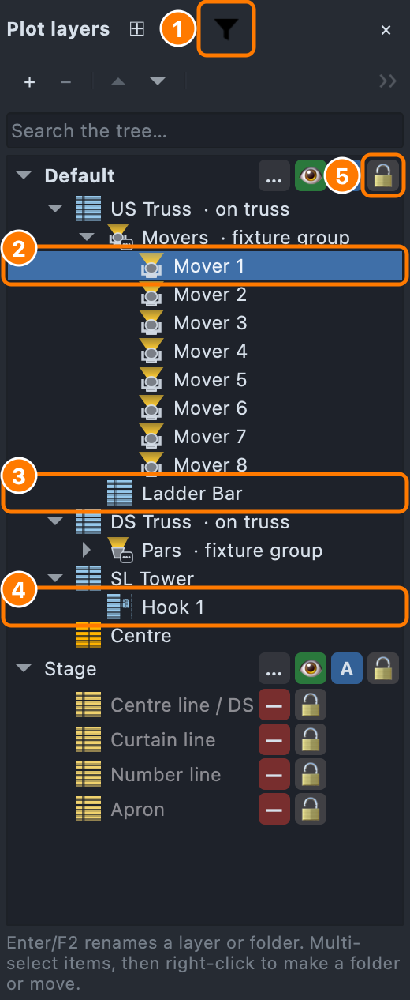

1. **Selected only** (the funnel; off to start with): the list shows just
   what is selected and what holds it -- its layer, its structure, its
   group -- and follows the plot as you pick.
2. **Picked on the plot, picked here.** The list opens only the branches
   holding what you picked and scrolls to the first; a fixture is picked
   where it hangs, not again under each fixture group that lists it.
3. **What hangs on what is a tree:** a bar under its truss or stand, a
   crossbar under its boom, a fixture under the bar, hanger, tower or boom
   it is on.
4. **Tower ▸ Hanger ▸ Lantern:** a hanger under its tower or truss, the
   lantern on it under the hanger. Drag a fixture onto a hanger's, bar's,
   tower's or boom's row -- or onto a fixture already hung there -- to hang
   it there.
5. **A layer's lock** (and its eye and labels). The list keeps clear of an
   overlay scroll bar, so the bar never covers these. What a locked layer
   holds is still picked here (the plot lets clicks through it), so this
   is where you reach it to read its properties.

Select several rows with Cmd/Ctrl-click or Shift-click: the plot selects
all of them, not just the last one clicked. Click a group's row (a group,
a fill's set) to select everything in it; on the plot a click picks one
member at a time.

Right-click a layer for **New Group** (named in place) or **New Layer**;
right-click a group for **New Group Inside**. **Move to Layer** on a
truss, tower or riser that carries things moves it with everything on it.

## Beams, footprint, and coverage

When a fixture is live (Design or Operate mode), the Lighting Studio and
the Rig Overview show what it's actually doing, not just where it sits:

- **Live colour** — a fixture shades by its real current output, reading
  every color-primary channel the fixture defines (RGB/W/Amber/UV/CMY and
  more), not just the common ones. An unlit fixture still reads as an
  object in the room at low ambient brightness, not a flat black shape.
- **Beams** — a moving head or any other emitting fixture (pars, washes,
  bars too, not just movers) draws a light cone from itself to wherever it
  actually lands — the floor, or the nearest platform top in its path —
  with a landing pool shaped like the true conic section where the beam
  meets that surface — or on the cyclorama, for a beam going level or up.
  A beam that lands on more than one thing — half on the end of the cyc and
  half past it, or across the edge of a deck — is split between them, each
  part of the pool on what it reaches. Platforms, risers and steps are
  solid: a beam thrown across the stage stops at a riser's side as well as
  its top, washes the faces it reaches, and lights nothing behind the riser
  or below the floor. In a side or front elevation (the Angled view with
  the eye level, up to 10°) the beam is cut round each riser it meets, and
  the light on a riser's top and lit face shows as a bright band just inside
  that edge.
- **Gobos and prisms** — a beam's pool is drawn through whatever its
  optics are doing: the gobo in the current slot (an open slot, or a wheel
  spinning between slots, shows none), turned by gobo rotation, repeated by
  a prism and turned by prism rotation. It shows on the floor, a deck, or
  the cyc, and dims the haze by how much light the gobo passes. Your own gobo
  pictures go in a slot per fixture: right-click a fixture on the plot →
  **Gobo Wheels…**, optionally for every fixture of its type.
  **Loaded gobos.** When you load your own glass in a light (the moon in
  AT-2 3's slot 3), name it: in **Gobo Wheels…** pick the slot and press
  **Name…** (or double-click its **Loaded glass** cell) and type "Moon". A
  picture is optional; a named slot with no picture of yours gets library
  pictures suggested by that name. From then on that light's slot is called
  "Moon" everywhere a gobo is named for it: the Look Editor's wheel list,
  the channel console's value menu, the Gobo look's "what each type plays"
  lines. A Gobo look named "Moon" finds it in **whichever slot each light
  carries it**, so AT-2 3 can have it in slot 3 and AT-2 5 in slot 5. A
  light in the look with no moon loaded ignores it, and Show Review says so
  (**FIX-19**). **Gobo Wheels…** works on several lights at once (select
  them on the plot, in the Fixture Manager or the Show Tree, or right-click
  a fixture group): the lights must have the same gobo wheels (if they
  don't, the item is greyed with the reason). A slot you change is changed
  in every one of them; a slot you leave alone keeps each light's own glass
  ("varies" shows where they differ). OK is one undo step.
  A definition that **names its gobo slots but has no picture for them**
  (no Res, a bare folder, a file that isn't there) still shows a gobo: the
  rig view draws a **stand-in** for each slot, from what its name says
  ("3 Spots" = three dots, "Split Circle" = pie slices, "Concentric" =
  broken rings, "Swirl"/"Spiral" = arms, "Zebra" = stripes, "Tetris" =
  blocks, "Random Spots" = scatter, "Flower"/"Lotus"/"Rose" = petals,
  "Triangles"), or a seeded breakup for any other name, the same every time
  and different in every slot. "Open", "White" and "No gobo" stay open. A
  shake slot (the name, or the shake preset) wobbles; a "Gobo Rotate Speed"
  range turns the glass before it. Stand-ins are a guess at the shape, not
  the real glass: **Gobo Wheels…** lists those slots with their stand-in,
  suggests a library picture by name for each (the pictures stock
  definitions give a slot of that name), and **Fit Suggested Pictures** fits
  the first suggestion in every empty slot. Nothing is kept until you press
  OK. Show Review notes it once per definition (**FIX-17**).
- **Light footprint** (the Show menu / a structure or fixture's context
  menu) — toggles an overlay of **everywhere a selected moving head's
  pan/tilt range can possibly reach**, not just where it's currently
  pointed. A head standing upright with a narrow tilt range can have a
  "coverage" that's nothing at all — and if so, the overlay tells you why in
  plain language (e.g. *"can light nothing here: standing upright, 190° of
  tilt reaches 5° below level — 115 ft out from 10 ft up"*) rather than just
  silently drawing an empty overlay.
- **"Where selected heads CANNOT reach"** — the complementary overlay: deck
  area none of the selected heads can aim at, shaded red.

Both overlays are visualization aids only — they aren't saved with the
workspace.

### Line of sight

**Show → Line of sight** says what stands in a beam's way and how the views
show it:

- **What blocks a beam** — drapes and cyc, walls and proscenium, platforms
  and risers, towers, trusses, pipes and stands (trusses, pipes and stands
  only when at least 8 in (20 cm) thick). Saved with the show; it's what a follow
  spot's *Fade When Blocked*, an Aim look's *Dim lights that can't see the
  target* and the blocked traces go by. See
  [Line of sight](stage-targets.md#line-of-sight).
- **Beams Stop at What Is in Their Way** — in the Angled view and the Rig
  Overview a beam already stops at a platform (its top or its side), a
  drape or a wall; with this on it stops at a tower or a truss too. Off by
  default; remembered.

On the plot, a head aimed at a target it can't see draws its aim line **red
and dashed to the blocker**, with a cross where it stops and a faint dotted
line on to the target; hover it for what's in the way and how far out.

### Heads travel at their real speed

A moving head takes time to get there. In the **Rig Overview**, when the
output jumps a head to a new pan and tilt, its beam now travels at the speed
that type of head can: 0.4 s for a half turn (180°) for a moving head, 0.1 s
for a scanner, pan and tilt together. A cue that "snaps" a spot across the
stage in a frame is drawn as the move it would be, so you see what the
audience sees (and what Show Review's [MOV checks](show-review.md) are
about). Definitions carry no speed, so these are defaults. A head that points
within only part of its pan channel (a two-arm beam: pan 0-127 points, above
that it spins) travels its range along that pointing band.

Turn it off with **Real Move Speed** in the Rig Overview's footer, beside
Beams; the heads then snap to the output as before. Remembered. It changes only how the Rig
Overview draws; the output itself is untouched.

### Washes and profiles: the edge of a pool

A beam's angle (the definition's **Lens** degrees) is where the light is
half as bright as in the middle. What happens past it depends on the
fixture:

- A **wash** goes on past its beam angle, fading out to nothing at about
  1.4 times it — a soft-edged pool. Pars, LED bars of pixels, wash movers
  and anything else that can't sharpen its beam are washes.
- A **profile** stops almost at its beam angle, with a crisp edge. A
  fixture is a profile when its definition has a **gobo wheel**, a
  **focus** or an **iris** channel — what you'd only have on a light meant
  to be sharp — or when its type is **LED Bar (Beams)**. A gobo in the
  beam is always drawn sharp.
- A **PC** or **Fresnel** lens (the definition's Lens name) is softer
  still, as those lenses are.
- A very narrow beam (under 12°) stays fairly crisp, whatever it is.

So the angle in the definition should be the fixture's real beam angle;
the edge follows from what the fixture is. A fixed lens has the same
Min and Max degrees — different ones say it zooms.

### How bright each fixture is

The Lighting Studio and the Rig Overview size each fixture's light from what the device actually puts
out, read from its fixture definition: the **declared lumens**, or failing
that the **declared watts at about 35 lm/W**. A 100 W LED fixture (3500 lm)
is the reference full beam, and a fixture's output is shared between its
heads, so one section of a bar carries its share. This applies to beams,
pools, light on people, light from inside steps, and the wash on the cyc.
A definition that declares neither is drawn at a guess (as before this
change), and the footer's **Not ready** list names those fixture types
("N fixture types declare no light output"), with **Edit Definition…** to
fix one — save it and the show picks up the new figure without reopening.

- **Pixel bars** — the light comes from the lit pixels, not one cone from
  the bar's centre: each lit section throws its own cones along the bar, in
  its own colour, and lit pixels fill their cell on the bar's face.
- **A bar's light leaves its face** — the side it's faced to, with its tilt
  and flip — so a bar hanging from a truss and faced front lights forward,
  not straight down.
- **Wide cones are dimmer by their spread** — a 150° flood puts less light
  on any one spot than a 40° spot of the same output, in the air, in its
  pool, and on people. A declared lens of 170° or more is treated as a 150°
  flood.

### Light from inside steps and platforms

A fixture placed **Inside** a Clear- or Open-topped platform or step lights
the room only through the top. Each lit head is its own light, firing along
the fixture's facing (tilt included) in its cone, so a washer tipped
upstage lights upstage. The top shows a footprint per lit section of the
bar, each in its own colour, and a person is lit only where those cones
reach. That light also washes onto **scenery**: if a step's light clears
the top and reaches the cyc, the patch it lights there is drawn too (with
Beams on) — handy for checking for overwash. Other structures don't yet
block it.

### Haze

The Rig Overview's footer bar has a **Haze** setting — **None / Light /
Medium / Heavy** (click to cycle; Medium is the default). It sets how
visible beams are *in the air*; where the light lands and what it lights
don't change with it.

In haze, low-output LEDs still read: each lit section of a bar or par gets
a soft **glow** round it, and a lit strip inside a clear- or open-topped
step sends a sheet of **lit air rising** off it, both as bright as the
pixels (colour × dimmer) and scaled by the haze. Lanterns have their own
halo; movers show their beams.

The glow is lit air round the light, so it is hidden by what stands in
front of the light: a row of steps behind the closed main drape shows no
glow on the drape (or on the floor in front of it), and where the drape
opens the glow shows through the gap. A scrim is seen through, glow and all.

### Colour rings

A mover with a **colour ring** round its lens (a ring of LEDs on one
colour-macro channel) shows it, live, on the **2D plot** — a band round
the head — and in the **Rig Overview** — a ring of points on the head's
face, turning with pan and tilt and hidden when the face is turned away.
Off is dark glass; a colour lights it all round; a chase
(Red/Yellow-Chase, RGB/Random-Chase) steps its colours round four times a
second. The ring has no dimmer: it shows whatever the spot's dimmer says.

What counts as a ring, in order: a head of its own whose only colour is a
colour wheel/macro channel, on a fixture that moves (a definition with a
**Ring** head); else a Colour channel named "Circle", "Ring" or "Halo";
else a Colour channel after the fixture's first whose slots include an
off and a chase (a wheel has neither). Anything else draws no ring. A
ring that is a head of its own is not drawn as a second mover: the
fixture is still one head on its yoke, and the spot's colour (its wheel)
is the beam's.

### Lasers and star projectors

A fixture definition can say what its light *is* (Fixture Editor → Look in
the Lighting Studio → **Light**). **Beam**, the default, is a cone that lands as a
pool. **All round** is a bare source, like a lantern. Two more are for
lasers:

- **Laser beam** — a pencil line from the head to where it lands, with a
  bright dot there; in haze, a glow along it. A head with several beams
  fans them across its lens angle.
- **Star field** — a projector of colour points: a few hundred stars
  scattered across its spread (the declared angle, else 100°), each landing
  where its ray meets the floor or a structure, with faint rays in haze. A
  prism-rotation channel (or a Prism capability with a speed) turns the field.

- **Where a laser's window lands (2D Top).** A fixed laser's scan window is
  drawn as a dashed amber outline where it lands. It stops at the cyc, a
  closed drape or a flat in its way: the pool on the cyc is a heavy amber
  span along its line, not a shape on the empty floor behind it, and any
  floor part is clipped to the plot's floor. Where the window crosses a
  no-light zone that keeps lasers out (the showband between the cyc and the
  risers), the part inside it is drawn in red.
- **Masking.** Tape over the front of any light: **Fixture Properties ▸
  Masking (tape)** or right-click ▸ **Masking…**. Top, bottom, left and
  right are degrees cut off the beam (or a laser's scan window), seen from
  behind the light. "Tape off the bottom 15°" is 15 in Bottom. The plot,
  Show Review (PWR-09 to 12) and area coverage all use it; it is the unit's
  setting, saved with the show, not the definition's. The same panel holds
  a laser's **power class** (1, 2, 3R, 3B, 4).
- **What a laser looks like.** In the Rig Overview a laser is a box in a
  **U yoke**, the way a sky laser hangs from its bracket: the yoke's clamp
  at the truss (or on the deck it stands on), its two side plates, and the
  box between them. The box's front is a dark **window** with a round
  **aperture** for each beam (one to three), toward where it throws, and
  the apertures light in its live colour; the box itself stays dark, as the
  real one does. **Tilt in yoke** tips the box between the plates; the yoke
  turns to the way it **Points** and stays square to its clamp. A
  definition with no size gets a sky laser's, 7 7/8 × 4 3/8 × 7 1/2 in (200 × 110 × 190 mm). Drawn so
  are definitions of type **Laser**, those whose light is a laser beam or a
  star field, and any fixture given the **Laser / star projector** symbol;
  another symbol (a strobe, say) draws it as that.

Both take their colour and level from the fixture's live output, like any
other light, and follow a mover's pan and tilt. A laser shows only when it
is lit: a level on its Intensity channel **and** some colour (with red,
green and blue all at 0 it puts out nothing).

- **On the 2D plot too.** In the Top view, **Show ▸ Laser & star output**
  (on to start with, remembered) draws every lit laser's beams as pencil
  lines out to where they land, and every star laser's stars as dots where
  they land — on the floor, a deck, or along the cyc's line — in the live
  colour, following the DMX about 15 times a second and turning with a
  prism rotation. Not just the selected ones: every lit one.
- **Which way it throws.** A laser that can't aim itself throws the same
  way in 2D and 3D: its Pan/Tilt aim if set, else out of the face it was
  put on (faced **Back** on a truss, it throws upstage — at the cyc, not
  into a pool under the truss), else out from its riser or deck, else down
  off a truss when hung, up when standing. The light footprint follows the
  same rule.
- **An older definition.** If the show carries its own copy of the
  fixture's definition and this computer has a different one, the show's
  is used (nothing switches by itself) — and the plot's tooltip says
  *Definition: the show's copy — this computer has a newer one* (or *a
  different one*), and the
  line at the top says so once as the show opens. **Review… ▸ Use This
  Computer's** switches (see
  [Troubleshooting](troubleshooting.md#files-and-fixtures)).

- **Silk flame** — a fan blowing a sheet of silk up over its own orange and
  yellow lights, switched by a relay: when its channel is past half, tongues
  of flame rise off it, wavering, and warm what is near it; below half it is
  off. The bundled **Generic → Silk Flame (relay)** is one channel for a DMX
  relay pack.

### No-light zones

Some places must stay dark: the orchestra pit, the conductor, a camera
position, the audience's eyes. **Add ▸ Add Scenery ▸ No-light Zone…** puts one on the
plot (just downstage of the stage's front edge to start with); its dialog
sets the **name**, where it is (X, Y of its upstage edge, **width** and
**depth** on the floor), its **bottom** (a pit is below 0) and its **height**
above that, and what it **keeps out**:

- **No light**: every lit beam.
- **No beams**: directional beams (a lens of 25 degrees or narrower) and
  lasers, not a wash that only fills.
- **No lasers**: lasers and star projectors.

A zone is a red hatched box with its name: a rectangle in Top, a box in the
Front and Side views. Its inside takes no clicks, so the plot under it
stays selectable; **drag its outline or the small square at its centre**
to move it (X and Y in Top; X and the bottom in Front; Y and the bottom in
Side), one undo step. **Double-click** bare plot inside it, or right-click it,
to **Edit** or **Remove** it. A beam stops at the stage floor, so a pit's
zone must reach up to 0 to catch what comes down into it. Every change is one
undo step.

The zones are saved **in the show** with the rest of the plot, not in the
venue file (decided, can change: a venue file carries only the power today).
[Show Review](show-review.md) PWR-11 names every cue where a lit beam's cone
crosses one, and the lights and the zone.

A fixed laser also gets its **scan window** drawn in Top: a dashed amber
outline where its H × V window lands on the floor (100 ft (30 m) out when it doesn't
come down), the same window PWR-09 checks against the audience and PWR-11
against the zones.

## Calibration offsets

A moving head's **Pan offset** and **Tilt offset** (Fixture Properties ▸
**Aim &amp; Mount**, or [Quick focus](#quick-focus)) correct the *physical* head: a
yoke bolted a few degrees round, a tilt that homes a little high. They are
calibration, not design:

- **The DMX includes them.** Every aimed look, line target and follow spot
  adds the offset after working out where the head should point, so the
  real light lands where the design says.
- **The views leave them out.** The plot, its pan/tilt gauges, the Studio,
  the Rig Overview, beams, footprints and line-of-sight rays all draw the
  **intended** aim. A head with +3° of pan offset aimed at the Main Drape
  draws its beam on the Main Drape, not 3° off it. (What you see is the
  light on stage, assuming the offset exactly cancels the fault — which is
  what setting it means.)

**Facing (pan zero)**, the invert switches and standing or hanging are not
calibration: they are how the head is rigged, and both the DMX and the views
use them.

**Test orientation → Aim at target** in Fixture Properties points the head
the way an Aim look would, offsets included, so you can set them by eye.
For a whole rig, use Quick focus.

## The Focus menu

Every tool for focusing is on one drop-down on the Lighting Studio
toolbar, **Focus ▾**, beside **Add ▾**:

- **Quick Focus…** — the rig, a head at a time, into the show's own
  calibration ([below](#quick-focus)).
- **Venue Focus…** — the show's focus calls, for the venue applied
  ([Venue focus](focus-calls.md#running-venue-focus)).
- **Edit Focus Calls…** — the calls, in order, and the venue
  ([Setting up the calls](focus-calls.md#setting-up-the-calls)).
- **Venues ▸** — the venue menu, the same one the footer's venue chip
  and **View ▸ Venue…** open: **Switch Venue ▸** a venue (or None), **New
  venue…**, **Rename…**, **Rig and Universes…**, **Venue Focus…**, **Focus
  report…**, and **Clashes (n)…** when there are any ([The venue
  chip](venues.md#the-venue-chip)).
- **Practice (scramble)…** — knocks the moving heads in the calls off
  their targets by a random amount for you to focus back, scored
  ([Practice](focus-calls.md#practice-scramble-and-focus-back)).
- **Focus Report…** — the venue's focus, light by light
  ([The focus report](focus-calls.md#the-focus-report)).

An entry that cannot be used yet is greyed, and its tooltip says why: no
lights placed on the plot, no focus calls yet, none of the calls with a
light placed on the plot, no moving head in the calls (Practice), a
practice applied already, no venue yet, or a show not saved yet.

## Quick focus

Aligning the rig before a show, one head at a time, with a game
controller (an Xbox pad, or a PlayStation DualShock 4 or DualSense) or
the keyboard. This guide names the Xbox buttons; a
PlayStation pad's own names, and its touchpad, are in
[On a PlayStation pad](focus-calls.md#on-a-playstation-pad).

**Start it** from **Focus ▸ Quick Focus…** on the Lighting Studio toolbar,
**Quick Focus** on the Rig Overview's bar, **View → Quick Focus…** (⌘⌥F),
or by holding **View + Menu** on the controller. Choose:

- **Heads** — **As selected** (what is selected on the plot, or in the
  programmer; greyed until something is), every moving head on the plot,
  or every **fixed light** on the plot (pars, fixed spots: see
  [Fixed lights](#fixed-lights-pars-and-fixed-spots) below).
- **Order** — by stage position (front to back, then house left to right)
  or as selected (a group's own order).
- **Aim at** — the selected scene's aim (each head its own point: on a
  line target every head has its own place on the line) or a stage target.
  With none in the show it says **No stage target yet**, and **Add a
  target…** beside it places one in the middle of the plot view.
- **Then check at** — an optional second reference to check the same
  offsets somewhere else across the stage.
- **The other heads** — dark, dimmed, or left as they are; and how bright
  to light the head being focused.
- **Use** — **Controller** or **Keyboard**: which device nudges the heads
  (see [Controller or keyboard](#controller-or-keyboard) below).

When **Start** is greyed, the dialog says why under the form: "No moving
heads are placed on the plot. Place them in the Lighting Studio, or
choose Fixed lights.", or "No stage target to aim at. Add one with Add ▸
Add Target Position." Fixed lights need no target, so they start without
one.

**Lights that cannot be aimed.** With **As selected**, a selected light
that cannot be focused — no pan and tilt, and not a fixed light placed on
the plot (a dimmer, a hazer, a work light) — is not dropped silently:
**Start** lists them by name, with **Exclude them** (the default) to
focus the rest, or **Cancel**.

It is a Design-mode tool: in Operate it refuses, and switching to Operate
ends it (unsaved nudges go back). If functions are running it says so — it
takes over only the heads it is focusing: over whatever is running on them
(only a parked fixture stays parked), with the Grand Master and Blackout
still applying.

Each head in turn is aimed at its reference, lit white with its shutter
open, and ringed on the plot and in the Rig Overview (also when you open the
Rig Overview in the middle of a session). The other heads go dark, dimmed or
stay as they are, as you chose. Nudge the head until the real light lands on
the mark: the light moves, but **the views keep drawing where the light
should point, not the nudged beam**. The beam, its pool, the trace to the
reference and the plot's pan/tilt gauges stay on the reference while you
nudge, after Save, Revert, Zero and Undo, and when you leave without saving.
Only the panel's numbers show the nudge. (The views draw the head's aim at
its reference directly, not its DMX read back: that would carry the nudge,
rounded to whole DMX steps and a frame behind, so the drawn beam would creep
and jump as you nudged.)

| Do | Controller | Keyboard |
|---|---|---|
| Next / previous head | RB / LB | ] / [ (or Tab / ⇧Tab) |
| Nudge (coarse) | Left stick | ⇧ + arrows (1°) |
| Nudge (fine) | Right stick | — |
| One step (0.1°) | — | Arrows |
| Spot down (narrower) / flood out (wider) | D-pad up / down | , / . |
| Sharper / softer (the edge) | D-pad right / left | ' / ; |
| Step size ×10 / ÷10 | — | + / − |
| Save this head | A | Return |
| Back to what was saved | B | Backspace |
| Zero the offsets | X | 0 |
| This head / all of them (scope) | Y | G |
| The other reference | LS (left stick click) | R (or T) |
| Say the light (its name, then where you are) | RS (right stick click) | W |
| Feedback: lights / voice / both | RS held | ⇧W |
| Save every light not saved | A held | ⇧Return |
| Every light not saved back to its last save | B held | ⇧Backspace |
| The next light not saved | LB + RB together | U |
| Next / previous focus call (Venue focus only) | RT / LT | PgDn / PgUp |
| Undo the last save | View (on release) | ⌘Z |
| How many are not saved | View + RS | N |
| Mark this light dead, or not (with a venue applied) | View + X | D |
| Hold every light where it is (again: let go) | Both stick clicks | H |
| Go to a light | — | Click it on the plot |
| Leave | Menu | Esc |

Hold **A** a full second to save every light; a press saves this one. In
a venue, a save says where it went ("Saved fixture 3 to Lincoln HS.") and
**X** goes back to the show's own calibration. The save lamp is blue
(all saved, a tick), yellow (this light, "!") or orange (another), with
the number not saved on it, and the light you are on breathes slowly on
the rig until it is saved. If the controller drops out, everything it
held is let go and the laptop says "Controller lost. Lights held."; with
two pads, the first to press a button has the controls.

The layout is the one every on-stage tool uses — Quick focus,
[Venue focus](focus-calls.md) and [Focus this cue](refine.md): the triggers step
the big unit, the bumpers the fixture, **Y** the scope, **A** keeps, **B**
goes back. **Y** works on the whole list at once (a truss trimmed a little
low: one nudge for every head on it); a bumper picks one head again. On a
change of head or scope the head(s) picked blink three times and the
laptop says where you are ("Fixture 3, Spot 3"; how much it says is the
panel's **Voice** setting): see
[Telling the operator where they are](focus-calls.md#telling-the-operator-where-they-are).

### The controller map

The panel draws the device it is using, with each control labelled by what
it does in Quick focus — **Next fixture** on RB, **Save** on A, **Nudge** on the
left stick, **Fine nudge** on the right, zoom and focus on the D-pad — and,
under each, the controller's own name for it. Here RB is held and the left
stick pushed up and to the right:

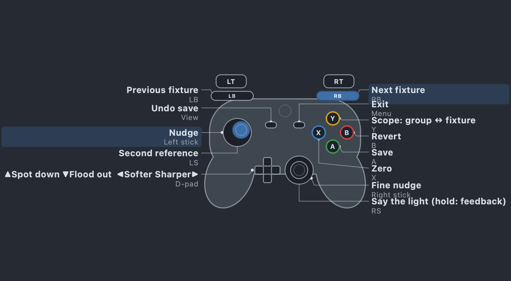

- **It is live.** A button lights while you hold it and a stick's cap
  follows the stick, so you can check on the real controller that each
  control does what the map says.
- **It is the controller's own mapping.** The labels come from the
  controller profile's roles (see **Controllers** below), not from a fixed
  picture: another make of pad is drawn the same way with its own names
  (Cross, Circle, R1, Options…), and a control its profile does not have is
  greyed and marked *not on this controller*. The Guide button is not
  used. The triggers step focus calls (they say so when calls are being
  run), the left stick click is the second reference (in focus calls, the
  target page: the stick moves the call's target) and the right stick
  click is **Say the light** (held: the feedback setting, see
  [Venue focus](focus-calls.md#telling-the-operator-where-they-are)).
- **Click a control** on the map to do what pressing it would.

### Controller or keyboard

**Use: Controller | Keyboard**, in the setup and at the top of the panel,
picks which device drives the nudges and which map is shown.

- **The default** is **Controller** when a controller that can focus is
  connected (its profile names the buttons it needs), otherwise
  **Keyboard**. The choice you make is remembered on this computer: once
  you pick Keyboard, Quick focus starts on the keyboard until you pick the
  controller again. With no controller connected there is no choice to
  make, so none is remembered.
- **No controller connected** (switched off, asleep, not paired): Quick
  focus starts on the keyboard and says so, on the panel and aloud — "No
  controller connected. Using the keyboard." — whatever the Feedback
  setting. Switch the pad on (press its Xbox or PS button) and it takes
  over by itself: "Controller back."
- **On the keyboard,** the map shows the keys Quick focus uses, each
  labelled with its action, and each lights while it is pressed (below,
  ⇧ and ↑). A controller that is also connected is **ignored** — its
  buttons and sticks do nothing — so a controller resting on the desk
  cannot drift a head.
- **The keys work either way.** With the controller chosen, every keyboard
  shortcut in the table above still works.
- **If the controller disconnects** in the middle of a session (unplugged,
  out of range, its own auto-off), Quick focus switches to the keyboard and
  says so: "Controller lost. Lights held." When it comes back it takes over
  again by itself and says "Controller back." — unless you are nudging
  with the keys at that moment (then once they have been still for a
  second; **Use the Controller** switches at once), or you chose
  **Keyboard** (then the panel and the voice say to click **Use the
  controller**; the controller is not forced on you).

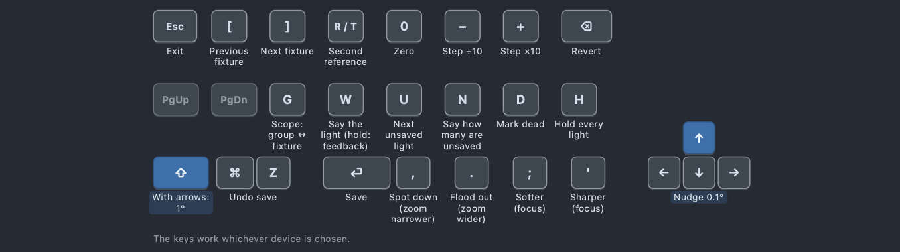

### Saving and the save status lamp

A nudge changes the head live but is not an edit until you save it (A or
Return): then it is the head's offset, marks the show changed, and **File →
Save** keeps it. With a **venue** applied (see
[Venues](focus-calls.md#venues-corrections-that-stay-with-the-room)) a save
goes to that venue's corrections, in a file beside the show, at once —
the show file is not changed. The panel says **Unsaved** while a head
differs from what was saved, and counts the heads you have checked.

**The status lamp**, at the top of the panel, is big enough to read from
the stage:

| Lamp | Means |
|---|---|
| Blue, with a tick | Everything is saved. |
| Yellow, with "!" | The light you're on has unsaved changes. |
| Orange | Some *other* light has unsaved changes. |
| Orange ring, yellow centre | Both: this light and another. |

The colours can be told apart by people who are colour-blind, and the
number not saved is on the lamp's rim.

Beside it the panel says which: **All saved**, **Unsaved: this light**, or
**Unsaved: 2 other lights (Spot 3, Spot 7)**. It changes as you nudge,
save, revert, zero and undo.

**A save shows on the rig.** When A keeps a light, the lamp flashes blue
and the real fixture dips to dark and back twice, quickly, so whoever is
standing on stage sees it was kept. A revert (B) doesn't blink. With
**Feedback: Voice only** (see
[Venue focus](focus-calls.md#telling-the-operator-where-they-are)) the
fixture doesn't blink; the lamp still shows it.

**On the plot and in the Rig Overview** every light with unsaved changes
has a dashed yellow ring and a yellow badge; the light you're on keeps its
own ring and gets the badge.

Leaving with unsaved lights names them ("2 lights have changes you have
not saved: Spot 3, Spot 7.") and asks: **Save All**, **Discard** (back as
they were saved), or **Cancel**. Afterwards the whole session is one step
of the Lighting Studio's undo (⌘Z).

### Sticks and profiles

The sticks feel like the follow spot's — they are the same stick, with the
controller profile's deadzone and sensitivity — scaled for alignment: full
left stick is 8° a second, full right stick 1°. Stick right is more pan
offset, stick up more tilt offset; on an inverted or standing head that
can look mirrored on stage, and the numbers say which way it went.

**Controllers.** Buttons are matched by what they are — A, LB, View… — not
by number: a controller profile (`.qxhid`) can say so with `role="…"` on each
axis and button, and one without roles still works if its controls have the
usual names. The Xbox profile has roles, and the D-pad as buttons 11–14.
So does the PlayStation profile: a DualShock 4 or DualSense is read into
the same layout (on a Mac, and on Linux through its joystick device) — Cross is A, Circle B, Square X, Triangle Y,
L1 / R1 the bumpers, L2 / R2 the triggers, L3 / R3 the stick clicks,
Create (Share) View and Options Menu, and its touchpad's fingers follow
the buttons (channels 16–21, `role="touch_x"` and so on). The tools then
call each control by the pad's own name: see
[On a PlayStation pad](focus-calls.md#on-a-playstation-pad).
While Quick focus is on it has the controller to itself: chaser stepping
and the follow spot wait.

**A different pad at each place.** A universe's input can take any of a
list of controllers — the Xbox pad here, the DualShock 4 there — and the
focus tools, the follow spot and focus calls work from whichever is
switched on, in its own names. See
[One input, whichever controller is here](other-improvements.md#one-input-whichever-controller-is-here).

**Xbox controllers on a Mac.** Every Xbox One, Series X|S and Elite
controller is read into the Xbox profile's layout, however it is connected:

- through Apple's **GameController** framework when it has the controller
  — it names every button itself (A, LB, the D-pad, the sticks…) on every
  model and firmware, USB, Bluetooth or Bluetooth LE;
- otherwise from the controller's own reports, by its model and connection:
  over USB the controller's input report, over Bluetooth its HID buttons
  and axes — the first Bluetooth firmware (Xbox One S, 02E0) numbers them
  one way, every later firmware (One S, Series, Elite 2, Adaptive) another,
  with the triggers on Brake/Accelerator and the right stick on Z/Rz.

The **Controller test** below shows which way your controller is read.

### A stick that doesn't come back to the middle

A worn or uncalibrated stick — an older DualShock 4 often does it — rests a
little off the middle, at +0.12 say. Every tool took that for a gentle
push, so heads crept with nobody touching the pad: in Quick focus, Venue
focus, the follow spot, and anything else a stick drives.

qlcconsole now learns where each stick rests and takes it out of what the
stick reads, before any tool sees it:

- **As the controller arrives** (switched on, plugged in, or its input
  patched), a stick left alone near the middle for a moment is taken as
  resting there. A stick that is moving, or held well out, is not — it is
  learnt later.
- **Full travel stays full.** The rest is taken out and each side stretched,
  so full left and full right still reach the ends, and the same push
  either way moves a light at the same speed (a stick resting left of the
  middle made pans to the right slower than to the left).
- **Nothing re-centres itself during the show.** If a stick sits still past
  the deadzone for 3 seconds with nothing else on the pad touched, the
  notice line says so once — *DUALSHOCK 4's stick isn't resting in the
  middle (Left Stick X +0.14)* — with **Centre Sticks**. A held slow pan
  looks just the same, so it only asks.
- **Centre Sticks** learns the rest again: let go of both sticks and press
  it in the notice line, in the **Controller test** window, or on the pad —
  hold **View** and click the **left stick** (**Create + L3** on a
  PlayStation pad, **View + LS** on an Xbox pad). It works in Design and
  Operate: it moves nothing. A stick still held is left as it was, and said.
- **Remembered.** The rest is kept with this computer's settings for each
  controller, so a known-worn stick is right from the first reading next
  time.

The deadzone is still the controller profile's, edited where it always was
(the HID plugin's profile editor). With no profile, a game pad gets 0.05
and any other joystick 0.08; the PlayStation profile now has 0.08. The
web remote (Steam Deck) learns its sticks' rest the same way, in the page.

### Working in the background

Quick focus — and the follow spot — keep reading the controller whatever is
in front: another app, the screen saver, a locked screen.

- **No App Nap.** While Quick focus or the follow spot has a controller,
  qlcconsole tells macOS it is doing user-initiated, latency-critical work.
  Without that, a Mac slows an app it thinks nobody is looking at (behind
  other windows, or with the display asleep) to a timer every few seconds,
  and a held stick all but stops. While it is on, the Mac also does not
  idle itself to sleep (the display still can). It lets go when Quick focus
  ends and the follow spot has no stick.
- **The panel stays up** when you switch to another app; it used to vanish
  until you came back.
- **Switched off and on again.** An Xbox controller switches itself off
  after 15 idle minutes, and a Bluetooth one reconnects after the Mac
  sleeps. Either way qlcconsole now finds it again by itself — press the
  Xbox button to switch it on — and Quick focus carries on with it.
- **Paused, said.** If the controller cannot be read, the panel says
  **Controller paused:** and why — the Mac is asleep, no controller is
  connected, it is being found again after a sleep (press a button on it),
  or macOS is refusing access (see **Permissions** below) — rather than
  just going quiet. On the keyboard nothing is said: the controller is not
  in use.

### Controller test

**Controller Test…**, next to **Use** in Quick focus's setup (and in
**Settings → Advanced → Game controllers**), opens a window listing every
input your controllers send, as it arrives, whether or not they are patched:

- the **device**, and its **connection** — USB, Bluetooth or Bluetooth LE,
  the model and its product ID, and how it is read (the GameController
  framework, or which report layout);
- the **element**: the raw input — a GameController name (`buttonA`,
  `leftThumbstick x`), a HID usage (`Button 4`, `Rz`, `Brake`, `Hat
  switch`) or a byte and bit of the USB report;
- its **raw** value, and the lowest and highest seen;
- the **channel** it feeds and that channel's value (0–255), and what it
  **maps to**: the profile's name, its gamepad role, its action, and what
  it does in Quick focus (and, with the pad's Run role on, in Run: see
  [Pad Run](show-control.md#go-from-the-game-controller-pad-run)).
  *nothing* means the input is not in the layout.

Below them, **Sticks** lists each stick of every controller that has sent
anything, live: what it **reads**, where it **rests at** (learnt, see
[A stick that doesn't come back to the middle](#a-stick-that-doesnt-come-back-to-the-middle)),
the **deadzone** around the middle, and what the **tools get** — *(still)*
while that is inside the deadzone. **Centre Sticks** learns every
controller's rest again once you let go.

Press every button once and move each stick and trigger all the way round;
each input is one row. **Copy** puts the whole log — the devices, a row per
input and every event in order — on the clipboard, **Save…** writes it to a
text file. That is everything needed to check, or fix, a controller's
mapping without the controller in hand.

### Permissions

A game controller does not normally need any permission on a Mac.
qlcconsole only opens the controllers themselves (it no longer opens every
HID device, keyboards included, which is what makes macOS ask).

macOS does have one, **Input Monitoring**, for apps that read input while
another app is in front. If macOS refuses to let qlcconsole open the
controller, Quick focus says **Controller paused: macOS is not letting
qlcconsole read the controller** instead of failing silently. The
Controller test shows whether Input Monitoring is allowed, and offers
**Ask macOS for Input Monitoring** (once, when it has not been asked) or
**Open Privacy Settings** (when it was refused). To allow it by hand:
**System Settings → Privacy & Security → Input Monitoring**, turn on
**qlcconsole** (or **Terminal**, if you start qlcconsole from a terminal),
then quit and reopen qlcconsole. (There is no entitlement or
usage-description text for it: the prompt is macOS's own.)

### Fixed lights: pars and fixed spots

A light with no pan or tilt was focused by hand on the ladder, so here it's
the other way round: you make the plot match the real light. Pick **Every
fixed light on the plot** (or select some), and it needs no **Aim at**.

Each in turn is lit, and a **person** stands where it lands, at head height
(5 ft 3 in (1.6 m) above whatever is there), so you see what the light gives. Move
where it lands until it matches the real one: **right** is toward stage
left, **up** is upstage — the left stick (fast), the right stick (fine) or
the arrow keys (⇧ for bigger steps; **+** / **−** change the step). The panel shows the light's **Pan** (° from downstage) and **Tilt**
(° down from level) as you go (Fixture Properties calls them **Points**
and **Tilt in yoke**): they are set from where it lands (see
Aiming a fixed light, under [Mounting a fixture](#mounting-a-fixture)).

**A** (or Return) saves it, **B** (or ⌫) puts it back as it was, and **View**
(⌘Z) undoes a save, as for moving heads. Leaving with unsaved lights asks
first.

### The beam

Where a light's beam can change, Quick focus changes it too: **D-pad up**
spots it down (narrower), **down** floods it out (wider) (or **,** and **.**
on the keyboard, ⇧ for 5°), always within the lens range its definition
gives, and the panel shows the angle. Where it has a focus channel, **D-pad
right** sharpens the edge and **left** softens it (or **'** and **;**); hold
a D-pad arm and it repeats. That is while you focus, to see it; it isn't
saved either, the cues set it.

- **A lens zoomed by hand** (a fixed spot or wash with a range but no zoom
  channel) is set once: it is saved with the light, like where it lands,
  and the beam on the plot and in the 3D view is drawn at it. It is also
  **Beam (lens set to)** in the light's Fixture Properties.
- **A zoom channel** (a moving head, or a wash zoomed over DMX) is driven
  while you focus, to see the size; it isn't saved — the cues set the zoom.

## Lanterns

A **lantern** — such as the bundled WLED Lantern — is drawn as a lantern,
not a spot: a **cage** (caps and posts) around a core lit in its live
colour, with a halo in the haze; in the flat views and on the plot, a
rounded cage with the core. It throws **light all round** rather than a
cone, lighting whatever is near it and falling off with distance.

What makes the light and what it's seen through are set per fixture, in
the structure editor's inspector and in **Fixture Properties**:

- **Light** — **Point source** (one glow), **Hanging LED cluster** (a wire
  string let fall through the cage — more spread out), **LED tape**
  (wound tight round a core — less spread out), or **LEDs on the lens face**
  (a wash's array behind its lenses — a 36 × 18 W mover shows its 36 there,
  lit in the beam's colour, dark when it is out), with an **LEDs** count for
  the LED kinds. The fixture definition sets it (Fixture Editor → Look in
  the Lighting Studio → Source); a fixture can say otherwise for its own build.
- **Glass** — **Diffuse** (the default: each pane glows from the LEDs
  nearest it, the LEDs a blur behind, frosted when dark) or **Clear** (each
  LED shows as a bead in its own colour).

The definition's choice is marked **(as defined)**; leave it there and the
fixture follows the definition. A WLED device that answers reports how many
LEDs it drives, and that wins over the definition's count.

What the LEDs show, best source first:

1. **The device's own live pixels**, when it's a WLED fixture that answers
   on the network (asked only while the Lighting Studio or the Rig Overview shows it and
   the look is actually going out).
2. Otherwise, the **port of its WLED effect**, run on the LEDs with the
   speed, intensity, palette and colours the device is sent — the same
   maths, but not in step with the device.
3. Otherwise, **colour 1 at its dimmer**, with a **"WLED: &lt;effect&gt;"** tag
   beside it naming the effect that has no port.

## Network nodes and cable runs

The physical DMX network can be drawn on the plot, so patching can follow
where the cable actually goes:

- **Add → Add Network Node** places an Art-Net/sACN node or a wireless DMX
  transmitter (pick a **Model** from the built-in gear list, or your own)
  and opens the **Network Topology** dialog for its ports and the universe
  on each. Double-click a node, or **More → Network Topology…**, to edit
  later. A node drags, locks, layers, groups, renames, and deletes like a
  structure.
- **Wireless receivers** are placed automatically among the fixtures on
  their universe (else beside the transmitter), shown with a dashed link;
  drag one from the Top view to where it's really rigged.
- **Cable runs** are drawn from each port through its fixtures in address
  order, as lines that show their stats when you hover; DMX fixtures no
  port serves are flagged.
- **More → Network Report…** lists nodes, ports used and free, universes
  carried, the longest run, per-port fixtures/channels/run length, network
  fixtures by IP, unserved fixtures, and warnings — with **Copy** and
  **Save CSV**.

## Fixture outlines and overlap warnings

Two small but load-bearing visual cues:

- **Outline contrast** — a fixture's body edge is brightened by a fixed
  amount rather than scaled multiplicatively, so a fixture with a declared
  black housing (common — plenty of real fixtures *are* black) is still
  clearly outlined against the dark canvas instead of nearly disappearing
  into it.
- **Overlap warnings** — if two fixtures' physical bodies actually occupy
  the same real-world space (two heads stacked at the same truss offset, or
  a deck fixture dragged into another's footprint), both draw with a flat
  warning-red outline instead of their normal contrast tint — deliberately
  independent of either fixture's own color, so it reads as a warning
  rather than an odd shade.

## Terminology

| Term | Meaning |
|---|---|
| **Plane** | Which of Top/Front/Side/Angled the view is currently showing (a structure editor also has Back: the Front elevation from upstage). |
| **Bar** | A short cross-piece truss hung on a parent truss — modeled as a child truss, not a separate object type. |
| **Placement: Inside** | A fixture centred in its host structure's volume rather than seated on its face/top — for fixtures rigged inside a truss or under a see-through platform top. |
| **Face** | Which way a mounted fixture faces — Top, Bottom, Front, Back, Stage left, or Stage right — has to agree with how it's actually attached. |
| **Layer lock** | Holds everything on a layer; nothing on it can be selected. An object's own lock (**Lock Position**) is separate and leaves it selectable. Both draw red. |
| **Position lock** | A group-level lock that freezes every member's position but leaves them selectable. |
| **Hanger** | Rigging on a truss or tower — clamp, arm, and chain to one hook a fixture hangs from. |
| **Sock / Faces** | Fabric over a truss that bars inside glow through / opaque panels on a tower's sides. |
| **Haze** | How visible beams are in the air (None/Light/Medium/Heavy) — doesn't change where light lands. |
| **Count badge** | The numbered circle a structure's own fixtures collapse into when they'd otherwise cover more than 40% of it on screen. |
| **Light footprint / coverage** | Everywhere a fixture's full pan/tilt range can reach — distinct from where it's currently pointed. |
| **Shift-drop** | Holding Shift as you drop a fixture over a truss, pipe or deck, to hang or stand it there; a plain drop only moves it. |
| **Beneath (faded)** | In the Top view, a fixture with a structure more than 20 in (0.5 m) above it, drawn faded and dashed but still clickable. |
| **Curtain line** | Where the main curtain hangs, across the stage (also called the setting line; the plaster line is the proscenium's). A stage piece on the Stage layer. |
| **Number line** | A line across the front of the stage numbered out from centre (CL), in feet or metres, for spiking and focusing. A stage piece on the Stage layer. |
| **Apron** | The stage downstage of the curtain line: its own piece of deck, from the curtain line out by its depth, with its front curve. A stage piece on the Stage layer. |
| **Stage pieces** | The centre line / DSC mark, curtain line, number line and apron: objects on the plot's Stage layer, each shown, locked, dragged and set on its own. |
| **DSC / CL** | Downstage centre: where the centre line (CL) meets the front of the stage. |
| **Rig Overview** | The read-only, whole-rig 3D window (View → Rig Overview…, Ctrl/⌘+Shift+R). |
| **Calibration offsets** | A head's pan/tilt offsets: in the DMX so the real light lands where intended, left out of every view so it shows the intended aim. |
| **Quick Focus** | Stepping through the heads, each aimed at its reference, to set their calibration offsets with the controller or keyboard. |
