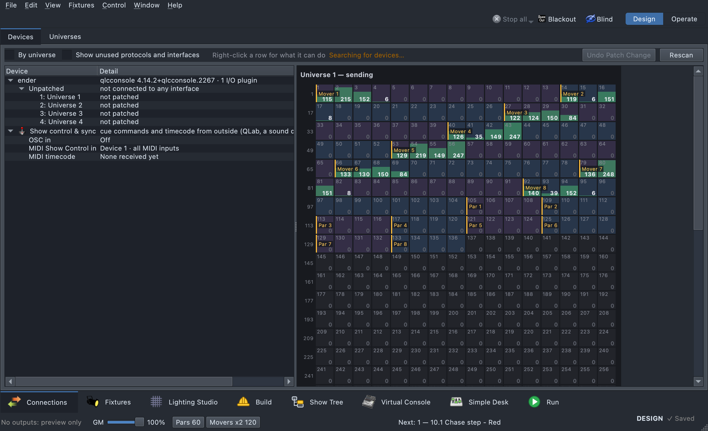

# Other improvements

Smaller fork-specific features that don't need a full guide of their own.

## Connections &amp; patch

The Connections tab reworks stock QLC+'s I/O patching into one place that
answers "how is this console actually wired," following the signal outward:
**protocol → interface → devices heard on it → the universes they carry.**
Two sub-tabs — **Devices** (shown above) and **Universes** (QLC+'s own
Inputs/Outputs page) — give the same information at different levels of
depth. Classic QLC+ opens on **Universes**; the other views on
**Devices**. (0.3 folded the old **Overview** spreadsheet into Devices:
its columns are By universe's, below.) At the bottom of Devices, **Show control &amp; sync** lists
what controls or clocks the show from outside — OSC and MIDI Show Control
cue commands in, MIDI timecode with its sync health — each row with its
state; click one to set it up on the right. See
[Show control (QLab)](show-control.md#checking-the-hookup).

Because Devices follows the wiring, a patched universe appears only under
the output it goes to, and only unpatched ones gather in their own
**Unpatched** folder. Tick **By universe** for the other way round: every
universe in number order, each with where it goes ("Art-Net → CS1
(172.18.2.211) · port 1 · universe 0:0:0", "WLED → 172.18.2.55", or "not
patched"; with more than one interface, "· via" the one it leaves by) and
what it
carries — same right-click actions, renamed inline the same way. The choice
is remembered. By universe, only the universes **in use** are listed — a
fixture patched into it, an output or an input — with a line at the foot
saying how many are hidden; tick **Show unused universes** to see them all.
(They're only hidden: universes are numbered by position and every patch
refers to them, so one from the middle can't be removed without renumbering
the rest.) Only the **Device** column is edited in place; Detail and
Carries describe the row and aren't text to type over.

By universe, the rows can also carry the whole patch as columns:
**Output** (protocol and interface), **IP** (the node's address, the sACN
unicast address, or broadcast/multicast), **U** (the universe on the far
end: net:subnet:universe for Art-Net, the sACN universe), **Mode** (the
transmit mode, or a MIDI output's mode), **Input** (with its Art-Net
universe or MIDI channel), **Profile**, **Feedback** (with its address) and
**PT** (passthrough). Right-click the list's header, or use **Columns**, to
show or hide each; the choice is remembered. Mode, Input, Feedback and PT
are on to begin with (Detail already says where each goes). The columns are
read-only: double-click one to open the universe's connection, on that part
— everything they show is edited there.

1. **By universe** — every universe in use, in number order.
2. **The universes**, each with where it goes, what it carries, and the
   patch columns you've chosen.
3. **What the selected universe is sending**, channel by channel.
4. **Columns** — which of the patch's columns to show (also the header's
   right-click).

Select a universe and the panel on the right shows what it is **sending**,
live: all 512 channels, each with its value and a bar as high, the channels
of each patched fixture shaded together and named where they start. The
values are what goes out, after the grand master; hover a channel for whose
it is ("Front Par, channel 1 — Dimmer").

Right-click an interface to patch a universe to it or configure the
protocol. Right-click a universe for **Edit connection…** (or just
double-click it), **Rename universe…**, **Unpatch from this interface** and
**Delete universe entirely…**. Those act on the one row you right-clicked.

### Editing a connection

**Edit connection…** — or a double-click on any universe, in either view —
opens one window for everything about where that universe goes. Patching an
unpatched universe and editing a patched one are the same window; a patched
one opens filled in.

- At the top: the **universe** (switch to another without closing), its
  **name**, the **protocol** (or **Not patched**) and the **interface**.
- Below, that protocol's own settings, in place:
  - **Art-Net** (and any protocol that sends to a node): **Send to** lists
    every port of every device under that interface, whether heard on the
    network, added by hand or only named by an existing patch, **free ones
    first**, then the ones another universe holds, saying which; or
    **Broadcast (no target)**, or **Another address…** — type the node IP
    and its universe as net:subnet:universe. Then the **transmit mode**.
  - **sACN (E1.31)**: the sACN **universe**, **Multicast** or a unicast
    address, the **priority** (0–200, 100 by default) and the transmit mode.
  - **MIDI**: the output mode.
  - **WLED**: its devices — the primary and any backup lanterns — are set in
    their own window: the button opens it, and a universe newly sent to WLED
    opens it when you press OK.
  - **A USB widget** (and other plugins whose interface is the device):
    nothing more to set per universe.
  - **Configure &lt;protocol&gt;…** opens the protocol's own settings window
    (a USB widget's output speed, Art-Net's interfaces) — it stays a window
    of its own; the plugins only have it as one.
- At the foot: the universe's **input** and **input profile** (and, for a
  MIDI input, its channel; for Art-Net, the universe it listens to),
  **feedback** (with its address for a network protocol) and
  **Passthrough**. Rows that don't apply are greyed, not hidden.

Nothing changes until **OK**, and then as one step of **Undo Patch Change**;
**Cancel** leaves the universe as it was. A port another universe already
sends to is refused with its name (one port, one universe), and so is
unicast with no address. In the lists, **port** is the socket on the node
(port 1, 2…) and **universe** its Art-Net address (net:subnet:universe,
e.g. 0:0:1). Classic QLC+'s **Universes** page keeps QLC+'s own patch
editor.

**Several universes at once.** Ctrl-click (⌘-click on a Mac) universes —
in either view, patched or not — and right-click one of them:

- **Patch N selected universes to…** asks the protocol, the interface and
  the device, then the port to start from. The universes go onto the ports
  **in the order you clicked them**, not the order they are listed: the
  first one you picked on the starting port, the second on the next, and so
  on (a shift-click range counts in list order). Before anything changes it
  shows the whole plan to confirm. If there are more universes than ports,
  the ones that fit are patched and the rest are named and left as they
  were. A port another universe already sends to is skipped (one port, one
  universe) and the plan says whose it is; universes in the same selection
  can swap ports freely. Choose **Broadcast** to put them all on the
  interface with no target, or **Another address…** to number up from a
  port address you type. On a protocol without devices (a multi-universe
  USB widget) they go onto consecutive interfaces.
- **Unpatch N selected universes** removes the patch from every one of them
  at once.
- **Retarget N selected universes…** re-aims already-patched universes at
  one node on consecutive port addresses, also in clicked order.
- **Transmit mode of N selected universes** sets the mode of every
  selected Art-Net (Standard, Full, Partial) and sACN (Full, Partial)
  universe at once.

Each is one step for **Undo Patch Change**. The Fixture Manager's universe
rows open the same connection window (**Patch output…**, or **Edit
connection…** on a patched one) and offer the same plural actions — see
[Patching a universe's output](fixture-manager.md#patching-a-universes-output).
(The Devices tab keeps all of this
to one row over the list — **By universe**, **Show unused…**, a one-line
"Right-click a row for what it can do" whose tooltip has the whole
explanation, the search status, **Undo Patch Change** and **Rescan** — so
the list and the output view get the window's height.) A full patch-change **undo**
(⌘Z, from either sub-tab) snapshots and restores the whole
patch state, not just the last single edit.

Compared to stock QLC+, this fork also fixed a number of real patching
gaps: device discovery correctly attributing ArtNet nodes instead of
defaulting unplaceable ones to loopback, universe renumbering under live
controllers, rescan working on every plugin type, hardware lines no longer
silently filtered from the "heard on" liveness view, and manual
targets/ports/aliases that persist with the workspace.

### Patches follow the network

Art-Net, E1.31 (sACN) and OSC universes are patched to a **network**, not
to one computer's network card. A show built on one console opens on
another on the same show network — or on the same laptop after its address
changed — already patched, with every target and port as it was; nothing
needs re-patching.

When a show opens (and whenever a universe is waiting, every few seconds),
each such patch picks the interface that reaches its network:

1. For a **unicast** universe (a target address such as 172.18.2.60), the
   interface this computer would send to that address through — a network
   it is plugged into, or a route to it (a router, a VPN). The ordinary
   default route (home Wi-Fi out to the internet) doesn't count.
2. The very interface address it was saved with, if this computer has it.
3. Any interface on the **same network** — the one saved with the show
   (for example 172.18.2.0/24), or for shows saved before this, the network
   of the saved address (using the interface's own netmask, or /24 if that
   isn't known).

If several interfaces qualify, the first one in the interface list is used.
Devices shows the network each interface is on ("output, input · network
172.18.2.0/24").

**Away from the show network**, nothing is lost: universes whose network
isn't present are **kept, offline** — in Devices under a red row named
after the missing interface ("172.18.2.219 · not present — kept, will
reconnect"), "172.18.2.219 — not present" in the universe list, and one
footer notice ("N universes patched to interfaces not present
(172.18.2.219) — kept, will reconnect"). Nothing
is sent to them meanwhile. Saving writes them back exactly as they were.
When the network appears — the laptop joins the show VLAN, a cable goes in,
the VPN comes up — they reconnect by themselves within a few seconds. The
same holds for **inputs and feedback** patched to a device or interface
that isn't present, and for any patch whose plugin isn't installed on this
computer. Patching or unpatching an offline universe by hand works as
usual; **Forget patch** (right-click it) drops a kept patch for good.

Saved shows keep the interface address and line number older versions
read, plus the network they're on (a `Network` attribute older versions
ignore).

### Controllers and MIDI devices coming and going

A game controller (PS4, PS5 or Xbox pad) or a MIDI surface patched as a
universe's **input** stays patched to that **device**, not to a line
number. A Bluetooth pad switched off, asleep, out of range or flat, or a
USB one unplugged, can go and come back at any time — including after the
show was opened without it:

- **While it is away,** the universe's input is kept, with its input
  profile, its controller profile (the gamepad roles Quick focus, the
  follow spot and focus calls use) and its settings. **Connections ▸
  Devices** shows the device under its plugin, greyed: "input · not
  connected — kept, reconnects by itself", its universe under it. The
  notice line above the tabs says **Controller 'DualSense Wireless
  Controller' disconnected — universe 2** in amber (**not connected** when
  the show opened without it), and the readiness footer lists it until it
  is back. Saving keeps the patch exactly as it was.
- **When it comes back** — on whichever line it now appears — the input is
  patched to it again by itself, within a moment of the computer seeing it,
  and the notice says **Controller '…' connected — universe 2**, then goes.
  Quick focus, the follow spot and focus calls carry on with it without a
  restart: Quick focus takes it back by itself and says **Controller back**
  (see [Controller or keyboard](lighting-studio.md#controller-or-keyboard)).
- **A pad's own auto-off** (an Xbox pad left idle switches itself off
  after about 15 minutes) is the same: said, kept, and back when you press
  its Xbox button. On a Mac this is seen whichever way the pad is read —
  through Apple's GameController framework (Xbox, DualShock 4, DualSense)
  or through IOKit — and, should the system not announce it, within a few
  seconds anyway.
- **A quick drop is not news.** A pad that drops out and is back within
  a couple of seconds (Bluetooth waking, reconnecting) is not mentioned.
- **Two of the same pad** are told apart by their serial number, where the
  pad reports one.

The device is found by its name — maker, model and serial, as listed in
Connections — so another device that turns up on the same line is never
taken for it. **Forget this patch** (right-click the greyed universe)
stops waiting for it.

On a Mac, controllers are noticed coming and going over USB, Bluetooth and
Bluetooth LE, and after the Mac wakes. On Linux, a controller's joystick
device appearing or going is noticed, Bluetooth included. MIDI devices
follow the same rules wherever the system reports them coming and going.

### Only transmit on the rig network

A laptop that is on some other network — a school's, a venue office's
Wi-Fi — must not put show traffic on it. Each show can say which networks
its output belongs on, its **rig networks**, and network output then goes
out only from this computer's interfaces on them.

Set them in **Settings → General → Network**: **This show's rig networks** takes one
or more IPv4 networks, separated by commas (for example 172.18.0.0/20).
They are checked as you type — an address without its /size, or anything
that isn't an IPv4 network, is pointed out in red and OK waits until it
reads right — and they are saved with the show. A show that has none but
already has network patches offers the networks its patches were saved
with (the grey example in the box, and **Use these**); nothing is filled in
until you say so.

While **Only transmit on rig networks** is on (it is unless you turn it
off; it is a setting of this computer, not the show), every Art-Net,
E1.31 (sACN), OSC and WLED output is checked:

- An output whose interface — or, for a WLED, the interface this computer
  would reach the device through — is **not on a rig network is held**:
  the patch is kept exactly as it is and saved unchanged, and nothing is
  sent. No unicast through the default route, no broadcast, no Art-Net
  polls or poll replies, no discovery on that interface either.
- A held output **resumes by itself** within a few seconds of this
  computer joining a rig network — the same check that reconnects an
  offline patch.
- **Loopback** (127.x.x.x) is never held, and outputs that aren't on a
  network (DMX USB, MIDI and the like) aren't looked at.
- A WLED named by a host name rather than an address can't be checked, so
  it is held while the check is on.

The footer says so in red, beside the readiness chip: **"Output held — not
on the rig network (172.18.0.0/20). Connected: en0 10.4.12.7"** — the
show's networks and where this computer actually is. Hover it for each
universe and why; click it to open the setting. In Devices a held patch
reads "held: … — kept, resumes on the rig network".

**Transmit anyway, this session…** (in the same place) lets output go out
wherever this computer is, after asking. It lasts until qlcconsole quits or
another show is opened, is never saved, and the footer says "Transmitting
anyway" the whole time; the same button then reads **Check the rig network
again**.

A show with **no rig networks** set transmits as it always did, with an
amber footer note suggesting you set them. Turning the check off shows an
amber "Rig network check off".

### When an output is in trouble

The Art-Net and E1.31 outputs say when where a universe goes stops working,
in three places: the **readiness footer** (one line per problem, with the
universes it hits: "Art-Net to 172.18.2.50: not reachable since 20:14
(universes 3, 4)"), the universe's **row in Connections** (the problem
appended to Detail in red, all of them in the tooltip; both the wiring tree
and By universe), and the log. Each clears by itself once it is fixed.

| Message | What it means |
|---|---|
| **Art-Net to 172.18.2.50: not reachable since 20:14** (or **E1.31 to …**) | This computer can't send to that address: the interface is down or gone, there's no route, or the address doesn't answer on the network (nothing there). |
| **Art-Net node CR041R (172.18.2.10): stopped answering since 20:14** | A node this session has heard from has missed three polls in a row (about 9 s). Unplugged, powered off, or its cable/switch is down. |
| **Art-Net node CR041R (172.18.2.10), port 2 (0:0:1): DMX output short since 20:14** | The node reports a short on the DMX line of the port carrying this universe — a bad cable, connector or fixture on that run. |
| **Art-Net node …, port 2 (0:0:1): not outputting DMX since 20:14** | That port was outputting earlier and has stopped, though the console is still sending to it. |

They are judged, not echoed, so they don't flicker:

- **Can't send** shows once sends have failed for a second or more (a brief
  hiccup is ignored; a hard error such as a packet too big, at once) and
  clears only after sends have worked for **30 seconds** without a break —
  a node that isn't there can make sends "succeed" for a few seconds at a
  time, which is not the same as being back.
- **Stopped answering** needs three missed polls in a row and clears after
  replies to two in a row. Only nodes heard from at least once this session
  are watched: one powered down before the show started isn't flagged.
- **Port faults** need the same fault in two replies in a row and clear
  after 10 seconds of clean replies. "Not outputting" is only said of a
  port seen outputting earlier, so a node that never reports it isn't
  flagged.

On a **broadcast** universe, the nodes watched are those that output its
Art-Net universe; on a **unicast** one, the node at that address.

What the console sends for this: nothing new on a node's own subnet — the
Art-Net plugin already polls each interface it outputs on every 3 seconds
(ArtPoll, broadcast), and the answers are what's watched. A unicast target
on **another** subnet never hears that broadcast, so it gets one unicast
ArtPoll every 3 seconds as well. E1.31 has no reply from a receiver, so
for E1.31 only "can't send" is shown.

### Setting up a new Art-Net node

A node fresh out of the box usually isn't on your network yet: Art-Net
nodes ship on a **2.x.x.x** or **10.x.x.x** address, some on their maker's
own default (192.168.0.x, say), and one set to DHCP with no DHCP server
gives itself **169.254.x.x**. Connections lists such a node **amber**, with
what to do first in its detail — "on its factory Art-Net address, not this
network: set its IP" — instead of as a usable green node.

**Rescan** (Connections, or the patch grid's **Rescan Devices**) is what
finds one: on top of the usual poll to each interface's own broadcast
address, it sends one ArtPoll to the **limited broadcast**
(255.255.255.255) out of each interface — one small datagram per interface,
only when you press it. A node on a foreign address may ignore the usual
poll, but every network stack takes that one.

Whether its answer gets back depends on the node. If it answers to this
computer's address or to 255.255.255.255, it appears. If it answers to its
**own** network's broadcast (2.255.255.255) — as Art-Net 3 nodes do — the
operating system throws the answer away before any program sees it, and the
node can't appear until this computer has an address on that network too
(below).

To set its address: right-click the node → **Set node IP address…**. The
dialog shows the node (name, address, MAC, interface), and:

- **Fixed address** (IP, subnet mask, optionally a gateway), **DHCP** (if
  the node says it supports it) or **Factory default address**.
- **Ask the node** asks for its current settings and changes nothing.
- **Apply to node…** asks you to confirm — node, MAC, old and new
  settings, the interface it goes out of — and only then sends. It's sent
  **once**, as an ArtIpProg, to the node's **current** address. The node's
  answer (or "no answer within 3 s") is shown underneath. Anything patched
  to the old address stops reaching the node; re-point it afterwards.
- It won't send an address that's this computer's own, another node's, a
  network or broadcast address, or a broken mask.

**A node not on any of this computer's networks can't be sent to.** The
dialog says so and doesn't offer **Apply**. ArtIpProg has to go to the
node's own address, and it doesn't say which node it is for — broadcast, it
would re-address **every** node on the cable that accepts it — so the
console never broadcasts it. Instead, give this computer a temporary
address on the node's network. The dialog shows the exact command for the
interface the node was heard on, for example on a Mac:

    sudo ifconfig vlan0 alias 2.255.255.250 netmask 255.0.0.0

(Linux: `sudo ip addr add 2.255.255.250/8 dev vlan0`; Windows, as
administrator: `netsh interface ipv4 add address "Ethernet" 2.255.255.250
255.0.0.0`.) Then **Rescan**: the node answers, is no longer amber, and
**Set node IP address…** can send to it.
When it's done, remove the address (the dialog shows that command too) and
**Rescan** again to find the node at its new address.

Nothing about a node is ever changed without that confirmation; hearing a
node, Rescan and opening the dialog send nothing to it. Nodes set from a
front panel or a web page may ignore ArtIpProg — the dialog then says it
got no answer.

### WLED output

A new output plugin for Wi-Fi LED controllers running WLED (lanterns,
strings, small pixel props). Each WLED device gets **one universe of its
own, aimed at its IP address** — add the fixture with the connection
"Network (WLED, JSON over Wi-Fi)" and patching does the rest, using the
WLED output rather than borrowing Art-Net.

- It sends WLED's own JSON state, not a DMX stream, and only **when the look
  actually changes** — at most about ten times a second per device, with a
  matching WLED transition so the steps blend. A held look is sent once; a
  long fade goes as a handful of states ending on the last one. This keeps
  Wi-Fi traffic small.
- Every few seconds it checks in with each device. Any that **don't answer,
  or answer on weak Wi-Fi** (weaker than -75 dBm), are listed by fixture name
  in the [readiness footer](#readiness-footer).
- While the Lighting Studio or the Rig Overview is showing a WLED fixture, it asks that device
  what its LEDs are actually showing and draws that — a **live view** of the
  real pixels. It stops asking when the view is closed.

**Is each WLED set up the way the show drives it?** Every 30 s (and a
moment after the show loads or a fixture changes) each WLED fixture's own
settings are read from the device (`/json/cfg`) and compared:

- Driven through **WLED's API**: it should not take realtime streams — an
  E1.31/Art-Net stream on its universe would take it over from the show.
- Driven by **Art-Net or sACN**: it has to listen for that protocol, on the
  universe its output sends, at its patched address, in the DMX mode its
  definition's mode needs (Effect (15ch) → WLED's *Effect*, Single DRGB →
  *Single DRGB*, Single RGB → *Single RGB*).

What does not match is listed in the footer ("N WLEDs not set up as this
show drives them") and on the fixture itself (a **WLED** row in the studio
inspector and Fixture Properties). **Fix on Device…**, in both places, shows
exactly what it would change on the device and writes it there only when you
agree, then reads it back.

Effects that the WLED device runs itself are picked in the look editor —
see [WLED effects](build.md#wled-effects).

#### Backup lanterns

A WLED universe can drive **more than one device**: a backup lantern beside
the primary shows the same look, with nothing programmed twice. If the
primary dies mid-show, the backup carries on.

**To add one:** in **Connections** (or the Fixture Manager's universe
row), right-click the WLED universe → **WLED Devices / Backup Lanterns…**.
Click **Add Backup**, type its IP (the show's WLED fixture addresses are
offered as you type), and **OK**. The patch now reads "WLED → 172.18.2.50
+ 1 backup".

- Each device gets the **same state**, read from the same channels — or,
  for a backup that is a different kind of device, from its own
  **Address** and **Channels** (leave them on *As primary* otherwise).
- **Move Up** / **Move Down** reorder the list; the top one is the
  **primary**. It's the one older versions of the app send to, and the one
  whose address and channels the backups follow.
- **Remove** takes a backup off. OK stays off while something is wrong:
  an empty or malformed IP, a device listed twice, or a device another
  universe already sends to (a device follows one universe).
- The change is **one step for Undo Patch Change** in Connections, like any
  patch change.

Every device is handled separately. Each has its own request in flight and
its own idea of what it was last sent, so a device that is off or hanging
**never slows the others**. A device that comes back after not answering
(switched off and on, out of Wi-Fi range) is sent the whole look again
straight away, even if nothing changed meanwhile.

**Status:** the universe's row in Connections says "1 of 2 answering —
172.18.2.51 not answering" while one is down. The readiness footer lists
the silent device by name ("Lantern SL backup"), and the WLED output's info
in Connections lists every device with its own answer. The Lighting Studio
and Rig Overview show the live pixels of the **first device that
answers**, so a dead primary doesn't leave the picture dark.

In the show file the extra devices are saved as `outputIP2`, `outputIP3`…
(with `wledAddress2`/`wledChannels2`… only when a backup has its own) next
to the primary's `outputIP`. Older versions of the app ignore them and send
to the primary alone. Up to 16 devices per universe. A universe whose
network isn't present is kept offline with its whole device list and
reconnects with it; the network is chosen by the primary's address, so
keep the backups on the same network as the primary.

So far the WLED output has been checked against a stand-in that answers
like a WLED device, not yet against real WLED hardware on a show network —
try it on your own devices before relying on it for a show.

## Window menu

Every tab is in **Window**. The tabs the [workspace view](getting-started.md#views)
shows come first, in its order, numbered as they are on screen: ⇧⌘1 is
the first tab, ⇧⌘0 the tenth. In the qlcconsole view that is ⇧⌘1
Connections, ⇧⌘2 Fixtures, ⇧⌘3 Lighting Studio, ⇧⌘4 Build, ⇧⌘5 Show
Tree, ⇧⌘6 Virtual Console, ⇧⌘7 Simple Desk, ⇧⌘8 Run; in
Classic QLC+, ⇧⌘1 Fixtures … ⇧⌘6 Inputs/Outputs. They renumber when the
view changes. The tabs the view hides follow, with no shortcut.
Choosing one brings it forward — its
tab, or its own window when it has been broken out (right-click a tab →
**Open in Its Own Window**, Shift-click it, or **Move … to Its Own
Window**),
which the menu marks "in its own window". **Put Back in Main Window**
returns one, **Put All Back in Main Window** all of them; **Minimize** (⌘M)
as usual. **Rig Overview…** (⇧⌘R) is here too. Effects have no item of
their own: they live in [Build ▸ Effects](build.md#making-effects). A tab that the workspace view hides (**View ▸
Workspace**) switches the view to **Everything** when you choose it, with
a line above the tabs to go back; see
[Views](getting-started.md#views).

**Functions is the stock QLC+ tab.** The qlcconsole view doesn't show it
(the Classic QLC+ and Everything views do); there, **Window ▸ Functions**
switches to Everything to show it, with a line above the tabs to go back.
"Classic" in qlcconsole only ever means stock QLC+. In Build each function
opens in the Workbench with its own editor, and new functions of every
type, the Function Wizard and the startup function are on **+ Scene ▾** and
the outline's right-click; see
[Coming from the Functions window](build.md#coming-from-the-functions-window).

## Overrides chip

When something holds the rig over the show, the footer says so in one
amber chip: **Overrides: Park (3), Hold at end · Clear**. It lists Park,
Highlight, Hold at end, Quick focus and Blind, and is hidden when none of
them is on. Click it to let go of all of them at once (Quick focus asks
first if it has unsaved offsets). If the rig looks wrong and you don't
know why, look there first.

## Readiness footer

The status chip at the bottom of the window reads **Ready** when nothing
needs attention, and **Not ready (N)** in red when something does. A show
with **nothing patched to any output** reads **No outputs: preview only**
in grey instead (with **· N to check** when something else is listed):
nothing reaches a rig, so nothing there is urgent, and red stays for real
problems on a rig with outputs. Click it then to open Connections, or for
the list when it has one. Hover it
for a one-line reason per problem; click it for the full list, where each
problem can be fixed on the spot. It checks for:

- fixtures **not patched** (they appear in the Lighting Studio but send no DMX);
- fixture types that **declare no light output** (no lumens or watts, so the
  Lighting Studio and the Rig Overview have to guess how bright they are);
- **address clashes** — a show file with two fixtures on overlapping
  channels now loads the second one unpatched and flagged, instead of
  silently dropping it;
- **duplicate fixture names**;
- **definitions that can't be read**, grouped under *Local* (your own) and
  *Included* (shipped with the app), each with the reason and, where another
  copy of the same fixture loaded instead, which one is being used;
- **duplicate definitions** — two of your own files for the same fixture,
  where only the newest is used;
- **universes with fixtures but no output**, so what they send goes
  nowhere;
- **network outputs in trouble** (see
  [When an output is in trouble](#when-an-output-is-in-trouble)), one line
  per problem with the universes it hits, and **Open Connections**;
- **WLED devices not answering**, or on weak Wi-Fi;
- **WLEDs not set up as the show drives them** (see WLED output), with
  **Fix on Device…**;
- **controllers and MIDI devices not connected** — a device a universe's
  input is patched to that is switched off, asleep or unplugged (see
  [Controllers and MIDI devices coming and going](#controllers-and-midi-devices-coming-and-going));
- **channels the Simple Desk is holding** — a channel touched on the desk
  overrides every look and scene until released, so a look that "doesn't
  change the fixture" is often this. Listed by universe and channel, with
  **Release**;
- **files in cloud storage that aren't on this computer** (see
  [Cloud storage](#cloud-storage));
- **fixtures with no definition here** — standing in as plain dimmers until
  their definition is back.

Select the rows you want (shift-click for a range; click a heading to take
everything under it) and use the fix offered for that problem:
**Patch…**, **Re-patch…** (clashes), **Edit Definition…**, **Repair in
Fixture Editor…**, **Move to Trash…**, **Number Them** (gives duplicates
"#2", "#3", keeping the name on the patched one), **Open Connections**,
**Download Now**, or **Fetch Definitions**. The list updates as each fix
lands.

"Repair in Fixture Editor…" opens the broken file in the Fixture Editor's
repair view, which shows where the file breaks and why, offers repairs it
has already tried, and closes again when you're done. Once it's saved, the
definition loads without restarting.

## Cloud storage

Show files, fixture definitions and scripts often live in a synced folder
(Synology Drive, iCloud Drive, OneDrive, Dropbox). Those services can leave
a file **online-only** — listed in the folder, but not actually on this
computer — and reading one means waiting on the network. With the network
out of reach, that wait used to hang the whole startup.

- **Startup never waits on the cloud.** Online-only files are skipped
  instead of fetched, and the footer says how many, in which folders, and
  which service holds them. **Download Now** fetches them in the
  background; fixtures and effects then load straight away, anything else
  on the next start. Better still, set the folder to stay on this computer.
- **The show cache.** Every definition a show uses that doesn't ship with
  the app is kept in a cache on this computer, refreshed whenever the show
  loads or saves — so a production run never needs the network.
- **Before a show loads**, each definition it names comes from the fixture
  library, else the show cache, else is fetched from the cloud under a
  "Waiting for the cloud…" window with a **Skip** button — and then cached.
- **Nothing lost on save.** A fixture whose definition isn't here still
  stands in as a generic dimmer, but it now **keeps its real manufacturer,
  model and mode** and saves them. (Stock QLC+ saved it as "Generic", and the
  real fixture was gone for good.) Saving with such fixtures warns first,
  and **Fetch Definitions** in the footer restores each one once its
  definition is back.

## Plot layers panel

A docked, tree-based organizer for everything on the 2D map — fixtures,
trusses, platforms, targets, power sources, images — each layer with its own
visibility, lock, and stacking order, plus a separate nested **group** tree
for spatial select-together groupings underneath it. New items land on
whichever layer is currently active.

Multi-select a set of rows for bulk actions: move to layer, or "New
Folder/Layer from selection…" (creates and populates it in one step). Rows
are labeled with what kind of grouping they actually are — *on truss*, *on
riser*, *on pipe*, *frame*, *fixture group* — so double-clicking one
reliably opens the right editor instead of guessing between four
visually-similar folder kinds.

- **Two locks: the object's and the layer's.** An object's right-click menu
  has **Lock Position** (that object; it stays selectable and its row shows
  a padlock) and **Lock Layer “Rig”** (everything on the layer). Everything
  locked is outlined in red. A folder's own "Lock Folder Position" still
  holds a folder still while leaving it selectable. See
  [Locks](lighting-studio.md#locks) -- including what happens to a 0.2
  show's "Locked" layer.
- **What hangs on what is a tree**, **Selected only**, **New Folder** --
  see [Plot layers](lighting-studio.md#plot-layers).
- **Rename any row** — select it and press Enter (or F2), fixture groups
  included. The editor starts from the bare name, without the "· on truss"
  label, and a rename shows everywhere the fixture appears.
- **Fixture groups are listed under the structures** their fixtures are on
  — under every group a fixture belongs to — or under their layer, or under
  "Fixture Groups" when they span layers. Right-click a group's row to move
  its fixtures to another layer, lay it out again from the stage, or remove
  it from a truss/tower.
- **Select All Similar** on a fixture group's row selects the other groups
  of the same fixtures laid out the same way (the four step fronts find each
  other); on a fixture, every fixture of the same model and mode. Selecting
  plot items also selects their rows here.

## Studio groups (Fixture Studio)

A richer relative of the plain spatial group described in
[Lighting Studio](lighting-studio.md): a group can additionally carry an
origin and rotation, promoting it to an editable rigid body whose members
are positioned in **group-local** coordinates rather than raw world
coordinates. Built for cases like a run of steps, each with a front face and
a top, composed into "all step fronts" / "all step tops" sub-groupings.

- A dedicated **3-plane editor** (Top/Front/Side) draws a frame's members as
  draggable bars, with per-face distribute/put-on-face actions and reference
  geometry (a platform's footprint, or a truss line) drawn in.
- A group can bind to a plain [Fixture Manager](fixture-manager.md) group
  two ways: **Seed** (lay members out from the group's cell layout) or
  **Adopt** (read their current studio position back into cells).
- **Save an arrangement as a template**, browsable in a component library,
  and "stamp" it onto a new selection elsewhere.

Reachable from the Plot layers tree (double-click a group node) or the plot
(right-click a set of fixtures → "Create Studio Group").

## DMX &amp; power overlay lenses

Two "More → Overlay" modes on the main 2D plot (distinct from the rig
view's beam/footprint overlays):

- **DMX lens** — colours every fixture by its DMX universe, so fixtures
  sharing a colour share a physical DMX run, and flags overlapping address
  ranges on the same universe in red with an "⚠ address clash" tooltip — a
  patch-planning aid.
- **Power lens** — colours fixtures by power circuit/source (part of the
  power-distribution model below).

## Blind / Park / Highlight / Flash

A classroom-safety and rigging-focus trio: Blind from the show controls
(top bar, or status bar) and the Control menu, the rest from the
Build tab's tools:

- **Blind** mutes physical DMX output while the 2D preview keeps updating —
  build and check a look with the room dark. Design-mode only; force-cleared
  the moment you switch to Operate. Fixtures set to **Ignore Blackout**
  (house and work lights, power relays —
  [Output rules](fixture-manager.md#output-rules)) stay as they are through
  Blind, as through Blackout: a universe with any sends them live and
  everything else as Blackout would.
- **Park** holds selected fixtures' output frozen, out of cue control, and
  persists that with the workspace. A parked fixture sends exactly what it
  was showing when you parked it, whatever runs (a cue, a fader, Highlight,
  the programmer) and wherever the **Grand Master** is. **Blackout** still
  takes it out, like everything except fixtures set to **Ignore Blackout**,
  and Blind mutes it with the rest. Unpark it and it follows the show again
  from the next frame.
- **Highlight** / **Flash** briefly drive selected fixtures to full white,
  for identifying which physical fixture is which. Both are over
  everything that runs (only a park is above them): a Flash takes a dim
  fixture up to full and a bright one down to dark for its moment, whatever
  the cue gives it. The Grand Master and Blackout still apply to them.

**Blackout** (top bar, Control menu) takes every light to zero whatever
is running, except fixtures set to **Ignore Blackout**, which keep their
live level.

While Park, Highlight or Blind holds the rig, the footer's
[Overrides chip](#overrides-chip) says so; one click on it lets go of
them all.

## Power distribution

A model of real electrical circuits sitting underneath the rig: a
**PowerSource** (voltage) feeds **PowerCircuits** (rated amps, derate %),
each carrying a set of fixtures. A live amperage/wattage estimate appears in
the footer in Design mode; a circuit-assignment dialog can auto-bin-pack
fixtures onto circuits, and UPS/battery entries get a runtime estimate.

Each fixture counts as its full power times its level (dimmer times the
average of its colours), before the Grand Master; dark, a mover idles at 15%
of it and anything else at 2 W. Full power is the fixture's own readings if
it has been measured, else its definition's power. A definition that gives
none is guessed at per fixture — 150 W a mover, 50 W anything else, 40 W a
channel for a dimmer pack — never per channel for LED gear, where a 40-pixel
bar's 120 colour channels once read 4.8 kW. Hover the footer's figure for
the breakdown: the biggest draws by fixture type, each marked **measured**
(its readings), **rated** (its definition) or **guessed** (no power in its
definition), a warning when a measured full draw is over twice what the
definition says (check the readings), which definitions have no power to go
on, and what the figure assumes (before the Grand Master, at the default
voltage where no circuit gives one). Click it to open the circuits editor.

### A fixture's maximum draw

Some fixtures are power hogs — a wall-washer bar pulling 6 A at full — and
a breaker doesn't care that the show only ran them full for one cue. Each
fixture can be held to a **maximum draw**, in amps (Fixture Properties →
**Max draw**, set on several at once with a multi-selection).

That needs its draw **measured**, because LED fixtures are far from linear:
the same bar drew 1.7 A at half, not 3, and 2 A with only red at full. The
readings are the whole fixture's current off a clamp meter, standby included:
each colour alone at full, everything at half, everything off, and
(optionally) everything at full.

- **Measure…** lights the fixture a state at a time — over anything else, and
  past its cap — and asks for each reading, then gives it back. Its other
  channels are left alone, so stop what else is running on it first. The
  readings can be used for all the fixtures selected (each keeps its own
  maximum).
- **Profile…** types in readings already taken. A colour left unmeasured
  shares what is left of the everything-at-full reading. With several
  selected, it opens on the readings of one that has been measured.
- **Copy to Same Fixtures…** gives a measured fixture's readings to every
  other fixture of the same make, model and mode in the show — measure one
  bar, copy, done. Each keeps its own maximum. With several selected, the
  measured one among them is the source, wherever it is in the selection.

From those it works out what the fixture draws at whatever it's sent: each
colour's share, split among its pixels, bent by the curve the half reading
gives. Whenever that would go over the maximum, its colours are scaled down
**together** — the colour holds, only the brightness drops — on what its
universe sends. Red alone at 2 A under a 3 A maximum is left as it is; full
white at 6 A is sent at about 69%. The universe panel in Connections, the
Lighting Studio, the Rig Overview and the power panel all show the held-back output, and the power
panel's footer names the fixtures being held back. A fixture with a maximum
but no readings isn't limited, and says so. The live and full-load
estimates use the readings (and the cap) wherever a fixture has them.

## Advanced settings

**Settings** has three tabs. **General** holds what everyone sets: autosave,
where the show controls go,
units, the Show Tree's Record choices, the rig network and software
updates. (The show's [move in black](show-tree.md#move-in-black) is the
Show Tree's **MIB** button, not a setting here.) **Appearance** holds how the window looks
([below](#appearance-settings)). **Advanced** holds settings for experienced
users and the show's output behaviour:

- **Output (saved with this show)**: **Auto-open shutters when a light is
  given a level** (below), and when **"On when not in use" fixtures come
  on**: **When you switch to Operate** or **When the show opens** (see
  [Output rules](fixture-manager.md#output-rules)).
- **Game controllers**: **Controller test…**, every input a controller
  sends and what it maps to
  ([Controller test](lighting-studio.md#controller-test)).
- **Effects**: which editor opens an effect script (the in-app editor, or
  your computer's editor for .js files). It used to be on the one Settings
  page.

### Appearance settings

**Settings ▸ Appearance** is how the window looks, on this computer (not
saved with the show). It used to be in the View menu; the choices you made
there carry over.

- **Window**: the **Theme** (Default, Tan, Blue, QLC+ Original, Red Shift,
  VS Code Dark) and the **Toolbar style** of the tabs, the top bar and
  every tab's tools: **Icons and text**, **Icons only** (tooltips name
  them) or **Text only**.
- **Footer**: whether it shows **the engine load** (off unless you turn
  it on), **the power estimate** (only for a show with its power set up in
  the Lighting Studio), **the grand master** and **the speed masters**, and how the
  speed masters show their beat (**Speed master beat**: Blink, Bar across
  each beat or No beat; **Show the beat**: Always, or Only while something
  on it plays). See [Speed masters](effects.md#speed-masters).
- **Always show scroll bars**: draw every scroll bar all the time. macOS
  normally shows them only while you scroll (when **System Settings ▸
  Appearance ▸ Show scroll bars** is *Automatically* or *When scrolling*),
  which hides that a long list or a row of sliders goes on past the edge.
  On Windows and Linux they are always shown and this changes nothing. A
  scene's slider row also scrolls sideways with **Shift + wheel** or a drag
  on the space between the sliders ([The scene
  editor](build.md#the-scene-editor)).

They apply when you press **OK**.

### Auto-open shutters

A moving spot has a **shutter**: a blade that blocks the beam. Many spots
rest with it **closed**. The AT-Spots in the classroom show and
DanceHysteria (American DJ Focus Spot Three Z) are like this: their shutter
channel sits at 0, *Off*. Before auto-open, a look of White at Full left
them dark until a **Shutter → Open** look was added too.

With **Auto-open shutters** on, qlcconsole works like a lighting console's
"auto open":

- A light **given a level** (a dimmer, or a colour on a light with no
  dimmer) by a look, a layer, a cue, a slider or the programmer, **whose
  shutter nothing sets**, has its shutter **opened** on output.
- The open value comes from the fixture definition: the shutter's default
  when that is already open, otherwise its **Open** / **Shutter open**
  capability. A plain strobe channel opens at 0. Iris channels are never
  touched.
- **An explicit shutter value always wins.** A look, slider or programmer
  edit that sets the shutter to Closed, Strobe or anything else keeps it
  there.
- **A Shutter look sends what it says.** *Closed* closes the shutter,
  *Strobe* strobes it, *Open* opens it — also on a spot whose shutter has
  an Open capability, which a Closed look used to open anyway. A Shutter
  look with no value (or 0, as every look made before Closed could be
  picked) is an *Open* look. On a mixed group the look's value is read on
  the fixture type it was picked from (a type that tags its capabilities
  comes first); every other type gets its own Open, Closed or a strobe at
  the same rate. A fixture whose shutter cannot close — a plain strobe
  channel, 0 open and the rest strobe — stays open under a Closed look:
  take its level down instead. Its strobe is a **Strobe** look's job.
- **A light with no level is left alone**, so nothing lights by itself. A
  dimmer that only rests at full because of its definition's default does
  not count as a level.
- It applies to everything that goes out: the DMX output, the 2D view and
  the Rig Overview all show the same thing. It changes only what is sent:
  the values your looks store are unchanged, and turning it off puts every
  shutter back to what the show sets.

It is **on** for new shows and for shows qlcconsole saved before it
existed. It is **off** for a show saved by QLC+ 4.x, so an old show opened
here sends the same DMX it sends in QLC+; turn it on in Settings ▸ Advanced
if you want it. It is **saved with the show**, not with this computer,
because it changes what the rig does: a show programmed with it on looks
the same on any computer.
Turn it off when a show wants every shutter to be programmed by hand, as
in QLC+. While it is on, the Build tab no longer warns "no look for:
shutter".

## Show timeline &amp; MTC follow

The Show Manager tab and the Build tab's embedded timeline editor
share: per-track intensity submasters, solo / solo-safe / hold-last /
priority flags, MIDI Timecode follow (auto-detect or a manual source
override) with freeze-on-stop and locate/seek, a draggable show-length end
handle, and footer sync-health/load indicators. Virtual Console widgets can
override the timeline per-channel while it's live.

## Control Map (MIDI learn)

A lightweight way to bind a MIDI trigger straight onto a function without
building a Virtual Console widget for it first: pick a function, hit
"learn," send the MIDI event you want to trigger it. (This is the first of
several planned phases — a dedicated grid dialog, fader/submaster targets,
and look-recall banking aren't built yet.)
