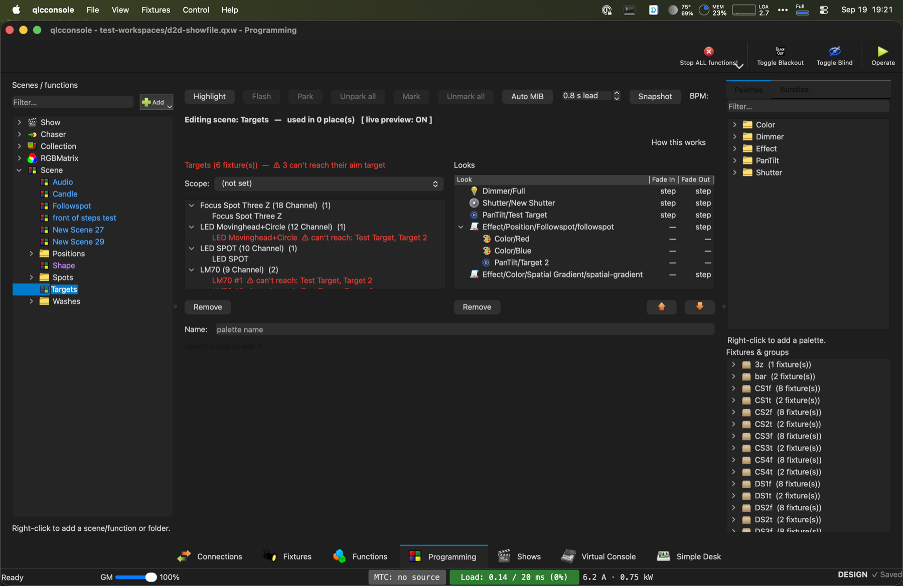

# Programming Tab

*"Scenes hold looks. Looks are made of palettes."* — the app's own guide text.

## Why

Stock QLC+ builds a Scene by setting raw per-channel DMX values, fixture by
fixture. Want "all the blue washes a little dimmer"? Re-touch every fixture's
channels by hand. Change your mind about the exact shade of blue? Re-touch
every scene that used it.

The Programming tab replaces that with an indirection layer. A Scene stops
being a flat bag of baked DMX values and becomes a declaration of:

- **Targets** — which fixtures or groups this scene affects
- **Looks** — which reusable **palettes** (Color, Dimmer, Pan/Tilt, Aim, Beam,
  Gobo, Shutter, Strobe, Effect) apply to them

Edit a palette once — say, nudge "Deep Blue" a little warmer — and every
scene that uses it updates. It's still an ordinary QLC+ `Scene` function
under the hood, so workspace files stay compatible with the classic Function
Manager / Scene Editor.

## Layout

Three panes:

- **Left — Scenes / functions.** A filterable tree of every function
  (Scene/Chaser/Collection/EFX/RGB Matrix/Show) in folders. Single-click
  selects; double-click opens it in the canvas.
- **Center — canvas.** A toolbar — **Highlight**, **Flash**, **Tap** and
  **Save Positions** as buttons; **Park** (park selected, unpark all),
  **Move in black** (mark, unmark, auto move-in-black and its lead time),
  **Beat** (internal beat on, BPM, speed masters — the button reads the
  tempo) and **More** (snapshot live output, jog speed) as drop-downs —
  then either an empty-state placeholder or the loaded editor. For
  a Scene, that's the **Targets** panel (left half) and **Looks** panel
  (right half) shown above. Other function types (Chaser, Collection, EFX,
  RGB Matrix, Show) open their own stock editors here instead. Below the
  canvas, the inline **Look Editor** appears whenever a look is selected.
- **Right — sources.** A **Palettes** tab (filterable, foldered, drag
  source) and a **Bundles** tab, with a permanent **Fixtures &amp; groups**
  tree underneath for dragging Targets. A **Search fixtures & groups…** box
  sits over that tree: a row stays when it or anything under it matches,
  the folders on the way down open, and a matching group keeps all its
  fixtures. Clear the search and the tree closes back up.

Double-clicking a fixture group opens its layout view in the canvas. A
**← Back to &lt;scene&gt;** button there returns you to the scene you came
from; if you open an effect while in a group's view, the tab goes back to
that scene first, with the effect showing.

## Building a look, step by step

1. Open the **Programming** tab.
2. If you don't have any palettes yet, right-click the **Palettes** tab and
   pick a type — Color, Dimmer, Pan/Tilt, Aim, Beam, Gobo, Shutter, Strobe,
   or Effect. It opens straight into the Look Editor for you to set its
   value; drag it into a folder afterward to file it.
3. On the left, pick an existing Scene (double-click) or click **Add** → New
   Scene.
4. **Drag a fixture group onto Targets** to add it as a **dynamic** target —
   its membership is followed live, so adding a fixture to that group later
   automatically pulls it into every scene using it. **Drag an individual
   fixture onto Targets** instead for a **fixed** target with static
   membership.
5. **Drag a palette from the right onto the Looks list.** Dropped on empty
   space, it becomes a base look (painted directly onto the targets).
   Dropped onto an Effect look, a Color/Dimmer palette instead nests
   *under* it, feeding that effect's gradient or master level.
6. Click a look to edit it live in the Look Editor at the bottom — see
   below. Every edit there applies immediately; there's no separate "apply"
   step.
7. Reorder looks with the up/down buttons (list order is paint precedence —
   later entries win on shared channels); remove a look or target with its
   panel's **Remove** button.
8. Save the workspace normally (⌘S / Ctrl+S).

If some of a scene's targets are still in the inventory (not patched), an
amber warning under Targets says so: they send no DMX, and the look shows in
the rig view only until you patch them in the Fixture Manager. Unpatched
target rows are also marked "(unpatched)".

A **Bundle** is a related, separate shortcut: a portable, shareable snapshot
of an ordered palette stack (no fixture targets attached). "Stamping" one
from the Bundles tab onto the open scene replaces its whole look stack in one
action — handy for re-using a "look" across shows without re-dragging every
palette. One level of undo is kept for a stamp.

## Transitions

A scene can arrive and leave as a **transition** rather than everything
fading together: a wipe across the stage, from the centre, a dissolve. The
row sits on the scene's canvas:

**In:** [shape] [time]  **Out:** [shape] [time]  **Edge:** [%]

| Shape | What happens |
|---|---|
| **None (the scene's fade)** | No transition; the scene's own fade times apply. |
| **Fade** | Everything together over the time. |
| **Wipe to stage left / Wipe to stage right** | Across the stage. |
| **Wipe up / Wipe down** | By height. |
| **Wipe front to back / Wipe back to front** | Downstage to upstage, or the reverse. |
| **From the centre / To the centre** | Outward from, or inward to, the middle of the stage. |
| **Dissolve** | Heads in a fixed random order. |
| **Along each bar** | Pixel by pixel along every bar. |

Each head's moment comes from **where it is on stage** (its place in the
rig), so the rig needs to be laid out in Lighting Studio for wipes to mean
anything. **Edge** sets how soft the leading edge is: each head's own fade
as a share of the whole time — 100% and everything fades together, low and
it's a sharp line.

The **whole look** follows the transition, effects included, cell by cell.
Channels that can't fade (gobo, shutter and the like) switch when the
transition reaches them, not at the start.

Things to know:

- An active transition **replaces the scene's fade time**.
- It doesn't apply when the scene's tempo is **Beats**.
- If you change it while the scene is previewing, restart the scene to see
  the new one — the transition in is worked out when the scene starts.

## The inline Look Editor

The editor shown depends on the selected look's palette type:

| Type | What you get |
|---|---|
| **Color** | A color-wheel picker, a grid of basic-color swatches, and six numbered sliders (1 R · 2 G · 3 B · 4 White · 5 Amber · 6 UV — matching a physical-fader numbering convention). Amber/UV only appear if your target fixtures actually have those emitters. |
| **Dimmer** | A gradient bar marked with the fixture's actual intensity capability regions (e.g. strobe bands), with a live capability-name readout. |
| **Pan/Tilt** | An XY pad plus Home/Down/Front/Left/Right preset buttons — the same raw pan/tilt pair applied to every target, regardless of where it's physically rigged. |
| **Aim** | A combo box listing your **Stage Targets** instead of raw angles — each fixture's actual pan/tilt is computed from its rig position, so fixtures in different spots converge on the same point. Needs fixtures placed in Lighting Studio first. See [Stage Targets](stage-targets.md). |
| **Beam** | Focus / Frost / Iris sliders. |
| **Gobo / Shutter** | A slider plus a picker of the target fixture's actual named capabilities, with thumbnail previews. |
| **Strobe** | A single rate slider (0–100%). |
| **Effect** | The **effect browser** (below), a dynamically-built parameter panel, and Save/Export/Import for sharing `.qxfx` effect files. |

Every type except Effect also shows a per-look **Fade in / Fade out**
override (leave at "step" to inherit the scene or chaser's own timing). A
scene [transition](#transitions), when set, takes the place of the scene's
fade.

If the editor is showing a palette that isn't in the look open on the
canvas, the look **tries it on**: it plays on top of the look's own
palettes so you can see it on the rig, but it's never saved into the look.
The editor says "Trying it on “&lt;look&gt;” — not saved into it"; drag the
palette onto the look to keep it. With no look open it says "Not in a look".

### The effect browser

An Effect look picks its effect from a browser rather than a dropdown. The
browser is a **window of its own**, so once an effect is picked its
settings have the look editor's whole width. Over the settings, one line
names the effect, with **Change effect…** to open the browser again:

- **Every effect you pick plays at once**, with its own settings, so the
  rig shows it while you browse; the **arrow keys** step through the list,
  playing each as they go.
- **Done** (or Enter, or closing the window) keeps what is picked;
  **Cancel** (or Esc) puts back the effect the look had — its settings and
  name too.
- A new effect look, with nothing picked yet, opens the browser by itself.
- The window remembers where you put it.

- A **Search effects…** box searches every category at once, whichever tab
  is open.
- Tabs: **Recent**, **Color**, **Dimmer**, **Position**, **Beam**, **Other**
  and **WLED**. Recent is remembered between sessions.
- Each row shows the effect's name, what it does, and a live strip of 16
  lights running it. Presets sit under the effect they're built from.

Two effects are called fire-something:

- **Fire** is the RGB Matrix flame, rising from the lowest heads on stage
  (its Orientation setting flips it).
- **Firelight** is the per-fixture flicker. (Older looks that used it keep
  it.)

RGB Matrix scripts that share a name with an effect script are listed as
"&lt;name&gt; (RGB Matrix)" — Confetti, Lightning, Meteor, Plasma.

Settings come in a few shapes: a slider for a number, a list for a choice,
a pad for a drawn path, a compass for a direction, and — for an effect
that shows words — a **text box**. What you type is taken as you type it,
so the rig shows it as you go.

#### Text

**Text** puts words on a pixel grid — the look's group as laid out in its
head layout: a run of LED strips, a matrix. It is not the WLED text (that
one is drawn by the WLED device); this works on anything whose pixels are
heads. Settings:

- **text** — the words, in a 5 × 7 font covering every printable
  character. The grid needs to be 7 pixels tall for a whole letter.
- **style** — **Scroll** brings the text in from the right and out past the
  left, round and round; **Still** holds it in the middle.
- **speed** (pixels a second, scrolling), **size** (pixels per dot of a
  letter, 1–4, for a big matrix), **level**.
- **mirror** / **flip** — if it reads backwards or upside down, the strips
  count from the other end or the rows the other way up.

The letters are drawn in the look's **first colour**, over its **second**
when the look has one (otherwise the background is left as the rest of the
look sets it).

(The RGB Matrix's own **Text** algorithm, in the Functions window, gained a
**Centered** animation style too: the whole text still, centred across and
down, the X/Y offsets nudging it.)

#### Step Test Pattern

A diagnostic card for LED-strip steps whose fixtures are named the usual
way — front strips **"&lt;step&gt; #&lt;n&gt;"** ("DS1 #3": step DS1, its
third strip) and top bars **"&lt;step&gt;t&lt;n&gt;"** ("CS2t1"). On every
step's front:

- strip *n* lights its first *n* LEDs white, so the order of the strips
  and the end each counts from can be read;
- the last LED of every strip is white, so a strip's length can be checked;
- from the 10th LED, one vertical line per step number (DS1 one, CS3
  three), every other LED — **blue for DS, green for CS, red for US**;
- the step's **name** in the middle, white, and beside it a **spinner** as
  tall as the step going round once a second — if it stops, the output has
  frozen.

On every top bar a dim blue dot runs back and forth over the colour
pixels. If a name reads backwards, the strips count from the other end:
turn on **mirror**. Which strip is the top row comes from the strips'
heights on the rig (highest first), else their numbers.

**Effects on a big rig.** An effect's script is handed every head of every
fixture each tick; that list is now kept between ticks and only what
changed is updated, so a rig of 96 strips × 64 pixels costs about 8 ms a
tick in a release build (it was 68). Renaming or moving a fixture shows up
on the next tick.

An effect run across two or more groups is laid out **as the rig stands on
stage**: one grid with every head where the rig view draws it — across is
stage left to right, up is height (or upstage, when everything is at one
height). A sine over the towers, bars and steps then moves across the stage
as one, instead of group by group. An effect on a single group still uses
that group's own layout.

### WLED effects

Picking an effect from the **WLED** tab has the WLED fixtures in the look
run it **on the device itself**: they're sent the effect, its speed,
intensity, palette and option, the look's three colours and the look's
dimmer. Every other fixture in the look runs qlcconsole's own port of that
effect where one exists (so far **Breathe** and **Chase**). A WLED effect
with no port ("no preview yet" in the browser) leaves the other fixtures as
the rest of the look sets them.

The WLED list comes from a WLED fixture in the show, or from the installed
WLED fixture definition if there isn't one.

Red warning text appears if a look's type has no matching channel on any of
its targets (e.g. a Gobo look applied to fixtures with no gobo wheel), and —
for Aim looks specifically — the Targets panel flags in red which fixtures
physically **can't reach** the point they're aimed at (see
[Stage Targets](stage-targets.md#reachability)).

## Design vs. Operate mode

There's no preview toggle local to this tab — it follows the app's global
Design/Operate mode:

- **Design mode**: the open scene plays live so you can see what you're
  building, but edits don't disturb a running show elsewhere.
- **Operate mode**: the scene runs as the actual show output.

The 2D Monitor plot, if open, stays in sync with whatever scene is open here.

## Saving your work

Ordinary look edits (color, dimmer, gradient, gobo, targets…) apply live —
there's nothing to "commit," just save the workspace as usual.

The one exception: dragging an Aim target's position or nudging a Pan/Tilt
palette with a joystick/HID controller in Design mode needs an explicit
**Save Positions** button (a two-click "arm, then confirm" action) before it
persists to the file — because that's the one edit path that isn't already
fully live.

**Snapshot** (toolbar button) is a different thing entirely: it bakes the
scene's *current live DMX output* into it as static values — useful for
capturing a look you built live on an external console.

## Terminology

| Term | Meaning |
|---|---|
| **Look** | A palette as applied inside a specific scene. |
| **Palette** | A reusable, named preset (Color, Dimmer, Pan/Tilt, Aim, Beam, Gobo, Shutter, Strobe, Effect) that expands per-fixture at run time. Lives in its own tree, independent of any scene. |
| **Target** | A fixture or group a scene's looks apply to — **dynamic** (a group, membership tracked live) or **fixed** (an individual fixture, static). |
| **Base look** | A look positioned before any Effect in the list — paints fixtures directly. |
| **Nested look** | A Color/Dimmer look placed *under* an Effect — feeds that effect's gradient/master instead of painting fixtures itself. |
| **Bundle** | A portable, target-free snapshot of an ordered palette stack, "stampable" onto any scene. |
| **Snapshot** | Bakes a scene's current live output into it as static values. |
