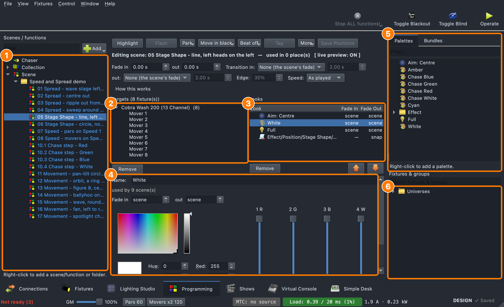
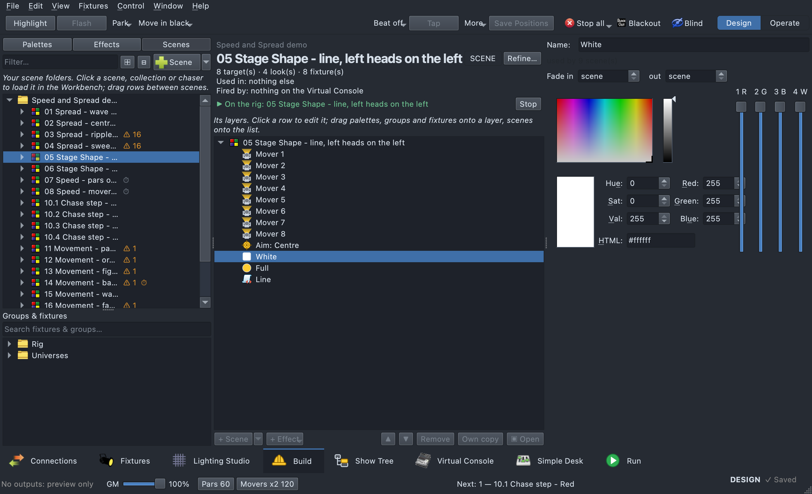
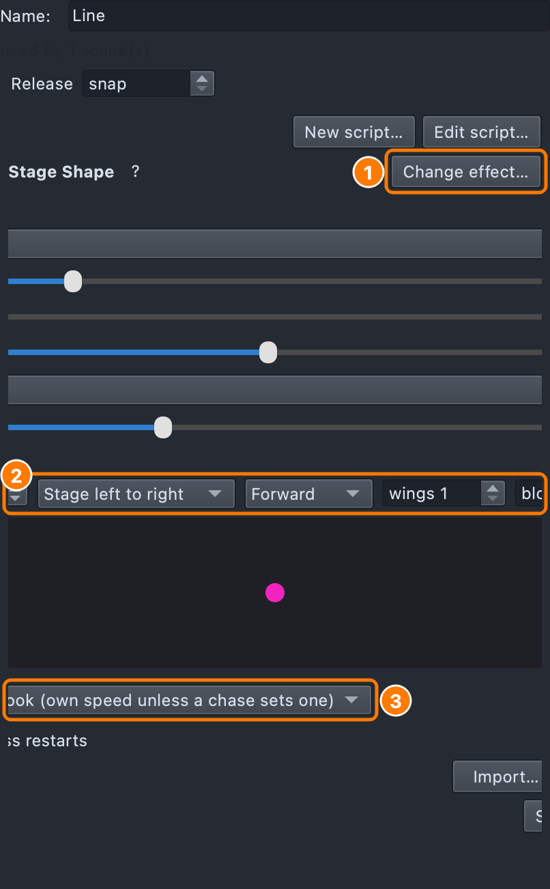
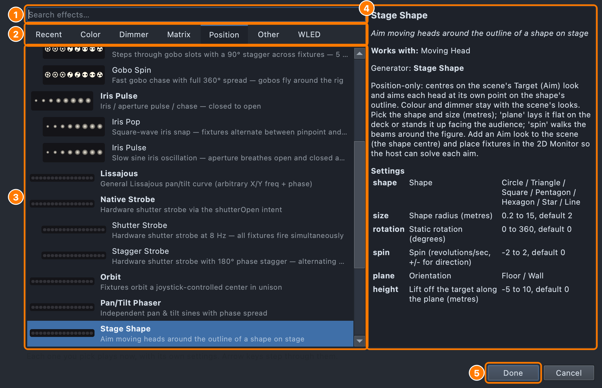

# Programming Tab

*"Scenes hold looks. Looks are made of palettes."* — the app's own guide text.

## Why

Stock QLC+ builds a Scene by setting raw per-channel DMX values, fixture by
fixture. Want "all the blue washes a little dimmer"? Re-touch every fixture's
channels by hand. Change your mind about the exact shade of blue? Re-touch
every scene that used it.

The Programming tab replaces that with an indirection layer. A Scene stops
being a flat bag of baked DMX values and becomes a declaration of:

- **Targets** — which fixtures or groups this scene affects
- **Looks** — which reusable **palettes** (Color, Dimmer, Pan/Tilt, Aim, Beam,
  Gobo, Shutter, Strobe, Effect) apply to them

Edit a palette once — say, nudge "Deep Blue" a little warmer — and every
scene that uses it updates. It's still an ordinary QLC+ `Scene` function
under the hood, so workspace files stay compatible with the classic Function
Manager / Scene Editor.

## Layout

1. **Scenes / functions** — double-click one to open it.
2. **Targets** — the fixtures and groups the open scene lights.
3. **Looks** — what it does to them, top to bottom; select one to edit it.
4. **The Look Editor**, for the selected look.
5. **Palettes** and **Bundles** — drag a palette onto Looks.
6. **Fixtures &amp; groups** — drag them onto Targets.

Three panes:

- **Left — Scenes / functions.** A filterable tree of every function
  (Scene/Chaser/Collection/EFX/RGB Matrix/Show) in folders. Single-click
  selects; double-click opens it in the canvas. See
  [Filing into folders](#filing-into-folders).
- **The tab's tools**, in the top bar beside the show controls (or over
  the canvas, with the show controls in the status bar, or the tab in a
  window of its own): **Highlight**, **Flash**, **Tap** and
  **Save Positions** as buttons; **Park** (park selected, unpark all),
  **Move in black** (mark, unmark, auto move-in-black and its lead time;
  the auto switch and lead time are the show's, the same as the Show Tree's
  **MIB** button and Settings → Show Tree — see
  [Move in black](show-tree.md#move-in-black)),
  **Beat** (internal beat on, BPM, speed masters — the button reads the
  tempo) and **More** (snapshot live output, jog speed) as drop-downs.
  In a narrow window, what doesn't fit is under **»**.
- **Center — canvas.** Either an empty-state placeholder or the loaded
  editor. For
  a Scene, that's the **Targets** panel (left half) and **Looks** panel
  (right half) shown above. Other function types (Chaser, Collection, EFX,
  RGB Matrix, Show) open their own stock editors here instead. Below the
  canvas, the inline **Look Editor** appears whenever a look is selected.
- **Right — sources.** A **Palettes** tab (filterable, foldered, drag
  source) and a **Bundles** tab, with a permanent **Fixtures &amp; groups**
  tree underneath for dragging Targets. A **Search fixtures & groups…** box
  sits over that tree: a row stays when it or anything under it matches,
  the folders on the way down open, and a matching group keeps all its
  fixtures. Clear the search and the tree closes back up.

**Resizing:** drag the handles between the three panes, and the one
between the canvas and the Look Editor below it. A handle moves its edge
and stops where a pane reaches its smallest — no pane snaps shut. The
fades-and-transitions line wraps when the canvas is narrow; the Look Editor
scrolls when you make it shorter than it is. Where you leave the handles
is remembered.

Double-clicking a fixture group opens its layout view in the canvas. A
**← Back to &lt;scene&gt;** button there returns you to the scene you came
from; if you open an effect while in a group's view, the tab goes back to
that scene first, with the effect showing.

## Filing into folders

Both the scenes/functions tree and the Palettes tab keep things in folders.

- **Drag to file.** Press on a scene (or any function, or a palette) and
  drag it onto a folder — it moves in. Drop it on another row and it joins
  that row's folder; drop it on the type's heading (**Scene**, **Chaser**…)
  or on empty space below the list to take it back out to the top. Select
  several first (⇧/⌘-click) to move them together. The folder it will land
  in is outlined while you drag, and hovering over a closed folder opens it.
- **Folders move too.** Drag a folder onto another folder and it goes inside
  it with everything in it.
- A scene stays among scenes, a chaser among chasers: a folder of another
  type doesn't take it. Dropping a scene **on a Collection's row** adds it
  to that collection instead of filing it.
- **Right-click a folder** for **Rename Folder**, **Delete Folder** and the
  usual **New …** items, which then create inside it. Deleting an empty
  folder just removes it. Deleting one with things in it asks first, and
  what was in it moves up a level — nothing is deleted.

Folders are saved with the show and show the same in the Functions window
(**Window → Functions**).

**Palette folders hold any type.** A folder in the Palettes tab can hold
colours, aims, dimmers and effects together — say a folder per song,
"01-Everybody Scream", with everything that song uses. Right-click empty
space → **New folder…** makes one at the top level. The tab shows folders
first, each palette with its type's icon, and the palettes in no folder
below them. Tick **Group by type** in the right-click menu to see it the
other way round: Aim, Color, Dimmer… first, with the same folders under each
type (it is remembered). In that view a folder is still one folder: renaming
or deleting it under Color does it for every type, and dropping a palette on
it files the palette there whatever its type.

Shows saved before this had a folder per type (Color › 01-Song, Aim ›
01-Song); they open with those merged into one folder per name, and effect
looks that had been filed automatically under Effect › category › engine are
left in no folder. Only what is really that old layout changes: a folder
you made that happens to be named like a type (*Color* holding dimmers) or
*Colour* keeps its name. Saving keeps the new layout; an older version of
qlcconsole opening such a show shows the same folders at the top level. The
Show Tree's Library uses the same folders.

### Taking something out of a collection, chaser or show

An open collection, chaser or show lists what is in it underneath its row.
Right-click one of those rows (or several, ⇧/⌘-click) and pick **Remove from
“…”**: they come out of it and the functions themselves stay. Taking a step
out of a chaser, or an item off a show's track, asks first, since its fade,
hold and timing go with it. **Delete Function Everywhere…** on such a row is
different: it deletes the function itself, from every collection, chaser and
show; the question names where it is used.

### Deleting palettes and functions

Right-click → **Delete**, or select and press **⌫** (Delete), in either tree.
The question lists every place the palette or function is used — each scene
and which look row, each effect look whose slot uses the palette, each
collection, chaser step and show track — and says what happens: scenes lose
that look (their other looks and values stay), effect looks lose that slot's
palette and use their look's colours, collections/chasers/shows lose it. With
a folder selected, ⌫ deletes the folder the same way as its menu item.

A palette the Show Tree uses is named by its **cues and looks** ("Cue 1.0.1
Verse in Full Show — Towers"), not by the scenes the tree made for them, and
the **VC buttons** that fire those are listed too.

### Palettes here and in the Show Tree

New, Duplicate, Delete and Move to folder of a palette are the same
operations as in the Show Tree's Library ([Palettes in the
Library](show-tree.md#palettes-in-the-library)), and each is one step on the
**one history** the two tabs share: **⌘Z** here (or the Show Tree's) takes
back whatever was done last — an edit to the look open on the canvas, a
Bundle stamp, a palette made, renamed, filed or deleted in either tab, or a
Show Tree change — and **⇧⌘Z** puts back what was undone last. Deleting a
palette here clears it from everything that uses it — scenes, effect slots
and the Show Tree's cues and looks, as the Library's Delete does — and one
⌘Z brings it back with its id, in every one of them.
The **Edit** menu's Undo / Redo name the step. Effect design, `.qxfx` files
and Bundles stay here.

## Building a look, step by step

1. Open the **Programming** tab.
2. If you don't have any palettes yet, right-click the **Palettes** tab and
   pick a type — Color, Dimmer, Pan/Tilt, Aim, Beam, Gobo, Shutter, Strobe,
   or Effect. It opens straight into the Look Editor for you to set its
   value; drag it into a folder afterward to file it.
3. On the left, pick an existing Scene (double-click) or click **Add** → New
   Scene.
4. **Drag a fixture group onto Targets** to add it as a **dynamic** target —
   its membership is followed live, so adding a fixture to that group later
   automatically pulls it into every scene using it. **Drag an individual
   fixture onto Targets** instead for a **fixed** target with static
   membership.
5. **Drag a palette from the right onto the Looks list.** Dropped on empty
   space, it becomes a base look (painted directly onto the targets).
   Dropped onto an Effect look, a Color/Dimmer palette instead nests
   *under* it and belongs to that effect only — its colours, its level;
   the ones above every effect are the look's own and feed every effect
   that has none of its own. See
   [How a look stacks](effects.md#how-a-look-stacks).
6. Click a look to edit it live in the Look Editor at the bottom — see
   below. Every edit there applies immediately; there's no separate "apply"
   step.
7. Reorder looks with the up/down buttons — the list is a stack read top
   to bottom, and the lower look wins on what two of them set (two Colours
   are colour 1 and colour 2 instead; see
   [How a look stacks](effects.md#how-a-look-stacks)). Remove a look or
   target with its panel's **Remove** button.
8. Save the workspace normally (⌘S).

If some of a scene's targets are still in the inventory (not patched), an
amber warning under Targets says so: they send no DMX, and the look shows in
the Lighting Studio and the Rig Overview only until you patch them in the Fixture Manager. Unpatched
target rows are also marked "(unpatched)".

A **Bundle** is a related, separate shortcut: a portable, shareable snapshot
of an ordered palette stack (no fixture targets attached). "Stamping" one
from the Bundles tab onto the open scene replaces its whole look stack in one
action — handy for re-using a "look" across shows without re-dragging every
palette. One level of undo is kept for a stamp.

## Transitions

A scene can arrive and leave as a **transition** rather than everything
fading together: a wipe across the stage, from the centre, a dissolve. The
row sits on the scene's canvas:

**In:** [shape] [time]  **Out:** [shape] [time]  **Edge:** [%]

| Shape | What happens |
|---|---|
| **None (the scene's fade)** | No transition; the scene's own fade times apply. |
| **Fade** | Everything together over the time. |
| **Wipe to stage left / Wipe to stage right** | Across the stage. |
| **Wipe up / Wipe down** | By height. |
| **Wipe front to back / Wipe back to front** | Downstage to upstage, or the reverse. |
| **From the centre / To the centre** | Outward from, or inward to, the middle of the stage. |
| **Dissolve** | Heads in a fixed random order. |
| **Along each bar** | Pixel by pixel along every bar. |

Each head's moment comes from **where it is on stage** (its place in the
rig), so the rig needs to be laid out in Lighting Studio for wipes to mean
anything. **Edge** sets how soft the leading edge is: each head's own fade
as a share of the whole time — 100% and everything fades together, low and
it's a sharp line.

The **whole look** follows the transition, effects included, cell by cell.
Channels that can't fade (gobo, shutter and the like) switch when the
transition reaches them, not at the start.

Things to know:

- An active transition **replaces the scene's fade time**.
- It doesn't apply when the scene's tempo is **Beats**.
- If you change it while the scene is previewing, restart the scene to see
  the new one — the transition in is worked out when the scene starts.

## The inline Look Editor

The editor shown depends on the selected look's palette type:

| Type | What you get |
|---|---|
| **Color** | A color-wheel picker, a grid of basic-color swatches, and six numbered sliders (1 R · 2 G · 3 B · 4 White · 5 Amber · 6 UV — matching a physical-fader numbering convention). Amber/UV only appear if your target fixtures actually have those emitters. Fixtures with a colour wheel or a colour ring add a **Wheel / ring** list: *Nearest to the colour* (each wheel and ring takes its slot nearest the colour), or a slot by name — a ring's chase, which no colour can pick. See [Colour rings](show-tree.md#colour-rings). |
| **Dimmer** | A gradient bar marked with the fixture's actual intensity capability regions (e.g. strobe bands), with a live capability-name readout. |
| **Pan/Tilt** | An XY pad plus Home/Down/Front/Left/Right preset buttons — the same raw pan/tilt pair applied to every target, regardless of where it's physically rigged. |
| **Aim** | A combo box listing your **Stage Targets** instead of raw angles — each fixture's actual pan/tilt is computed from its rig position, so fixtures in different spots converge on the same point. Needs fixtures placed in Lighting Studio first. See [Stage Targets](stage-targets.md). |
| **Beam** | Focus / Frost / Iris sliders. |
| **Gobo / Shutter** | A slider plus a picker of the target fixture's actual named capabilities, with thumbnail previews. |
| **Strobe** | A single rate slider (0–100%). |
| **Effect** | The **effect browser** (below), a dynamically-built parameter panel, and Save/Export/Import for sharing `.qxfx` effect files. |

Every type except Effect also shows a per-look **Fade in / Fade out**
override (leave at "step" to inherit the scene or chaser's own timing). A
scene [transition](#transitions), when set, takes the place of the scene's
fade.

If the editor is showing a palette that isn't in the look open on the
canvas, the look **tries it on**: it plays on top of the look's own
palettes so you can see it on the rig, but it's never saved into the look.
The editor says "Trying it on “&lt;look&gt;” — not saved into it"; drag the
palette onto the look to keep it. With no look open it says "Not in a look".

1. **Change effect…** opens the effect browser (below).
2. **Spread** — how the effect is spread across the heads
   ([Spread](effects.md#spread)).
3. **Speed** — the speed master it runs on
   ([Speed masters](effects.md#speed-masters)).

### The effect browser

1. **Search effects…** — every category at once.
2. **The tabs**: Recent, Color, Dimmer, Position, Beam, Other, WLED.
3. **The effects**, each with a live preview; the one picked is playing.
4. **What the picked effect does**, what it works with and its settings.
5. **Done** keeps it; **Cancel** puts back what the look had.

An Effect look picks its effect from a browser rather than a dropdown. The
browser is a **window of its own**, so once an effect is picked its
settings have the look editor's whole width. Over the settings, one line
names the effect, with **Change effect…** to open the browser again:

- **Every effect you pick plays at once**, with its own settings, so the
  rig shows it while you browse; the **arrow keys** step through the list,
  playing each as they go.
- **Done** (or Enter, or closing the window) keeps what is picked;
  **Cancel** (or Esc) puts back the effect the look had — its settings and
  name too.
- A new effect look, with nothing picked yet, opens the browser by itself.
- The window remembers where you put it.

- A **Search effects…** box searches every category at once, whichever tab
  is open.
- Tabs: **Recent**, **Color**, **Dimmer**, **Position**, **Beam**, **Other**
  and **WLED**. Recent is remembered between sessions.
- Each row shows the effect's name, what it does, and a live preview of
  what it does:
  - a **colour or dimmer** effect: a strip of 16 lights running it (amber
    and UV in their own colours, a shutter strobe blinking);
  - a **position** effect: where the heads point — the shape it traces (a
    diamond, an orbit, a figure 8, Stage Shape's outline round its target)
    as a faint line, every head as a dot along it, four of them bright —
    zoomed to fit its movement. One that only follows a joystick (a
    follow-spot) is shown being steered;
  - a **gobo, iris or zoom** effect: a row of beams seen end-on — their
    gobo pattern, or their size opening and closing.

  Presets sit under the effect they're built from.

Two effects are called fire-something:

- **Fire** is the RGB Matrix flame, rising from the lowest heads on stage
  (its Orientation setting flips it).
- **Firelight** is the per-fixture flicker. (Older looks that used it keep
  it.)

RGB Matrix scripts that share a name with an effect script are listed as
"&lt;name&gt; (RGB Matrix)" — Confetti, Lightning, Meteor, Plasma.

Settings come in a few shapes: a slider for a number, a list for a choice,
a pad for a drawn path, a compass for a direction, and — for an effect
that shows words — a **text box**. What you type is taken as you type it,
so the rig shows it as you go.

#### Text

**Text** puts words on a pixel grid — the look's group as laid out in its
head layout: a run of LED strips, a matrix. It is not the WLED text (that
one is drawn by the WLED device); this works on anything whose pixels are
heads. Settings:

- **text** — the words, in a 5 × 7 font covering every printable
  character. The grid needs to be 7 pixels tall for a whole letter.
- **style** — **Scroll** brings the text in from the right and out past the
  left, round and round; **Still** holds it in the middle.
- **speed** (pixels a second, scrolling), **size** (pixels per dot of a
  letter, 1–4, for a big matrix), **level**.
- **mirror** / **flip** — if it reads backwards or upside down, the strips
  count from the other end or the rows the other way up.

The letters are drawn in the look's **first colour**, over its **second**
when the look has one (otherwise the background is left as the rest of the
look sets it).

(The RGB Matrix's own **Text** algorithm, in the Functions window, gained a
**Centered** animation style too: the whole text still, centred across and
down, the X/Y offsets nudging it.)

#### Step Test Pattern

A diagnostic card for LED-strip steps whose fixtures are named the usual
way — front strips **"&lt;step&gt; #&lt;n&gt;"** ("DS1 #3": step DS1, its
third strip) and top bars **"&lt;step&gt;t&lt;n&gt;"** ("CS2t1"). On every
step's front:

- strip *n* lights its first *n* LEDs white, so the order of the strips
  and the end each counts from can be read;
- the last LED of every strip is white, so a strip's length can be checked;
- from the 10th LED, one vertical line per step number (DS1 one, CS3
  three), every other LED — **blue for DS, green for CS, red for US**;
- the step's **name** in the middle, white, and beside it a **spinner** as
  tall as the step going round once a second — if it stops, the output has
  frozen.

On every top bar a dim blue dot runs back and forth over the colour
pixels. If a name reads backwards, the strips count from the other end:
turn on **mirror**. Which strip is the top row comes from the strips'
heights on the rig (highest first), else their numbers.

**Effects on a big rig.** An effect's script is handed every head of every
fixture each tick; that list is now kept between ticks and only what
changed is updated, so a rig of 96 strips × 64 pixels costs about 8 ms a
tick in a release build (it was 68). Renaming or moving a fixture shows up
on the next tick.

An effect run across two or more groups is laid out **as the rig stands on
stage**: one grid with every head where the Lighting Studio draws it — across is
stage left to right, up is height (or upstage, when everything is at one
height). A sine over the towers, bars and steps then moves across the stage
as one, instead of group by group. An effect on a single group still uses
that group's own layout.

### WLED effects

Picking an effect from the **WLED** tab has the WLED fixtures in the look
run it **on the device itself**: they're sent the effect, its speed,
intensity, palette and option, the look's three colours and the look's
dimmer. Every other fixture in the look runs qlcconsole's own port of that
effect where one exists — 160 of them, every 1D effect WLED has: Android, Aurora, Blends, Blink, Blink Rainbow, Bouncing Balls, Bpm, Breathe, Candle, Candle Multi, Chase, Chase 2, Chase 3, Chase Flash, Chase Flash Rnd, Chase Rainbow, Chase Random, Chunchun, Color Clouds, Colorful, Colorloop, Colortwinkles, Colorwaves, Dancing Shadows, Dissolve, Dissolve Rnd, Drip, Dynamic, Dynamic Smooth, Fade, Fairy, Fairytwinkle, Fill Noise, Fire 2012, Fire Flicker, Fireworks, Fireworks 1D, Fireworks Starburst, Flow, Flow Stripe, Glitter, Gradient, Halloween Eyes, Heartbeat, Hyper Sparkle, ICU, Juggle, Lake, Lighthouse, Lightning, Loading, Meteor, Meteor Smooth, Multi Comet, Noise 1, Noise 2, Noise 3, Noise 4, Noise Pal, Oscillate, Pacifica, PacMan, Palette, Percent, Perlin Move, Phased, Phased Noise, Plasma, Police, Popcorn, Pride 2015, PS 1D Balance, PS Chase, PS Dancing Shadows, PS DripDrop, PS Fire 1D, PS Fireworks 1D, PS Hourglass, PS Pinball, PS Sparkler, PS Spray 1D, PS Springy, PS Starburst, Railway, Rain, Rainbow, Rainbow Runner, Random Colors, Ripple, Ripple Rainbow, Rolling Balls, Running, Running Dual, Saw, Scan, Scan Dual, Scanner, Scanner Dual, Shimmer, Sine, Sinelon, Sinelon Dual, Sinelon Rainbow, Solid, Solid Glitter, Solid Pattern, Solid Pattern Tri, Sparkle, Sparkle Dark, Sparkle+, Spots, Spots Fade, Stream, Stream 2, Strobe, Strobe Mega, Strobe Rainbow, Sunrise, Sweep, Sweep Random, Tetrix, Theater, Theater Rainbow, Traffic Light, Tri Fade, Tri Wipe, TV Simulator, Twinkle, Twinklecat, Twinklefox, Twinkleup, Two Areas, Two Dots, Washing Machine, Wavesins, Wipe, Wipe Random; and, following the audio input (Inputs/Outputs; with none they rest, dark), the sound-reactive DJ Light, Freqmap, Freqpixels, Freqwave, Gravcenter, Gravcentric, Gravfreq, Gravimeter, Juggles, Matripix, Midnoise, Noisefire, Noisemeter, Noisemove, Plasmoid, PS GEQ 1D, PS Sonic Boom, PS Sonic Stream, Puddlepeak, Puddles, Ripple Peak, Rocktaves, Waterfall — written from what each does on a device (not from WLED's
code), so they look the same on the WLED fixtures and the rest.
Hyper Sparkle, Police and Two Areas are WLED's older names, offered when a
device's firmware still lists them. WLED's 2D effects, and Copy Segment,
Image and Slow Transition (which need the device's other segments, its
stored images or its colour history), run on WLED devices only.

A WLED effect with no port runs on a WLED device and nowhere else, so the
browser only offers it when the look's targets include a WLED device;
otherwise the WLED tab lists just the ported ones. (An effect the look
already runs stays listed either way.)

The WLED list comes from a WLED fixture in the show, or from the installed
WLED fixture definition if there isn't one.

Red warning text appears if a look's type has no matching channel on any of
its targets (e.g. a Gobo look applied to fixtures with no gobo wheel), and —
for Aim looks specifically — the Targets panel flags in red which fixtures
physically **can't reach** the point they're aimed at (see
[Stage Targets](stage-targets.md#reachability)).

## Design vs. Operate mode

There's no preview toggle local to this tab — it follows the app's global
Design/Operate mode:

- **Design mode**: the open scene plays live so you can see what you're
  building, but edits don't disturb a running show elsewhere.
- **Operate mode**: the scene runs as the actual show output.

The 2D Monitor plot, if open, stays in sync with whatever scene is open here.

## Saving your work

Ordinary look edits (color, dimmer, gradient, gobo, targets…) apply live —
there's nothing to "commit," just save the workspace as usual.

The one exception: dragging an Aim target's position or nudging a Pan/Tilt
palette with a joystick/HID controller in Design mode needs an explicit
**Save Positions** button (a two-click "arm, then confirm" action) before it
persists to the file — because that's the one edit path that isn't already
fully live.

**Snapshot** (toolbar button) is a different thing entirely: it bakes the
scene's *current live DMX output* into it as static values — useful for
capturing a look you built live on an external console.

## Terminology

| Term | Meaning |
|---|---|
| **Look** | A palette as applied inside a specific scene. |
| **Palette** | A reusable, named preset (Color, Dimmer, Pan/Tilt, Aim, Beam, Gobo, Shutter, Strobe, Effect) that expands per-fixture at run time. Lives in its own tree, independent of any scene. |
| **Target** | A fixture or group a scene's looks apply to — **dynamic** (a group, membership tracked live) or **fixed** (an individual fixture, static). |
| **Base look** | A look positioned before any Effect in the list — paints fixtures directly. |
| **Nested look** | A Color/Dimmer look placed *under* an Effect — feeds that effect's gradient/master instead of painting fixtures itself. |
| **Bundle** | A portable, target-free snapshot of an ordered palette stack, "stampable" onto any scene. |
| **Snapshot** | Bakes a scene's current live output into it as static values. |
