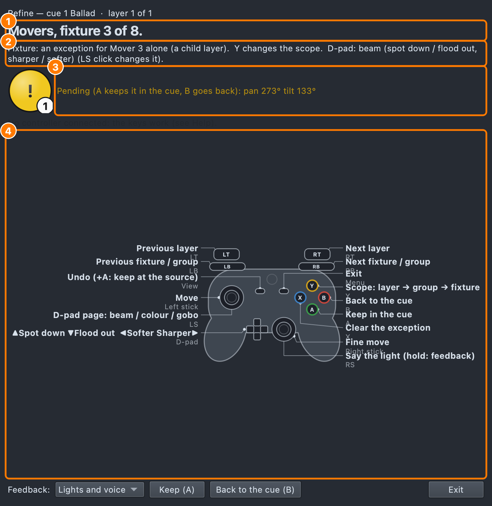

# Refine

Changing a cue from the stage, with the controller: where its lights
point, their zoom, focus, colour and gobo — the cue's own values, seen on
the real rig as you move them.

Refine is not focusing. [Focus calls](focus-calls.md) correct the rig's
calibration for a venue; Refine changes what a **cue** does. The
controller is laid out the same way in both, so it only has to be learnt
once.

## Starting

In the [Show Tree](show-tree.md), in Design or Operate:

- a cue's page: **Refine on the controller…**, or
- right-click a layer: **Refine on the controller…** (it starts on that
  layer).

In Design the cue is previewed on the rig. In Operate the show carries on
as it is running (see [Refine during the show](#refine-during-the-show)).
The Refine panel shows the cue, the layer, the scope, what the D-pad sets,
and what is pending.

In Build's [Workbench](build.md#the-workbench):

- **Refine…** in the Workbench's header, for what is loaded: a Show Tree
  cue (from its selected layer) or a Build scene, or
- right-click a cue's layer, a scene, or a scene's group or fixture row:
  **Refine on the controller…** (it starts on that row).

The controller works exactly the same on a Build scene; see
[On a Build scene](#on-a-build-scene).

1. Where you are: the layer, the group or the fixture (the voice says it too).
2. The scope, and what the D-pad sets.
3. What is pending: A keeps it in the cue, B goes back.
4. The controller, labelled with what each control does in Refine.

## Scope: layer, group, fixture

**Y** goes Layer → Group → Fixture → Layer.

- **Layer** — the layer's own look changes, for all of its fixtures.
  A position keeps its fanning: the whole fan moves.
- **Group** — one of the layer's groups (only where the layer has more
  than one). A move is an **offset** from each fixture's own position, so
  a fan inside the group stays a fan: it is kept as a position exception
  on each of the group's fixtures. Zoom, focus, colour and gobo are kept
  as one exception for the group.
- **Fixture** — one fixture. Kept as an **exception**: a
  [child layer](show-tree.md) of that layer on just that fixture, with the
  value as its own look. The layer still lights it with everything else.

The **triggers** step the cue's layers (a new layer starts at Layer
scope); the **bumpers** step the groups or fixtures. A bumper at Layer
scope picks the first fixture.

## Changing values

| Do | Controller | Keyboard |
|---|---|---|
| Next / previous layer | RT / LT | PgDn / PgUp |
| Next / previous fixture (or group) | RB / LB | ] / [ |
| Scope: layer → group → fixture | Y | G |
| Move (coarse, fine) | Left stick, right stick | Arrows (⇧: 5°) |
| Spot down / flood out (zoom) | D-pad up / down | , / . |
| Sharper / softer (focus) | D-pad right / left | ' / ; |
| D-pad page: beam / colour / gobo | LS (left stick click) | P |
| Keep in the cue | A | Return |
| Back to the cue | B | Backspace |
| Clear the exception | X | 0 |
| Undo (on its release) | View | ⌘Z |
| Keep at the cue it tracks from | View + A | ⇧Return |
| Say the light | RS (right stick click) | W |
| The next change not kept | LB + RB together | U |
| How many are not kept | View + RS | — |
| Feedback: lights / voice / both | RS held | ⇧W |
| Hold everything where it is (again: release) | Both stick clicks | H |
| Leave | Menu | Esc |

Up spots the beam down (narrower), down floods it out; right sharpens
the edge and left softens it, here as in Focus mode, and the voice says
the word once a press ("Spot down."). Hold an arm and it keeps going: once, then after
a moment over and over until you let go. On the **colour** and **gobo** pages, D-pad right
and left step forward and back through the show's colour or gobo palettes and say the name of each.

What you change is **pending**: the rig shows it at once, but the cue is
not changed until **A**. Then everything pending is kept as **one** Show
Tree step (⌘Z or View undoes it), and the voice says where it went
("AT spots kept in cue 4."). **B** drops what is pending and the rig
shows the cue again. Leaving with something pending asks whether to keep
it. Holding **A** for a second keeps everything too, but a hold never
answers a warning (below): only a fresh press does.

**A reusable layer** changes in every cue that uses it. The first **A**
only says so ("Specials is reusable: it is also used in Main 4. Press A
again to change it there too.") and the panel lists the other uses with
**Change them all**; **A** again goes on, **B** drops it.

The panel has Focus mode's lamp: blue with a tick, all kept; yellow, a
change pending here; orange, pending elsewhere; with the count.

Starting Refine while Focus mode (or Refine) has work not saved is
refused, saying what to do first.

**X** at Group or Fixture scope takes the exception off: the child layer
loses what it set on this page (position, zoom and focus on the beam
page), and goes when nothing is left on it. The fixture is lit by its
layer again.

Positions are kept in whole degrees, as the Show Tree's position values
are.

A layer aimed at a stage target (an Aim position) cannot be moved by
degrees as a whole: it would stop following its target. Move the target
in the Lighting Studio, or pick one fixture (Y) and give it a position of
its own.

## A layer the cue only tracks

A cue that sets nothing on a layer still plays it, tracked in from an
earlier cue. Refine steps through those layers too, after the cue's own,
and the voice says so: "AT spots, tracked from 2. Keeps go into this cue."

- **By default A keeps the change in this cue.** The layer becomes the
  cue's own here, and the cue the value came from is not touched.
- **Or keep it where it comes from:** hold **View** and press **A**
  (⇧Return), once. Or tick *Keep in the cue it tracks from* on the panel
  (**S**) to make that the rule. The change is then made in that cue, and
  every cue that tracks it plays it too. The voice says which.
- A tracked layer is edited as a whole (Layer scope). Keep it in this
  cue first, and then Y picks a group or a fixture for an exception.

## On a Build scene

A Build scene has no layers of its own, so Refine takes the nearest
thing to each part of a cue:

- **The layer is the scene.** With a collection loaded, the triggers step
  its scenes; with one scene, they stay on it.
- **The groups are the scene's group rows** (and its loose fixtures, as
  one).
- **Layer scope edits the scene's looks: its palettes.** A position, zoom
  or focus palette has its value moved in place, as the Look Editor does.
  If other scenes or cues use that palette, the first **A** only says who
  ("Centre is also used by 1-Ballad. Press A again to change it there
  too.") and the panel lists them with **Change them all**; **A** again
  applies it everywhere, **B** drops it. With no palette for it,
  the scene's own values on every fixture. On the colour or gobo page, the
  palette picked takes the place of the scene's.
- **An exception** (Group or Fixture scope) leaves those fixtures out of
  the attribute's palettes and gives them the scene's own values — the
  fixture row's ▣ count shows them. **X** puts them back in the palette.
- Each keep — palettes and the scene's own values together — is one step
  of Build's undo (⌘Z, or View on the controller).

## Telling you where you are

The same as [Focus calls](focus-calls.md#telling-the-operator-where-they-are):

- **The lights.** At Group or Fixture scope, what is picked keeps the
  cue's level and the rest of the layer dims to 15% — only the fixtures
  the cue has brighter than that; one already lower is never raised. On
  every change what is picked blinks three times.
- **The voice.** "AT spots, layer." "AT spots, fixture 3 of 8."
  "DS wash, group 2 of 3." "AT spots kept in cue 4." "Back to the cue."
  **Say the light** adds the cue: "Cue 4, AT spots, fixture 3 of 8."
- **Holding.** Both stick clicks (or H) hold everything where it is:
  "Holding."; again, "Released." The left stick click (the D-pad page)
  acts when you let it go, so the two can be pressed together.
- **Warnings** are always spoken, with a slow blink and a long buzz: a
  refusal, a reusable layer, the controller lost ("Controller lost. Lights
  held."), nothing reaching the rig (Blackout, the Grand Master at zero).
  See [Focus calls](focus-calls.md#telling-the-operator-where-they-are).

## Refine during the show

Refine works in Operate too, and switching between Design and Operate
does not end it. In Operate the show is running, so Refine is quiet:

- **Only the cue running.** Refine starts only on the cue its list is
  playing now. Any other cue is refused: GO to it, or refine it in
  Design.
- **No blink, no dim.** What is picked does not blink, and the rest of
  the layer is not dimmed: the audience sees the show. The voice still
  says where you are.
- **Kept, and held.** What you move shows on the rig at once, and **A**
  keeps it in the cue as in Design. The voice says "AT spots kept in cue
  4. It plays next time it runs." Until then Refine holds what was kept
  on the rig.
- **GO lets go.** When the list moves off the cue, the hold is released
  and Refine sends nothing until that cue runs again. The voice says so.

Leaving Refine lets go of the hold too. Back in Design, the cue is
previewed with everything kept.
