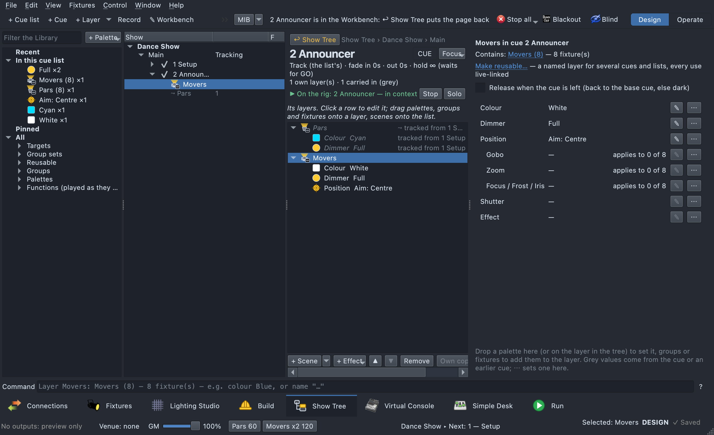

# Show Tree

The Show Tree tab (beside Build, **⇧⌘6**) is where you write a show
as cues. Everything is in one tree:

**Production → Cue list → Cue → Layer**

- A **layer** is a group (or several groups, a group set, or some
  fixtures) and the looks it plays in that cue, one per attribute: Colour,
  Dimmer, Position, Gobo, Zoom, Focus / Frost / Iris, Shutter and effects.
  Each look is a palette. A layer can have **child layers** on part of it.
- A **cue list** can be **Tracking**, where a cue carries on whatever it
  doesn't change, as on an Eos or MA. It can also be **Non-tracking**, where
  each cue plays only what it holds, as a chaser does.
- Cues have **Track / Block / Cue-only** modes, **Release**, a **base cue**
  and **includes**. Values that come from somewhere else show grey and say
  where they came from.
- Beside its cue lists, a production has a **Looks** section: busking looks
  built the same way, fired from Virtual Console buttons
  ([Looks](#looks-busking)).
- A show can hold **several productions**; the **current** one is what GO
  plays ([Productions](#productions)). A cue can have **sub-cues** 4.1,
  4.2… that **Sub GO** steps through ([Sub-cues](#sub-cues)). The **Run**
  tab and the **Cue Runner** VC widget play it all
  ([The cue runner](#the-cue-runner)).

**The Build tab works alongside it.** It makes what the tree schedules:
palettes, effect design, `.qxfx` files, Bundles, scenes and collections,
in its Workbench. The
everyday palette work — new, rename, folders, delete — is also in the
Library here ([Palettes in the Library](#palettes-in-the-library)). Both
tabs use the same palettes, groups and Look Editor, and the same palette
undo.

**You never build the playback by hand.** Each cue list plays as a
**chaser** of the same name, each cue as a **collection**, and each layer as
a **scene**. The tree makes these for you, files them under `Productions/`,
and rewrites them after every change. The scenes and collections are hidden.
The chaser is visible, so it plays anywhere a chaser does: a Virtual Console
Cue List, the footer GO, or show control by cue number. What the tree makes
is changed only in the tree: elsewhere it is locked. See
[Playing it](#playing-it).

## The tab

- **Header.** It has + Production, + Cue list, + Cue (**+ Look** in a
  Looks section), + Layer, Record, **+ Sub-cue**, Merge, Delete, Undo, Redo,
  Import chaser… and the **Production** switcher (the current production).
  At its right end, by the show controls, is **MIB**, the show's auto
  move-in-black (see [Move in black](#move-in-black)); a narrow window
  folds the buttons into **»**, never MIB.
  On the right are two pieces of status:
  - what the rig shows, such as *"▶ On the rig: 1.0.1 Verse"* (see
    [Seeing it on the rig](#seeing-it-on-the-rig));
  - while you drag, what the drop will do; after an edit, which cues it
    changed (*"Changed: 1.0.1 Verse, 1.0.2 Out"*).
Left to right: **the Library**, **the tree**, **the page** — so a drag
from the Library lands in the tree right beside it.

- **Left: the [Library](#the-library).** It holds groups, group sets,
  targets, palettes and functions to drag in, or to add with Return (see
  [Adding layers](#adding-layers)).
- **Middle: the tree.** It shows productions, cue lists, cues, and each cue's
  layers. Grey **⤳** rows under a cue are layers it doesn't hold itself but
  that are on stage in it. Beside each is only the number of the cue it
  came from: plain for *tracked from*, **⊕ 1.0.0** for *included from*,
  **↳ 4.1** for a sub-cue, **■ base** for the base. A tracking cue's row
  counts its layers: **● 2** set in this cue, **○ 1** released here, **⤳ 5**
  tracked in. Its other badges are **■ base**, **⊘ block**, **◐ cue-only**
  and **⊕ N** (includes N). On a layer row, **●** means it sets values here
  and **○ release** that it lets them go.
- **Hover for the details.** A grey row's tooltip names the layer, where
  it came from, and each value it brings (*Colour: Blue*, *Dimmer: Full*),
  with its own cue when a value came from somewhere else. A cue row's
  tooltip lists everything that tracks in, what the cue sets or releases,
  what the next cue receives, and whether the last edit changed it. The
  cue page has the same list in full under **Tracked in**.
- **Sizing the tree.** Drag the lines between the Library, the tree and
  the page to share the room; drag the line between the tree's two columns
  to make the badge column wider or narrower. The names get the rest, and
  text too long for its column ends in "…". Both are remembered. A layer
  that plays a function as it is shows **▣**. A use
  of a [reusable](#reusable-layers-and-cues) layer or cue shows **⟲** and
  how many uses there are. Under the cue lists, **Looks** holds the
  production's busking looks, in their folders; a look a VC button fires
  shows **VC ×1**.
- **Right: the page** for what is selected:
  - **A production** shows whether it is **current**, its **main list**
    and its **timecode** source ([Productions](#productions)).
  - **A cue list** shows its mode and base cue, **Convert to tracking…**
    and **Detach to plain chaser…**.
  - **A cue** shows its number, name, note, mode, base check box, includes,
    fade in / out, hold, its **sub-cues** (and + Sub-cue), cue looks, every
    layer on stage in it, a dashed drop area, and *Next cue receives*. A
    **sub-cue** shows **Advance** (Sub GO, or Auto-follow after a wait) in
    place of the mode, base, includes and hold. The **note** opens up
    while you type in it: Return applies it, Shift+Return starts a new
    line, Esc puts it back.
  - **A layer** shows what it contains, then one row per attribute.
  - **A look** shows its name, note, *Fired by* (the VC buttons, **Make VC
    page**, **Move to folder…**), its looks and layers; **Looks** or a
    look folder lists its looks and has **Make VC page**.
- **Under the page: the Look Editor**, when **✎** opens a value or a
  palette is edited from the Library. Its **Used by** line says where the
  palette is used (*"Used by: 6 cue(s), 2 look(s) · 1 VC button"*); click
  *which* for the list, and a cue or look to go there. At the
  bottom, full width, is **[the command line](#the-command-line)**, which
  is always there.

The dividers between them can be dragged; their places are kept.

## Working on a cue in the Workbench

To work on a cue's layers in detail, open it in the **Workbench** — the
same editor Build has ([The Workbench](build.md#the-workbench)), here in
place of the page. **Double-click** a cue, a look or a layer, press
**✎ Workbench** in the header, choose **Open in Workbench** from its
right-click menu, or type **`wb`** (`wb 0.0.3` for another cue of the
list). The Library and the tree stay where they are: click another cue in
the tree and the Workbench follows it.



- **The header** names the cue, its list and production, its mode, fades
  and hold, how many layers are its own and how many are carried in, its
  includes, its note — and what is on the rig.
- **The rows** are what is on stage in the cue, in order. Each of its own
  layers opens up into one row per attribute (*Colour Blue*, *Dimmer
  Intensity 45%*…). A layer carried in — tracked, included, back to the
  base — is **grey**, with where it comes from (*⤳ tracked from 0.0.1
  Setup*); so is a value inherited from an earlier cue or a cue look. A
  layer that plays a function as it is (**▣**: a raw scene, an EFX, a
  collection) opens in the Workbench itself with **▣ Open** or a
  double-click; **↩** comes back to the cue.
- **The editor pane**, beside the rows, edits what is selected:
  - nothing: the cue's own page (number, name, mode, fades, includes…);
  - a layer: its page as the tree has it — every attribute with **✎** and
    **⋯**, Release, Make reusable, a line aim's strip;
  - a value: its palette in the **Look Editor**, at full height. It says
    whether the palette is shared (changing it changes every cue that uses
    it) or a one-off of this cue.
- **Changing things.** Drop palettes, groups and fixtures from the Library
  onto a layer row (below the rows: onto the cue), exactly as onto the tree.
  Right-click a value for the tree's menu (set, clear, off, Level…);
  **⌫** on a value clears it, so it inherits again. Right-click a layer for
  Solo, Release, Remove. **+ Scene** plays scenes (or any function) from
  the show as layers; **+ EFX** / **+ RGB Matrix** make a new one on the
  selected layer's fixtures. **▲ ▼** and **Remove** work on the cue's own
  layers.
- **Carried-in rows are read-only.** They aren't removed, moved or
  cleared here: they belong to the cue they come from. Setting a value on
  one (a drop, or a value's menu) makes it this cue's own, as in the tree.
- **On the rig.** In Design mode the cue plays **in context** — what tracks
  in too — and every edit shows at once; the selected layer's fixtures are
  highlighted on the 2D view, and clicking a fixture there selects the
  layer that lights it. **Solo** plays only the selected layer. **Stop**
  holds the preview, **Play** brings it back. In Operate nothing previews,
  as everywhere in the tree.
- **Undo.** Every edit is one step of the tree's, on the one history:
  **⌘Z** in the Show Tree takes it back.
- **↩ Show Tree** puts the page back, with the cue — and the layer the
  Workbench had selected — selected in the tree. The Workbench goes back to
  Build, loaded as it was there. Leaving the tab does the same; coming back
  opens the cue again.

## Quick start

### From a chaser you already have

1. **Import chaser…** → pick the chaser. A new production named after it
   holds a cue list that plays exactly as the chaser did. What repeats
   from step to step is set once and tracks
   ([below](#what-repeats-is-set-once-and-tracks)). The
   chaser itself plays as it did; the sheet below offers to file it away
   (**Import in place**). For a whole show at once, use
   [Convert an old show…](#an-old-show-convert-it).
2. A sheet says what was made:
   - **Plays the same**: each cue's channels checked against its step's.
     *0 channels differ* means every cue puts out what its step did;
     otherwise it names each cue that differs and by how many channels.
     It compares the cues as they stand, not mid-fade; effects (EFX, RGB
     Matrix, effect palettes) play as they are on both sides.
   - **What each step became**, a row per cue:
     - Each step became a cue. Its number comes from the step's cue
       number, else from a name like `0.0.4-SHOUT`, else its position.
       Fades, hold and note are kept.
     - A scene of groups and palettes became a layer.
     - A step's collection used inside another step became an
       **include**.
     - A collection inside a step that is **no step itself** (a
       `0.0.0-base` every step holds) is read into the cue: its scenes
       become the cue's layers, as the step's own do. One that plays
       nothing is left out. **Collections read into the cues** lists
       them.
     - Anything else plays as it is (▣). That covers raw channel values,
       EFX, RGB Matrix, a scene with its own fades, and so on.
       **Played as they are, and why** gives the reason once per
       function, with how many times it occurs. To edit one, open it from
       the tree ([how](#adding-layers)).
     - A chaser of raw scenes with their own fades (a looping par chase)
       plays the same too: the list fades from one scene to the next as
       the chaser did, even when a step is shorter than the fade.
   - **Set once, then tracking**: the cues that track and what each no
     longer repeats, with the releases made
     ([below](#what-repeats-is-set-once-and-tracks)). In the table, **⤳**
     marks a cue that tracks and **○** a layer released when its cue
     ends.
   - **Two scenes on one group**: where two scenes in one cue set the same
     group, the chaser ran both, HTP on intensity and LTP on the rest. The
     cue list keeps the later scene's values, and the check above shows
     whether that changes anything.
   - **Mixes and notes**: where a cue includes another at full and sets
     the same fixtures lower itself (0.0.5 includes 0.0.4's StepTops at
     full and has its own at 45%), the chaser showed the brighter level.
     Where the tree's rule would change that, the cue **mixes** (see
     [Who wins](#who-wins)): the include plays beside its own scene, so it
     looks as it did. The sheet names each such cue and how many channels
     the rule would change. Cues where the rule plays the same are left
     alone.
   - **Import in place** (ticked): the chaser, and the collections and
     scenes only it plays, are filed under `Imported/<chaser> (originals)`
     in Build ▸ Scenes, and a Show timeline that played the chaser
     plays the list. Nothing is deleted; **Restore original** puts it all
     back ([how](#an-old-show-convert-it)). Untick it to keep both side by
     side.
   - **Fire the cue list from what fires the chaser now** (ticked): VC
     buttons, VC Cue Lists, sliders, speed dials, clocks and audio
     triggers that played the chaser, the main cue list and its cue-list
     number move to the new list. It is part of
     the import's undo step: **Undo** puts them back on the chaser. Untick
     it to leave them on the chaser. It isn't offered when nothing fires
     the chaser.
   - **Undo import** takes the whole import back; **Done** keeps it.
3. Click a cue. In Design mode it plays on the rig. Open a layer and change
   it.

#### What repeats is set once and tracks

A chaser repeats whatever stays on: the same `0.0.0-base` collection in
every step, the same scene in three steps running, the step before's
collection inside the next. The import reads that the way a console
would:

- it is **set in the first cue** where it appears, and the cues after it
  **track** it, as long as it appears in each step in a row. Those cues
  don't repeat it;
- in the **last cue** where it appears, its layer is ticked **Release**,
  so it leaves when the next step doesn't play it (a layer that only
  tracked into that cue gets a Release layer of its own there);
- after a **gap** (in steps 1 and 2, not 3, back in 4) it is **set
  again** in the cue where it comes back;
- an **include** of a step whose layers the cue before already plays is
  taken out: tracking brings them.

"The same" means the same function (the same scene, EFX or collection
member), not two that happen to set the same values. The first cue stays
**Block**. Every cue is checked: one that would then play differently stays
Block and repeats what it has, as before. Where anything tracks, the list
is **Tracking**; where nothing repeats, it stays Non-tracking. The sheet's
**Plays the same** check runs on the result.

**To go further:** select the list → **Convert to tracking…**
([how](#convert-to-tracking)). It also tracks values that only repeat what
is on stage (two scenes with the same looks) and makes cues Cue-only where
that saves repeating. It shows what it will change, and every cue then
plays exactly as before.

By hand instead (or after it, to go further):

1. Select the list and set **Mode: Tracking**.
2. Pick a **Base cue**.
3. Tick **Release** on layers that should leave when their cue ends.
4. Delete layers that only repeat the cue before.
5. Remove includes of the cue before (the cue page, **Includes**, **−**).

*Next cue receives* on each cue page shows what carries on as you go.

### An old show: convert it

A show made the QLC+ way (scenes, collections, chasers, no Show Tree)
opens as it is: nothing is converted on load, and it plays and saves as
before. The Show Tree tab says so once, in a line at the top: *This show
uses chasers: 2 look like cue lists (Full Show, New Chaser 8)…*.
**Upgrade this show…** opens the upgrade (below); **✕** puts the line
away for this show. The upgrade is always at **File → Upgrade This
Show…**, and the converter on its own at **Import chaser… → Convert an
old show…**.
One chaser at a time from Build: **Send to Show Tree…**
([below](#send-to-show-tree-from-build)).

**The converter** lists every chaser of the show, told apart by how it
runs:

- **Cue list**: it waits for GO on some step, has notes or cue numbers,
  answers to a cue-list number, is the show's main cue list or plays in
  a VC Cue List. It is ticked, with its plan below: the cues, layers, ▣
  rows, includes and nested collections it would make, and **Plays the
  same**: the import's channel-by-channel check, run without changing
  anything.
- **Effect**: it only loops on its own timing (a strobe, a par chase, a
  pan sweep). It is not offered: it stays a function, and plays as a ▣
  layer wherever you drop it on a cue. **Import chaser…** still takes it
  if you want it as a list anyway.

**Convert** imports each ticked chaser, each its own undo step, in one of
two ways (**Convert by**):

- **Import in place** (the default). The list takes over from the chaser:
  - the list is linked to the chaser it came from;
  - the chaser and the collections and scenes only it plays go to
    `Imported/<chaser> (originals)` in Build ▸ Scenes. What the list
    still plays as it is (a raw scene on a ▣ row) and what another
    function plays stay where they are;
  - VC buttons, VC Cue Lists, sliders, speed dials, clocks, audio
    triggers, Show timelines, the main cue list and the cue-list number
    fire the list instead.
- **Import beside the chaser**: the list is made and both stay, as the
  plain import does.

#### Send to Show Tree, from Build

A chaser you are working on in Build goes over from there: load it in the
Workbench and click **Send to Show Tree…** in its header, or right-click
its row in **Build ▸ Scenes** (Folders or Classic) → **Send to Show
Tree…**. It is **Import in place** for that chaser, with the same sheet
(**Plays the same**, a row per cue, what tracks). The sheet's **Done, show
it in the Show Tree** keeps it and goes to the new list in the Show Tree
tab; **Done** keeps it and stays in Build; **Undo import** takes it back. A
chaser the tree made, or one sent already, has the item greyed with the
reason.

The list's page says where it came from. **Restore original…** (on the
list's page or its right-click menu) undoes Import in place: the list
leaves the tree, with any change made to it since; the chaser and its
originals go back to their folders; and what fires the list fires the
chaser again. It asks first and is one undo step.

**Raw scenes into palettes.** A ▣ row that plays a scene of raw channel
values has **Capture into palettes…** (on its page and its right-click
menu). It reads the scene fixture by fixture into Dimmer, Colour,
Position and Gobo looks that put out exactly its values, reusing the
show's palettes where one plays the same value and naming new ones as the
show names its own. Fixtures with the same looks become one layer (on a
group when one holds exactly them). What no look plays exactly (an
effect-mode channel, say) stays raw in a scene of its own, *Wash-Red
(rest)*, beside the new layers. It asks with the plan, then changes every
cue that plays the scene as it is, but only where every cue of the list
then puts out exactly what it did; a cue that would change keeps the
scene. The scene itself is kept. One undo step. A scene with its own
fade times, a transition, a blend mode or a speed master isn't offered:
a layer would play it differently.

### Upgrade this show

**File → Upgrade This Show…** (or **Upgrade this show…** on the old-show
line) is the converter with everything around it, in one place. Nothing
happens until you press **Upgrade**, and none of it is needed: a show
built the old way keeps playing as it always has.

**1. Chasers and collections** lists every chaser and collection with
what would become of it:

- a **cue-list chaser**, ticked: *cue list:* its cues and layers, and
  **Plays the same** (the channel-by-channel check). Untick it to
  **leave it alone**;
- an **effect chaser**: *kept as a function*;
- a **collection**: *read into the cues of* the ticked lists that play
  it, or *leave alone* (it plays as it is; drop it on a cue for a ▣
  layer). One already filed by an import says so;
- a chaser already **imported in place**: *Converted*, with **Restore
  original…** at the bottom of the dialog.

**2. Raw scenes into palettes** lists the raw scenes the tree plays on ▣
rows, and the ones a ticked list would. Tick one to **Capture it into
palettes** (as above): the row shows how many layers and palettes it
makes and what stays raw; select it for the looks. None is ticked for
you. A scene that can't be captured says why (its own fades, say).

**Convert by** is the converter's: in place (the default) or beside the
chaser. **Upgrade** converts the ticked chasers, then captures the ticked
scenes. A capture still keeps the scene in any cue that would come out
different. The whole upgrade is **one undo step** (*Undo Upgrade this
show*). **Restore original…** later puts one chaser back.

### Three cues with the mouse

Use your own group and palette names in place of Towers, USTs, Blue and Red.

1. **+ Production**. Then, with it selected, **+ Cue list** named
   `01-Opener` (a leading number numbers its cues: the first is 1.0.0). A
   new list is **Tracking**.
2. **+ Cue** → **1.0.0**. Type the name `Preshow`.
3. Drag **Towers** from the Library (All → Groups) onto the dashed area of
   the cue page: that makes a layer. Drag **Blue** and a dimmer palette onto
   the layer's row.
4. **+ Cue** → **1.0.1** `Verse`. Towers is there already, grey: *tracked
   from 1.0.0 Preshow*.
   - Drag **USTs** onto the page and **Red** onto its row.
   - Click the grey Towers row. On its Dimmer row, **⋯ → Level…** 100 sets
     it in this cue.
5. **+ Cue** → **1.0.2** `Out`. Set its **Mode** to **Block**: it starts
   from nothing, so with no layers it is dark.
6. The list plays as the chaser **01-Opener**. GO it from the footer, or pick
   it in a Virtual Console Cue List.

### The same, typed

Click the command line (or press **:** in the tree), then:

```
list "01-Opener"
cue + "Preshow"
Towers colour Blue dimmer 45
cue + "Verse"
USTs colour Red
Towers dimmer 100
cue + "Out" block
```

- `list "…"` makes a **Tracking** list in the selected production (or the
  only one), as **+ Cue list** does.
- Each `cue +` adds a cue after the selected one and selects it, so the
  lines after it act on that cue.
- `Towers dimmer 100` in 1.0.1 brings the tracked Towers layer into the cue,
  keeping its Blue.
- Every line is one undo step.

## Adding layers

Drag from the Library onto the **tree** or onto the **page** on the right;
both take the same drops. The line at the top right says what a drop will
do before you let go, for example *"one layer on Towers + USTs in 1.0.0
Preshow (⌥: a layer for each group)"*.

- **Several groups (or fixtures) dropped together make one layer** on all
  of them. Hold **⌥** as you drop for a layer each, in one undo step.
- **+ Layer** does the same with what is selected in the Library: one
  layer, or **⌥-click** (or its arrow → *A layer for each*) for one each.
- **Onto a layer**, groups are added to that layer. That works on its row in
  the tree, its row on the cue page, or anywhere on its own page.
- **Onto a grey (carried-in) layer**, the layer is brought into this cue
  with the new groups added, keeping the values it carried. This is one
  undo step.
- **A palette** onto a layer sets that layer's look. Onto the cue (its row,
  or the page outside a layer) it is a **cue look**.
- **A function** (an EFX, an RGB Matrix, a scene with channel values) onto
  a cue plays as it is, as a layer of its own (▣). The tree doesn't set
  its looks, and it has no Release. Several dropped together make a layer
  each, in one undo step.
- **To edit what a ▣ layer plays**, double-click it, or right-click →
  **Open "Haze"…**, or select it and press **Open** on its page. The
  function opens in its own editor in the Workbench (the scene,
  EFX, RGB Matrix, collection or chaser editor): the Workbench docked
  beside the tree when it is open there (**↩** comes back to the cue),
  Build's otherwise. What you change there is what the cue plays. The page lists where else the function plays
  (**Also in:** other cues, the show's own collections and chasers): those
  change too.
- **Below the tree's last row**, a drop is a new layer in the selected cue
  (or the selected layer's cue): *"New layer in 1.0.3 Out: Towers"*.
- After a drop on the cue page, the cue stays selected, so you can keep
  dropping.

**Without dragging.** In the Library, **Return** (or a double-click) does
what a drop on the tree's selection would:

- a **cue** selected: the groups or fixtures selected in the Library become
  a new layer (several: one layer; **⌥Return** a layer each), and the cue
  stays selected for the next; a palette becomes a cue look;
- a **layer** selected: groups join it, a palette sets its look;
- a function: a layer that plays it; a target: Position aims at it.

The line at the top right says what Return will do. **⌘F** (or **/** in
the tree) jumps to the Library's filter: type a few letters and press
**Return** to add the first match (or what is selected); **↓** goes into the
list, **Esc** back to the tree. Each add is one undo step.
- To take a group out, right-click a layer on several groups →
  **Remove &lt;group&gt; from layer** (never its last).

A layer stays **one layer** when its groups change. Added to in a cue it was
tracked into, it takes the tracked layer's place and values. Added to where
it is set, the change carries on to the cues it tracks into.

### Split and merge layers

- Right-click a layer on several groups → **Split layer (one per group)**.
  You get a layer per group (and one on its fixtures), each with the same
  looks. Nothing on stage changes, and the pieces keep tracking as the layer
  did: where the same layer is set again in a later cue, it is split there
  too.
- **Merge layers** makes one layer from several layers of one cue:
  1. In the tree, click one layer, then **⌘-click** the others (or
     **⇧-click** to take the rows between).
  2. Click **Merge** in the header, or right-click one of them → **Merge N
     layers**.

  Both are greyed until two or more layers of **one** cue are selected (a
  grey ⤳ row or a layer of another cue in the selection greys them). The
  merged layer is selected, and it is one undo step. Merge is **refused,
  with the reason**, rather than guessed, when:
  - they set an attribute differently (*"Towers sets Colour to Blue, USTs to
    Red"*);
  - one is released and another isn't;
  - merging would change what a later cue plays (*"Merging would change what
    cue 0.0.5 plays on USTs (Dimmer)"*).

### Editing several layers

Select several layers in the tree (⌘-click, ⇧-click) — of one cue or of
several — and the page edits them **together**:

- the header says *"3 layers in cue 0.0.1 Startup — edited together"* (or
  *"in 2 cues"*), with their names and how many fixtures they hold;
- **Release** is ticked when all are released, empty when none are, and
  part-ticked when some are; a click releases them all (and, when all
  already are, carries them all);
- each attribute row shows the value they **share** (grey when it comes
  from elsewhere) or *mixed*; *applies to N of M* adds them up;
- whatever you set there — a palette dropped on the page, **⋯ → Set to**,
  **Level…**, **Colour…**, **None**, **Clear**, Spread / Grouping / Cross —
  goes on **every** selected layer, in one undo step;
- right-click one of them → **N selected layers** → Release on / off, Set
  look, Clear look, Split each; **Merge** and **Delete** take the selection
  as before;
- on the command line, start with the attribute and it acts on them all:
  `colour Blue`, `dimmer 45`, `release on`.

The Design preview shows the cue of the layer you clicked last.

### Group sets

A **group set** is one name for several groups, made once and used in any
cue, list or production: *Towers* = *SL* + *SR*.

- **Make one:** in the Library, select the groups (⌘-click), right-click →
  **Make set…**, and name it. Or type `set "Towers" SL SR`. It shows under
  **All → Group sets**, as *"Towers (SL + SR)"*.
- **Groups that are alike:** right-click a group → **Select all similar**
  selects every group in the same folder made of the same fixtures (as
  many of each kind) and as many heads: all the truss tops, say, but not
  their RGB-only groups. **Make set…** is right below it on the same menu.
- **Use it** as a group: drag it onto a cue for one layer on the whole set,
  or type its name (`Towers dimmer 45`). With **⌥**, you get a layer per
  member instead. Onto a layer, it joins it.
- **Change it:** right-click the set → **Members: the selected groups**
  (select them first), **Rename set…** or **Delete set** (refused while a
  cue uses it, naming the cues). Typing `set "Towers" …` again gives it new
  members. Each is one undo step.
- **It stays the same layer.** The set, not its members, is what the layer
  is, so changing the set's members changes every cue that uses it and
  keeps their tracking.
- **Spread by where they stand.** Each member keeps its own head layout, and
  whatever is laid out across the set goes by the fixtures' places on stage,
  not by group or patch order. An effect lays out over the rig as it hangs.
  A line aim numbers the lights along the line by where they hang, so the
  towers on both sides and the spots between them interleave (see
  [Line aims](#line-aims)).

### Child layers

A **child layer** is on part of its parent: one member of its set, a group
inside it, or some of its fixtures. *Steps: White, Base* with a child *US:
Red* — US is Red and still at Base; the rest of Steps stays White.

- **Make one:** hold **⇧** as you drop groups onto a layer (on its row in
  the tree, its row on the cue page, or its page). With **⌥⇧**, a child
  each. Or right-click the layer → **Add child layer** (the groups inside
  it, or the Library's selection), or type `US in Steps colour Red`.
- A child must be **inside** its parent. If it isn't, the hint says so:
  *"Floor isn't part of Steps: a child layer is on part of its parent"*.
- **It sets only what it sets.** The parent lights the rest of it, and its
  page shows those values grey: *"Base — from Steps (parent)"*. Cue looks
  reach the parent, not the child.
- **No show-through.** Where the child sets something, the parent doesn't
  light it there at all. A child at 20% under a parent at full is at 20%,
  not full.
- In the tree a child sits under its parent's row. Deleting the parent
  deletes its children (one undo step). A parent can't lose fixtures its
  children need. Split and Merge refuse a layer with children.
- Carried into later cues, a child keeps its parent (*"⤳ US (in Steps)"*).
  A later cue that sets the parent's colour sets it on the child too — this
  cue beats earlier ones.

### Where layers overlap

Two layers of one cue on fixtures in common (*All* and *Some* inside it)
don't fight: on each fixture, for each attribute, one of them sets it — the
same rule as everywhere else in the tree, see [Who wins](#who-wins). The
other isn't lit there for that attribute, so a lower level is never
overridden by a higher one (no highest-wins show-through); what only one of
them sets, it plays.

Overlap is **per head**: a group made of a fixture's heads covers only
those heads. A mover with a colour ring made into **Movers** and **Ring**
groups (see [Colour rings](#colour-rings)) has two layers that don't
overlap at all, though they are the same fixtures. A layer on the whole
fixture and one on its ring do overlap on the ring: the lower layer wins
the ring, the whole-fixture layer keeps the rest.

## Setting looks

A layer's page has one row per attribute:

| Attribute | |
|---|---|
| Colour | Colours dropped together are colour 1, 2, 3 |
| Dimmer | |
| Position | Spread, Grouping and Cross under it when it aims at a line ([Line aims](#line-aims)) |
| Gobo, Zoom, Focus / Frost / Iris | The **Beam** family, indented; each resolves on its own |
| Shutter | Shutter and strobe |
| *kind* effect | One row per effect kind (Colour effect, Position effect…), plus an **Effect** row to add one |

Each row shows its value, where it comes from, and four controls:

- **A value set here** is plain. **One that comes from elsewhere** is grey
  and italic and says where: *"Blue — from cue 1.0.0 Preshow"* (a cue look),
  *"Intensity 45% — tracked from 1.0.0 Preshow"*, *"… — included from …"*,
  *"… — base, from …"*. A row with nothing on it shows —.
- **applies to N of M** appears when only some of the layer's fixtures have
  that attribute (or, for a gobo by name, that gobo). The rest ignore the
  look; hover to see which ones.
- **✎** opens the value's palette in the **Look Editor** at the bottom of the
  tab (the Build tab's, see
  [The inline Look Editor](build.md#the-inline-look-editor)). A
  named palette is shared, and the editor says so: changing it changes every
  cue and scene that uses it.
- **⋯** opens a menu:
  - **Set to** (or **Set in this cue**, for a grey value): any palette of
    that kind, the ones you used recently first.
  - **Update cue X**, for a tracked or included value: see
    [Changing a tracked value](#changing-a-tracked-value).
  - **Level…** (Dimmer) or **Colour…** (Colour): a value you pick. See
    [Values you pick or type](#values-you-pick-or-type).
  - **Its own colour / dimmer** (on an effect row): see
    [Effects](#effects).
  - **None (off here)**: the attribute is off in this layer, whatever it
    would inherit.
  - **Clear (inherit)**: takes this layer's value away, so the row inherits
    again.

Setting anything on a grey layer makes it this cue's own, in the same undo
step, with its carried values kept.

**Cue looks.** A palette dropped on a cue (or `cue look …` typed) is a look
for the cue. It reaches every layer of the cue's own that doesn't set that
attribute itself. It does not reach grey (carried-in) layers. Before you let
go, the hint says how far it reaches: *"Blue → cue look on 1.0.0 Preshow:
reaches 2 of 3 layers"*.

**A Dimmer look on fixtures with no dimmer channel** (RGB bars, pixel heads)
dims their colour: Blue at 19% goes out as a dim blue, and the Rig Overview
shows it that way.

### Who wins

**One rule, up and down the tree: for each fixture and attribute, the most
specific source wins.** From least to most specific:

1. what **tracked in** from earlier cues — a later cue's value over an
   earlier one's;
2. an **included** cue (the later include first);
3. the **cue's looks**;
4. the **layer's** own looks;
5. a **child layer's** own looks;
6. an **effect's own** looks (they belong to that effect, inside it only).

Where two layers of a cue set the same thing from the same level of that
list — two layers' own values, two cue looks reaching them, two tracked
values from the same cue — the **deeper** one wins (a child, wherever it
sits, as a child beats its parent), then the **lower** one in the cue. That
is the same rule read along the cue: further down is nearer the point of
use, as a child is under its parent and a later cue after an earlier one.
There are no exceptions to it for overlaps: an overlapping layer's own
value beats a cue look reaching a lower layer, because a layer's own is
more specific than a cue look.

*Example.* Cue 2 has a cue look **Blue**, a layer **Steps** at *Full* with
a child **US** (a group inside Steps) at *20%*, and below them a layer
**Floor** at *50%* that overlaps US and part of Steps. Cue 1 left **Red**
on Steps.

| Fixtures | Colour | Dimmer | why |
|---|---|---|---|
| US | Blue | 20% | Blue: the cue look reaches Steps, and US is lit by its parent for what it doesn't set. 20%: a child beats its parent, and is deeper than Floor |
| Steps in Floor | Blue | 50% | Floor is lower than Steps, and both are layers' own |
| the rest of Steps | Blue | Full | the cue look beats the Red tracked in from cue 1 |

**Fixtures with no dimmer channel** (RGB bars, pixel heads) show a Dimmer
as their colour scaled. There the Dimmer that wins dims the colour that
wins: a child's 20% dims the Blue its parent gives, and so does a lower
layer's level. (The layer whose Dimmer wins plays that colour on those
fixtures itself.)

**The one place it doesn't apply: a cue that mixes.** A cue made by
**Import chaser** whose scenes overlap plays them both at once, as the
chaser did (the highest intensity wins). So does a cue that includes
another at a level above its own on the same fixtures: in a cue that
mixes, an included cue's layers play beside the cue's own instead of
giving way to them (what it passes on to a tracking cue is the rule's).
Its page has **Overlapping layers
mix (as a chaser)** ticked and the tree marks it **≈ mix**, with a tooltip.
**Convert to tracking** puts every such cue on the rule where that plays
exactly the same, and lists the ones where it would not, which keep mixing.
Untick the box to put one on the rule anyway.

### Values you pick or type

A level or colour you pick (⋯ → **Level…** / **Colour…**) or type
(`dimmer 45`, `colour #33aa55`) **reuses the palette that plays exactly that
value**. Later you can adjust it everywhere at once by changing that
palette. If several palettes play it, the order is:

1. the one this cue list already uses most;
2. the one you used most recently;
3. the first by name.

Only plain Dimmer and Colour palettes are matched.

When no palette plays it:

- **Typed:** a **new palette** is made, named and filed the way your
  palettes of that kind are. With `Intensity 45%` in `Palettes/Dimmer`,
  `dimmer 30` makes `Intensity 30%` there. Colours get a colour's name or
  hex, as yours do (`Red`, `Sea Green #33aa55`). The command line says
  *reused "Intensity 45%"* or *new palette "Intensity 30%" in
  Palettes/Dimmer*. Undo takes the value off the cue; the new palette stays.
- **Picked:** you get a **one-off** value, just for this layer. It shows in
  the Library's **Recent**, not in All. **Make reusable** next to it on the
  row turns it into a palette in one click, named as above. To choose the
  name yourself, right-click it in Recent → **Make reusable…**. Either is one
  undo step: undo makes it a one-off again. A one-off that no cue uses any
  more is deleted.

### Colour rings

Some movers have a **colour ring**: a ring of LEDs round the lens, driven
by one channel of named colours and chases (off, Red … White,
Red/Yellow-Chase … RGB/Random-Chase). With a definition that makes the
ring a head of its own, **Create Group(s) from Selection** by head type
makes a **Movers** group and a **Ring** group, and each is an ordinary
layer: cascade, tracking, Release and the preview all work on it as on any
group.

- **A Colour look on the Movers group** sets only the colour wheel; **on
  the Ring group**, only the ring; **on the whole fixture** (or a group of
  both heads), each its nearest slot.
- **Which slot a colour picks**, on a wheel and on a ring alike: black is
  the ring's **off** (a wheel has no off and stays on its open/white slot —
  the dimmer makes it dark); white or a grey is **White**; any other colour
  the slot of the **nearest hue** (dark orange → Yellow on the ring, Orange
  on the wheel; pink → Red; teal → Cyan). A dim colour still picks its hue:
  the ring has no dimmer.
- **A chase is no colour**, so it is picked by name: in the Look Editor's
  **Wheel / ring** list, or typed — `Ring colour Red/Yellow-Chase` makes (or
  reuses) a palette named after it. Where a wheel or ring has no slot of
  that name it plays the look's colour instead.
- **Typing the group:** a group made per head type is named
  *fixtures · type* ("Mover · Ring"); the type alone (`Ring colour Blue`)
  names it as long as only one group ends that way and nothing else is
  called that. `"Mover · Ring"` in quotes always works.
- **"Applies to N of M"** counts the ring like a wheel: a Colour look on a
  Ring group applies to all of it.

With a definition that keeps the ring in the spot's head (or in no head), a
Colour look sets **both** the wheel and the ring, each to its nearest slot
— the same in either mode. To set them apart, move the fixtures to a
definition with the ring as a head of its own (Fixture Manager → **Change
Definition…**).

### Gobos by name

A gobo look can mean *the same gobo* on fixtures with different wheels.

1. Open the look in the Look Editor (✎).
2. Pick the gobo on one type's wheel (**Wheel of** chooses the type).

The look takes that gobo's name (for example "Dots"), and every other type
plays **its own** gobo of that name. A type whose wheel has none ignores the
look, and *applies to* counts only the fixtures that have it. The editor
lists, per type, what each one plays.

- Pick a slot on another type's wheel and it is kept for that type. This
  helps when the names differ ("Dot Ring" on one, "Dots" on the other).
- **Gobo name** changes the name. Each type finds its gobo by the first of
  these that finds anything:
  1. a slot **picked** for that type;
  2. the **same name**, where case, spaces, `-` and `_` don't matter. A
     gobo's picture names it too, with its folder: `ClayPaky/gobo00006` (a
     picture name only ever matches that picture);
  3. **singular or plural**, ignoring the word "gobo" and numbers: "Dot",
     "Dots" and "Gobo 3 Dots" are the same;
  4. the **one** slot whose name starts with or contains it, for 3 letters or
     more ("Breakup" finds "Breakup Rotating").
- If a step finds **more than one** gobo on a type ("Dots" when the wheel has
  only "Dots Shake" and "Dots Rotating"), nothing is guessed:
  - that type ignores the look;
  - the row says *"ambiguous: pick per type…"* (hover to see which);
  - the link opens the Look Editor so you can pick the gobo on that type's
    wheel.

  The same name twice on one wheel (an "Open", say) counts as one gobo.
- A gobo look that was never named this way plays one DMX value on every
  fixture, as before. Editing a gobo palette in the Look Editor (on either
  tab) names it.

### Effects

An effect palette dropped on a layer (or set from the **Effect** row's ⋯)
runs on that layer's fixtures. On the effect's row, **⋯ → Its own colour /
dimmer** gives it a colour or dimmer that applies inside the effect only
(*"Sinelon in Red"*). On the command line, a colour or dimmer right after an
effect is its own: `Steps effect Sinelon colour Red`.

**An effect on the cue is one effect across its layers.** Drop it on the
cue (or `cue look effect Sinelon`): a Sinelon runs across the stage as one,
over every layer of the cue's own, laid out by where the fixtures stand.
Each layer still keeps its own level and colour under it. A layer that sets
that kind of effect itself, or sets it to **None**, is left out. The rows
say *"one effect with Towers + USTs"*. It carries on as one into the cues
it tracks into, until a later cue changes some of those layers.

**From the effects bench.** An effect tried on groups in Build ▸ Effects
(or Window ▸ Effects) can come here as a new layer: select the cue, then
**Make a layer ▸ Into the Show Tree's cue** in the designer. The new layer
is on the Try on groups, plays the effect, and is selected in the tree.
It is one undo step. See [Make a layer](effects.md#make-a-layer).

## Line aims

A **line target** (drawn in the Lighting Studio, see
[Line targets](stage-targets.md#line-targets)) spreads the lights aimed at
it along it. In the Show Tree a Position can aim at one, with three settings
of its own.

- **Aim:** the Library's **All → Targets** lists the stage targets (a line
  says *"(line)"*). Drop one on a layer or a cue. The Aim palette that
  already points there is used, else one is made (*"Aim DS-Edge"*). Typed:
  `Towers aim DS-Edge`.
- **Spread, Grouping, Cross** are rows under Position, each set and carried
  on by itself:

  | Row | Values | Not set |
  |---|---|---|
  | **Spread** | −5 … +5: +5 end to end, 0 all on the centre, below 0 crossed | the Aim look's own (+5) |
  | **Grouping** | each light, pairs, threes, fours, halves | each light |
  | **Cross** | groups swap sides, or each group flips (mirror) | swap sides |

  Set them from the row's **⋯** (values, or **Spread…** for any), or type
  `Towers spread 0 group pairs cross mirror`. A row says where its value
  came from, as any row does: *"0 — from cue 1.0.1"*.
- **On the cue: one formation.** An aim at a line set on the cue spreads the
  lights of all the cue's own layers along it **as one row**, numbered by
  where they hang along the line across all of them. Towers and the spots
  between them interleave. The cue page's **Line ⋯** (or `cue look spread
  +5`) sets Spread, Grouping or Cross for the cue. These reach only the
  layers whose Position aims at a line, so a wash layer doesn't carry a
  meaningless Spread on.
- A layer that sets **its own** Position, Spread, Grouping or Cross leaves
  the formation and spreads on its own. A formation carries on as one until
  a later cue changes some of its layers.
- **The order strip** under Position shows where each light lands: numbered
  dots along the line, 1 nearest its start, across the whole formation.
- **The plan view** under it shows the same from above: the line, each
  light where it hangs with its beam to its point (numbered as the strip),
  and, as **rings**, where the cue before put the same lights, with the
  sweep between them dashed. It follows Spread, Grouping and Cross as you
  change them.
- **Between cues** a Spread change fades over the cue's fade time, so the
  beams sweep.

## Renaming

A layer's **name** is its own, separate from its groups (until you name it,
it is called after them). The tree shows just the name (what it holds is
in the row's tooltip). The main window shows what it holds: on the cue
page a compact line under its name, and on its page **Contains:**
*"TrussC-RGB (8) · TrussW-RGB (8) — 16 fixtures"*.
There each group is a link that shows it in the Library, and **✕** takes it
out of the layer (one undo step; never its last). A named layer's name
works on the command line as its groups do (`Truss wash dimmer 45`), and
Tab completes it; with a layer selected, the command line says what it
holds.

- **In place, as in the Build tab:** select the row in the tree and
  press **Return** (or **F2**). Type, then **Return** to keep it or **Esc**
  to leave it as it was. An empty name goes back to the groups' name.
- It works the same on a cue (its name; its number stays), a cue list and
  a production.
- Typed: `name "Hero"` names the selected layer (or else the cue); `name ""`
  goes back to the automatic name. Right-click → **Rename…** still works.
- One undo step. A renamed layer is the same layer: it tracks as before.

## Tracking

Select a cue list to set its **Mode**:

- **Non-tracking**: each cue plays only its own layers and includes, as an
  imported chaser does.
- **Tracking**: a cue starts from the one before and changes only what it
  sets.

Each cue has a **mode** too, set on its page, with right-click → **Mode**, or
by typing it:

| Mode | Starts from | Passes on |
|---|---|---|
| **List default** | as Track in a Tracking list, as Block in a Non-tracking one | as that mode |
| **Track** | the cue before | everything on stage |
| **Block** (⊘) | nothing: only its own layers and includes | everything on stage |
| **Cue-only** (◐) | the cue before | what it started from: its changes don't pass on |

- **Release.** A layer with **Release** ticked (on its page) leaves when its
  cue is left. It goes back to what the **base cue** plays on that layer,
  else dark. Ticking it on a grey layer makes the layer this cue's own first.
- **Base cue.** Pick it on the list's page, tick *"The list's base cue"* on a
  cue, or right-click a cue → **Make the base cue**. It is marked ■ base.
- **Includes.** A cue plays the output of the cues it includes, as if you
  stood in them, under its own layers. When the included cue changes, so
  does this one.
  - On the cue page, **+** adds one. A cue that would make a loop (one that
    already plays from this cue) is greyed out with the reason.
  - **−** takes one out; **↑ ↓** reorder them (the later one wins).
  - You can also drag a cue onto another with **⌥** held, or right-click →
    **Include cue**.
- **Next cue receives**, on a cue's page, says what the cue after it starts
  from:
  - each layer with its values;
  - what goes *back to the base*;
  - what a release leaves *dark*;
  - *nothing* when the next cue is a Block cue.

After every change the top right names the cues it changed (*"Changed:
…"*). That is the edited cue, the cues after it that track from it (up to a
Block cue), and every cue that includes one of those.

**Hold.** A new cue holds **∞**: it waits for GO. A cue with a set hold
follows on by itself when the hold runs out, as a chaser step does.

**However you get to a cue, it looks the same.** A cue shows what the list
played from the top would show there, whether you got to it with GO, with
**Back**, or by a jump (a double-click, show control, timecode). That goes
for what the cue doesn't set itself too: a fixture it leaves dark, or lights
with only a dimmer, keeps the colour, position and beam the cues before it
left on it, as it would played from the top. A setting only later cues
make goes back to what the stage had when the list started. GO from there
carries on as from the top. Back plays the cue's own fade; what it doesn't
set goes back under the leaving cue's fade-out. This holds for Block,
Cue-only, Release, includes and cues that mix. Effects move by themselves,
so their channels go on from wherever they are. A Loop list that goes round
carries on from its last cue; a jump to its first cue plays it as from the
top.

### Skipping cues

A cue can be **skipped** without deleting it: a song cut from tonight's
set, a cue you are not ready for in rehearsal. Put it back the same way.

- **To skip a cue:**
  - untick the box at the start of its row in the tree (every cue row has
    one; ticked means it plays);
  - right-click it → **Skip cue** (on a skipped cue: **Unskip cue**);
  - select it and press **⌘/**;
  - tick **Skip: GO passes over it** on its page;
  - type `skip 0.0.3`, `skip 0.0.3 thru 0.0.5` or `skip 0.0.3, 0.0.7`
    (`unskip` puts them back; with no number, the selected cue).
- **Several at once.** With several cues selected, unticking one of them,
  the menu and ⌘/ act on them all. ⌘/ skips them, or puts them back when
  every one is skipped already. Each change is **one undo step**, and it is
  saved with the show.
- **How it looks.** A skipped cue is grey and struck through, with **⦸
  skip** in the badge column, and everything under it (its layers, what
  tracks in, its sub-cues) is grey too. Its tooltip says *Skipped: GO
  passes over it*.
- **Playing.** **GO**, **auto-follow** and **Back** pass over a skipped
  cue. **NEXT** (in the Run tab, the footer's menu and the Cue Runner)
  names the next cue that plays.
- **A jump still plays it.** Double-click it in the Run tab or a Cue
  Runner, fire it by number from show control (`GO 3`), or select it in
  the tree in Design: it plays, because you asked for it. Show control's
  log says *(skipped: played as named)*. The preview line says *(skipped:
  GO passes over it; played as picked)*. GO from there goes on to the next
  cue that plays, and that cue looks as it does played from the top.
- **Tracking: as if it weren't in the list.** Nothing of a skipped cue
  passes on: the cue after it starts from the cue before it, so its
  changes don't track forward and its releases don't happen. A skipped
  **Block** cue blocks nothing. Every other cue plays exactly what it
  would with the skipped cues deleted. The **⤳** badges, the tooltips and
  **Next cue receives** all read it so. A jump to a skipped cue plays it
  as from the cue before it that plays.
- **The edges.**
  - The first cue skipped: GO from stopped starts at the first cue that
    plays.
  - The last cue skipped: GO on the cue before it ends the list.
  - Every cue skipped: GO does nothing (show control says *every cue is
    skipped*).
  - A skipped cue's **sub-cues** don't play from GO either. A sub-cue can
    be skipped on its own: Sub GO passes over it.
  - A cue that **includes** a skipped cue still plays its output.
  - A skipped **base cue** is still what Release goes back to.
  - Looks (busking) can't be skipped; they are fired, not GOne through.
- **Import and Convert.** Importing a chaser keeps each step's skip flag,
  and **Convert to tracking** keeps it.

### Text colours

A cue list, and any cue in it, can have a **text colour**: a quick way to
read a long list at a glance -- songs in their own colour, the cues the
stage manager calls in red. It changes how the cue reads, never what it
plays.

- **To set it:**
  - right-click a cue list or a cue → **Colour ▸**: Red, Orange, Yellow,
    Green, Cyan, Blue, Purple, Pink, **Custom…** (any colour) or **None**;
  - on the cue list's or the cue's page, the **Text colour** button opens
    the same menu;
  - type `textcolour red` (the selected cue), `textcolour blue list` (the
    whole list), `textcolour #33aa55 0.0.3 thru 0.0.5` or
    `textcolour none 0.0.3` (`textcolor` works too).
  With several cues selected, the menu acts on them all. Each change is
  **one undo step**.
- **Who wins.** A cue's own colour wins over its list's; a cue with
  **None** takes its list's. A sub-cue takes its cue's, unless it has
  its own.
- **Where it shows:** the cue's row in the Show Tree, the docked
  Workbench's header, the **Run** tab's list and its **NOW**, **NEXT** and
  **SUB NEXT** lines, the **Cue Runner** widget (with its upcoming
  lines), and a VC **Cue List** playing the list (its rows and *Next:*).
- **Readable in every theme.** Where a colour would be hard to read on the
  theme's background -- yellow on white, blue on a dark theme -- a lighter
  or darker shade of the same colour is drawn instead. Done cues in the Run
  tab and skipped cues stay grey.
- **Saved with the show.** An older build opens the show as it was, without
  the colours.

### Changing a tracked value

A grey value came from an earlier cue. On its row, **⋯** offers two
choices:

- **Set in this cue**: the value changes here and from here on, and the
  layer becomes this cue's own;
- **Update cue 1.0.0 Preshow**: the value changes *where it was set*, so
  every cue it tracks into follows. Its **None (off from there on)** turns it
  off at the source.

### Record and duplicate

**Record** (in the header, or right-click a cue → **Record as new cue**)
freezes what is on stage into a new **Block** cue right after the selected
cue. Each layer becomes its own, with the looks it plays. "What is on stage"
can mean three things:

- **The selected cue**: what it puts on stage, including its own layers,
  what tracked in and what it includes. This is what Design previews.
- **The running cue**: the cue its cue list is playing for real (footer GO,
  a Virtual Console Cue List).
- **Everything lit**: every cue list running, the Design preview on top, and
  any other scene, EFX or RGB Matrix that is on (each as a layer that plays
  it as it is). Programmer and Simple Desk values are not recorded.

When only one of these has anything, or they would record the same thing,
Record just records it. When they differ, it **asks**. In Design the dialog
starts on the selected cue; in Operate, on the running cue. Tick **Don't ask
again** to make your answer the default.

The defaults live in **Settings** (⌘,) → **Show Tree**. There is one for
Design and one for Perform (Operate), each set to Ask or one of the three.
A default that names something not on stage (the running cue, with nothing
running) asks instead. Typing `record selected`, `record running` or
`record lit` skips the question.

**Duplicate cue** (right-click a cue, ⌘D, or `dup`) copies the cue's own
content, not what tracks into it. It is never the base cue.

**Copy and paste.** In the tree, **⌘C** copies the selected cues (several:
⌘-click them), **⌘V** pastes them right after the selected cue, in their
order, each numbered in turn. This works into another cue list too. Copied
**layers** paste into the selected cue (a layer on a group the cue already
has sets its looks there). Also in the tree's right-click menu, and typed:
`copy`, `copy cue 1.0.2 1.0.3`, `copy layer Towers`, then `paste`. The
copies are the cue's own layers on the same groups, so they track as any
cue's own do; includes come only within the same list. One undo step per
paste. In the command line and the page's fields, ⌘C and ⌘V copy text as
usual.

Record and Duplicate number the new cue as + Cue does. + Cue goes after the
selected cue and counts up its last number when that is free (1.0.0 →
1.0.1). Otherwise it makes a point cue: with 0.0.4 and 0.0.5 taken, you get
0.0.4.5. **Cues are never renumbered**, because show control fires them by
number. You can type a number into a cue's **Number** field yourself.

## Seeing it on the rig

**Design mode: the cue you are editing is on the rig.**

- Selecting a cue, or a layer in it, plays that cue (its whole tracked
  state), and every change shows at once. The top right says *"▶ On the rig:
  1.0.1 Verse"*.
- Selecting another cue moves the preview there. A layer both cues share
  keeps running, with no re-fade.
- Selecting the list or nothing, or leaving the tab, stops the preview.
- This holds **also while a cue list is running for real**, its own or
  another (*"▶ On the rig: 1.0.1 Verse, over Full Show running"*). The cue
  you are on takes precedence on every channel it sets, so a dimmer you edit
  down shows even over a running cue at full. The running list keeps going
  underneath.
- **What you see is what GO plays.** The preview puts out what the cue puts
  out when it is played — the same values on every channel, also where
  layers overlap and in a cue that mixes (its own layers mix with each
  other there as they do on GO, highest intensity winning, while together
  they still take precedence over a running list).
- When the preview stops, the stage is what really runs again. Nothing a
  chaser or the Virtual Console started is stopped.

**Operate (Perform) mode: the running cue list owns the stage.** Selecting a
cue doesn't touch the rig. Your changes reach the stage when the cue next
plays, on GO. The top right says *"Live: editing is blind, changes reach the
stage on GO"*.

- **Blind** (the app's Design-mode toggle) mutes the physical rig while the
  2D views keep showing, and that includes the preview. A Show Tree "blind
  edit" of its own is still to come.
- The footer's live **power estimate** counts the preview as anything else
  lit in Design (see
  [Power distribution](other-improvements.md#power-distribution)).

## The command line

The line at the **bottom** of the tab is for typing what you would say. It
is always there and calls the same operations as the mouse.

- **Getting to it.** It never takes the keyboard by itself: click it, or
  press **:** in the tree. **Esc** goes back to the tree.
- **Running a command.** **Enter** runs it. **↑ ↓** recall earlier commands.
  The hint under the line lists the words.
- **One undo step each.** Every command is one undo step. A command that
  fails part way changes nothing: the line stays, and the reason shows in
  red beside it.
- **Where it acts.** A command acts on the cue (and cue list) selected in
  the tree, and leaves the selection on what it made or touched.

| Type | Does |
|---|---|
| `production "Corporate Gig"` | Selects that production, or makes it |
| `production "Corporate Gig" current` · `production current` · `production none` | Makes it (or the selected one) the **current production**, or none |
| `main` | Makes the selected list its production's main list |
| `list "01-Opener"` | Selects that cue list, or makes a new **Tracking** one in the selected production |
| `cue 1.0.1 "Verse"` | Selects cue 1.0.1, or makes it in number order. Renames it if the name differs |
| `cue + "Verse"` | A new cue after the selected one, numbered as + Cue does (from a sub-cue: after its cue) |
| `sub "Hit"` · `sub + "Sweep" follow 0.5` · `sub "Strobe" subgo` | A **sub-cue** of the selected cue (after the selected sub-cue); Auto-follow after 0.5 s, or Sub GO |
| `follow 1.5` · `subgo` | The selected sub-cue auto-follows after 1.5 s, or waits for Sub GO |
| `cue 4.2` | Selects sub-cue 4.2 (when no main cue has that number) |
| `track` · `block` · `cueonly` · `default` | Sets the selected cue's mode (`default` = List default). Also works after `cue …`: `cue + "Out" block` |
| `base` | Makes the selected cue the base cue |
| `Towers colour Blue dimmer 45` | The cue's layer on Towers (made if needed; a grey one is brought in), then its looks |
| `Towers USTs dimmer 100` | **One** layer on both, as a drop of both does |
| `Towers+USTs dimmer 100` | The same |
| `Towers, USTs dimmer 100` | A layer **each**, as an ⌥-drop does |
| `Movers/Front/Spots colour Red` | A group by its folder path |
| `T1-CW colour Red` | A fixture by name works as a group does |
| `cue look colour Red` | A cue look |
| `Steps effect Sinelon colour Red` | An effect, and its own colour |
| `Towers gobo none` (or `off`) | None: off here |
| `Towers gobo clear` | Clear: inherit again (`effect none` / `clear` covers every effect there) |
| `Steps colour #33aa55` | Reuses the palette that plays exactly that, else makes one ([how](#values-you-pick-or-type)) |
| `Steps dimmer 45` (or `45%`) | The same for a level, 0–100 |
| `function Haze look, House lights` | Functions played as they are, a layer each |
| `release Towers` | Turns Release on, or off again |
| `include 0.0.3` | Includes that cue; again, takes it out |
| `skip 0.0.3` · `skip 0.0.3 thru 0.0.5` · `skip 0.0.3, 0.0.7` · `skip` | **Skips** those cues (none named: the selected one); [Skipping cues](#skipping-cues) |
| `unskip 0.0.3` · `unskip 0.0.3 thru 0.0.5` · `unskip` | Puts them back: GO plays them again |
| `record` | Record as new cue, as the button does (your setting, or it asks) |
| `record selected` · `record running` · `record lit` | Records what the word says |
| `US in Steps colour Red` | A **child layer** on US under the cue's Steps layer |
| `set "Towers" SL SR` | Makes a **group set** (again: new members) |
| `Towers dimmer 45` | A set by name works as a group does |
| `Towers aim DS-Edge spread 0 group pairs cross mirror` | A line aim and its settings |
| `cue look spread +5` | The cue's Spread: reaches the layers aiming at a line |
| `name "Hero"` · `name ""` | Names the selected layer (else the cue); "" = automatic |
| `copy` · `copy cue 1.0.2` · `copy layer Towers` · `paste` | Copy and paste, as ⌘C / ⌘V |
| `reusable` · `reusable "Back Wash"` | **Make reusable**: the selected layer (else the cue), named as given |
| `use Back Wash` | A use of that reusable: a layer in the selected cue, or (a reusable cue) a cue after it |
| `unlink` | **Unlink here**: the selected layer (else cue) keeps what it is, as its own |
| `detach` · `detach list` | The selected layer to a plain scene; the selected list to a plain chaser |
| `convert` · `convert apply` | **Convert to tracking**: what would change, in the help pane; then do it |
| `palette colour "Amber 2" #ffb000` · `palette dimmer "Half" 50 in "Levels"` | A **new palette** of that type (colour, dimmer, position, aim, beam, gobo, zoom, shutter, strobe, effect), valued and filed if you say so; it opens in the Look Editor |
| `palette Amber rename "Amber 3"` · `move "01-Song"` · `move none` · `dup` · `edit` | Rename, file in a folder (or none), duplicate, open in the Look Editor |
| `palette Amber delete` · `delete anyway` | Delete: refused while something uses it (it says what), unless `anyway` — then every use is cleared with it (Undo puts them back) |
| `palette folder "01-Song"` · `rename "02-Song"` · `delete` | A palette folder: new, renamed, deleted (what is in it moves up) |
| `look "Hit 1"` · `look "Hit 1" in "Hits"` | Selects that **look** of the production, or makes it (and the Looks section); `in` files it. Then set its layers as on a cue |
| `vcpage` | **Make VC page** for the selected look's folder (else every look) |
| `adopt "Old Busk"` | **Adopt as look**: a scene becomes a look |
| `wb` · `wb 0.0.3` | The selected cue (or layer), or that cue, in the **Workbench** ([Working on a cue in the Workbench](#working-on-a-cue-in-the-workbench)) |
| `dup` · `undo` · `redo` | As Duplicate cue, Undo and Redo (one history with the palettes, [Undo](#undo)) |
| `help` · `help spread` · `?` | The language, with examples (see below) |

**Names** are the Library's (groups, fixtures, palettes, functions), matched
whole and ignoring case; the longest name that fits wins. A name with spaces
works as it is (`AT W ALL dimmer 100`). Put it in quotes if it would clash
with another name or holds a `,` or `+`.

**Values.** A palette's name, `none` / `off` / `clear`, a level (Dimmer) or a
`#rrggbb` colour (Colour). Other attributes take palette names only.

**Other words it takes:** `color`; `dim` and `level`; `pos`; `focus`,
`frost` and `iris` (all Focus / Frost / Iris); `strobe` (Shutter); `fx`
(effect); `fn` (function); `grouping`; `cue-only`; `cue new`; `pal`
(palette); and `layer` before a group.

### Help

**`help`** (or **`?`**) lists every word, grouped: navigate, build, looks,
tracking, record and copy, reuse (with detach and convert), palettes, looks
(busking), sub-cues, undo. **`help <word>`** (`help record`, `help
spread`) shows its syntax (optional parts in [ ], alternatives with |),
what it does, examples and related words. The help shows in a small pane
above the line: **Esc** closes it, and a click on an example puts it in the
line for you to run or change. A word the line doesn't know, or an attribute
misspelt, says what you probably meant: *"Did you mean “record”?"*.

**The app's `help` is the reference:** it is made from the same table the
command line reads, so it is always right. The table above is a summary.

### Tab completion

**Tab** completes the word you are typing, from what the line takes there:

| After | Tab offers |
|---|---|
| nothing yet | the command words, groups (also by folder path) and fixtures |
| a group or fixture | more groups, or the attributes |
| an attribute | that kind's palettes (an effect's for `effect`), and `none`, `off`, `clear` |
| `cue` | `look`, `+` and the list's cue numbers |
| `cue` and a number | the cue modes and `base` |
| `include` | the list's cue numbers |
| `list` | the cue lists (the selected production's first) |
| `production` | `current`, `none` and the productions; after a name, `current` |
| `sub` (and a name) | `follow`, `subgo` |
| `function` | the functions |
| `release` | groups and fixtures |
| `record` | `selected`, `running`, `lit` |
| `set "name"` | groups |
| `aim` | stage targets and Aim palettes |
| `spread` · `group` · `cross` | their values (−5…+5; each, pairs…; swap, mirror) |
| groups, then `in` | the parent's groups |
| `copy` | `cue`, `layer`, then cue numbers or groups |
| `use` | the reusable layers and cues |
| `convert` · `detach` | `apply` · `list` |
| `palette` | the palette types, the palettes, `folder` |
| `palette` and a palette | `rename`, `move`, `dup`, `delete`, `edit`; after `move`, the folders and `none` |
| `palette folder` | the palette folders, then `rename`, `delete` |
| `look` | the production's looks; after a name, `in` and the look folders |
| `adopt` | the functions |
| `help` | every word |

- **One match:** Tab puts it in, with a space after it.
- **Several matches:** Tab completes the part they share and shows them
  beside the line (ten at a time, the current one in [brackets]). **Tab
  again** puts in the next one, round and round. With nothing typed yet,
  Tab only lists them, and Tab again steps through.
- **Names with spaces** complete as one word (`AT W` → `AT W ALL`).
- **Quotes.** A name you begin with a quote is closed for you. A name with a
  `,` or `+` in it is put in quotes.

In the command line, ⌘Z undoes your typing. Type `undo` to undo the tree
(or the last palette change).

## Undo

- **Every change in the tab is one step** of **Undo** (⌘Z) / **Redo** (⇧⌘Z),
  or the header buttons, whose tooltips name the step. One undo gives back
  exactly what was there before. That includes every drop, however much is
  dropped at once (several groups, an ⌥-drop, several functions, a colour
  and a dimmer together), every ⋯ choice, every command, Record, Split,
  Merge, a Delete of several rows, **Make reusable** (a value, a layer or
  a cue), **Unlink here**, a reusable renamed or deleted, **Detach to plain
  scene**, **Detach to plain chaser**, **Convert to tracking** and an
  import. Up to 200 steps.
- Undo puts the tree back and rebuilds the scenes, collections and chaser
  from it, including the chaser's playback settings and any one-off values.
  Undoing a Detach removes the plain scene it made; Redo brings it back as
  it was. Undoing a Detach to plain chaser gives the list back on the same
  chaser and collections (locked again); Redo hands them over again.
- **Palettes are on the same history.** A palette made, renamed,
  duplicated, filed or deleted — in the Library, typed, or in the
  Build tab's palette list — is a step too, and Undo takes back
  whichever came last: a tree change or a palette change. Undoing a
  palette's delete brings it back with its id, and every cue, layer, look,
  reusable, scene and effect slot the delete cleared has it back in its
  place — one step, the show exactly as it was.
- **What undo doesn't cover:**
  - a palette's values changed in the Look Editor (a colour dragged, a
    level moved): those are the palette's, as in the Build tab;
  - a palette a command made (`dimmer 30` with none at 30%): undo takes the
    value off the cue, and the palette stays, as an ordinary palette;
  - a VC page made by **Make VC page** (delete the frame on the console).
- **The Build tab is on the same history.** ⌘Z / ⇧⌘Z there take
  back whatever was done last: an edit to the look open on its canvas, a
  Bundle stamp, or a step of this one history (a tree change or a palette
  operation, from either tab). The **Edit** menu's Undo / Redo name the
  step the tab you are in would take back.

## The Library

The panel on the left (⌘F jumps to it). One filter box at its top narrows every section. It
finds a group at any depth, or a folder by its name, and clearing it closes
again what it opened.

- **Recent**: the last ten groups, palettes and functions you used in this
  session, one-off values included.
- **In this cue list**: what the selected list already uses, most used
  first, for example *"Towers ×6"*. It shows while a list or one of its cues
  is selected.
- **Pinned**: right-click anything → **Pin** (★). This is kept on this
  computer.
- **All**:
  - **Targets**: the stage's points, areas and lines ([Line aims](#line-aims));
  - **Group sets** ([Group sets](#group-sets)): right-click groups → **Make set…**;
  - **Reusable**: the [reusable layers and cues](#reusable-layers-and-cues),
    each with how many use it (hover: *Used by*);
  - **Groups**, in the Fixture Manager's folders. Right-click one (or
    several) for **Select all similar**, **Make set…** and **Move to
    folder ▸**: the folders in use, *no folder*, or **New Folder…** (made
    inside the one they are in). They stay selected where they land. The
    Fixture Manager uses the same folders;
  - **Palettes**, by type with your folders under each, or folders first
    ([Palettes in the Library](#palettes-in-the-library));
  - **Functions (played as they are)**: not chasers, and not what the tree
    made. Right-click a scene → **Adopt as look** ([Looks](#looks-busking)).

Select several items (⌘- or ⇧-click) to drag them together or use **+
Layer**.

### Palettes in the Library

The everyday palette work happens here, without going to Build. Every
operation is one undo step on the tab's [Undo](#undo).

- **+ Palette** (beside the filter, or right-click a palette folder →
  **New palette**): pick the type — Colour, Dimmer, Pan/Tilt, Aim, Beam,
  Gobo, Zoom, Shutter, Strobe, Effect. It is made in the folder selected in
  the Library (else where the show keeps that type), selected, and opened
  in the Look Editor under the page.
- **Rename**: **F2** on a palette (or right-click → Rename) renames it in
  place; Return keeps, Esc leaves it.
- **Folders hold any type.** A folder per song, *01-Everybody Scream*, can
  hold its colours, levels, positions and effects together. Right-click →
  **New folder…**; **F2** renames a folder; right-click → **Delete folder**
  moves what is in it up a level (nothing is deleted). Every type follows a
  folder renamed or deleted.
- **Move** palettes by dragging them onto a folder (the **Palettes**
  heading itself is *no folder*), or right-click → **Move to folder**.
- **Duplicate**, **Edit** (the Look Editor), **Used by** (every cue and
  look by number and layer, scenes, effect slots, and the VC buttons that
  fire them; click a cue or look to go there).
- **Delete** (⌫, or right-click → Delete…) asks first and names everything
  that uses it — and everything that uses it lets go of it: every cue,
  layer and look (a look with nothing else left is cleared, not set to
  None), reusable layers and cues, scenes and effect slots. Nothing is left
  showing *(missing)*. One Undo brings the palette back with every use, each
  in its place.
- **Two views.** Right-click the Palettes heading → **Group by type**:
  ticked (the default), Colour, Dimmer… each with your folders under it;
  unticked, your folders first with every type inside, and the palettes in
  no folder below. It is remembered.
- **One folder model** with the Build tab's palette list: the same
  folders, the same palettes in them, whichever tab files them.
- **Older shows** kept a folder per type (*Color › 01-Song*, *Dimmer ›
  01-Song*). Opening one makes those one folder, *01-Song*. Only what is
  really that old layout changes: a folder you made that happens to be
  called like a type (*Color* holding levels) or *Colour* stays as it is.
  Saved, every path says it is the new kind, and is never changed again.
- **Still in Build:** designing effects (the browser, presets, WLED),
  `.qxfx` import and export, Bundles, and capturing.

## Editing the tree

Click a row to select it. **⌘-click** adds or removes a row, **⇧-click**
takes the rows between. The page on the right, the Design preview and
everything that acts on one row follow the row clicked last; several layers
selected are edited together on the page ([Editing several
layers](#editing-several-layers)), and Merge and Delete take them all.

Right-click in the tree for:

- **+ Production…**, **+ Cue list…**, **+ Look**, **+ Cue**;
- on a cue: **Copy to look** (what it puts on stage, as a new look);
- on Looks or a look folder: **New folder…**, **Rename folder**, **Delete
  folder**, **Make VC page**; on a look: **Move to folder**, **Make VC
  page**;
- on a cue: **Make the base cue**, **Include cue**, **Mode**, **Record as new
  cue**, **Duplicate cue**, **Move up** / **Move down**;
- on a cue: **Make cue reusable…** (or, on a use, **Unlink here**);
- on a layer: **Rename…**, **Detach to plain scene**, **Make reusable…** (or
  **Unlink here**), **Add child layer**, **Split layer**, **Merge layers**,
  **Remove &lt;group&gt; from layer**;
- on a cue list: **Convert to tracking…**, **Detach to plain chaser…**;
- on a cue or layer: **Copy**, **Paste after this cue** / **Paste into this
  cue**, **Duplicate**;
- **Rename…** on a production or cue list, and **Delete** on anything but a
  grey row.

### New here

**⇧⌘N** makes the next thing for where you are. The **Edit** menu says what
that is before you press it, for example *New Cue After 0.0.3 (⇧⌘N)*.

| Selected | ⇧⌘N makes |
|---|---|
| Nothing, and no production yet | A production, **Show** |
| Nothing, or a production | A cue list in it (the current production when nothing is selected) |
| A cue list | A cue at its end |
| A cue | The next cue after it, numbered as **+ Cue** numbers it: after 0.0.3 comes 0.0.4, or a point cue between when 0.0.4 is taken |
| A sub-cue | The next main cue after its cue, as **+ Cue** does (**+ Sub-cue** makes another sub-cue) |
| Groups, fixtures or sets in the Library, with the Library focused | A layer on them in the selected cue |
| A layer | A new layer in its cue, on what the Library has selected. With nothing picked there, ⇧⌘N selects the cue and goes to the Library's filter: find the groups, then **Return** makes the layer |
| A look, or Looks | The next look |

The new row is selected with its name open to type, as **F2** opens it.
**Return** keeps the name, **Esc** keeps the default. Making it is one undo
step and the name is another.

With the [Workbench docked](#working-on-a-cue-in-the-workbench) and the
focus in it, a cue there follows the same rules. A collection or chaser you
opened there with **▣ Open** gets the Workbench's own ⇧⌘N, as in
[Build](build.md#new-here).

**Moving cues.** Drag a cue onto another cue of its list to move it there;
its number stays. With **⌥** held, the drop makes the other cue include it
instead. One cue at a time: several selected cues dragged together are
refused, and the top right says so.

**Deleting.** **Delete** (or Backspace) in the tree deletes the selected cue
or layer at once. With several cues and layers selected, they all go, in one
undo step. A cue list or production asks first, and is deleted only on its
own: with one in a multi-selection, Delete says so and does nothing. Undo
brings any of them back.

**Detach to plain scene** turns a layer into an ordinary, visible scene
named after the cue and layer. The layer then plays that scene as it is, and
the tree no longer edits its looks. It is one undo step.

## Reusable layers and cues

A **reusable layer** is a layer you use in many cues: a "BackStage" wash,
the house "Works". A **reusable cue** is a whole state you put in many
lists: a "Walk-in", a "Blackout". Palettes stay the reusable *values*;
reusables are reusable *arrangements*.

- **Make reusable.** Right-click a layer (or a cue) in the tree → **Make
  reusable…**, or the page's *Reuse* line, or type `reusable "Back Wash"`.
  Give it a name. It goes into the Library under **All → Reusable**, and
  the layer (cue) is its first use. A child layer can't be made reusable
  (make its parent), nor a layer of a reusable cue's use (the cue is).
- **Use it.** Drag it from the Library onto a cue (or select it and press
  **Return**, or `use Back Wash`):
  - a reusable **layer** becomes a layer of that cue;
  - a reusable **cue** becomes a new cue right after it, numbered as + Cue
    numbers, with the timing it was made with.
  The drop hint says which before you let go.
- **Live-linked.** Every use is the same: change one — a look, a group
  added, its name, a cue's mode, a layer added to a reusable cue — and
  every use changes, in one undo step. The tree marks each use **⟲** with
  how many there are; the page says *"Reusable layer Back Wash — used in 3
  place(s): an edit here is an edit to all"*.
- **What stays each use's own.** A layer's **Release**, its parent and
  what it carries on from. A cue's **number**, **note**, **fades and hold**
  and **includes**.
- **Tracking.** A use is an ordinary layer on its groups: it tracks into
  the next cues as any layer does, and a tracked value set with *Update cue
  X* sets it in the use it came from — that is, in all of them.
- **Unlink here** (the page's link, right-click, or `unlink`) makes this use
  a plain copy of its own, as it is now. The other uses stay linked. No
  badge stays on it; its tooltip says *"Unlinked from Back Wash"*. A
  reusable deleted while used leaves the same on each use.
- **Used by.** Right-click it in the Library → **Used by** lists every use
  by list and cue (click one to go there), the reusable cues it is part of,
  and any VC button that plays one of its uses' cues or layers. The page's
  **Used by…** link does the same.
- **Rename** it in the Library (right-click → Rename…) or by renaming any
  use: every use takes the name.
- **Delete** it in the Library: while it is used, it asks first, and each
  use stays as it is, unlinked.
- **Split** and **Merge** are refused on a use (every use would change):
  unlink it first.

## Convert to tracking

An imported list tracks only what its steps repeated
([what repeats is set once](#what-repeats-is-set-once-and-tracks)); the
rest of its cues are Block, repeating what stays on or including the cue
before. **Convert to tracking…** (the list's page,
right-click the list, or `convert`) makes it a Tracking list that plays
**exactly** as it did, cue by cue:

- each cue **tracks** from the cue before wherever it then plays the same;
  an **include of the cue before** is taken out (tracking brings it);
- a layer the cue before passes on but this cue doesn't light is
  **released** there, so it doesn't track in;
- a value a layer only **repeats** (the same as what tracks in) is taken
  out, and a layer left with nothing of its own goes too;
- a cue that can't track without changing (it plays something else, a base
  cue would bring a value back) **stays Block**;
- a cue whose changes the next cue undoes (*0.0.6 STOMP* adds FlashWashes,
  *0.0.7* goes back to 0.0.5) is made **Cue-only** where that takes
  repetition out: the next cue starts from what it started from, so no
  Release is needed and what would only repeat goes;
- a cue that **mixes** (an import, *≈ mix*) is put on the tree's one rule
  ([Who wins](#who-wins)) where every channel plays the same; where it
  wouldn't, the plan says so (*"1 Red-Base: stays Mix — the one rule would
  change 1056 channel(s) on 22 fixture(s)"*) and it keeps mixing.

Before anything changes it shows the plan, one line per change (*"0.0.5
WHO ARE WE: tracks from 0.0.4 SHOUT (its include of 0.0.4 SHOUT taken
out)"*), and asks. It is one undo step. Each change is kept only if every
cue still puts the same looks on the same fixtures; on DanceHysteria's
Full Show, 0 channels differ in any cue before and after. Typed: `convert`
shows the plan in the help pane, `convert apply` does it.

It leaves alone what it can't prove plays the same: cue looks, a mixing cue
the rule would change, and reusable uses. A list that tracks already says
*Nothing to convert*.

## Detach to plain chaser

**Detach to plain chaser…** (the list's page, right-click the list, or
`detach list`) hands a cue list back as an ordinary chaser:

- the list's **chaser** and its cues' **collections** become your own
  functions, unlocked and shown in Build ▸ Scenes where they are
  (`Productions/<production>/…`), to edit as any chaser;
- the **scenes** only this list plays go with them; a scene another list
  still plays is **copied**, and the chaser plays the copy, so it is all
  its own from the start (the tree keeps its scene for the other list);
- one-off values those scenes play become ordinary palettes;
- the list **leaves the tree**. VC widgets and show control that play the
  chaser keep playing it, unchanged.

It asks first, and is one undo step: undo puts the list back on the same
chaser and collections.

## Looks (busking)

A **look** is a state you fire by hand from a Virtual Console button — a
hit, a blackout, a crowd wash — rather than a cue in a list. Each
production has a **Looks** section beside its cue lists.

- **Make one.** **+ Look** (the header in a Looks section, or right-click
  anywhere → **+ Look**), or type `look "Hit 1"`. The first look makes the
  section. Name it on its page.
- **Build it as a cue.** A look has the same layers, attribute rows,
  child layers, group sets, effects, line aims and reusable layers as a cue,
  and the same drops, pickers and commands (`Towers colour Red dimmer
  Full`). Its page has no number, mode, includes, fades or *Next cue
  receives*, and its layers no Release: **a look never tracks** — it plays
  only what it has.
- **Folders.** **New folder…** on Looks or a folder; drag looks onto a
  folder (or onto *Looks* for none), or **Move to folder**. **F2** renames
  a folder; **Delete** moves what is in it up.
- **Fire it from VC.** Each look plays as a **collection** of its own,
  named after it and shown in the function pickers under
  `Productions/<production>/Looks/<folder>` — assign it to any VC button as
  you would any function (Toggle or Flash). Its id stays the same as you
  edit the look, so the button keeps firing it. **Make VC page** (on Looks,
  a folder, a look's page, or `vcpage`) puts a frame on the Virtual Console
  with one Toggle button per look there, captioned with its name and
  coloured by its first colour. **Again**, it updates that frame: a button
  for each look added since, the buttons it made for looks since deleted (or
  filed elsewhere) taken away; buttons you moved or resized and widgets of
  your own in the frame stay as they are. Delete the frame on the console
  and the next Make VC page makes a new one. The look's page lists the buttons that fire
  it (*Fired by*); the tree marks them **VC ×N**.
- **Over a running cue list** a look mixes as any function does: the
  highest intensity wins, and for colour, position and the rest the last
  started wins. Stop it, and what the list plays is back.
- **Seeing it.** Selected in Design, a look plays on the rig, as a cue does
  (it wins over what runs); in Operate nothing previews — what runs owns the
  stage. **Record as new cue → everything lit** records a look a button
  fired as its layers.
- **Copy to look** (right-click a cue) freezes what the cue puts on stage —
  tracked, included and its own — into a new look. **Copy / Paste** move
  layers and cues between lists and looks too.
- **Adopt as look** (Library → Functions, right-click a scene, or `adopt`)
  makes a look from an existing scene: its groups and palettes become a
  layer when they play exactly the same, else the scene plays as it is
  inside the look. The scene stays. When VC buttons fire the scene, it
  offers to point them at the look.
- What the tree made for a look is locked elsewhere, as for cues.

## Productions

A show can hold several productions -- a tour's two sets, the dance show
and the corporate gig in the same venue. They share the Library (groups,
palettes, targets, reusables); each has its own cue lists and its own Looks
section. **Undo is one history** for all of them.

- **The current production** is what plays: the footer GO (**⌘↩**), Back,
  Sub GO, show control (QLab, OSC, MSC) and every Cue Runner set to follow
  "the current production". Pick it in the header's **Production:** switcher,
  on the production's page (**Make current**), from its right-click menu, or
  in the footer's GO menu (**Production**). The tree marks it **▶ current**.
- **Its main list** is the one GO plays (its first list until you choose):
  the production page's **Main list**, a list's right-click **Make main
  list**, or **Play on GO** (makes the production current too). The tree
  marks it **· main**. The current production's main list *is* the show's
  main cue list: choosing a main cue list in a chaser editor moves the
  current production with it, and choosing a plain chaser there means no
  production is current.
- **Its timecode source.** The production page's **Timecode** picks where its
  timecode comes from while it is current: the show's setting (Connections →
  Show control & sync), any source, or one universe -- QLab's MTC for one
  production, a desk's for the other. The show's own setting is kept.
- Switching production never stops a list that runs: the next GO plays the
  new one. Which production is current is saved with the show, and is not a
  step of Undo (it is what GO plays, not an edit).
- The footer says whose GO it is: *"Dance ▸ Next: 1.0.2 — Build"*.

## Sub-cues

A cue can have **sub-cues** -- 4.1, 4.2… -- that **Sub GO** (**⌥⌘↩**)
steps through while GO still goes on to cue 5: the hit, the sweep and the
strobe inside a chorus.

- **+ Sub-cue** (the header, a cue's right-click menu, or the cue page's
  *Sub-cues* line) adds one under the selected cue, after the selected
  sub-cue. They are numbered under their cue (4.1, 4.2), and a new main cue
  never takes one of their numbers.
- **Each is a cue of its own**: layers, cue looks, groups and palettes
  dropped on it, its own fade in and out, a name and a note -- everything a
  cue has but a mode, base, includes or hold.
- **Advance** (on its page): **Sub GO** waits for Sub GO; **Auto-follow
  after** a wait goes on by itself that long after the sub-cue before it has
  faded in. The tree says *Sub GO* or *auto 0.5s*, and its fade. **The first
  plays with GO**: GO into cue 4 plays 4.1 and holds there.
- **Tracking:** 4.1 starts from what cue 4 puts on stage, 4.2 from 4.1. A
  value set in 4.1 shows grey in 4.2, marked **↳ 4.1** (*from sub-cue 4.1*
  in its tooltip).
- **Cue-only:** what the sub-cues change doesn't pass on. Cue 5 starts from
  cue 4's own state, however far Sub GO got (D9).
- **Back** (⌘⇧↩) goes to the previous main cue; **Sub Back** (⌥⌘⇧↩) to the
  previous sub-cue. Show control fires a sub-cue by its number (`/go 4.2`,
  MSC GO 4.2), and `/subgo` / `/subback` step ([Show control](show-control.md)).
- Under the hood, cue 4's step plays a hidden chaser of the sub-cues'
  collections, held on Sub GO -- the same sub-cues a hand-made chaser gets
  ([sub-cues in the chaser editor](show-control.md#sub-cues)). A scene two
  sub-cues share keeps running through Sub GO, with no re-fade.

## The cue runner

The **Run** tab (**⇧⌘0**) is the operator's view of a production: big
targets, keyboard GO, nothing else to bump. The **Cue Runner** Virtual
Console widget is the same runner on a VC page.

- **Header:** the production and cue list it plays (switch with the box:
  the current production, or any list of any production), the **timecode**
  (*TC 01:02:03:15*, *hold* when it stops arriving) and **LIVE / DESIGN**
  (⌘F12 switches).
- **The list:** every cue, its sub-cues under it, each with its state --
  **▶** running (with its fade's progress), **▷ STANDBY** (loaded), **NEXT**,
  **SUB NEXT** -- its timing (fade; *with GO*, *Sub GO* or *auto 0.5s*) and
  its note. Done cues are grey.
- **What changes.** NEXT (or STANDBY) and SUB NEXT carry one line: only what
  differs between the stage now and that cue, from the tracking -- *"Towers
  → Red, spread +5, gobo Breakup; BackStage in → Green, Intensity 45%;
  USTs out"*. GO into a cue with sub-cues shows what its first sub-cue
  brings.
- **Buttons:** **GO** (⌘↩; **Space** in the Run tab), **Sub GO** (⌥⌘↩),
  **Sub Back** (⌥⌘⇧↩), **Back** (⌘⇧↩), **Pause** / **Resume** (holds the
  fade and an auto-follow's wait) and **Stop** (⌘⇧Esc stops everything).
  Back and a jump land on the cue as GO from the top would
  ([Tracking](#tracking)).
- **Click a cue: LOAD** -- it becomes STANDBY, what the next GO plays.
  **Double-click: jump** to it now (a sub-cue: its cue first).
- **One state everywhere.** The Run tab, every Cue Runner widget, the
  footer, the keys and QLab / OSC / MSC all drive the same list: what one
  does, all show.

**The Cue Runner VC widget.** Virtual Console → Add → **New Cue Runner**.
Its properties (double-click in Design) choose what it **plays** (the
current production, or one list -- several widgets can each follow a
different list or production) and its **size**: **Compact** (on now, next,
GO and Sub GO) or **List** (the whole runner). The old **Cue List**
widget stays for plain chasers. **Edit → Swap Widget** turns a Cue List
playing a Show Tree list into a Cue Runner on it, in the same place (and a
Cue Runner back into a Cue List).

- **The info on top, the buttons under it.** The header is the
  production and list, with small **LIVE** / **DESIGN** and timecode chips
  (the timecode only while there is a source). Under it: the cue on now,
  large, with a thin fade bar while it fades; **NEXT** and what it
  changes; **SUB NEXT** while a sub-cue waits; then, in the compact size,
  the cues after NEXT ("then 3 Chorus"). Under the info: **GO** and **Sub
  GO** (dimmed until a sub-cue waits), and **Back** and **Stop** as small
  buttons (the list size adds **Sub Back** and **Pause**).
- **Make it bigger and the info grows**: a larger cue name, NEXT on up to
  three lines, more of the cues to come. The buttons keep their height.
  Made smaller, the lines elide (the whole line is in the tooltip), the
  small buttons go first, and the widget stops at a minimum size where GO
  still works.
- **Handles inside it.** In Design mode, drag the dotted bar between the
  info and the buttons to set the buttons' height, and the one between GO
  and Sub GO to share the row. Both are saved with the show. In Operate
  they're hidden and locked.
- **What it shows.** The properties' **General** tab: how many **upcoming
  cues** to list (0-5, as the room allows), and whether to show the
  **timecode**, **Sub GO** and **Back and Stop**.
- **External Input.** The properties' **External Input** tab maps each
  action: **GO**, **Sub GO**, **Back**, **Sub Back**, **Pause / Resume**,
  **Stop**, **Load next** and **Load previous** (they move STANDBY one
  main cue). Each one takes a controller input and a key, as a Cue List's
  buttons do: auto-detect or choose the input, the input profile's
  settings and custom feedback values. They act in Operate mode only. A
  mapped control with feedback is lit while its action can do something:
  GO while there is a cue to GO to, Sub GO while a sub-cue waits, Back and
  Stop while the list runs, Load next / previous while there is a cue to
  load, and Pause while paused.

## Playing it

- Each cue list plays as a chaser of the same name, at
  `Productions/<production>` in Build ▸ Scenes. Its steps carry the
  cue numbers, fades, holds and notes.
- Play it from the **Run** tab or a **Cue Runner** widget
  ([The cue runner](#the-cue-runner)), pick the chaser in a Virtual Console
  Cue List, GO it from the footer, or fire its cues from QLab by number
  ([Show control](show-control.md)). What GO plays is the **current
  production's** main list ([Productions](#productions)).
- The cue collections and layer scenes are hidden, in
  `Productions/<production>/<list>`. A scene two cues play is the same
  scene, so it keeps running through GO, with no re-fade, and effects keep
  their place.
- **They are changed here, and locked everywhere else.** Outside the tab,
  what the tree made says *"Made by the Show Tree — edit it there."*:
  - **The chaser's editor** (Build's Workbench, Shows, a
    Virtual Console widget's live edit) opens with its steps and name
    locked, under a bar that says so and has **Show in Show Tree**. Its
    playback settings stay yours to set and are kept: run order,
    direction, speed modes, GO on the beat, its cue-list number. It plays
    and can be tested as any chaser.
  - **A cue's collection or a layer's scene**, should one be opened, shows
    only that bar. A layer's scene's bar also has **Detach to plain
    scene**, which makes the plain scene that is then edited.
  - **Deleting** one, **renaming** it in place, **moving** it to another
    folder or **adding to** or **taking out of** it is refused, with the
    same words and **Show in Show Tree**. Delete the cue list in the tree
    instead.
  - Clicking **Show in Show Tree** brings the tab forward with the list,
    cue or layer selected.
- A show saved with a Show Tree still opens and plays in a build without
  one. The chaser and its cues are ordinary functions there; only the tree
  is lost if you save it there.

### Move in black

**Auto move-in-black** looks ahead to the next cue while the show runs. Any
mover that cue will light, and that is dark now, is sent ahead of time to
where it will be revealed: pan and tilt, colour, gobo, beam. Its level is
left alone, so nobody sees it move. Each light is let go as its cue lights
it. A next cue closer than the **lead time** (0.8 s for a new show) is too
soon to move in black, so nothing new is sent for it.

It is one setting of the show, saved with it. There are three places to
set it, and they always agree:

- **The Show Tree's header: MIB**, at its right end, just left of Stop
  all, Blackout and Blind. Click
  it to turn it on (it lights up) or off. Its arrow holds the same switch
  and the **Lead time**. While it is moving lights, it says how many:
  *MIB · 3*.
- **Build → Move in black ▾**: **Auto move-in-black** and **Lead
  time**, with marking lights by hand (see
  [The Build tab](build.md)).
- **Settings** (⌘,) → **Show Tree** → **Move in black**: the switch and the
  lead time, applied on OK. The note under them says it: saved with this
  show, not this computer. Another show keeps its own, and a new show
  starts with it off.

## Keys and mouse

| Keys / mouse | Does |
|---|---|
| ⇧⌘6 | Bring the Show Tree forward |
| ⇧⌘0 | Bring the **Run** tab forward |
| ⌘↩ / ⌘⇧↩ | GO / Back: the current production's main list |
| ⌥⌘↩ / ⌥⌘⇧↩ | Sub GO / Sub Back |
| **Space** (in the Run tab) | GO, for the list the Run tab plays |
| Click / double-click a cue (Run tab, Cue Runner) | LOAD it (STANDBY) / jump to it now |
| Drag from the Library onto a cue, a layer, or the page | One layer on everything dropped; onto a layer, added to it |
| **⌥** held as you drop groups | A layer for each group (a set: each member) |
| **⇧** held as you drop groups on a layer | A child layer on them (⌥⇧: one each) |
| Double-click a cue, look or layer · **✎ Workbench** · `wb` | Open it in the Workbench, in place of the page ([Working on a cue in the Workbench](#working-on-a-cue-in-the-workbench)); **↩ Show Tree** comes back |
| **Return** / **F2** (in the tree) | Rename the row in place; Return keeps, Esc leaves it |
| **⇧⌘N** | New here: a production, cue list, the next cue, a layer or a look, by what is selected ([New here](#new-here)) |
| **⌘C** / **⌘V** / **⌘D** (in the tree) | Copy cues or layers / paste after (into) the selected cue / duplicate |
| **⌘/** (in the tree), or the tick on a cue row | Skip the selected cues, or put them back ([Skipping cues](#skipping-cues)) |
| ⌥-click **+ Layer** | A layer for each group selected in the Library |
| Drag a cue onto another cue | Move it there; with **⌥**, include it |
| Click / **⌘-click** / **⇧-click** (in the tree) | Select a row / add or remove one / take the rows between |
| Delete / Backspace (in the tree) | Delete the selected cues and layers, one undo step (a list or production asks) |
| **F2** (in the Library) | Rename the palette or palette folder in place |
| Delete / Backspace (in the Library) | Delete the selected palettes (asks, saying where each is used) or folder |
| Drag palettes onto a Library folder | File them there (onto *Palettes*: no folder) |
| Drag looks onto a look folder | File them there (onto *Looks*: no folder) |
| **:** (in the tree) | To the command line |
| **Esc** (in the command line) | Close the help, then back to the tree |
| **Tab** (in the command line) | Complete the word; again, the next match |
| ↑ / ↓ (in the command line) | Earlier / later commands |
| Enter (in the command line) | Run it |
| ⌘Z / ⇧⌘Z | Undo / Redo the last change, to the tree or a palette (in the command line: type `undo`) |
| F1 | This guide |

## Limits and not yet

- **A look has no fade, transition or speed master of its own** yet; a VC
  button's Flash and the look's scenes' own settings are what there is. A
  look's MIDI trigger is set on its VC button.
- **The Look Editor's value changes** (a colour dragged) are not on Undo, in
  either tab. **Make VC page** isn't on Undo either (the console has its
  own Delete).
- **A Dimmer dims a colour it doesn't own** (no dimmer channel) only when
  the Dimmer's layer has no Colour of its own, and one colour look per
  layer; otherwise each layer's colour is scaled by its own Dimmer.
- **Convert to tracking** leaves cue looks alone (taking one out could
  change which value wins where layers overlap).

- **Effects in the cue don't take precedence in the Design preview.** The
  cue's looks win over a running list, but an EFX, RGB Matrix or other
  function played as it is mixes with what runs, as it normally would.
- **Gobo names ignore numbers** in the singular/plural step. So "Gobo 3
  Shake" can find a wheel's only "Gobo 2 Shake" (with several, it is
  ambiguous). Pick the slot for that type to be sure. A second gobo wheel
  and a swapped glass aren't matched by name.
- **An effect can have its own Colour and Dimmer, not its own Gobo.** Prism
  and gobo rotation have no rows yet.
- **Blind editing in the Show Tree** (editing a cue without previewing it in
  Design) is still to be decided. Today only the app's Blind, which mutes
  the whole rig, does that.
- **Edits in Operate are blind** and reach the stage on the cue's next GO.
- **Import** doesn't carry a step's own speed master or Sub GO steps (a
  chaser step plays as a function layer).
- **Sub-cues are one level** (no 4.1.1), have no includes, mode or base, and
  the first plays with GO (its Advance is ignored). Convert to tracking and
  Detach to plain chaser leave a list with sub-cues alone.
- **No tracking sheet** yet (so no sub-cue columns in it); the Run tab's
  list and *what changes* line read the tracking instead.
- **An effect laid out over several layers** writes each layer's part from
  its own scene. A script that looks at its neighbours' base colour sees
  only its own layer's.
- **Later:**
  - the tracking sheet (cues × layers, with sub-cue columns);
  - a "stage now" strip of swatches in the runner;
  - a plain-language command line ("make the towers blue at half").
