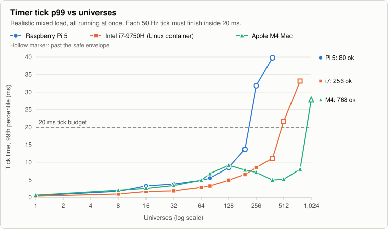
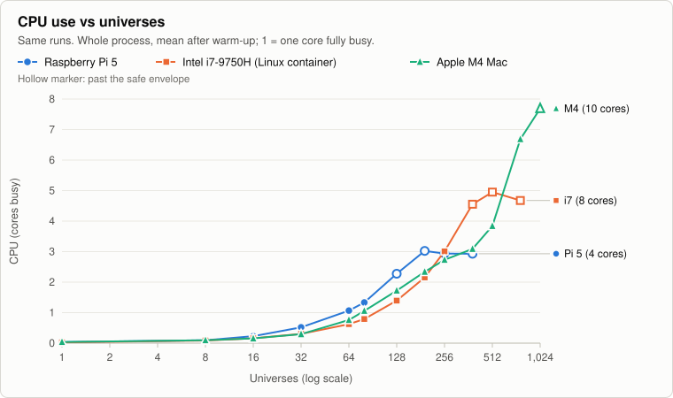
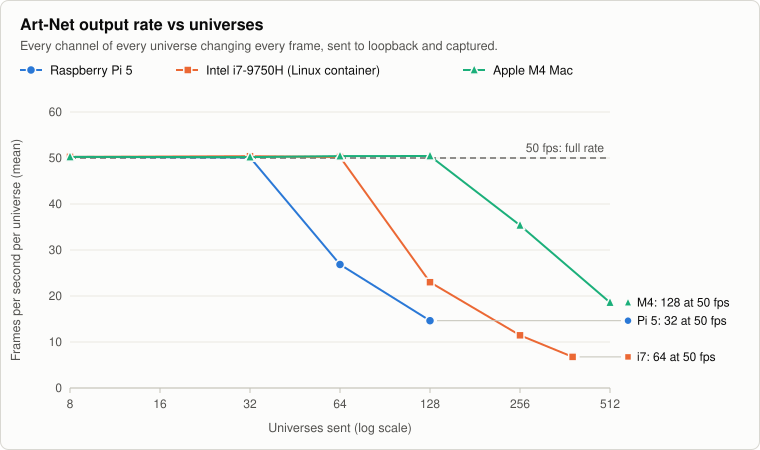
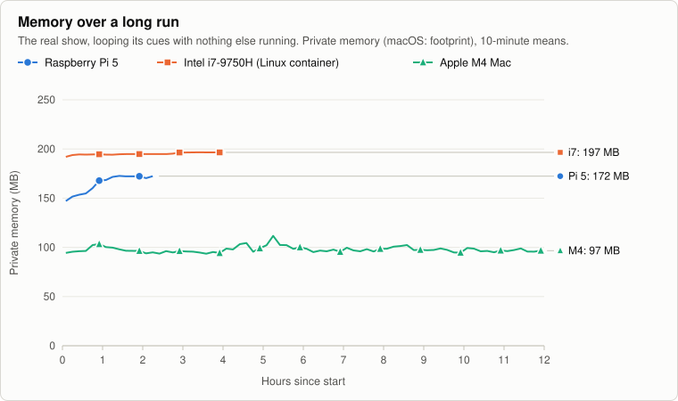
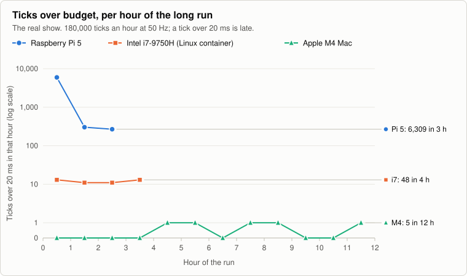

# Performance

How much one computer running qlcconsole can drive, measured on three
machines against the 0.3.0 release candidate (RC8, `849abc83d`) in October
2026. The numbers are from synthetic loads built to be heavier than a real
show (see [What "realistic load" means](#what-realistic-load-means)) and
from long runs of a real show. The data behind every table and chart is in
[`perf-data/`](perf-data/); [How to reproduce](#how-to-reproduce) has the
commands.

## Safe operating envelope

| Computer | Smooth at the realistic mixed load | Fails at | At the smooth limit: tick p99, CPU, memory | Art-Net out at the full 50 fps, every channel changing |
|---|---|---|---|---|
| Raspberry Pi 5 (8 GB) | **80 universes** (13,600 fixtures, 40,800 channels); 128 borderline (frame interval p99 32 ms) | 256 (tick p99 31.8 ms) | 5.5 ms, 1.3 cores, ~130 MB | **32 universes** (64 drops to 27 fps) |
| Intel i7-9750H (Linux container, 8 vCPU) | **256 universes** (43,500 fixtures, 130,000 channels); 384 borderline (30.6 ms) | 512 (21.7 ms) | 8.5 ms, 3.0 cores, ~400 MB | **64 universes** (128 drops to 23 fps) |
| Apple M4 Mac (32 GB) | **768 universes** (130,000 fixtures, 392,000 channels) | 1024 (27.8 ms), also the engine's universe maximum | 8.0 ms, 6.7 cores, ~1.3 GB | **128 universes** (256 drops to 35 fps) |

- **Smooth** means the timer's tick time at the 99th percentile stays under
  its 20 ms budget and the interval between output frames stays at or under
  30 ms at the 99th percentile. **Fails** is the first step where the tick
  p99 goes over 20 ms.
- The engine and the network are separate limits: a Pi 5 can compute 80
  universes of this load, but sends only 32 universes of fully changing
  Art-Net at 50 fps. Size a rig by the smaller of the two.
- Static looks alone cost the timer almost nothing (tick p99 under 1 ms).
  What limits them is the one output thread per universe: smooth to 192
  universes on the Pi 5, 512 on the i7 and the 1024 maximum on the M4.
- A real show is much lighter than this load: the 240-fixture show used
  for the long runs takes a quarter of a core or less on the i7 and the
  M4, and about half a core on the Pi 5.

## What "realistic load" means

Every universe holds 170 RGB fixtures (510 channels) and everything below
runs at the same time, all the way through:

- one 170-fixture look per universe;
- for every 4 universes, a chaser with real step times (0.2–1 s holds,
  0–0.5 s fades), a scripted RGB matrix and an EFX;
- for every 8 universes, a Show Tree-style cue list (8 cues × 4 layers,
  2 s crossfades, auto-follow).

At 128 universes that is 128 looks, 32 chasers, 32 RGB matrices, 32 EFX
and 16 cue lists, all running. The number of fixtures per universe (16 to
170, at 32 universes) made no measurable difference to the tick time.

## Charts

### Timer tick vs universes



The tick is the 50 Hz MasterTimer's work for one frame: every running
function's step and the mix into the universes. Each point is a 40 s run
after 10 s of warm-up. A hollow marker is past the safe envelope: over the
budget, or with frames arriving more than 30 ms apart.

The M4's curve dips between 192 and 512 universes. It has 4 performance
and 6 efficiency cores, and which kind the timer lands on changes from run
to run; treat the dip as scheduling, not as the load getting cheaper.

### CPU vs universes



Up to the knee, the tick's wall time is its CPU time. Past it, the CPU is
saturated (the Pi 5 at about 3 of its 4 cores, the i7 container at about 5
of 8, the M4 at about 7 of 10) and the tick waits to be scheduled. Memory
grows by about 1.6 MB per universe of this load.

### Art-Net output vs universes



One EFX per universe changes every channel every frame, so every frame is
a new ArtDMX packet. The output goes to 127.0.0.1 and is captured there,
so this measures the sender, not a network or a node. About 0.5% of frames
arrive one tick late on every computer at every load: a jitter floor, not
loss. Sequence gaps (dropped frames) appeared only on the overloaded i7, at
128 universes and above.

### Per-function limits

One function type at a time, on 32 universes × 170 RGB fixtures. Each cell
is the most of that function that ran smoothly, then the count that failed;
"≥" means nothing failed up to the largest count tried. This is a table
rather than a chart: several cells have no failure to plot, and one has no
passing step.

| Function | Raspberry Pi 5 | Intel i7-9750H (Linux container) | Apple M4 Mac |
|---|---|---|---|
| Static 170-fixture looks | 256 / 512 (output threads) | ≥ 2048 | ≥ 2048 |
| Chasers, per-step timing (0.2–1 s holds, 0–0.5 s fades) | 256 / 512 | 512 / 1024 | 1024 / 2048 |
| Chasers stepping every tick (a worst case) | fails at 8 | 16 / 32 | ≥ 1024 |
| Scripted RGB matrices (64–256 heads) | 128 / 256 (jitter from 128) | 256 / 512 | 512 / 1024 (jitter from 128) |
| EFX (4–19 heads) | 512 / 1024 | 1024 / 2048 | ≥ 4096 |
| Cue lists (8 cues × 4 layers, 2 s crossfades, auto-follow) | 64 / 128 | ≥ 256 | ≥ 256 |

Scripted RGB matrices are the most expensive function per instance; a
chaser that steps every frame is the worst case of all, and not something
a show does on purpose.

## Long runs and memory

### The long runs

Each computer ran a real show (DanceHysteria, about 240 fixtures, looping its
cues; no input or output plugins) for hours, then the same show with a
generated block of extra universes, RGB matrices and chasers merged in and
all running ("scaled"). The app ran offscreen with a sandbox home folder.
It was sampled every 30 s; memory slopes are fitted after 30 minutes of
warm-up.

| Computer | Show | Hours | Ticks over 20 ms | Worst tick | CPU | Private memory (macOS: footprint) |
|---|---|---|---|---|---|---|
| Raspberry Pi 5 | real | 2.3 | 6,309 (5,931 in the first hour, then about 300 an hour) | 76 ms | 0.55 cores | 141 → 170 MB, still settling |
| Intel i7-9750H (Linux container) | real | 4.0 | 48 (12 an hour) | 35 ms | 0.12 cores | 187 → 197 MB, +0.8 MB/h |
| Intel i7-9750H (Linux container) | scaled | 4.0 | 50 (13 an hour) | 44 ms | 3.4 cores | 223 → 297 MB, flat after warm-up (−0.1 MB/h) |
| Apple M4 Mac | real | 12.0 | 5 | 22 ms | 0.24 cores | 106 → 101 MB, flat (−0.06 MB/h) |

An hour at 50 Hz is 180,000 ticks, so the i7's 12 an hour is 0.007% and the
Pi 5's 300 an hour is 0.17%. The M4's scaled run was still going when this
page was written (it ends overnight); the Pi 5 dropped off the network
after 2.3 hours of its first run and its scaled run is not here.





The Pi 5's first hour includes the show loading and every cue's first
playback; after it, the rate settles. Its last point is a partial hour (17
minutes), scaled to a per-hour rate. The i7's rate matches the earlier
measurements on the same container (11.3 to 13.2 an hour since mid-October).

### Leaks

Under LeakSanitizer on Linux (a Debug build with ASan and UBSan), cycles of
open a show, make Build edits, run, close leak **74 KB per cycle**, the
same as at RC4:

| Source | Per cycle |
|---|---|
| `Fixture::genericDimmerDef` / `genericDimmerMode`: a fixture definition per generic dimmer (L1) | 35 KB |
| `RGBAudio::~RGBAudio` creates the show's audio capture (L2) | 30 KB |
| `QLCFixtureDef::loadXML`: the reader leaks on a read error (L3) | 5 KB |
| `Fixture::setFixtureDefinition` (most likely L1 again) | 4 KB |

Also still present: the Fixture Manager's group menu keeps its old actions
(L4, about 1,300 actions per open of a big show), and a UBSan report at
teardown (L7). The Inputs/Outputs list growing with each show opened (M1)
is fixed. The labels are those of the leak table in
[TEST_MATRIX.md](dev/TEST_MATRIX.md#matrix-2-scale-leaks-and-clean-installs-on-rc4-items-2-4).

On macOS, `ps` RSS grows by about 60 MB a minute once Art-Net input starts,
while the footprint (what the system charges the app) stays at 145–265 MB.
The growth is reusable allocator pages, not a leak; what the allocator is
holding them for is not known yet.

## Art-Net, OSC and web under input load

The whole app, offscreen, with only the Art-Net and OSC plugins: 32
universes of the realistic load out over Art-Net, plus 16 universes of
Art-Net input and 8 of OSC input. Each phase ran 3 minutes.

| Phase | Raspberry Pi 5: CPU, ticks over 20 ms an hour, web round trip p99 | Intel i7 (Linux container) | Apple M4 Mac |
|---|---|---|---|
| idle (output only) | 1.7 cores, 720, 18 ms | 0.9 cores, 40, 2.5 ms | 0.8 cores, 20, 5 ms |
| 4 universes of Art-Net in | 2.4 cores, 1,200, 258 ms | 2.1 cores, 0, 41 ms | 0.8 cores, 0, 6 ms |
| 16 universes of Art-Net in (44 fps, every channel changing) | 2.4 cores, 1,876, **6.4 s** | 2.2 cores, 897, **1.7 s** | 2.3 cores, 0, 225 ms |
| OSC, 2,000 messages a second | 1.8 cores, 864, 45 ms | 0.9 cores, 0, 2.3 ms | 0.8 cores, 0, 2.6 ms |
| web: 8 WebSocket clients plus HTTP | 1.7 cores, 864, 24 ms (357 requests/s) | 0.9 cores, 0, 3.6 ms (377 requests/s) | 0.8 cores, 0, 4 ms (297 requests/s) |
| all at once | 2.4 cores, 2,230, 6.5 s | 2.2 cores, 622, 3.1 s | 2.3 cores, 0, 207 ms |

- **The output held 49–50 fps in every phase on every computer.**
- **Heavy Art-Net input slowed the GUI and the web interface** in 0.3.0,
  which share the main thread with the input's processing: with 16 fully
  changing universes coming in, a web client waited seconds for an answer
  on the Pi 5 and the i7. OSC and web load on their own cost little.
  **Fixed in 0.3.1:** the main thread rebuilt the effect scripts' MIDI
  data on every input value, and every value crossed from its universe's
  thread as a separate event. On the i7, 16 universes in, 120 s:

  | 16 universes of Art-Net in | 0.3.0 base | 0.3.1 |
  |---|---|---|
  | CPU | 2.2 cores | 1.2 cores |
  | Ticks over 20 ms | 22–25 | 0 |
  | Web round trip p50 / p99 | 0.7 s / 1.8–2.1 s | 2 ms / 41 ms (as idle) |
  | Web requests a second | 9 | 345 |

- The Pi 5's first run of this test crashed as 16 universes of Art-Net
  input started; an identical rerun didn't. The cause is not known yet.

## SCHED_FIFO on Linux

The MasterTimer asks Linux for real-time scheduling (SCHED_FIFO). Without
the `CAP_SYS_NICE` capability or an rtprio limit for the user, Linux refuses
and the timer competes at normal priority with one thread per universe.
On the Pi 5, granting it (`prlimit --rtprio`) at the realistic load:

| Universes | Normal priority: tick p99, frame interval p99, late frames | SCHED_FIFO |
|---|---|---|
| 64 | 5.7 ms, 24.8 ms, 2 late | 5.0 ms, 23.9 ms, 0 late |
| 128 | 7.4 ms, 30.6 ms, 18 late | 13.4 ms, 25.5 ms, 5 late |
| 192 | 15.3 ms, 41.5 ms, 241 late | 22.7 ms, 30.2 ms, 16 late |
| 256 | 28.8 ms, 52.6 ms | 45.7 ms, 55.1 ms |

Real-time priority steadies the frame cadence below saturation (3 to 15
times fewer late frames) but does not raise the ceiling. To grant it, give
the user an rtprio limit (for example `@audio - rtprio 95` in
`/etc/security/limits.d/` and the user in `audio`), or the binary
`cap_sys_nice`. The i7 container could not grant it at all.

## Method

1. **Engine sweeps.** `stresstest/perf_sweep.py` drives `qlcstress engine
   --mode realtime`: the real MasterTimer at 50 Hz with its universe
   threads, 40 s per step with the first 10 s excluded. Per tick, on the
   timer thread: compute time (wall and CPU), the interval between output
   frames, the number of running functions. Every second: process CPU
   (getrusage), RSS and the universe threads' backlog. A step is **broken**
   when the tick p99 is over 20 ms or the universe threads are a frame
   behind in 5% or more of samples; it has **jitter** when the frame
   interval p99 is over 30 ms.
2. **Art-Net on the wire.** `stresstest/wire/wire_sweep.py`: qlcstress
   sends to 127.0.0.1, the loopback is captured (Linux: AF_PACKET in a
   network namespace; macOS: tcpdump on lo0), and each universe is checked
   for frame rate, interval p99 and maximum, late frames and ArtDMX
   sequence gaps.
3. **The full app under input load.** `stresstest/wire/io_load.py`, as in
   [the table above](#art-net-osc-and-web-under-input-load).
4. **Long runs.** `stresstest/soak24/run_soak.py`: the real show, then the
   scaled show, sampled every 30 s.
5. **Leaks.** `stresstest/m2leak` under ASan, LSan and UBSan, over 1, 10
   and 40 cycles; bytes per cycle are the slope between them
   (`m2leak/lsan_parse.py`).
6. **SCHED_FIFO A/B.** `stresstest/rt_ab.sh`.

### Hardware and versions

| Computer | CPU | Memory | OS | Qt | Build |
|---|---|---|---|---|---|
| Raspberry Pi 5 | Cortex-A76, 4 cores at 2.4 GHz (ondemand governor, about 55 °C, not throttled) | 8 GB | Debian 13 | 6.8.2 (Debian) | Release, GCC 14.2, from a `git archive` of RC8 |
| Intel i7-9750H (Linux container) | i7-9750H, 6 cores / 12 threads; an LXC container with 8 vCPU | 16 GB | Debian 13 in LXC on Proxmox | 6.8.2 (Debian) | Release, GCC 14.2, from a `git archive` of RC8 |
| Apple M4 Mac | Apple M4, 4 performance + 6 efficiency cores | 32 GB | macOS 26.7 | 6.9.3 (bundled) | the RC8 DMG: qlcstress linked against the DMG's own engine library and Qt |

### How to reproduce

The harness is in [`stresstest/`](../stresstest/README.md). Build the app
(Release), then qlcstress against its engine library:

```sh
cmake -S stresstest/engine -B stress-build -DCMAKE_BUILD_TYPE=Release \
      -DQLC_BUILD=$PWD/build-rel -DCMAKE_PREFIX_PATH=<your Qt>/lib/cmake
cmake --build stress-build

# The scaling sweep (a1p) and the per-function sweeps; hours per host.
# --only-first 2 --seconds 6 --warmup 2 is a one-minute smoke test.
QT_QPA_PLATFORM=offscreen python3 stresstest/perf_sweep.py \
    --qlcstress stress-build/qlcstress --resources resources \
    --out perf/sweep --sweeps a1p,bp,cp,c,a2

# Art-Net on the wire (Linux: inside a loopback-only namespace)
sh stresstest/wire/run_netns.sh $HOME python3 stresstest/wire/wire_sweep.py \
    --qlcstress stress-build/qlcstress --resources resources \
    --plugins <folder with only the Art-Net plugin> --out perf/wire \
    --capture linux --universes 8,32,64,128

# The long run: the real show, then the scaled one
python3 stresstest/soak24/run_soak.py --show show.qlcc \
    --scaled-show show-STRESS.qlcc --phases real,scaled --hours 4 --out perf/soak
```

`stresstest/chain_linux.sh` and `stresstest/chain_mac.sh` run the whole
set on one host in order, with the paths the campaign used. The campaign's
`analyze.py` turns the result folders into tables; then

```sh
python3 -I tools/perf/extract.py <campaign folder>   # -> docs/perf-data/*.csv
python3 -I tools/perf/plot.py                        # -> docs/images/perf/*.svg
```

rebuild this page's data and charts. The charts are deterministic: the
same data gives byte-identical SVGs.

## Caveats

- **The loads are synthetic.** They run every function at once with
  full-universe looks; real shows are much lighter (compare the long runs).
- **Tick time covers the MasterTimer thread only.** The universe output
  threads, the GUI and the plugins are measured through CPU, the frame
  interval and the backlog, not the tick.
- **The Linux machine is a container** (LXC on Proxmox, 8 of 12 threads)
  that could not grant SCHED_FIFO; bare metal with real-time priority
  should do at least as well.
- **The M4 has performance and efficiency cores**, which makes its curves
  less smooth than the others.
- **The Pi 5's long run ended early** when it dropped off the network
  after 2.3 hours; its numbers are from before the dropout, and it has no
  scaled run.
- Art-Net was measured on loopback. A real network, switch and nodes add
  their own limits.
- The Linux and Pi 5 builds report "build 0" in their version string (built
  from a `git archive`, without the git history the build number comes
  from).
- Steps above 1024 universes (past the engine's maximum) are left out.
