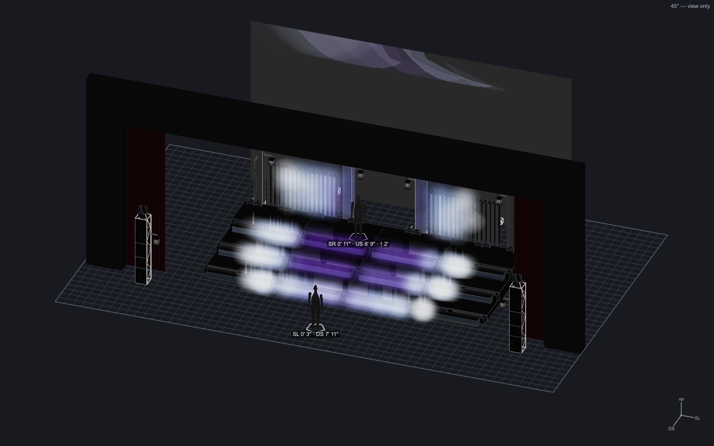
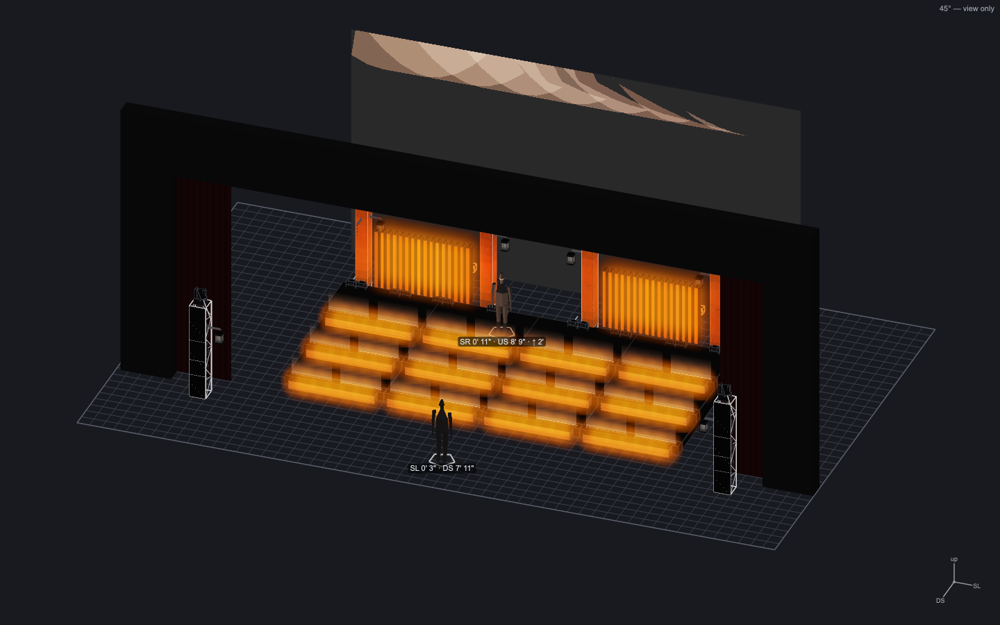
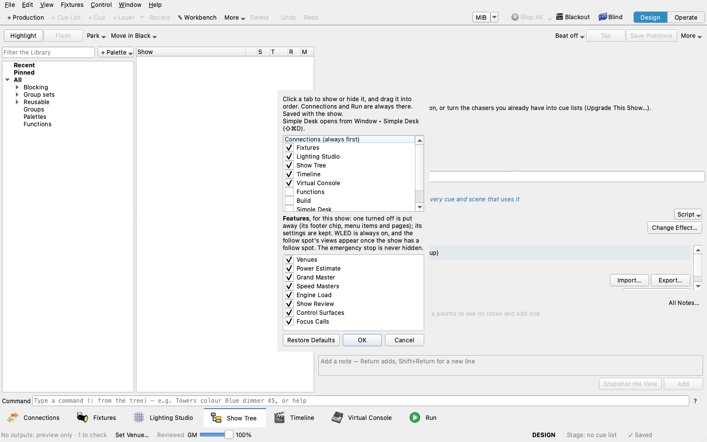
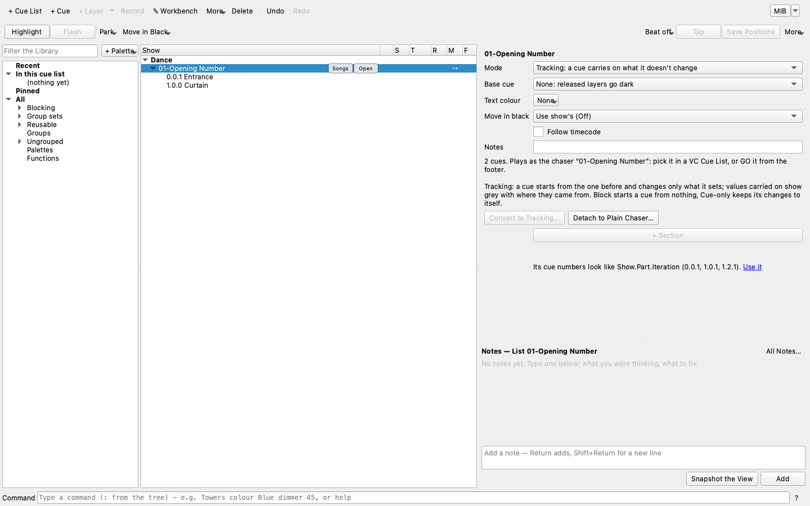

An effects and Show Tree release. Fire looks like fire, lightning is a new
effect, and a show can now put away the parts of the app it doesn't use.

**Highlights**

- **Lightning Spread, a new effect:** One Burst throws lightning out from the
  look's aim target in a fraction of a second, each light flashing to full and
  flickering out with a re-strike or two; Static Generator keeps the centre
  glowing and crawls arcs out from it. A strike burns white-hot at its core
  with a cold blue edge, then fades out in the look's colour.

  

- **Fire looks like fire:** Fire Spread, Firelight and Candle Flicker flicker
  every head and every pixel of a bar on its own. The bands and diagonal
  stripes that used to run across the bars are gone.

  

- **Turn features off per show:** View ▸ Workspace ▸ Tabs & Features… puts
  away venues, the power estimate, the Grand Master, speed masters, engine
  load, Show Review, control surfaces or focus calls for one show. The
  emergency stop is never hidden.

  

- **Show Tree, faster to work in:** fold a production or show to its songs in
  one click, keep notes on the show and on each song section, release or
  untrack several layers in one undo step, and hover any cue or list tick box
  to read what it does.

  

- **Effect settings you can read:** Fire Spread's front and behind colours sit
  as swatches under the setting, each effect's settings sit on a faint tint so
  you can see where one ends and the next begins, and an effect says which
  colours it plays.
- **Updates are found sooner:** qlcconsole checks at every launch and every
  four hours while it runs.
